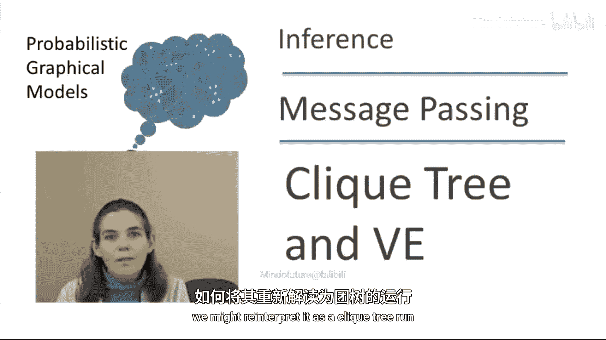
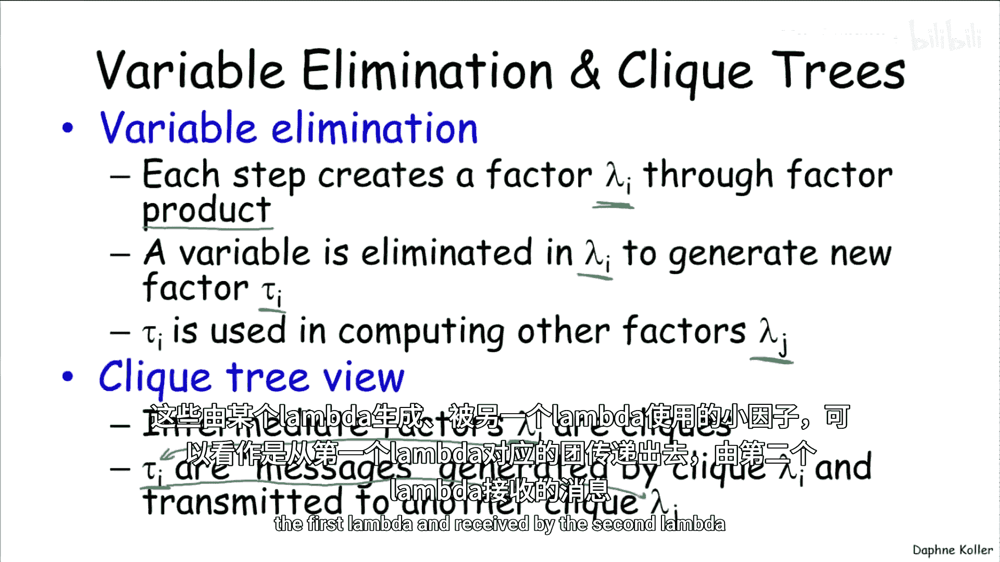
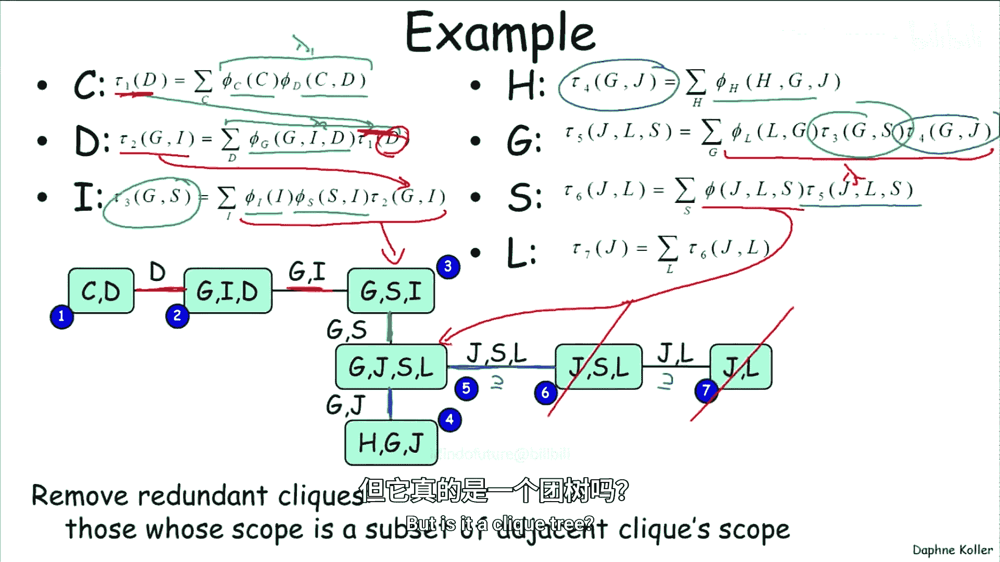
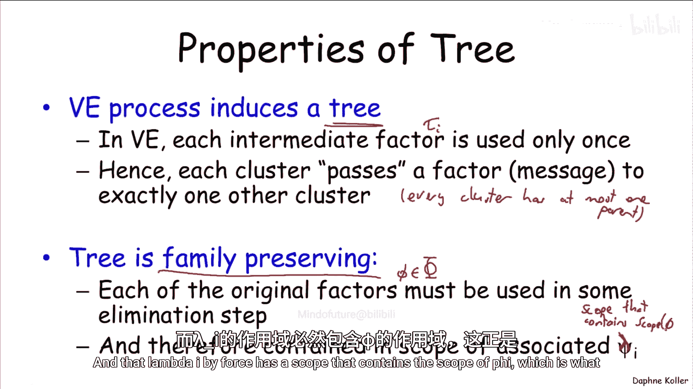
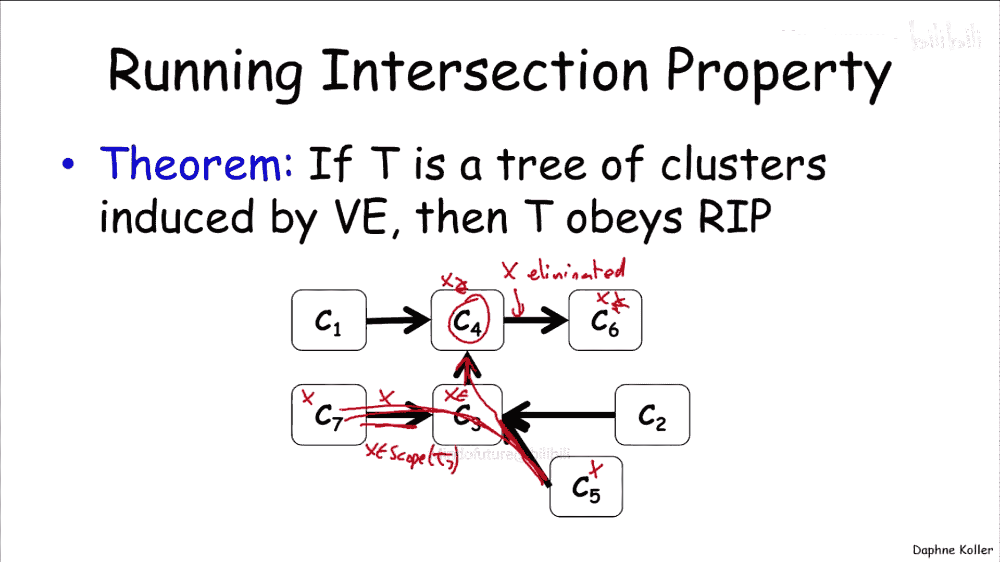
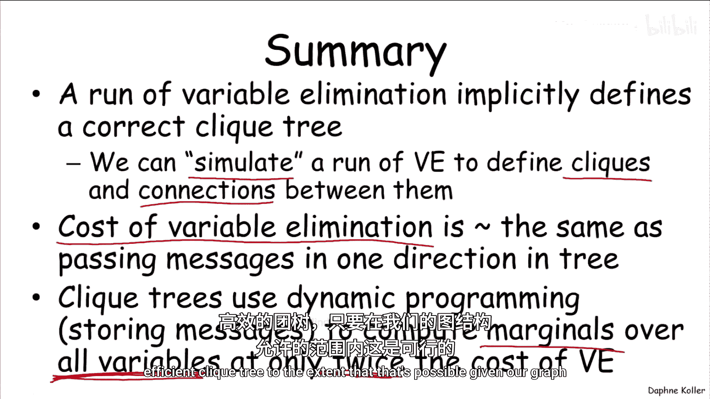

# 【斯坦福】概率图形模型2：推理 ｜ Probabilistic Graphical Models 2 Inference p13 P13_团树与变量消元_03_02_04 -BV1fY6VBBEyo_p13-

We previously used the variable emination algorithm as a way of proving the correctness of the cleaek tree algorithm。

 It turns out that this relationship can also be used to answer another fundamental question regarding clleek trees。

 which is the question of where clek trees come from。

 or rather how we might construct a good clleek tree。In order to do that。

 what we're going to do is we're going to look at a run of variablemination and we're going to see how we might reinterpret it as a cl tree run。

SoIn in order to do that， let's look at the variable elimination algorithm and try and take a cled review of what it's doing。

So the variable elimination algorithm as a reminder。

 starts by takes a series of steps where in each step it creates a large factor which for the purposes of this discussion。

 we're going to call lambmbda I and it does that by taking a bunch of factors and multiplying them together。

When that is done， we eliminate a variable from Lambda I and that gives us a new smaller scope factor。

 which we're going to call tau I， and tau I is put into the pool of factors that we have available to us。

 which means that at some point we're going to use it in the context of computing another large factor Lada J when we multiply a bunch of factors together。

So now let's。Think about this process in terms of passing messages in between computational entities in the same way that we had when we were doing message passing algorithms。

 So we're going to look at these intermediate factors Lada eyes as the claks in a clique tree。

And the cow eyes that are used that are produced in the context of one cleeique。

And utilized by a different。Cleek， we're going to consider that to be a message。

 so these little factors that are produced by one lambda and consumed by another lambda can be viewed as a message that's passed from the clique that corresponds to the first Lambda and received by the second Lambda。

So summarizing the variable emination algorithm defines a graph。😊。

We're going to have a cluster C for every factor lambda I and we're going to draw an edge between C and CJ if the factor that was generated in the computation in which I multipied together all the factors to produce lambda I is used in the computation of lambmbda J。

And so we can think of it as CI。Whi corresponds to lambmbda I passing a message to CJ that corresponds to lambda J。

 and that message is the tau I that was produced by。By the lambda I computation。

So now let's look at this in the context of an example。

We're going to go through the variable emination process that we had for our network that we had earlier。

 the enhanced student network， and so the first variable elimination step multiplies together the C factor and the CV factor。

 and that gives us， this is my Lambda1。And Lambda 1 produces a clique whose scope is CD。

 and so that's this clique over here。The next step eliminates D and the way in which it does that is it takes tau 1 and then it multiplies that by one of my original factors。

 PhiG， and so now we have a lambda2， this is my lambmbda 2。And that gives me a clique whoco is GID。

And since GID used。How one。Then we have aned from CB to GIB。Who scope？Is the variable D？

The next step in the analysis that we did before eliminated the variable I and again used two of the original factors phi I and Phi S。

 and it also used taau 2。And so now we have a factor lambmbda 3 whose scope is GS and I。

 because those are the variables in this scope over here and the message，GI is that we see here。

 this edge between GID and GSI corresponds to this tau2 that was produced by Lambda 2 and consumed by Lambda 3。

The next elimination step didn't use any of the factors produced by other cliques。

 it just used one of the original cleaiques so just used by H。

 and so that it's currently not connected to anything is just sitting there all it's lonesome。And。

The next step now gets use gets to use。Factors that were produced in two separate computations。

 So notice。That this。Computation for Lambda5， which is this guy。Used both He three。And Tu 4。

Which is why we have both an edge from clusterster  three。And an edge from cluster  four。

The next step that we took。Marginalized out。S， it's multiplied in PL5。

And one of the original factors， DLs。 And so now we have a message。Here。

That's passed between cluster 5 and cluster6。And finally， there was the marginalization of L。

 and so we have a JL cluster。Now， if you look at this。Graph at this clak tree。

 you'll notice that it's。Bigger than the clique tree that we had for this network to begin with of the and the reason for that is that we actually have three adjacent cliques where one is a subset of the other。

 So JL is a subset。Of JSL， which in turn is a subset of GJSL。Now if you think about it。

 there's really no point to including three cliques where one is a subset of the other because you might as well do all of the computation in the first cl to begin with there's no value to sort of breaking it out into separate data structures and so typical post-procesing step is to then go ahead and remove redundant cliques。

And just basically collapse them and their factors into the one。

 the biggest cliques that subsumes them， so in this case since we had P JLS。

 which originally was utilized in Tu6， we're now going to move that and put that instead in- sorry。

 it was used in Lambda 6， we're now going to stick that into Cleique5。

And so we've seen how we can take a variable elimination。Process。

 run a variable elimination and use that to produce what looks like a qua tree。But is it a clek tree？

So what properties can we prove about this output from a variable elimination run？Well。

 first is the fact that it is in fact a tree， we want it to be a cleaek trade better be a tree。

Why is it a tree， because in variable emination， every intermediate factor tau， once you produce it。

 it gets consumed exactly once？Once it gets consumed， remember in the variable elimination algorithm。

 it gets taken out of the set of factors and then it disappears because it gets multiplied in。

And so if you think about this as a directed tree， it starts out and it produces factors and each factor feeds up into only a single other parent。

And so as a directed tree， it means that every every cluster has。Exact has at most one parent。

And in fact， every cluster， except the last one has exactly one parent because eventually everything has to be consumed because everything is multiplied together。

And so this variable elimination process induces a directed tree where we subsequently forget about the directionality of the edges。

The second property that is， again， not difficult to show is that the tree is family preserving。

And that is because each of the original factors was in my original factor set。

 each of my original factors， phi in my original factors set big phi was somewhere in the variable elimination process。

And that means it must have been used at some point because eventually I'm multiplying all factors together。

And therefore， it must be contained in the scope of one of these， sorry this should be Lai。

And that lambdi， by force， has a scope。That contains。The scope。Of P。

Which is what we need for the family preservation property。

The final property that we had that we would like to show hold is that the tree respect survey is the running intersection property。

And so as a reminder， that property says that if you have two cluster C and CJ with a variable x that is present in both。

 then x needs to be in each cluster and each subset in the unique path between C and CJ。

So first of all， let's convince ourselves that that running intersection property holds here。

 and we've already seen that because this is actually the familiar cl tree that we had for this example。

 in fact we produced that cl tree by running variable elimination using exactly the process that I showed you before。

Now let's show that however， more generally， so we want to prove to ourselves that if T is a tree of clusters that was induced by a run of variable elimination。

 then T obeys the running intersection property。And so now remember that this tree came from a directed run。

 And so what I'm showing you here is actually a directed tree where we see how the cluster is communicated。

 This is not the same tree that we had in our。Example。

 it's a more complicated one to illustrate sort to make theorem a little bit more interesting to show。

So in one of those subsets and in exactly one of those subsets。

 the variable x is eliminated because this is a run of variable elimination。

 every variable is eliminated exactly once。So let's imagine that x is eliminated here。

So this clickique over here。Is the last Cx where so C4 has x in it。X is in C4 and x is not。In C6。

Now let's take any other。Cluster that containss。X。So for example， assume that cluster 7 contains x。

Well。If cluster 7 contains x， and x wasn't eliminated on this edge because it's eliminated exactly once。

 it means that it needs to be on the subset。Which means it was in the message ta that C7 produced。

So it's in tau 7， x is in the scope。Of Tau 7。Which means that x also needs to be in the scope of C3 because it was multiplied in。

 if it was multiplied in， then it has to be in that scope。

And so by continuing this in exactly the same inductive argument。

 we know that since x has to be in C3， it also needs to be on this subset and so on。

And so we've shown that x needs to be on the path from。C72 C4。

And now let's take a different cluster that contains x， for example， C5。

 we can similarly show that x needs to be。On every step along the path。And since this is a tree。

It means it needs to be on the path between C7 and C。

And so that argument shows that for any pair of clusters or cliques that contain x。

 x has to be on every step of the path between them。

So the sunrise。A run of variable elimination implicitly defines a correct cleaique tree。

 which means that you can if we want to get a cleaak tree that has the required properties。

 family preservation and running intersection， we can simply simulate a run of variable emination what does it mean to simulate doesn't mean that we run variable elimination because that would be an expensive process。

 we just figure out what factors I would multiply and what scopes they would have and therefore and what factor gets used where and that gives me the cliques。

And the connections between them， and this is the exact process that we did in the simple example that we had。

And。That。Cleek treeree has a computational cost， which is essentially equivalent to the cost of running the variable elimination algorithm because if you think about the sizes of the cliques that are produced。

 they correspond exactly to the sizes of the factors produced by variable emination。

 so these costs are directly comparable to each other。Except that as we showed before。

 the Cek trees use dynamic programming or storing or caching of the messages so that we don't need to recompute the same message more than once。

 and that allows us to produce marginals over all of the variables in the network and only twice the cost of running variable ofmination。

So。Taking yet one other step backwards， what that means is if you care to get the values of the marginals for。

EvenNot necessarily even all variables， but multiple variables。

One efficient way of doing that is to take variable emination。

 do the simulation to figure out what cl tree we want to build， or how to build a cl tree。

 and then use that cl tree to compute all of the marginals by appropriate message passing。And。

We talked about variable elimination and how to construct to use heuristic solutions。

 to construct a good variable emination ordering， one that gives us relatively small factors。

 hopefully along the way， and that exact same set of heuristics is also useful for constructing a small。

 efficient cl tree to the extent that that's possible given our graph。

