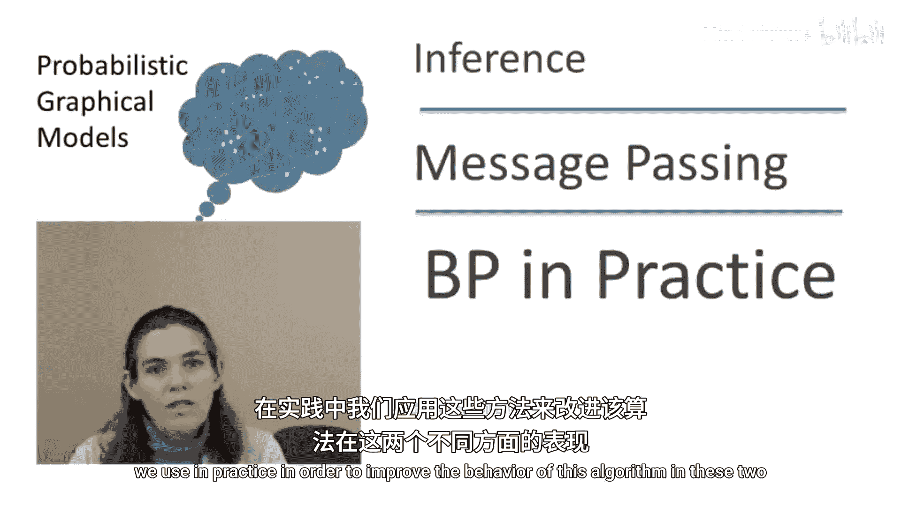
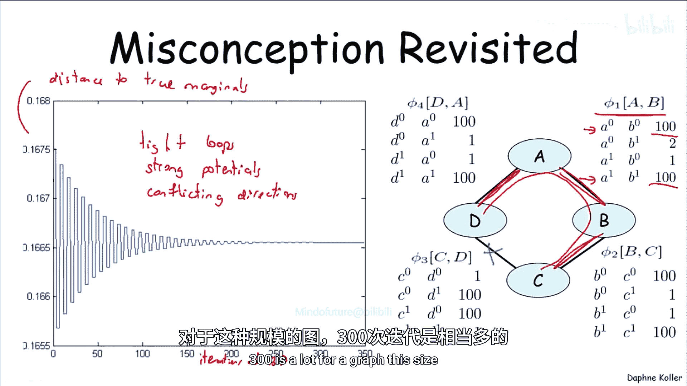
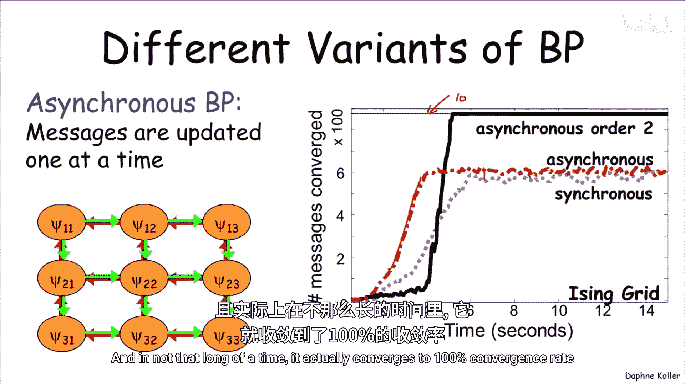
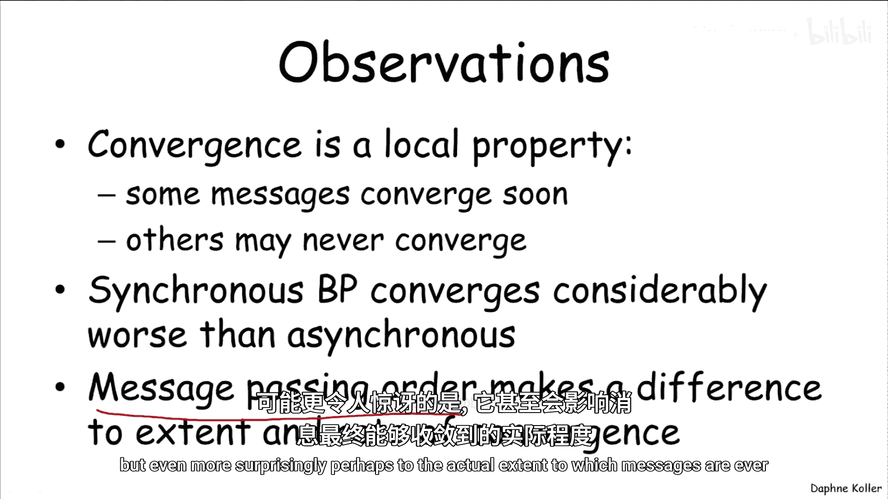
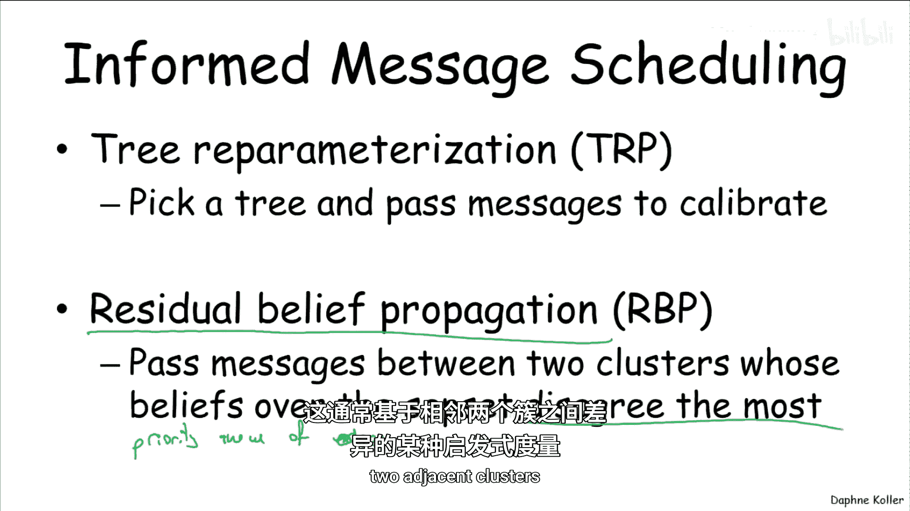
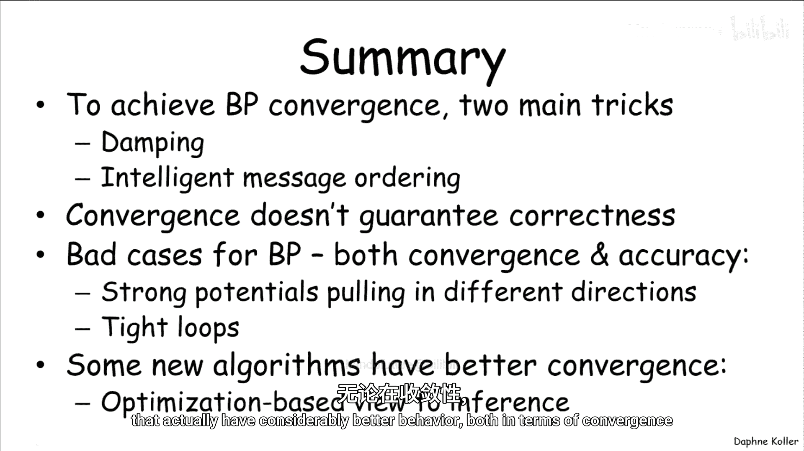

# 【斯坦福】概率图形模型2：推理 ｜ Probabilistic Graphical Models 2 Inference p14 P14_实践中的置信传播_03_03_01 -BV1fY6VBBEyo_p14-

The belief propagation algorithm， when run over a general clustergraph。

 is the iterative algorithm in which messages are defined in terms of previous messages。

 And we said before that when run over a general clustergraph。

 the algorithm might not converge and that even if it converges。

 it might not get to the right answers。What we're going to talk about now are how bad these problems are and what are some of the tricks that we use in practice in order to improve the behavior of this algorithm in these two different regards。

So let's get some intuition by looking back at our misconception example。

This is not actually our misconception example， it's one where we modified some specifically the potential Phi 1AB to make the behavior even more extreme by making these potentials larger so that there is a stronger push to agreement between A and B。

 so A and B really， really prefer to agree。And what happens in this example。

 We can see this beautiful oscillatory behavior of the belief propagation algorithm。

 So the X axis is iterations of。😊，NBP。And this is some notion of distance。To the true distribution。

 to the true marginal。And why do you have such strong oscillations。

 Let's look at what these potentials are doing。So this。

Potential over here pushes A And B to agreement。And so as you pass this message。

 A and B one to agree。AndD also want to agree。B and C want to agree。

 but C and D really want to disagree。And so as messages are passed。

 you're getting conflicting messages from both sides。The， for example， on the seaside。See。

 keep scrolling at it to agree with it。 Sorry to disagree with it。 On the other hand。

 when you go all the way around the loop。He's actually urging thee to agree with it。

And so from the one side。You're getting a pull for C and D D to be the same and from the other side you're getting a pull for them to be different and this sort of this conflict over the cycle over the loop causes this oscillatory behavior as messages are passed from one side or the other。

This type of configuration。😊，Of specifically。Tight loops。Strong potentials。

And conflicting directions。Is probably the single worst example for or the single worst scenario for belief propagation。

 this is the case where it's going to do the worst in terms of both convergence and in terms of the accuracy of the results that are obtained。

Now， in this example， ultimately you actually do get convergence。

 you can see it takes about 300 iterations， but ultimately you get convergence。😊。

300 is a lot for graph this size。

Here's one that up to 500。He didn't get convergence at all， now maybe if we ran it for 10，000。

 it might converge， but it's hard to say。And so how do we improve the convergence as well as the accuracy properties of the network？

So first， let's look at what not to do。Here is the most important thing not to do。

 which is a variance of belief propagation called synchronous belief propagation in synchronous belief propagation。

 which was actually one of the most commonly used variants of the very beginning of the use of the BP algorithm。

 all messages are updated in parallel， so all of the processors wake up， so all the clusters wake up。

 they look at all of their incoming messages。And they compute all of the outgoing messages all at once。

Now， this is a great algorithm from the perspective of simplicity of implementation and also from the ability to parallelize because you could assign a processor to each of the cluster and they're all working in parallel and there is no dependencies between them。

😊，Unfortunately， synchronous belief propagation is actually not a very good algorithm。

 and so what you see here is the number of messages that have converged as a function of the amount of time spent。

 this is an icing grid with certain parameters， it doesn't matter。

 and you can see that you know there is a certain improvement。Over time， and then it kind of apotes。

At the certain number of messages that have converged。By contrast。

 let's compare that behavior to asynchronous belief propagation where messages are updated one at a time。

So this one and that one。Now notice that this algorithm is poorly specified because I didn't tell you what order we should do the updates and we'll come back to that in a minute。

But even by the simple virtue of passing messages in an asynchronous way， the behavior improves。

Both in terms of how quickly we get messages to converge。

And in terms of the number of messages that are converged。Now。

 this is not a particularly good message passing order， here is a much better。Message passing order。

It takes a little bit longer。To get certain messages to converge is trying to make sure that everything is converging。

 but notice that eventually。And in not that long of a time。

 it actually converges to 100% convergenence。

诶。So here are some important observations regarding this。First of all。

 convergence is a local property and belief propagation。 Some messages converge quite quickly。

Others might never converge。And when you have some messages that after you run the algorithm room a for a certain amount of time。

 don't converge。One often simply just stops the algorithm and says， you know。

 this is what we have and we're done。没。Synchronous belief propagation has considerably worse convergence properties than asynchronous belief propagation。

 which is why。Pretty much at this point， very few people actually ever use synchronous belief propagation。

And if we're using asynchronous belief propagation。

 the order in which messages are passed makes a difference both to the rate of convergence。

 but even more surprisingly， perhaps to the actual。Extend to which messages are conversed。

E converge。And so how do we pick the message passing order？

There there's several different scheduling algorithms I'm going to present two of the more popular ones。

 the first called tree reparameterization。Or TRP for short。

 And what it does is it picks a tree and then passes messages in that tree in the same way that you would do in a clleek tree algorithm to sort of calibrate that tree。

 keeping all other messages fixed。 So， for example， we might start by calibrating。😊，The red tree。

Which means I pass messages。This way。And then back in the other direction。

Keeping all other messages fixed。Now I pick a different tree， I'm going to pick the blue tree。

Here's a blue tree， notice that I can't close the loop because otherwise it wouldn't be a tree。

So I kindt go all the way back to Psi 11， and now I calibrate in the other direction。

And I continue to do that by picking a tree and then running it and then calibrating it。

 and the only constraints that I need to satisfy is first of all， that my trees cover all edges。

So that's a constraint because otherwise I'm going to communicate。

 miss a certain message that needs to be passed。And the second is not so much of a constraint。

 but rather it tends to improve performance if the trees are larger。

Which means it's good to pick spanning trees。Which span as much of the graph as possible without containing a loop。

So standingning trees are good。So that's one。Message scheduling algorithm。

The second message scheduling algorithm is something that's called residual belief propagation and there's actually several variants of that now。

 and what it does is it tries to look for good messages， messages that are high value messages。

 so it looks for two clusters whose beliefs disagree a lot and if they disagree that means that if I pass that message that's going to potentially have a large impact on the receiving clique。

OrClu rather。 And so I'm going to。Look， I'm going to keep a priority queue。Of mess of， of edges。

And I'm going to pick。The message is from the top of the queue based on how much I think they're going to affect。

 how much of an effect they're going to have， which is some kind of heuristic notion potentially of the disagreement。

Between the two adjacent clusters。

The other big， important。Trick that people use to improve the convergence of the belief propagation algorithm is what's called smooth or sometimes damping of messages。

 and this is a general trick that's often used to reduce oscillations in dynamic systems that are based on these kinds of fixed point equations where the left hand side is defined in terms of the right hand side。

So here we define deelta Ij in the original belief propagation algorithm as a function of other deltas and we've seen that that can give rise to ocillatory behavior。

 this is just a standard belief propagation message and what we're going to do now is instead of that I'm going to do a kind of smooth version。

 so I'm not going to let the message change too drastically。

 I'm going to have a weighted average where the weight is lambda of the new message。

Which is this thing。And the old message。And that turns out to， again。

 dampen oscillations in the system and increase the chances that it converges。

So let's look at some example behaviors。So here we see。嗯。

Synchronous belief propagation in red over here。And this is the percentage or fraction of message converged。

So one would be perfect convergence。 We can see that synchronous plateaus at about 25。

 20 to 25% of messages converged， which is。Paetic enough to be pretty much useless in practice if only 20% of your messages converged then really the remaining messages don't really mean very much。

Without smoothing is the green line？😮，This one。And we can see that this is asynchronous。

 asynchronous without smoothing， we can see that even without smoothing。

The asynchronous algorithm achieves considerably better performance than the synchronous algorithm。

 we didn't even show synchronous without smoothing because it would be the worse。And then finally。

 the blue line is asynchronous with smoothing。And we can see that it achieves perfect convergence at some point。

And you can look at behaviors of individual messages or individual marginals。

 rather individual beliefs。 so here this is still an icing grid， by the way。Iyngri。

Which is sort of a standard setup for trying out convergence of various approximate inference algorithms。

 and so what you see here， the line here， the black line is the true。Margiinnal。

And you can see that synchronous belief propagation basically flip flops around it indefinitely。

 whereas asynchronous belief propagation converges pretty quickly and very close to the right answers。

Not always。This is a different variable in the same model， the black line again is the true。

And here we can see that sure enough asynchronous does improve convergence。

 but convergence is still to an answer， that's not quite right， and you see that behavior。

 you see both behaviors in real networks， and in practice depending on all the factors that I mentioned at the very beginning。

 how tight the loops are， how strong or peaked the potentials，嗯。

Those are going to determine how many of the factors have this oscillatory behavior and how wrong the answers are。

So as we just summarizing， there's two main tricks for achieving BP convergence。

 damping or smoothing and intelligent message passing。

Convergence is often easier to obtain using these tricks than correctness and convergence unfortunately doesn't guarantee correctness。

And the bad cases， the ones that negatively impact both of these are strong potentials that are pulling you in different directions and tight loops。

And we're not going to have time to go into all of these topics。

 but there's some new algorithms that actually have considerably better behavior。

 both in terms of convergence and in terms of the accuracy of the results。

