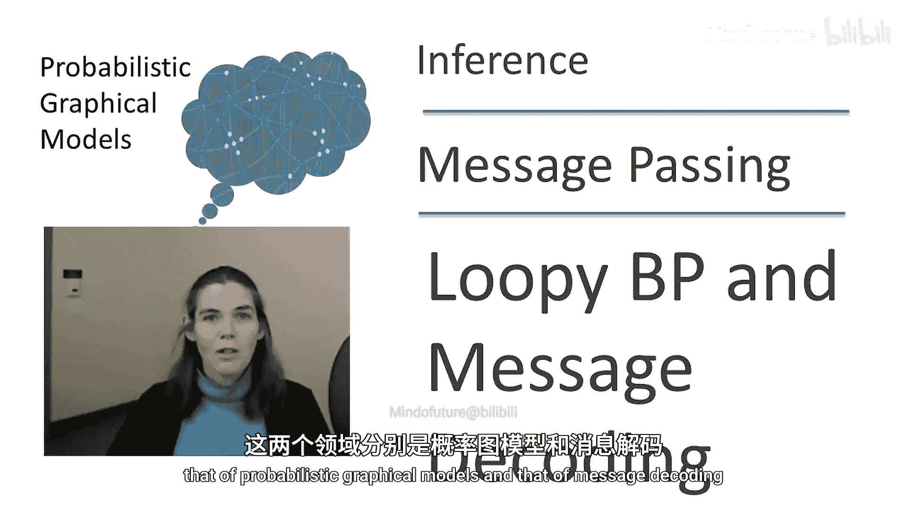
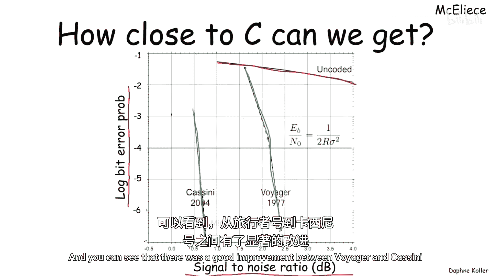
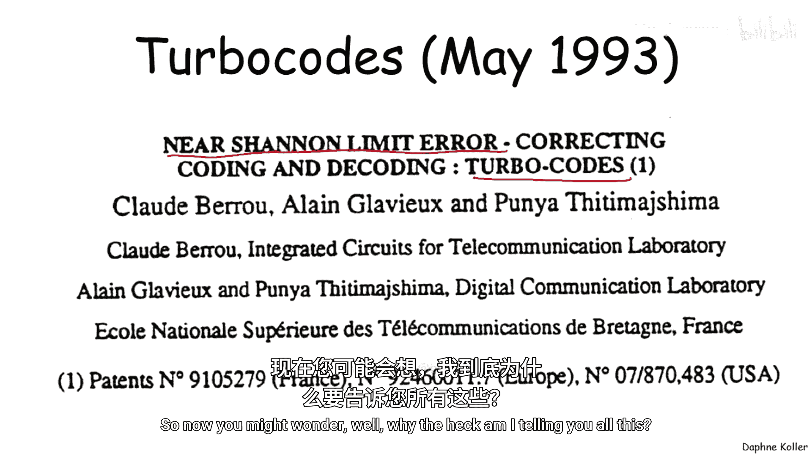
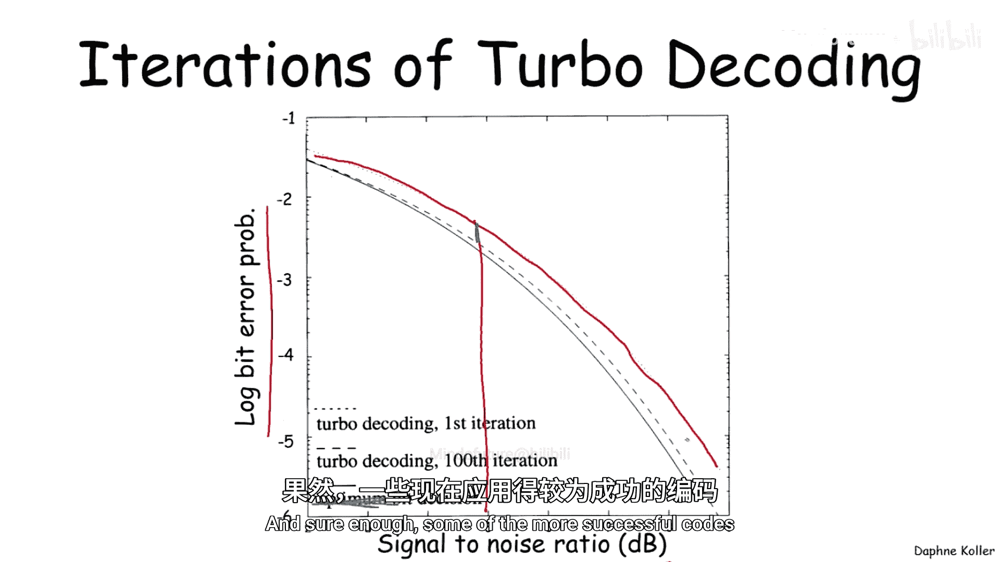
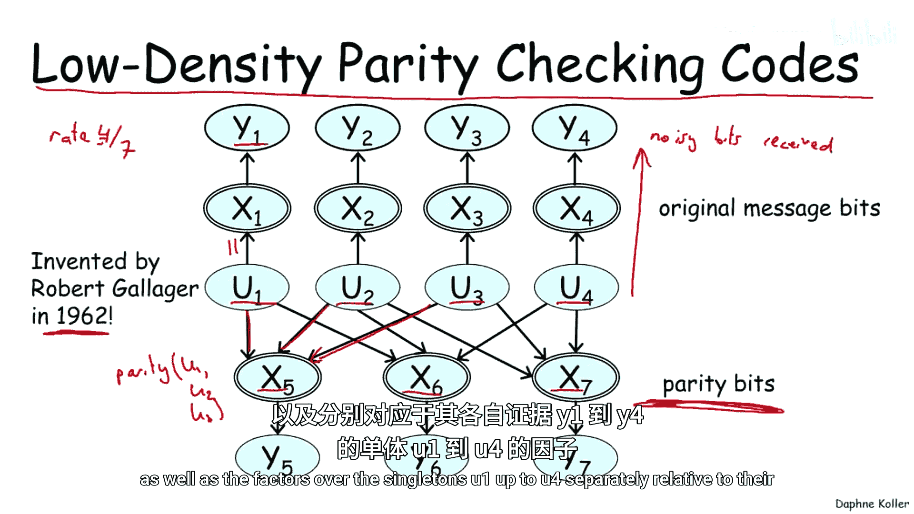
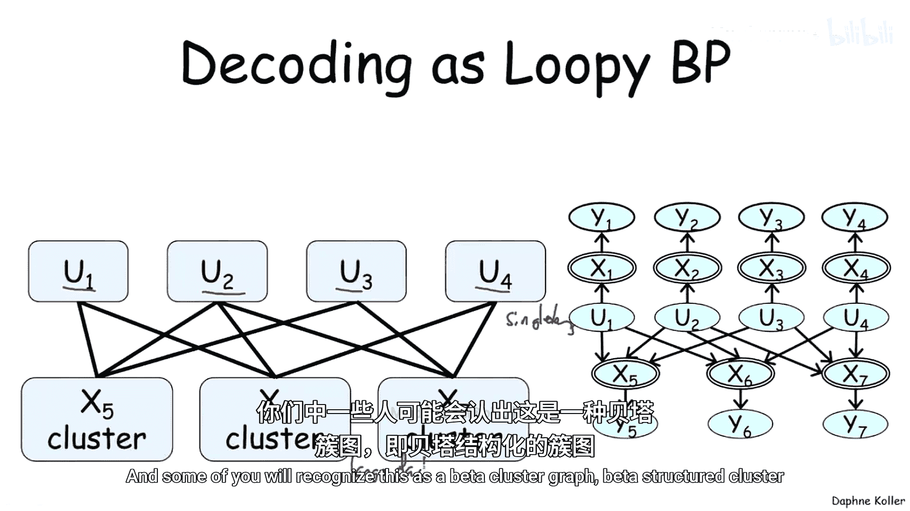
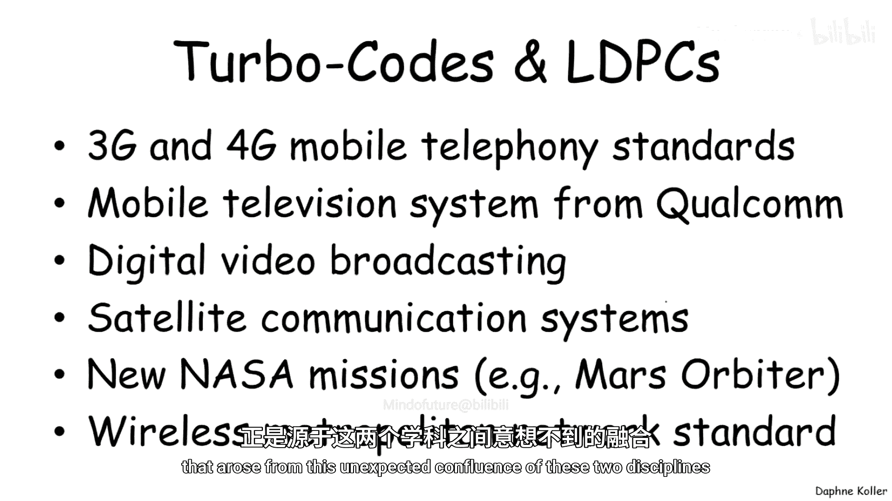
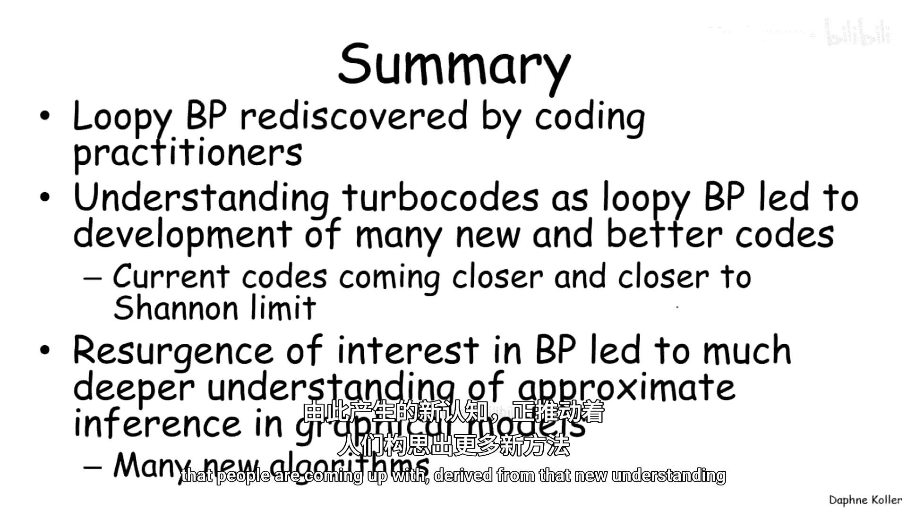

# 【斯坦福】概率图形模型2：推理 ｜ Probabilistic Graphical Models 2 Inference p15 P15_环状置信传播与消息解码_03_03_02 -BV1fY6VBBEyo_p15-

One of the more interesting stories in the field of probabilsisticographical model relates to the connection between the algorithm of loopy belief propagation and the problem of decoding messages sent on a noisy channel。

 This is a connection that was discovered fairly recently and has proven to have a tremendous impact on both disciplines。

 that of probabilsisticographical models and that of message decoding。

So let's understand the message decoding problem， imagine that I want to send K bits across the noisy channel。

 if I just go ahead and naively send those K bits， then it's impossible for me to know from the noisy bits that I receive at the other end what the correct bits ought to have been because we don't know which ones got corrupted and which ones didn't。

And so what people have developed is the notion of coding theory where those K bits are passed through an encoder and what we get at the end are N bits where n is usually greater than K。

 and those are the bits that are actually transmitted across the noisy channel to give us a set of noisy bits y1 up to YN。

 which we now hope to be able to decode in a way that ideally gives us bits V1 up to VK that are close and hopefully completely accurate relative to the bits that were originally sent U1 up to UK that' message coding and decoding in a nutshell。

And the rate of a code such as this is k over n， that is you send n bits of which k are actual information。

The bit error rate that one gets and that's a function of the channel itself is the overall probability that a bit that we get。

On this side。Saay the first bit， what is the probability that the first bit is correct。

 that is the same as the original bit， and so the error rate is the total average of the probability that these are different across the K decod bits。

So。We can now think about different channels in their properties。

 and there's this very important notion called a channel capacity。

So let's first think about different error rates that a。

 different error modes that a channel might exhibit。

 so here's something called the binary symmetric channel， often abbreviated BSC。

 and the binary symmetric channel says that when I send the 0， then with probability 0。9， I get a 0。

 but with probability 0。1， I get a1。And conversely when I send the one。

 I get a one with probability 0。9 and the 0 with probability 0。1。

 you can see why it's called the binary symmetric channel because the error is symmetric between0 and1。

A different error model erassure channel where the bits don't get corrupted。

 they just get destroyed now the big difference between the binary eraser channel abbreviated B EC is that when a bit gets destroyed。

 I know it that is what I get at the end is a question mark as opposed to a bit where I don't actually know whether that was the original bit that was sent or a corrupted it here I know that the bit was corrupted。

And finally， here is what's called a Gaussian channel where the noise that gets added on top of is actually analog noise and so there is sort of a Gaussian distribution relative to the signal that was sent。

And it turns out that these different channels have very different notions of what capacity means and capacity will define exactly what implications that has in a moment。

 but information theorists， your super smart people have computed the capacity for these different kinds of channels and it turns out that for example。

 the capacity for the binary symmetric channel is is a little bit over 0。

5 where the capacity of the binary eraer channel is 0。9 where 0。

9 is this probability of getting the correct bit and if you think about that it makes perfect sense that the capacity of a channel where you know the bits were erased is higher than one where you have to figure out whether bits are right or wrong。

 so this is less a more benign type of noise。And what you see over here is the capacity of the Gaussian channel。

 and it's an expression that involves things like the width of this Gaussian， for example。

 the wider it is the lower the capacity。Now， Shannon。

 in a very famous result known as Shannon's theorem。

 related the notion of channel capacity and bit error probability in a way that tells us and defines an extremely sharp boundary between codes that are feasible and codes that are infeasible。

 so let's look at diagramogram， the x axis is the rate of the code， remember the rate was k over n。

In the example that we gave， and this is a rate in multiples of channel capacity。

 so this says once you define the channel capacity。

 we can look at the rate of a code and each code will try for could be in a different point on the spectrum in terms of the rate。

On this axis we have the bit error probability， so obviously lower is better in terms of bit error probability and what Channon proved is that this region over here。

 the region that I'm marking here in blue， the attainable region is you could construct codes that achieve any point in this space。

That is， for any point in this two dimensional space of rate and bit error probability。

 you could achieve that。That you can construct a code， he didn't show it as a constructive argument。

 it was a non constructive argument， but he proved that there existed such codes。Conversely。

 he showed that anything that passes。On this side of the boundary。

 the forbidden region is just not attainable， that is no matter how clever of a coding theorist you are。

 you could not construct a code that had a rate above a certain value and bit error probability that was below a certain value which is the shape of this boundary that we see over here and you can see why the channel capac is called capacity because this is a multiple of one。

So this was Shannon's theorem and it set up as we said。

 a nonconstruct proof that the blue region was an attainable region。

 but the question is how can you achieve something that's close to the Shannon limit as known？

And around up to a certain point in time， the mid-90s。

 this was sort of a diagram of the kind of what was achievable in terms of code。

 and so this is a diagram we'll see several times from in a minute。

 so here is on the X axis we have the signal to noise ratio measured in DB。

 and on the Y axis we have the log of the bit error probability。😊。

And what you see here are codes that were used first up here， we see the uncoded。Version。

 and you can see that the uncoded is not very good， it has very high bit error rates。

 so higher here is worse bit error rates， so very bad and of course as the signal to noise ratio moves to the left。

The error rate grows。And what you see over here in these two other lines。Our。The bit error rates。

 sorry， the curves achieved by two of the NASA's space missions， Voyager and Cassini。

 and you can see that there was a good improvement between Voyager and Cassini because 1977 to 2004。

And then， in May。3， a revolution happened in coding theory。And this was a paper by Baru etal。

You can read the title of the paper， it was a shocking title。

 it says near Shannon limit error correcting codes， and they called this term code。

And initially when they tried to submit this paper。

 people didn't believe them that this was possible because this was so much better than any of the previous codes that had been proposed and people said no。

 this can't possibly be the case and then they checked it and it turned out that in fact。

Their code worked， but nobody really understood why。So now you might wonder， well。

 why the heck am I telling you all this， what does it have to do with the probabilistic graphical models？

U。Oops。Sorry， we've discussed that。嗯。So why was this so surprising。

 because if you look at the turbocodes in terms of this diagram that I showed you a minute ago。

 you can see that over here we have again， this is remember the und this is the same kind of diagram。

 signal to noise in the X axis， bit log bit error probability in the Y axis， here once again。

 we have Voyager and Cassini。there。And look at the turbocode。The turbocodes are way to the left。

Of any of these previous codes。Now again， remember left is better。

 left means that you're achieving the same bit air probability with a higher signal to noise ratio。

So。So what is the magic of Tbocodes？And this is where we bring ourselves back to probabilistic graphical models because you might be sitting there thinking。

 well， you know find coding theory is great， but this is the coding theory class。

 so what does this have to do with probabilistic graphical models？So to understand that。

 let's look at what turbocodes do。So turbocodes took the same set of bits that we want to transmit。

 you1 up to UK， and they pass them through two encoders， encoder 1 and encoder 2。

And then those bits were passed through our noisy channel over here so that what we get at the end is noisy versions of those two sets of bits。

And what we'd like to do really coding is a probalistic inference problem when you think about it。

 because what it's trying to do is it's trying to compute a probability distribution over the message bits。

 given my noisy evidence， Y1 and y2， which are the noisy bits that I receive on the channel。没。

But instead of trying to solve this probabilistic inference problem， exactly。

What Bruidal proposed in this turbocoing paper is this sort of iterative approach where we have a decoder that matches the first encoder。

 so decoder  one matches encodeder one and decoder one takes these noisy bits that you get from encodeder one after they pass through the noisy channel。

And decoder2 gets a separate set of bits， the bits that were passed through Ender 2。

 and then the noisy channel。Now what happens roughly speaking in two code is that the two decoders start to communicate with each other。

 so decoder one looks at its bits and it doesn't exactly know what the correct bits are。

 but it computes a posterior over those noisy bits。

And it takes the posterior over each of the noisy bits and it passes it。The decoder2。

 which now uses it as a prior over the values of these target bits， the youth。

 combines it with the evidence。From the noisy bits Y and now computes a more informed posterior over the use。

Which it then sends to decoder1。And this process。Continues。To iterate。Until。

Inverence so each decoder computes a posterior and passes it to the other decoder。

 which uses it as a prior。And if you look at the implications of this iterative algorithm。

 what happens so you can see here is。are the different values tubo for turbo decoding and what you see here again is the signal to noise ratio and the X axis。

 the log bit error probability on the Y axis， and you can see that initially in the first iteration of turbo decoding。

The curve is not that great。But then as the iterations improve， the bit error rate goes down。

So for example， for a fixed signal to noise ratio， say here。The bid error rate goes down。

From here to here， over durations。And what you see as the dark line at the bottom is the optimum bit decision if we were to do correct probabilistic inference。

 and so the surprising part was how close this totally heuristic and unmotivated algorithm as it seemed at the time comes to the optimum of the bid decision。

The revolution that happened in。This field came up when other people realized people like McCese and Mckaai and Frey realized that what was really going on here is that this algorithm that we saw over here is running a variant of loopy belief propagation。

 because what's going on here is that each of these decoders。

Is actually running exact inference over a network that is sort of tractable。

 and then it's passing messages， these beliefs that they're being passed are what we had as the Delta IJs between。

 in this case， these two components。Really， what was going on here are two decoders that are communicating with each other via a process that is exactly identical to loopy belief propagation。

😊，And this caused the revolution in the field in two different ways。Actually。

 it caused the revolution to different fields。It caused a revolution in the field of probabilistic graphical models because up until that point people had known that you could pass loopy messages over the graph。

 in fact， this was an observation that was made as early as 1988 by Jud Perarl when he wrote the seminal book that really introduced Bayesian networks to the field of artificial intelligence and he wrote at the time that sure you can pass these messages over this loopy graph but't but you have no guarantees of convergence and you have no guarantees that this gets the right answers and so it's not perhaps a good idea and from 1988 until the mid-1990s。

 the algorithm had been completely abandoned because people said that it had these limitations so it wasn't a good idea but when people realized that in the context of coding theory。

 this algorithm which is obviously heuristic and has all these potential limitations。

 nevertheless succeeds in achieving performance。That looks。Like this。then people said， wait a minute。

 if it works so well for decoing， maybe it's a good algorithm to think about after all。

 and from the mid 1990s until today this，Set up a huge amount of work in the field of probabilistic graphical models on understanding when and why loopy belief propagation works。

 as well as constructing improved versions of loopy belief propagations。

 some of which we briefly mentioned in this course， so that's the first revolution。

The second revolution occurred in the field of coding。Where people said， well。

 if all that's going on is that we're running loopy belief propagation over a graph that is trying to compute the posterior over the use。

 the message bits， given the noisy bits， the Ys， well we can construct lots of other codes and use those codes and run loopy belieff propagation on the resulting graph。

 and sure enough， some of the more successful codes that are in used today are in fact not necessarily the turbo codes that Buru at all originally came up with。

 but a class of codes called load density parity checking codes that are actually really good and elegant match to loopy belief propagation。

Now it turns out since30 checking codes were actually invented by Robert Gallagher in 1962。

 and since 1962 up until sort of the late '90s， they had been totally abandoned because they were computationally intractable to do in terms of exact probabilistic inference。

 but by realizing that one could run loopy belief propagation as a way of decoding using these codes that reintroduced the codes into the field and now they're wildly successful and there's all sorts of variations on them and extensions and so on。

😊，So what are these parity checking code So in a parity checking code we're actually sending two types of bits so if these are original bits you you1 up to you for。

The original set of bits。Are just the first set of bits are just the original message bits。

 so I denoted them here， even though x1 is actually identical to u1。

 I just wanted to denote specifically x1 as the sent bits so x1 is just a copy of U1 x4 is a copy of U4 and once again the Y's are the noisy。

Bits that are received。After transmission。On the other side， the xs that you see here on the bottom。

Our parody bits。Parity bits are like check sums on a file。

 They look at and they compute different parity of different subsets of the bits。

 So x5 here is the parity。That is whether even or odd， zero if even， and one if odd of U1， u2 and U3。

And see you1 you two and three。X6 tests the parity of a different set of bits。

 you want U2 and U4 and x7 does U2 U3 and U4， so here we're sending four original bits and three parity bits。

 so this in total is a code whose rate。Is four over seven because they's  seven bits sent of which form message bits or。

form message。And when you think about this， this really lends itself beautifully to a belief propagation algorithm because you have these factors over here。

 this factor over U1， U2， U3 and the received bit Wi-fi。

 and so messages are passed over a graph of a gitri。

That has these factors associated with it as well as the factors over the singletons。

 u1 up to U4 separately relative to their evidence y1 up to y4 separately。

And so decoding is now done as loopy belief propagation where we have， as we said， the U1 cluster。

 U2， U3 and U4， these are my singleton clusters。And then these are the large factors。

And some of you will recognize this as a beta cluster graph。

Data structure cluster graph。And so this is just a list of applications。

 this is probably maybe one of the most ubiquitous applications of probabilistic graphical models in use today。

 simply because it exists in so many instantiations of you know in many set top boxes and when you're doing digital video broadcasting in communications of mobile television。

 mobile telephones to satellites NASA missions， wireless networks and so on。

 so one of the really powerful applications of By believe probabilistic graphical models that arose from this unexpected confluence of these two disciplines。

So really you could say that loopy belieff propagation。

 which was originally discovered or proposed by Judah Per in 1988。

 was actually rediscovered by practitioners of coding theory。

 these were not theoreticians of coding theory， these were people actually sat down in engineered codes。

And understanding those turbocodes in terms of loopy belief propagation。

 and that was done by a bunch of more machine learning and information theory Ti people led to the development of many。

 many new and better codes， and the current codes are actually coming gradually closer and closer to the Shannon limits in a constructive as opposed to a theoretical way。

😊，And at the same time， the resurgence of interest in belief propagation led us to much of the work that we see today in approximate inferencing graphical models。

 as well as both on theoretical understanding side。

 as well as on new algorithms that people are coming up with derived from that new understanding。

