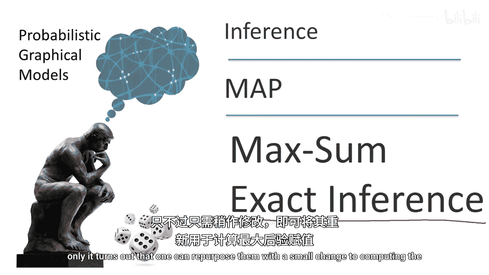
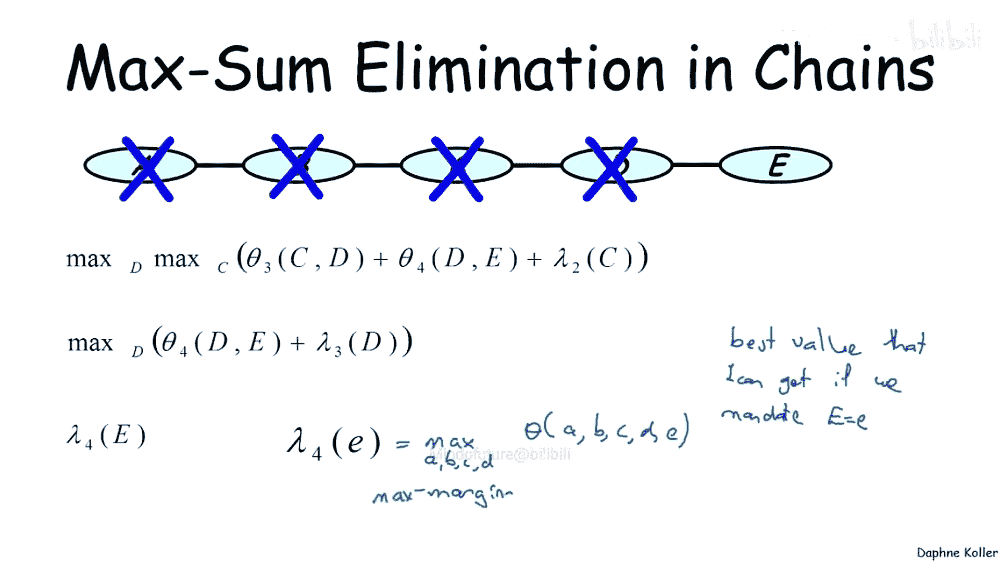
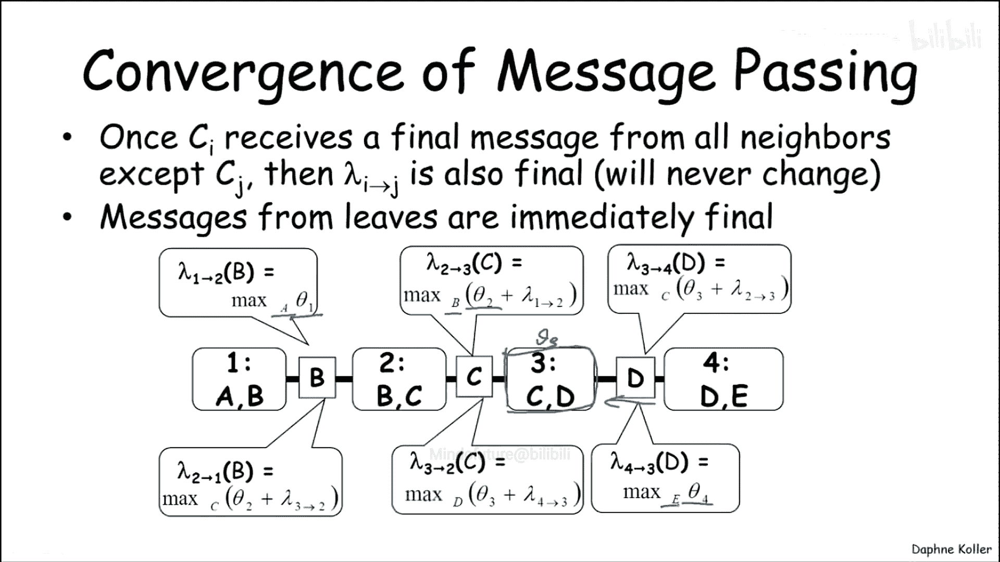
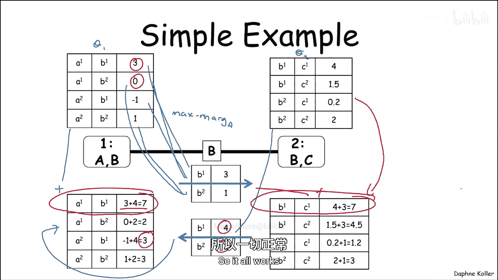
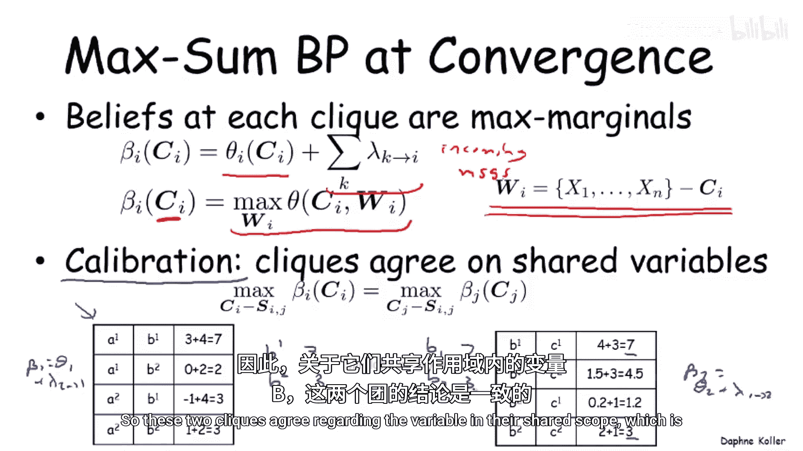
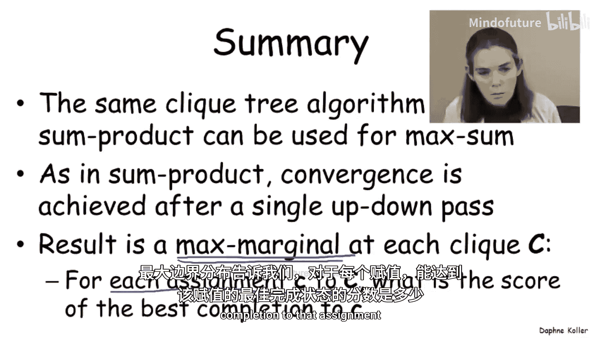

# 【斯坦福】概率图形模型2：推理 ｜ Probabilistic Graphical Models 2 Inference p16 P16_最大和消息传递_04_01_01 -BV1fY6VBBEyo_p16-

A lot of our thinking so far has gone into constructing algorithms for the problem of computing marginals in a graphical model。

 but as we previously discussed a very different type of inference problem。

 but one that has many applications in itself is that of finding a single coherent joint assignment that has the highest probability。

And we showed already that that doesn't have the same that you can just solve the marginals problem and pick the highest probability assignment for each variable and that gives you the map assignment。

 that's not what happens， and so we need to have a different set of algorithms for solving the map problem and we're going to talk now about the first of these which is effectively following the exact same lines that we did for exact inference for computing marginals only it turns out that one can repurpose them with a small change to computing the map assignment。

So the first operation that we to do in order to get this to work is we're going to take products and turn them into sumations。

 and we're going to be doing that by observing that P our distribution P of P is proportional。

 as we know to product factors。And if we're trying to find the argmax of that particular product。

 it can also be written， be formulated as the argmax of estimation sumation。

 where each of these theta ks is the log。of the potential 5K。

 which is basically the same as taking the table that represents the factor and converting each entry into its logarithm。

 and that gives you something that rather than being a product of factors is a sum of these log factors。

And there's really good reasons for doing that first because summmatations are easier to handle than products。

 but also because if you're multiplying a whole bunch of very small numbers。

 you're going to get numerical underflows and converting this into summatations is a much more robust algorithm numerically in terms of a practical implementation。

And so now we're going to consider the problem that we just wrote here。

 which is the argm of an expression that we're going to call theta of x1 up to Xn。

 which is defined as the sum of factors over smaller scopes， which are these theta k。

And this is the example that I meant to show a moment ago。

 so this is taking a factor over scope A and B and converting it to its log factor by taking log base2。

 and you'll notice that the numbers were carefully selected to give me nice outputs。

 but that doesn't have to be the case。So now that we've reduced the problem to one that we're taking the max over sination。

 we're going to now go back to our simple example of a chain and we're going to think about how we can do max sum variable emination in chains and this is going to look。

Almost identical to the max， to the some product algorithm that we had before。

 So let's understand what we're trying to do here。 So we're trying。

 assuming that what we're trying to do now is forget the arg max。

 Let's assume that we just want to find the max of this of this。Expression， Theta。Of A， B。C，D。

And so just like in the sum product case， we can break up the maxes into a max over A and then a max over B and a max over C and a max over D。

And while we might not be quite as used to doing this kind of operation that I'm just that I'm about to show。

 it's equally valid to point out that because none of these guys， theta 2， theta 3 or theta 4。

 depend on a， we can。Add them up。To the max。Over this guy over theta 1 of AB after computing the max。

And so that's going to give me。A。Factor here。Which looks like max over a theta 1 of AB。

And I'm going to call that lambda 1 of b because notice that this is not a constant。

 it's a function that depends on B for different values of B。

 you're going to have different A's that maximize and different values of the max expression。

 and so this lambda 1 of B is simply the max over a of theta 1 AB。

And that process has effectively now eliminated A from this expression and given me a maximization problem over one fewer variable。

 only BC， D and E。Just like in the context of some product algorithms。

 we can view all of these operations as operations over factors rather than just thinking about them in terms of expression。

 so whereas before we define things like factor product and factor marginalization we can now define analogous operations that correspond to factor summation and factor maximization so factor summation a very obvious operation。

 does exactly what we did here， so if we wanted in the case of factor product。

 if we want to define the row for A1， B1， C1， we're going to add up the entry3 from A1 B1 and the entry 4 from B1 C1 and that's going to give me7 and I can similarly define all of the other entries in the factor summation which we're showing here on the right。

Factor maximization is the same way that we could。Some marginalize a factor。

 this is something that Max marginalizes。It's called the max marginalization。

And what it does is it looks， if I I'm sorry I'm trying to get rid of B， I have these two rows here。

 say for example， A 1， B1 C1 and A1， B2 C1 that only differ on B， and my new entry here。

 a1 C1 is going to be the max of these two entries over here， which in this case is going to be7。

And similarly for， say， A1， C2。I'm going to end up with a max of 4。5 and 2， which is 4。5。

 So this is another form of marginalization where I remove the variable B。

 but using an operation other than summation。So now that we've defined these two operations。

 we can go back and define the max sum variable emination in chains as a set of factor operations where I eliminate a then B and so on and so forth。

 so for example， having eliminated a as in the previous step。

 I can now do the exact same operation by noticing that the only factors that depend on B are theta 2 of B and lambda 1 of B。

 so these other two。I can move outside of the maximization。

And that's going to give me a max over B of a factor that is the sum of the two factors， theta 2。

 BCC， and lambda1 of B that I got from the previous emination step。

And that's going to give me a new factor， Lambda 2 of C。

 and the process continues in exactly the same way as variable elimination did for the case of some product。

And that's basically。The algorithm。So now let's think about what we get at the end of this execution for the final factor。

What is Lambda 4 having gone through Lada 2 and Lada 3 now we get lambda 4 of E。

 What is lambda 4 for given value， little E？Lambda4 of little E is what we got by maximizing。Over A。

 B， C， and D of Thena， AB，C D。So this is the best possible assignment， the best value。That I can get。

But I can possibly get。If。We mandate。That E equals little E。And so this is a factor。

 and it gives me that value for each one of the values score。Effectively， for each value。

 little E of E。This is called a max marginal。

In the same way that we took variable emination for some product and we use that to define a clickek tree algorithm。

 we can do exactly the same thing for max product or max sum using the exact same type of data structure so here we're going to use the exact same click tree and we have cliques over AB。

 BCC and DE and we're going to as usual assign the potentials。To the appropriate。Saks， using。

Family preservation property。And now let's go ahead and see how messages are passed。

This in this clleek tree architecture。So initially the AB Cique is going to define the message Lambda 12。

 which is obtained by maximizing out a over theta 1 and the resulting message over B gets passed to clique 2 C 2 can take that message multiply it with its own factor theta 2 and add that this is max sum remember I'm going to add that to Lada 12 and that gives me the message Lada 23 and the same thing can happen when C 3 passes the message to click 4 in this case over the scope D so exactly the same message passing process except using max and sum instead of sum and product。

We can equally well pass messages in the other direction， so four to three over scope D。

 three to two， and two to1。And all the properties that we said hold in the context of some product click trees hold here as well。

 first notice， for example， that once this message Lambda 12 is sent， it never changes again。

 it's defined once and for all。Lambda 23， once it receives the message Lambda 12。

 it too has stabilized and will never change and similarly for Lambda 34。

 so we can do one pass from left to right to compute all of the left to right messages and a similar pass right to left to compute all of the right to left messages。

 and as soon as we do that they've all converged。The second thing to notice is what is the value of this clique over here。

So if we look at this， we can see that when I compute。

 when I finally get all of the messages from both sides， I have integrated in theta 1。Saaylor 2。

Theta 3， which is stored in the Cique itself and theta 4 coming in from the message on the right and maximize out all of the variables。

 A， B， and E。So that what I have left is a factor over the Cique3， which is the max over A。

 B and E of the sum of all of the factors in this network。So just to summarize。

 once the Cique eye receives a final message from all of its neighbors except CJ。

 then that message is also final will never change。

 and the messages from all leaves are immediately final and so what we have is an algorithm that at convergence。

That converges after two passes and gives us correct max marginals at every single one of the cliques。

So let's take a simple example just to convince ourselves that this is doing the right thing。

 so I'm looking now at a much simpler number that only has A B and C。

 so there's two factors one over Theta1 of AB。And say the two。OB。And first。

 we're going to construct the。Overall， theta。Which is the sum of theta 1 and theta 2。

So this is a factor summation went into this expression。

And let's look at it and see what is the map assignment in this example。

 and if we just look at the numbers that we computed， we see that the map assignment is A1， D1。

 c1 with a value of7。Now let's look at the message passings process that you will have on this very simple cl tree with two cliques。

So this is theta 1， it's assigned to clique 1， theta 2 is assigned to clique 2。

And let's look at the two messages that are passed。So here was my A1。

So AB passes a message to BC and that message。Is the max marginal？Or max marginalization。

Over the variable A。And so we can see that here we have a max between three。And。And negative one。

 So we get three， because this is the max over the two values of a that are consistent with B1。

 And for B2， we have the max over 0。And one， so we get one。

And exactly the same process gives us for this message。Where I'm max marginalizing C。

 I get this message。That's passed from left to right。Now each of these two cliques takes its message。

 notice that I've gotten immediate convergence here because there's only one message to pass in each direction。

 and so what I get here is the sum of this factor。Plus， the incoming message。

So I've added these two together， and so I have， for example， for the first row for A1， B1。

 I have three from here and four from here， so I get3 plus four， which is equal to seven。For A1 B2。

 I get a0 from here and a2 from there，0 plus equals2。

And I can do exactly the same operation to get this to get this。

Asve said to get this factor on the right， I get that by summing up this with that。

 and I get this factor over here。And you'll notice that miraculously。

The maps in each of these factors separately。Is a 1， B1 on the left and B1， C1 on the right。

 So sure enough， what I got here was the most likely assignment consistent with A1， B1。

 and over here the most likely assignment consistent with B1 C2。

And you'll notice if you go back and check and I'm not going to do that right now。

 but if you go back and check this big table over here。

 you can convince yourss that this doesn't only hold true for A1 B1。

 if you look for example at A2B1 you'll see that what you get here。

 the value 3 is the value of the most likely assignment that are consistent that is consistent with A2B1 so actually let's go back and check that so here is A2B1。

We have two assignments consistent with A2B1， one is 0。5， and one is 3。3 is the best one。

 and sure enough the value that we get here is three， so it all works。

So what can we say about this algorithm once it converges。

 The important thing is that we can compute beliefs at each clique that represent exactly the max marginals of that clique。

 So how do we compute these beliefs analogously to what we had in the context of some product。

 We look at the factor assigned to the clique， which is the theta I。

 And we add to it the incoming messages。Before you remember。

 we had the factor assigned to the clique multiplied by the incoming messages because we were doing products instead of sumations。

What is this belief encode， This belief is exactly the max marginal。

So specifically we can consider for any given assignment to the C CI。

 we can look at the best possible the score of the best possible completion to the C CI。

 and that is the value of the belief at that clique。

So it's the max over all of the variables WI that are not assigned to the clique。

One important consequence of the fact that we have max marginals is that we get a calibration property here as well。

So the cliques must agree on the variables that they share。

So to understand this let's look at these two cliques that we have in the simple two click example and here are the beliefs that we had for Cek 1 and for Cique2。

 it's the sum of theta 1 plus the incoming message over here。And。Theta 2 plus lambda and 2。

And let's look at what the calibration property tells us， it tells us that for example。

 if we look at the implications of this clique regarding the variable B。

 we would have that this clique tells us that the best possible completion for B1 has a score of7。

 and the best possible completion for B2 has a score of3。This clique， if we look at it。

 tells us that the best possible completion for B1 also has a score of 7 and the best possible completion for B2 also has a score of 3。

 so these two cliques agree regarding the variable in their shirttz scope， which is the variable B。

So to summarize， we can apply in the context of max sum exactly the same clea tree algorithm used for some product。

 messagesssage are passed in the same way。 The cleaique tree is constructed in the same way。

 The only difference is that the message passing operations use max and sum as opposed to sum and product。

At exactly as in some product， convergence is achieved after a single up and down pass。

 and the result of that is a set of beliefs that represent max marginals at each of those cliques where as a reminder。

 the max marginals tell us for each assignment， what is the score of the best possible completion to that assignment。

😊。

