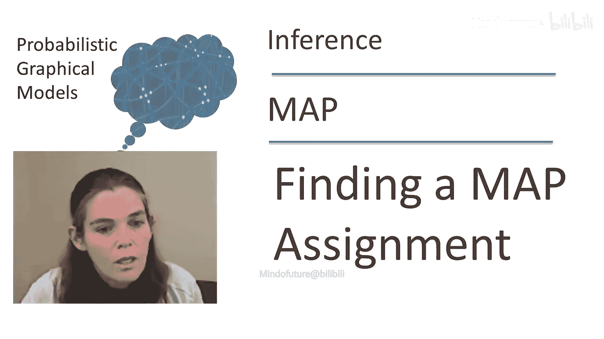
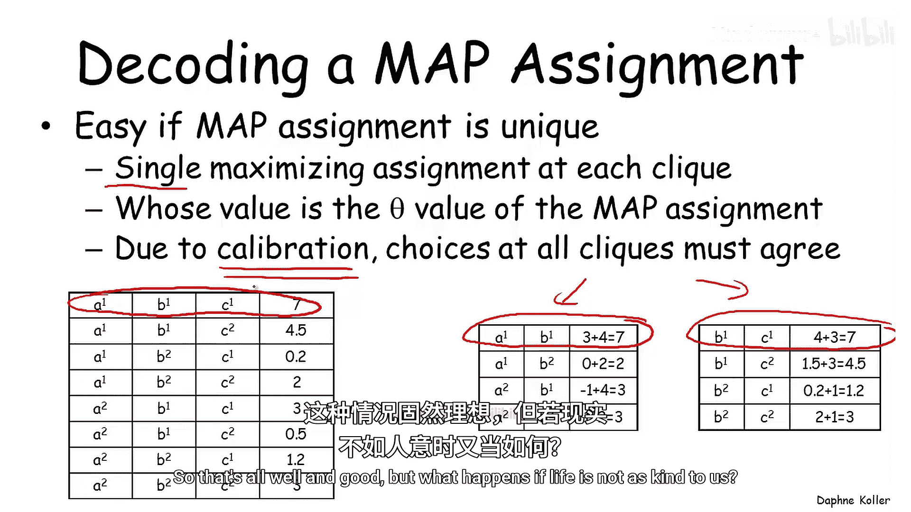
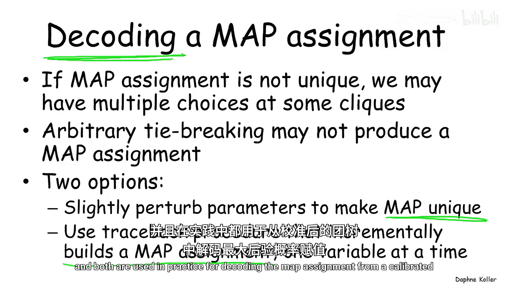

# 【斯坦福】概率图形模型2：推理 ｜ Probabilistic Graphical Models 2 Inference p17 P17_寻找最大后验概率赋值_04_01_02 -BV1fY6VBBEyo_p17-

We previously showed a cleere algorithm for performing Max cell message passing。

 but we didn't talk about how one can take the output of that algorithm and construct an actual map assignment。

 We just showed how we can get max marginals， so how do we compute a map assignment。

Well， it turns out that this task is easy， as our examples already indicated。

 if the map assignment is unique， because at that point。

 we have a single maximizing assignment at each clique。

 and we've already seen that the value of that maximizing assignment is the theta value of the map assignment。

 So in our example that we showed before。 we had the A1。

 B1 C1 assignment as the map assignment and we saw that A1 B1 was the maximizing assignment in Cique1 and B1 C1 was the maximizing assignment at Cique2。

 and we also saw that due to the calibration property。

 the choices that all of these cliques must agree， which means that it doesn't really matter whether we pick the value of B from this clique or for Maccle because they're going to give us exactly the same answer。

😊，So that's all well and good， but what happens if life is not as kind to us？

So if the map assignment is not unique， then we might have multiple choices at some of the cliques and we might have to make a decision。

So for example， imagine that at calibration at convergence of the some product Albert。

 then we have these two cliques over here and we can see that in this click over here。

 we have two assignments， A1， B1 and A2 B2 both of which have the value 2。

 and in this clickique over here， once again we have two maximizing assignment。😊，And the problem is。

 we can't now look separately at each of those cliques and pick an assignment because at that point we might pick。

 say， this assignment in this cl and this assignment in that clique。

 and now we have a conflict regarding the value of the variable B。

And it's not just a matter of saying， well， okay， let's forget， for example。

 the fact that we picked the value B2 in this clickique over here because what you because we also pick the value C2 and intuitively we can see that C2 goes with B2 and not with B1。

 So the value A1， B1 the assignment A1， B1 C2 is not a good map assignment。

 So what we need to do is we need to pick。Not this one， but rather B1。

 C1 in the second cl in order to re with the first cl。

And so what we see is that arbitrary tie breaking may not produce an actual map assignment。

So how do we actually address this problem， it turns out there's two main choices in terms of the solution。

The first is to tweak the problem a little bit so as to make the map assignment unique。 So。

 for example， if we add a tiny random perturbation to all of our factors。

 then with probably that's effectively one， there' is going to be unique map assignment at which point we can go ahead and use the solution that we had。

 if the map assignment was unique。The second is to use a procedure that picks assignments one at a time building a map assignment cl by cl。

 so we start out with the AB cl we pick A1 B1 and then when we go down to the next cl down the line we remember that we pick B1 and we only are allowed to now pick an assignment that's consistent with B1 and that turns out to be an alternative algorithm that whose complexity is effectively the same as that of calibrating the C tree to begin with and so it's not more expensive each of these options is a very reasonable option and both are used in practice for decoding the map assignment from a calibrated C tree。

