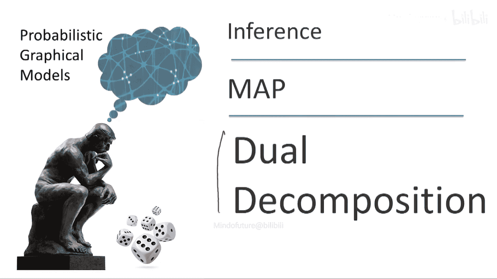
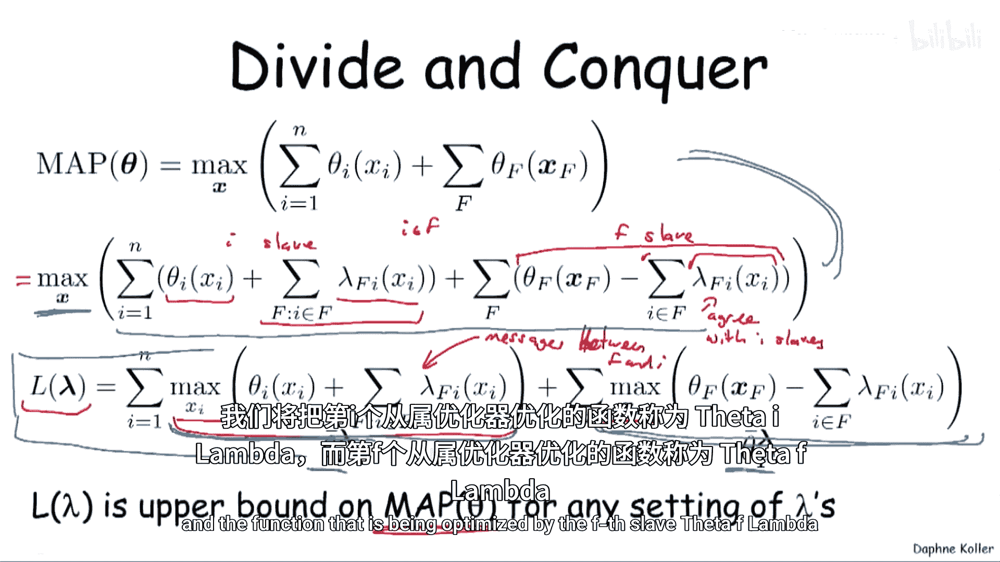
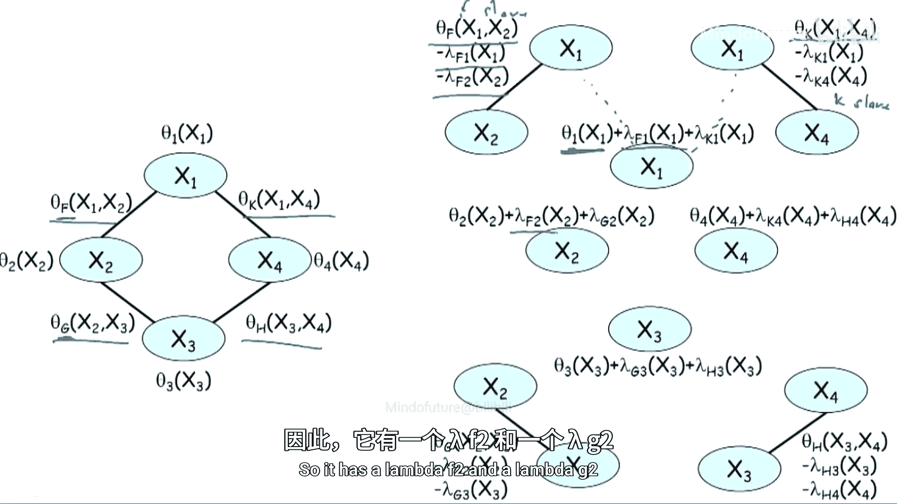
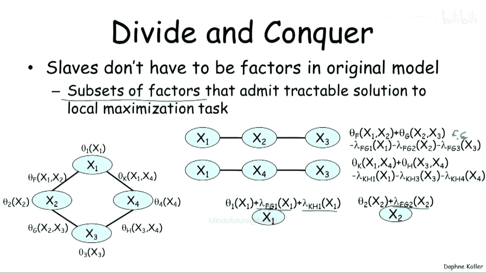
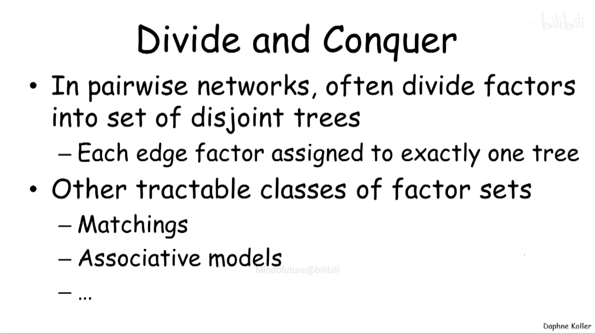

# 【斯坦福】概率图形模型2：推理 ｜ Probabilistic Graphical Models 2 Inference p19 P19_对偶分解直觉理解_04_02_02 -BV1fY6VBBEyo_p19-

We previously defined the map inference problem， which is that of finding the highest probability assignment to a graphical model。

 and we talked about particular classes of models for which the map problem was tractable。

 one was a class of models that had sufficiently lowtre width so that one could use techniques such as the variable elimination or clee treee methods。

 and then we also talked about a variety of other special purpose classes where one could do tractable inference。

What we're going to talk about now is a general purpose algorithm that can be used to solve any map problem。

 keeping in mind of course that the map problem is an NP hard problem and so you're not going to get a fully polynomial time algorithm that one can utilize in the context of any problem so the class of methods that we're going to talk about is called dual decomposition and it's derived from the increasingly prevalent view of the map inference problem as an optimization problem and building on techniques from the field of optimization theory。

let's go ahead and first reformulate the problem in a way that makes it amenable to this kind of analysis。

 And this is just a convenience。 So here we're going to assume that the map problem that we're trying to optimize。

 remember， we've reformulated this is a max sum as opposed to a max product。

 which is a convenient reformulation and we're going to assume that the theta that we're trying。

To optimize is comprised of a sum of two different kinds of factors。

 the first is singleton factors which are over the scope of single variable X。

 and the second are larger factors that are over the scope of multiple variables and clearly one can fold in the singleton factors into some larger factor that contains the variable in its scope。

 but it turns out to be convenient to keep them in the model for reasons that will become clear in a minute。

So now our goal is to find the value for the moment。

 we're going to talk about how to find an actual assignment in a little bit。

 but imagine that our goal is to just figure out what is the value of the highest probability assignment X。

 and so we're trying to find the x that maximizes this total summation。So one thing that we could do。

 which would be wrong， but we could do it is to say， well， let's。

Forget about the fact that we're trying to do a single joint assignment。

 rather we're going to think about each problem with blinders on。

 so we're going to think about each theta I XI by itself and we're going to find the XI that optimizes that factor and we're going to do the same for the larger factors。

Now that of course is going to be a very poor solution because the X that's going to optimize one theta I is going to be completely inconsistent with the XI that is selected by one of the larger factors that contains XI。

 so you're going to get a completely incoherent joint assignment。

 it's not going to be a joint assignment-， it's going to be a bunch of different assignments that don't agree with each other。

So what thecomposition does is it's going to try and do the same kind of divide and conquer。

 but it's going to do it in a way that tries to force these local decision making problems to agree with each other。

And so how are we going to do that， we're going to do that by introducing a set of costs and the costs are going to be things that are going to drive each of these local problems to hopefully eventually agree with the decisions made in other local problems。

So going back to this， what we're going to do and now this is actually an equality。

Is we're going to do the following。For the variable I， we have its own local potential theta I。

 and then we have a bunch of costs。And these are the costs that are derived from and we have a cost for each factor F that contains I in its scope。

And that cost is going to try and pull。The little eye decision maker， which is called a slave。

 By the way， each of these decision problems is called a slave。 So this is the eye slave。

And here is a little term that's supposed to pull the ice slave to agree with。

The decision made in factor F。Similarly， we have an F slave。

And what we're trying to do is we're trying to get the F slave to agree。With the ice slaves。

Or the variables Xi in its scope。Now。As written over here。

 let's convince ourselves that this expression is in fact equal to the first line。

 and the reason is that here I add a term lambmbda f of Xi for I in the scope of F。

 and here I subtract，That same expression。Over here。 So each of these expressions。

 Lambda FI gets added in at I and subtracted out at F。 And so they cancel out。So far。

 I've had equality。But now I'm going to really let each agent make their own decisions。

 So now before there was still the maximization on the outside。

 now I'm going to let each agent look at its little set of factors that it owns。

 including the sort of penalty terms that it has in order to agree with the other slaves。

 And each one is going to make its separate。Optimization。With all of those terms together。

So you can think of these these penalty terms。As a messages。From or between。

F and I their way to communicate。For F to communicate the I。

 what it thinks ought to be done and for I to communicate with F at the same time。Now。

 one important point that we'll come back to。And a little bit is that this function here。

 which is called L of lambmbda， notice that this is a function of Lambda。

And only a function of lambda because it's no longer a function of x because of' maximized over the x。

 so you're going to get a different value of this function depending on the choices of the penalty parameters。

This function is an upper bound on map theta for any value of lambda。

Now let's understand why that is。It's。We've seen in this line over here。

But this is actually equal to that。We've shown that everything cancels here。

And what I've done here is over here I'm forcing。The single X to maximize this entire expression together。

And here I'm letting each term be optimized separately。

And that gives me more degrees of freedom because here I had to pick the same X across the board。

 and here this one gets to pick one x。And this one gets to pick another value of x。

 and so since the assignment where they all agree is one of the assignments that can be considered in this optimization problem over here。

The overall value that can be gained is only higher than if I had to force them all to agree。

 which is a more constrained optimization problem in general the more constraints I have on the space that I'm optimizing the the lower the value that I can get。

So introducing some notation which use in a little which we'll use in the rest of this presentation。

 we're going to call the function that the I slave is optimizing theta I lambda and。

The function that is being optimized by the F slave theta F lambda。

So let's take an example to make this a little bit more concrete because this was a little bit abstract。

 so let's go back to our example of a fourway loop where we have x1 x2 x3 and x4。

 and we're going to have these four pairwise potentials which we're going to denote with letters this time to disambiguate indices a little bit so we have theta f of x1 x2。

 theta G of x2 x3， theta H and theta K。So now how is this decomposition going to work here。

 Let's assume for the moment that we're going to decompose this over edges。

So our factors are going to be， for example， the E x1x2。

So now what is the optimization problem that this factor chooses， Well。

 it has its own potential theta F x1 x2。 and then it's going to have these little costs that are going to try and get it to agree with x1 on the with the one slave on。

X1， then with the two slave on X2。We're similarly going to have。Or x1 x4。This is the K。

 so this is the F slave。This is the case sleeve。And it's going to have its own potential， Theta K。

 and two penalty terms that are going to try to make it agree with the one slave on X1 and with the fourth slave on X4。

And we similarly have exactly the same form for the other two， slaves， the G slave， and the H slave。

In addition， we have slaves for the individual variables。The one， two， three， four ss。

So here is the one slave， and notice that the one slave has its own。Potential theta 1 x1。

 and at the same time， it has these two terms that are trying to make it agree on the one side with F。

 which is over here， so this is because of this and on the other side with K because of that。

And the same thing applies to the other slaves， so the two slaves， for example。

 is going to have to agree with F。And it going to be incentivified to agree with F and with G。

 so it has a lambda F2 and a lambda G2。

Now I've done this in the context of a very simple scenario where I've broken up my model into the factors that existed in the original specification。

 so for example， I had factors that were pairwise potential also I had a slave for each such factor。

 but that doesn't have to be the case， in fact， the only constraint that I need to satisfy is that I need to define a slave to be defined as a subset of factors that admit a tractable solution。

So that each one can be optimized。Efficiently， when considered an isolation。So for example。

 if we return to this network， say one thing we could do is we can introduce two larger slaves instead of the four smaller FGKH slaves。

Which one is。Corresponding to F and G together。 So this is the FG slave。

And the other one representing the KH slave。And in this case， if we think about the agreement。

 we still have the 1， two， three， four slaves that represent the individual variables。

And so now we're going to have to require that theta f agrees with x1 with a one slave on x1 with a two slave on x2 and with a three slave on x3。

 and so we have this。Expression， which has a lambda term for each of those three variables。

And we have a similar term for a similar expression for the KH slave。Where in this case。

 the KH slave has to agree with the one slave on x1， the fourth slave on X4。

 and the three slave on X3。If we now think about the Singleton slaves， for example， X1。

 we see that X1 has to agree with the FG slaves， so there is a term to encourage that and with a KH slave because it's present in both。

On the other hand， the x2 variable only occurs in the first slave。

 and so it only has a single agreement term。With with the FG slave。

And similarly for x3 and x4。So how do we then construct the slaves？In pairwise networks。

 what we typically do is we divide the factors into a set of disjoint trees。

 and this is in fact what I showed in the previous slide。

 we divided it into one tree that went through the first wedges and the second one that went through the second wedges。

And then they're disjoint， which means that every edge factor is assigned to exactly one tree。

 and because theyre trees， we know how to optimize them efficiently using techniques like variable emination or cleaique tree。

But we also discussed that there is other classes of factors that offer tractable inference。

 so for example we talked about matchings or models that are associative or regular or supermodular or whatever we call them and all of these are tractable classes and we can take a whole bunch of factors that fit into one of。

