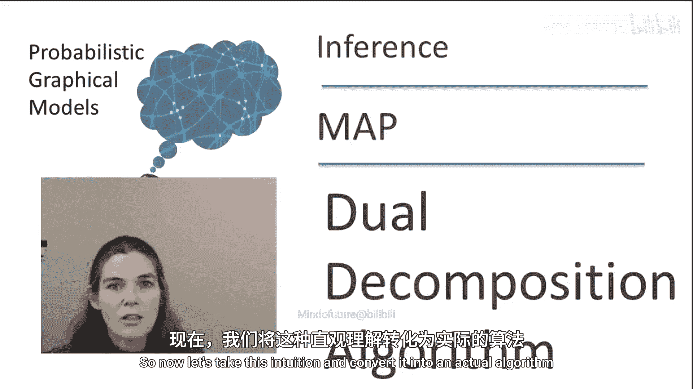
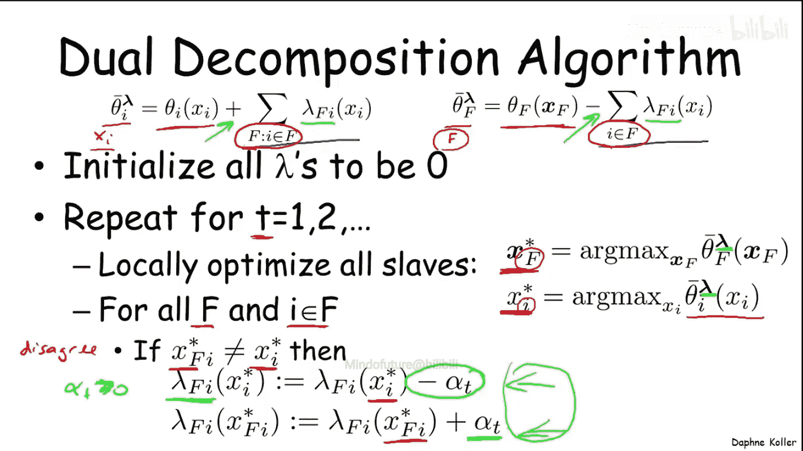
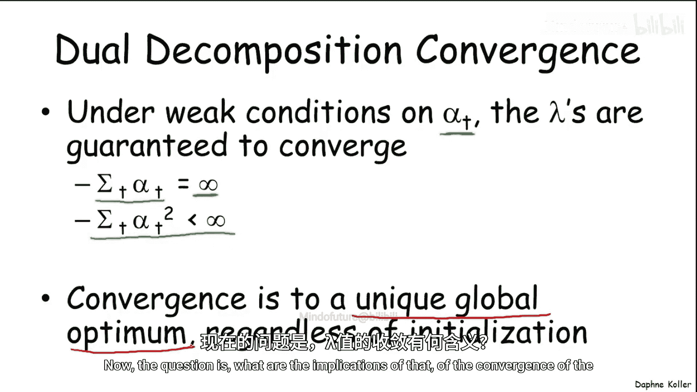
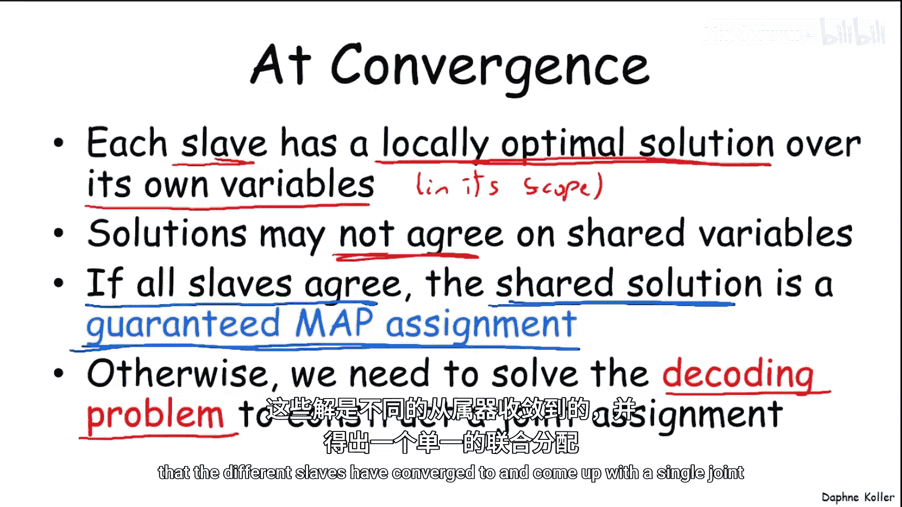
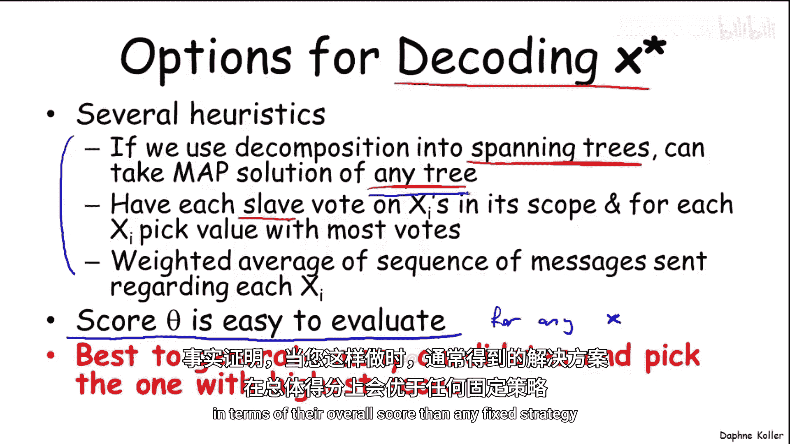
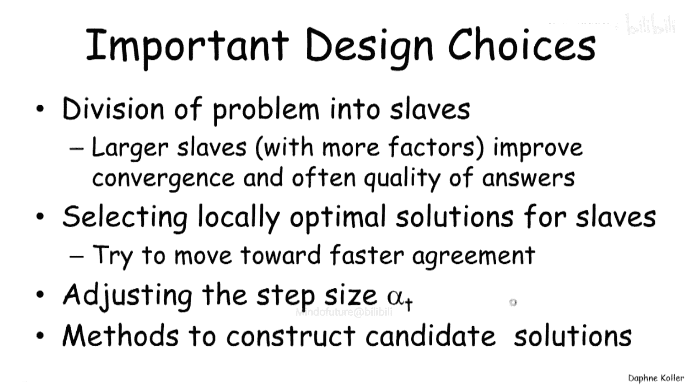
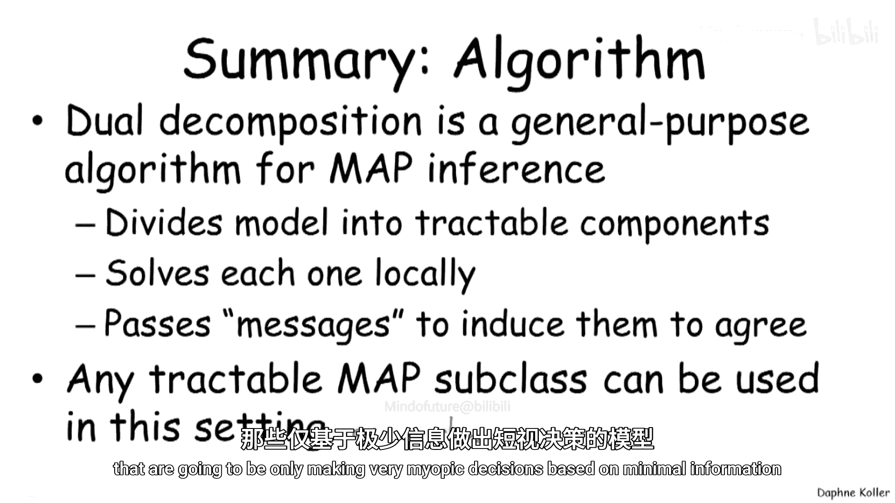
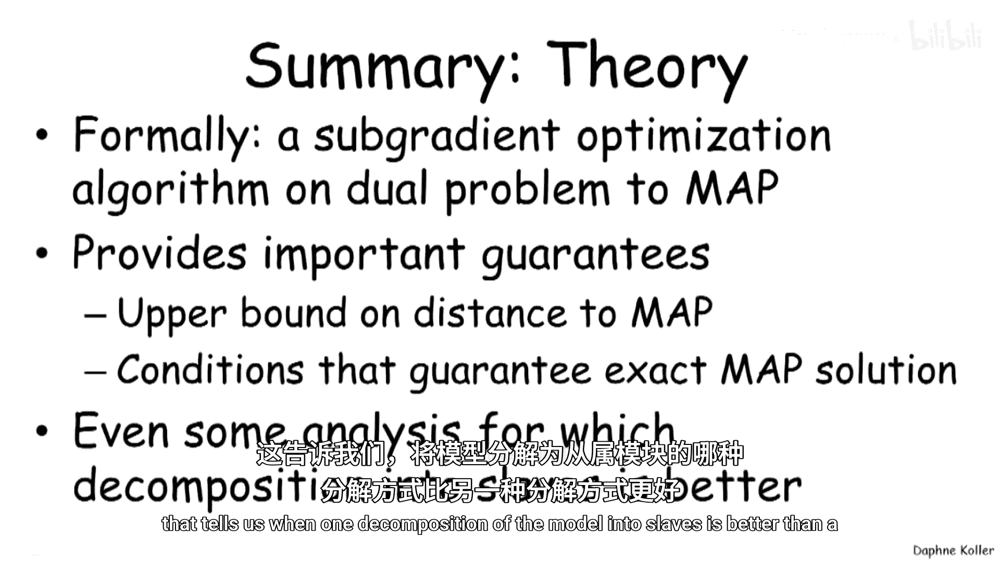
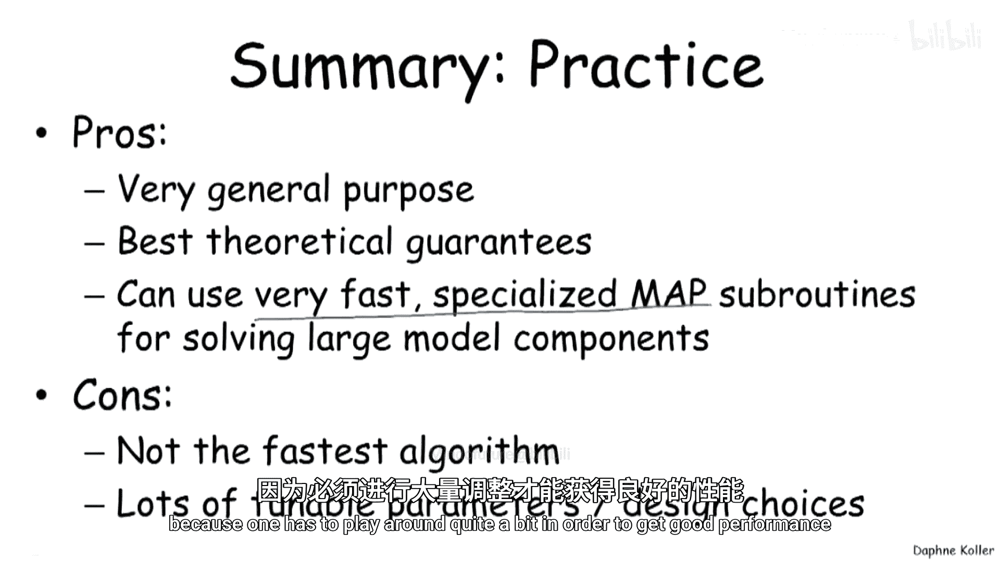

# 【斯坦福】概率图形模型2：推理 ｜ Probabilistic Graphical Models 2 Inference p20 P20_对偶分解算法_04_02_03 -BV1fY6VBBEyo_p20-

We previously defined the intuition for the dual decomposition algorithm。

 which takes an optimization objective and decomposes it into a bunch of different slaves and uses communication between the slaves to try and get them to agree with each other about the overall map assignment。

😊，So now let's take this intuition and convert it into an actual algorithm。

So what we have here is each slave gets its own pet objective function。

 so here is the objective function the for the slave corresponding to the variable Xi。

And here is the objective function that the slave corresponding to the larger set F is trying to optimize Now each of these initially has as a component its own local objective function that is assigned to it。

But in addition， we're going to introduce for each of those a set of terms。

 these terms that modify its objective function so as to try and get it to agree with with the other slaves。

 specifically we're going to try and get the I slave， to agree with the factors F。

In which I appeared。 and conversely， we're going to try and get the F slave。

To agree with the slaves of the variables in its scope。So let's see how that gets done。

We're going to initialize all of these incentive terms， all of these lambdas。To be zero。Initially。

 each slave makes its decision based purely on its own local piece of the objective。

But then as the algorithm evolves， these incentives start to change。

 so how does that happen at each iteration T？Each slave optimizes its current objective。

 so the I slave。Optimizes theta I hat lambmbda， where lambmbda is the current is the current set of the penalties。

 the current。Set of penalties。And that gives it an assignment which we're going to call X I star The F slave does the exact same thing。

 It optimizes its own local objective， which is theta hat F， also using the same set of lambmbdas。

 and that gives it x hat sorry x star of F。Which is。This guy over here。Now。

 let's see what happens if there is a disagreement between a large slave F and a variable I in its scope。

What we would like to do is we would like to incentivize them to agree with each other。

And so what we do is that for all F。And all variables， I in F， if they disagree。

That is if the chosen variable for Xi in。The assignment chosen by the factor F is different from the assignment of I chosen by the I slave。

 then we need to change their incentive function， and we do that。By basically changing the lambda。

And so specifically we see that here。When we look at the penalty for the pair FiI。Which is。Over here。

 we decrease。Alpha t would decrease by a factor alpha t， which is greater than zero。

The preference for Xi star。Wwhich is the value chosen by the ice slave and if we see that。

 if we look at that， we see that that's going to disincentivize the ice slave。

From picking the value that it picked， conversely， we increase the preference for the value chosen by the F slave。

 which is this value over here。By the same amount， alpha P。

 Now that changes the preference of the I slave， but it also changes the preference of the F slave by the exact same amounts。

 but in the opposite direction， because notice that here we have a negative sign。

 whereas here we have a positive sign， so it makes both the I slave and the F slave。

 move in the same direction move in opposite direction so as to agree with each other。

So what happens as we continue doing these iterations over time？Well。

 one can show that under fairly weak conditions on these parameters， alpha t。

 the lambdas are guaranteed to converge， what are these conditions， the alphas need to be big enough。

So that they make a difference so that if we sum up all of the alpha Ts for al T。

 we end up with a diverging sequence that sums to infinity。

 on the other hand they need to be small enough so that we eventually achieve convergence and that is obtained by the second condition on the summation over here。

Now， in fact， one can also show that not only do we get convergence。

 we get convergence to a unique global optimum regardless of the initialization。

 so the lamb is always converge。Now， the question is。

 what are the implications of that of the convergence of the lambda？

And so what happens at convergence？At convergence， you can show that there's no more change and so at that point each of our sleeves。

Has its own locally optimal solution over its own variables， the ones that are in its scope。

So is that good enough？Unfortunately， not always， that is， even though we have achieved convergence。

 the solutions of different slaves may or may not agree on the variables that are shared between them。

However， if they do agree， if we can get all of the slaves to agree with each other。

 we can show that the shared solution is a guaranteed map assignment。So if the slaves agree。

 we have effectively solved our initial optimization problem。

 which is that of finding a map assignment。If that doesn't happen。

 that is if the slaves have not agreed on their shared variables。

 then we need to solve what is called the decoding problem。

 where we need to somehow put together these different solutions that the different slaves have converged to and come up with a single joint assignment。

So how do we do that， how do we solve this so called decoding problem？

It turns out that people have constructed a range of different solutions for this。

 none of which have particularly strong performance guarantees。

 but they often work quite well in practice so for example。

 if we use decomposition of the original problem into spanning trees。

Then each of the spanning trees covers all of the variables so we can take the map solution of any individual tree and say that that is an assignment to all of the variables。

 so that's one approach。A second approach that is not a one a winner takes all is to have each of our slaves vote on the excise that are in its scope。

 and then for each exile you just do the majority voting， so that's another approach。

A different approach uses some kind of weighted averaging of the sequence of messages that are sent regarding each XI through the course of the iterations of the algorithm。

 so each of these works reasonably well but what it turns out that the right solution is to simply use multiple solutions and then pick the best one。

And the critical observation here is that the scoring function theta for any assignment。

Is something that we can easily evaluate so why not do all of these and use multiple trees and generate a whole collection of x's and then evaluate theta x for each of those solutions and then pick the best one and it turns out that when you do that you generally get solutions that are better in terms of their overall score than any fixed strategy。

Now， the other nice aspect of this analysis comes back to a point that we made earlier in this module。

 which is that for any lambmbda， this function that we defined as L of lambmbda is an upper bound on the value of the true map assignment。

Now， what does that imply？It means that if you give me any X that you think is a reasonable candidate。

 So this is a candidate。For the map assignment。Now， by definition。

 it's either equal to the map or it's worse than the map。 so whatever the score is， theta x。

Is going to be less than or equal to the value of the map assignment because it certainly can't be any better than the true maximum。

And that in turn， is less than or equal to Els lambda。Now， the point is that this is a mystery。

 We don't know the value of the true map assignment， but we can compute this。And we can compute that。

And that gives me a bound on how bad my current assignment is because I can because I know that the difference between the true map assignment and the score of my assignment is no worse than。

The value of L lambda minus the score of my assignment。

 which means that I can look at the difference between my assignment score and L of lambmbda。

 And if it's small enough， So if this is small enough。I'm happy。

Even though I might not have the true map assignment because I know that I'm close enough to the point that I don't care anymore。

And so that's a really nice guarantee because it allows me to sort of stop and say good enough。

 I don't know if I'm at the optimum， but where I am， I'm happy。

So what are some of the important design choices in implementing dual decomposition？First。

 there is the division of the problem into slaves。In general， not surprisingly。

 larger slaves that incorporate more factors are more expensive to optimize because you're solving a more complicated optimization problem within each slave。

 but on the other hand， they can be shown to improve convergence and often get you closer to the true map assignment。

A second design choice is how to select the locally optimal solution for the slaves In many cases。

 a slave might have more than one optimizing assignment and some of them might be more in agreement with other slaves than some and so how do you pick within the set of equally good slave assignments。

 the one that's going to get you to convergence faster？The third。

 which we've briefly mentioned before is how do you adjust the step size alpha T so as to move things towards convergence？

Fast but still slow enough to generate convergence There are some hard and fast rules that guarantee convergence。

 but they're often quite slow and there is clever rules that still guarantee convergence and tend to work better in practice and this is an active area of research that's ongoing right now。

And then finally， we've talked about the decoding problem and the fact that there's many heuristic choices there。

 and so that's another design choice that one needs to make when implementing dual decomposition。

So let's summarize different aspects of what we've talked about， first of all。

 let's summarize the algorithm。Dual decomposition is the general purpose algorithm from app inference that works by dividing the model into tractable components that could be potentially multiple factors in a single component or slave。

Solved each slave locally and then passes these lambmbda messages between them to try and get them to agree。

嗯。And we've talked before about the presence of tractable map subclasses。

 any tractable map subclass can be used in the setting as a slave。

To allow slaves to be large and richly structured as opposed to just little tiny factors that are going to be only making very myopic decisions based on minimal information。

One of the nice things about the dual decomposition algorithm is that it has a lot of theoretical backing to support it so formally and we're not going to go into the details of what this means but just mention what this is actually doing from a formal perspective。

 this is a subgradient which is kind of like a gradient optimization but not exactly a sub gradientdient optimization algorithm on a problem that is a dual problem to the map problem and if you didn't understand that that's okay this is just sort of a pointer for those of you who might have seen some optimization before to kind of fit this in to that world。

嗯。But this view does provide some important guarantees。

 some of which I've mentioned in this presentation。

 first it gives us an upper bound on the distance to between where we are in the true map assignment。

 and it provides us with conditions such as agreement among all of the slaves that guarantee a condition under which we have actually found a true exact map solution。

And there's even some interesting analysis which I'm not going to present that tells us when one decomposition of the model into slaves is better than a different decomposition of the model into slaves。

Now in practice， this algorithm has some significant pros and cons on the pros it is very general purpose you could really use it for any model if you're willing。

 for example， to decompose the slaves fine enough。Of the algorithms that are currently out there。

 it provides some of the best theoretical guarantees in terms of convergence properties and because of the way that it's structured it can use these very fast。

 specialized map subroutines for solving large model components like matching problems， for example。

 or subsets of edges that are submodular associative。On the other hand。

It's really not the fastest algorithm out there， that is there are algorithms that when they work work considerably faster than the dual decomposition algorithm。

 and more so than most it has a lot of tunable parameters and design choices which make it a somewhat finicky algorithm to apply in practice because one has to play around quite a bit in order to get good performance。

