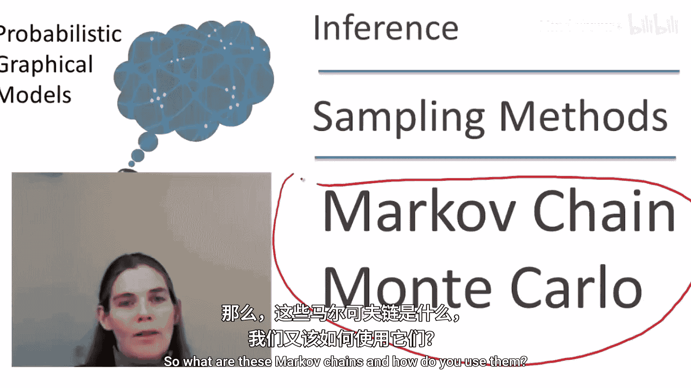
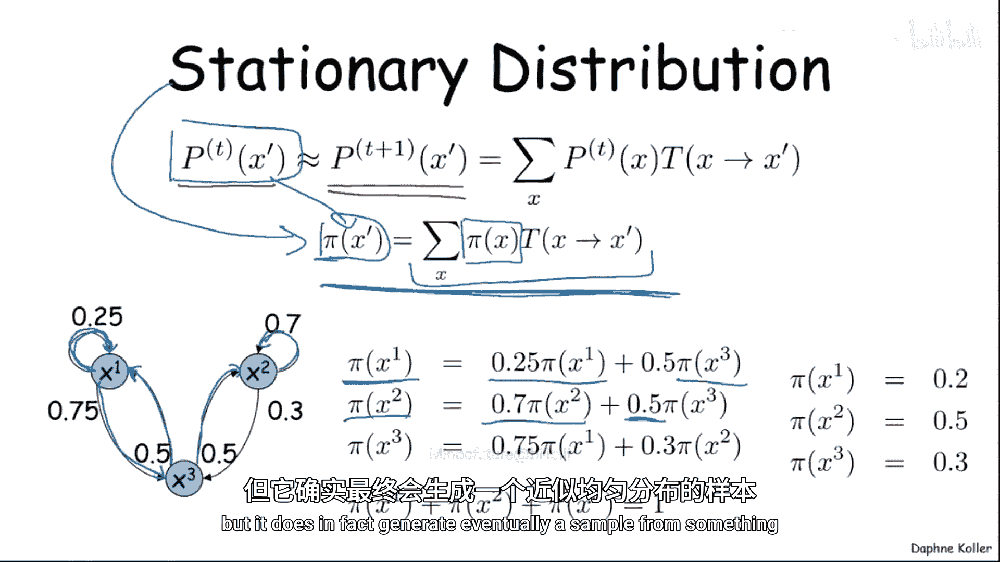
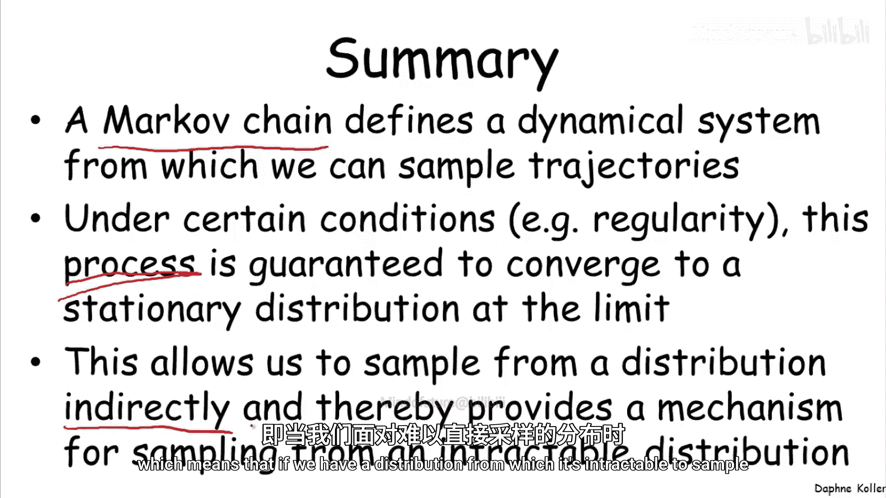

# 【斯坦福】概率图形模型2：推理 ｜ Probabilistic Graphical Models 2 Inference p22 P22_马尔可夫链蒙特卡洛_05_01_02 -BV1fY6VBBEyo_p22-

One of the most generally useful class of sampling methods。

 one that's very commonly used in practice， is the class of Marco chainmonto Carlo methods。

 and those are methods that allow us to design an iterative sampling process that。

 through a sequence of steps allows us to generate a sample from a desired target distribution that might be intractable to sample from directly。

😊，So what are these Markov chains and how to use them？

So。A Markov chain is a method for sampling from a distribution P that is intractable to sample from and so we've seen one example of such a distribution P if you'd like to sample from a say a Bayesian network where we have some evidence we don't really know how to sample from that if you'd like to sample from a Markov network we don't really know how to sample from that either in general and so here we have examples of distributions P and we'd like to come up with a way of generating even one sample from that distribution P。

So Markov chain gives us a general mechanism for doingna。

And what the Markov chain does is it defines an iterative process by which the first sample that you generate is not going to be from a distribution P。

 but ultimately as you move along， you are going to get closer and closer to generating a sample from P。

So let's understand what that means， so we have a Markov chain and a Markov chain is defined over a state space which we're going to use x's to denote。

And so here is an example of such a state space， this is a very simple state space。

 it starts with the zero point over here， and you could imagine。

 and it has the four negative numbers to the left and four positive numbers to the right。

And a Markov chain defines a probabilistic transition model， which given that I'm at a given state。

 X， tells me how likely I am to transition to a different state x prime。

And that is a probability distribution， as indicated in this formula here， so that for any x。

 the probability the sum over the probability of the states to which you can transition is exactly one。

So for example， if in this case we have our little grasshopper who starts out at state zero。

 we can see that it has a probability of 0。25 of transitioning to the right， a probability of 0。

25 of transitioning to the left， and a probability of 0。

5 of not making any progress and staying exactly where it is。And in fact。

 that same general probability distribution is actually in this example replicated across the different states in the chain with the exception of the states at the end where if the poor grasshopper tries to go to the left when it's a negative4 it's going to hit the wall and it's going to end up staying where it is regardless and so the probability in this case of staying is actually 0。

75 corresponding to the two different cases that we just talked about。

 but anyway this is a Markov chain and you can imagine。

Simulating a random process by which a grasshopper traverses this chain。

And so initially it starts out with say， state zero and then。

And then what happens and then as it moves， it selects to move left with probability a quarter。

 right with probability a quarter and stay at the same place with probability 0。

5 Once to say it's moved to the left， it now does exactly the same thing。

So let's think about the temporal dynamics of this type of process。

 we can ask what is the probability that it's step T plus1， so this is the step。

What is the probability that at that time step， the state at time T plus1？

Is equal to some value x prime。Now we can get that by a recurrence relationship that looks at the state of time T。

 so if we had previously computed the probability distribution over where the grasshopper might be at time T。

We can sum up over all possible states X where the grasshopper might be and ask if it was at state X at time T。

What is the probability that it ends up being that it ends up going to X prime。Together。

 gives me a distribution over pairs。X comma x prime where this which measures the probability that a time T。

 the grasshopper is at state x and a t plus1 is at x prime。

 and since I'm only interested now in asking about t plus1， I sum up or marginalize the time T step。

St X。So if we go back to our grasshopper example， we can simulate this process and here is the first three steps of this so at time zero the grasshopper is at state0 with probability 1 at time1。

 it's going to be at negative one with probability a quarter and it's positive one with probability a quarter probability half it's stuck at the same state and now we can simulate the next step so at the next time step the probability that it manages to move all the way to negative2 is 0。

25 squared because it considers two successful moves to the left。

Here you have two successful moves to the right。At state  zero you have， for example。

 a sum of different events， which is the probability that it stayed in the same state twice， a 0。

5 squared， plus the two events that correspond to moving to the left onces and back to the right or moving to the right and back to the left。

 each of which happens with probability 0。25 squared， so this is an example of how you would do this。

Now， it turns out that for many of these chains and we'll describe conditions in a moment。

 ultimately as the process evolves， the probability distribution kind of equalizes。

 which means that the probability that a time T you're at state x prime is almost the same as the probability that a time t plus1 you're at x prime。

 so sort of it kind of the distribution over where you might be tends to equalize。

And and so we can then consider what's called the limiting process。

 the limiting distribution you would get as you simulate the process for more and more steps。

 and that is typically denoted by pi， which is called the stationary distribution。

It also has a bunch of other names， but stationary is the most common。And if you plug in。

If you basically take out this approximate equality and you can see that what we have as a condition on pi is that the distribution at one time step is needs to be the probability of x prime and the stationary distribution needs to be equal to this summation over here。

 where pi now appears both in the left hand side and within the summation on the right hand side。

Now it turns out that this concept of a stationary distribution is actually at the heart of Google's page rank algorithm。

 so what they're actually computing， at least in the original page rank is the probability that if you take a random walk on the web that you end up at a particular website。

 so this notion of a stationary distribution is actually quite powerful as we've seen。

So let's take a simple example， which is this three state Markov chain shown here。

 so for example note that from state 1， there's a probability of 0。75 of going to state 2。And 0。

25 is going to stay in the same state。And we can now write down a set of equations that represent。

What properties the fixed point distribution needs to satisfy。 and if you do that。

 you're going to get the following equations。 So for example， it tells me that pi of x1。

Has to be equal to 0。25 times pi of x1 because of the self transition here。Plus， oops。呃。0ero point。

Yes， sorry that。Pi of x1 is equal to 0。25 times pi of x1 plus 0。5 times pi of x3。

Because if you were at pi of X， you can end up in x1 in one of two ways。

 either by starting out an x1 and staying there or by starting out at x3 and moving to x1。

 which happens with probability 0。5。Similarly， pi of x2。

 you can end up either by being at x2 and staying there。

 which is this transition or by being at x3 and moving to x2， which happens with probability 0。

5 and so this is a set of three simultaneous equations and three variables。

This by itself is an underdetermined system because you can multiply all of the pis by a factor of 100 and it would still be a solution。

 but we can add to that the one constraint that says that all of the pis have to be equal。

 the sum of all the pis has to be one which is because it's a probability distribution and once you do that you end up with a unique solution to the system of linear equations and it's not difficult to plug those pis into the system and confirm that indeed this is the stationary distribution that satisfies these equations。

By the way， for the grasshopper example that we showed on the previous slide。

 the stationary distribution is the uniform distribution。

 so this has to be one of the dumbest ways of generating a sample from the uniform distribution。

 but it does in fact generate eventually a sample from something that's very close to uniform distribution。

😊。

So when does a Markov chain converge to a stationary distribution， I said many of them do。

 but it turns out that not all of them， and so a condition that guarantees convergence to a stationary distribution is something called regularity。

 so a Markov chain is regular。If the following condition holds。I notice the order of the quantifiers。

 if there exists some。Number K intotegerK， such that for every pair of states。

 so this is the universal quantifier， the probability of getting from x to x prime in exactly k steps is greater0。

Now notice what that means， it means that you pick the K first。And。

And only so you can't have a different K for different pairs of states。

 you can pick K to be 1000 or a million， it doesn't matter for this purpose。

 but you need to pick it first and then there needs to be a way of getting from x to x prime in exactly that number of steps with probability greater than zero。

It turns out that that is a sufficient， not a necessary。

 but a sufficient condition to guarantee that the MarkovV chain converges to a unique stationary distribution regardless of a start state。

 so it converges and it converges to a single stationary distribution that's characterized by the equations that we saw on the previous slide。

Now what are some sufficient conditions for regularity because this one is a little bit hard to check and so one sufficient condition for regularity that people often use in practice is first that every pair of states。

 x and x prime need to be connected with a path of probability greater than1。

 sorry with probability greater than zero。And for every state， there's a self transition。

So you can always transition from a state to itself。So if you think about that。😊。

That means that if you take k to be the diameter of this graph， so she said K to be the distance。

Between the furthest。Ca of states。Then you can get between every pair of states using exactly K steps because you can take less than K and then just stick around for a while until you hit K。

Because of the self transitions。So this is a way of guaranteeing that for this value k。

 you can get from every state to every state。And that's what people typically do。

 They typically add these self transitions to guarantee regularity。 So to summarize。

 we've defined the notion of a Markov chain， which defines a general dynamical system or an iterative sampling process for which we can sample trajectories that traverse the space of the chain。

Under certain conditions such as the regularity condition that we define， which is sufficient。

 although not necessary， this iterative sampling process is guaranteed to converge to a stationary distribution at the limit that is after we generate enough samples。

And so this provides us with a general approach to sample from a distribution indirectly。

 which means that if we have a distribution from which it's intractable to sample。

 this provides us with an alternative mechanism。

