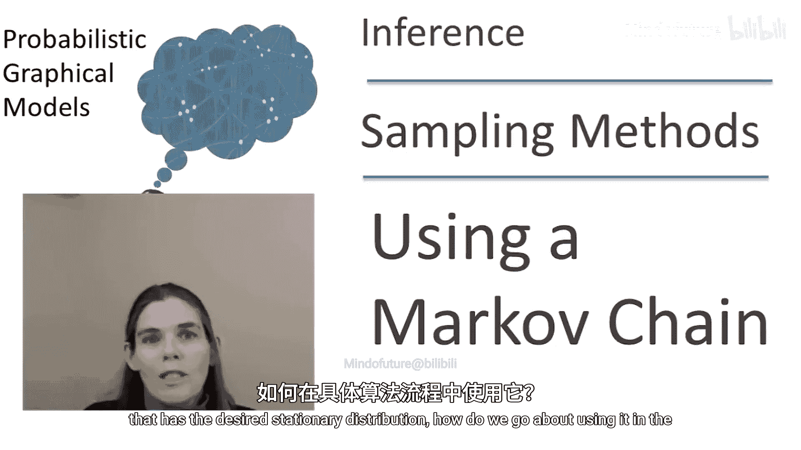
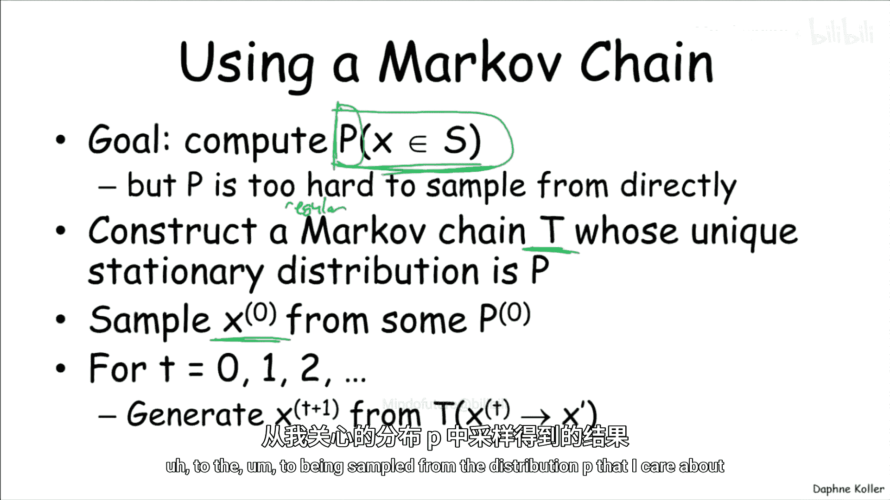
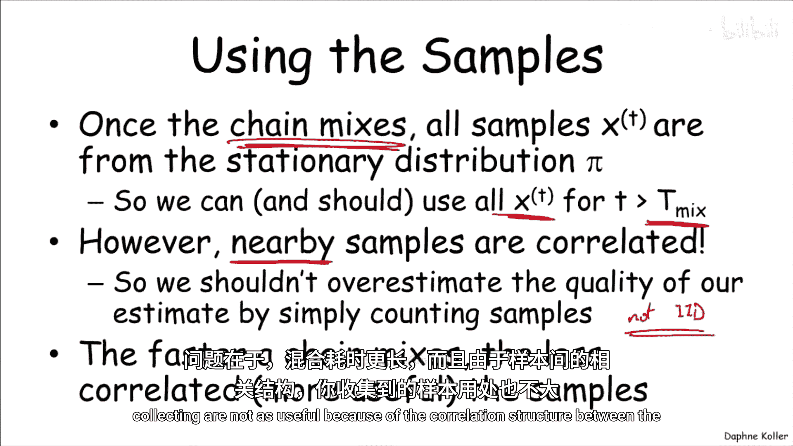
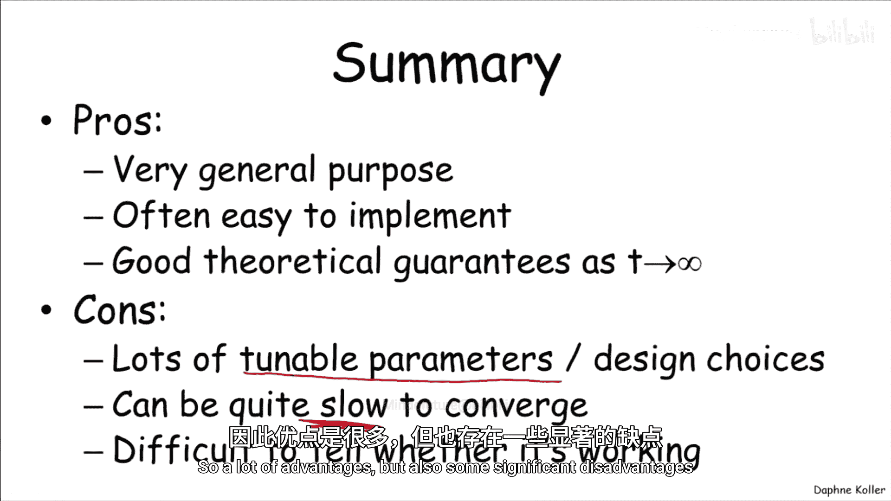

# 【斯坦福】概率图形模型2：推理 ｜ Probabilistic Graphical Models 2 Inference p23 P23_使用马尔可夫链_05_01_03 -BV1fY6VBBEyo_p23-

We previously defined the notion of a Markov chain that allows us to generate samples from an intractable distribution。

 but we left unanswered the question of assuming we have a Markov chain that has the desired stationary distribution。

 How do we go about using it in the context of a concrete algorithmic procedure。 Well。

 Let's imagine that somebody has provided us a Markov chain。

For a distribution- sorry imagine that our goal is to compute some probability relative to a distribution P。

But for whatever reason， P is too hard to sample from directly。And so how do I？

Use a Markov chain to get around that。First， we construct the Markov chain T。

 whose unique stationary distribution is P， so it needs to be a regular Markov chain usually。

And then we're going to generate samples from this distribution。

 so we're going to start out by sampling my initial state from some arbitrary distribution P0。

P0 is not the same as P so obviously I can't use the zero sample as a way of estimating an event relative to P and so what I do now is I start walking along the chain starting sampling X T plus1 from the transition model and because the chain converges to a stationary distribution。

 eventually I'll have a sample that is very close to。

To being sampled from the distribution P that I care about。

So now here's the sticky issue， and this is really a sticky issue。

When have we walked long enough that we could actually use our samples？

Because we don't want to use samples at the beginning， because they're far from P。

And so we need to walk around long enough for the chain to get close to its stationary distribution and that state is called mixing。

 so mix is when P of T is close enough。派。So that your time T distribution is close to the stationary。

 and that's the point at which I could say。Good enough， I can start collecting samples。

AhSo how do we know if a chain has mixed or not？And the short answer is you don't。And so this is。

 as I said， the sticky part of Markcotain methods。So in general。

 you can never really prove that a chain has mixed。But。😮，In some cases。

 you can show that it hasn't mixed。And then if you run lots and lots of tests and none of them have convinced you that the chain hasn't mixed。

 then you sort of resign yourself to assuming that it has in fact mixed。

 so how do you convince yourself that a chain hasn't mixed？You compute。Change statistics。

And we'll show some examples of that in a moment in different windows within a single run of the chain。

 So for example， here I have a single run of the chain。And I run for a while。

And then I look at little windows。Usually， they won't be this small。 and I compare this window。

To this window， computing various statistics， for example。

 what is the probability of hitting a particular state and I say。😊。

Is the probability of that in this window close to the probability of that in this window。

 and if it is， then maybe I've reached at least some kind of convergence point。

In terms of where the chain is reached。Now， this， of course。

 is not a sufficiently good answer because it could also be derived in a chain that has these sort of two very high probability regions。

But are very hard to get from each other。And if the chain is kind of ambling along in this part of the space and never hitting the other part of the space。

Then you're still going to get very similar probabilities across a window of a single run of the chain because all of the samples are taken from this part and none of them are ever taken from that part。

 and so we don't know that we haven't fixed。So a more reliable statistic is to take these statistical a more reliable evaluation criterion is to take these statistics across different runs that are initialized in different parts of the space。

 and then you might hope that one chain is traversing。😊。

One run of the chain is traversing this region and another run of the chain is traversing this region。

 and so now the statistics would show a difference and indicate that mixing hasn't taken place。

So what statistics might so might we do it？More concretely。

 so let's look at two examples here is two example runs of a chain that we'll describe a little bit later and what we measure here and this is the first statistic to measure in Markov chains is the log probability。

Of of a sample。So， you compute。The log probability of a sample。

 now you can't always compute the log probability directly you might compute an unormalized log probability as we'll talk about later。

But basically you compute the log probability or some constant factor thereof。

 and now you can compare to runs， and this is a run that's initialized from an arbitrary state。

 and this is one that's initialized from a high probability state。And you look at this and you say。

 has it mixed relative to this criterion， the answer is maybe。It looks okay。

 but you're not entirely sure。But we can look at other statistics。Oh， sorry。

 let's look at another example， what about this one？Here is again， an example of two runs。

 one of which is initialized from an arbitrary state and initialized from a high probability state and you can see that the log probability values are nowhere close to each other。

And so in this case， the answer is definitely not， these are two runs of the chain and really neither is mixed。

And so you need to run for a lot longer， which。You know this goes up to 600，000。

 so it kind of indicates to you how much time this might take。A different。Statistic。

 a different way of looking at this is for a different kind of statistic， so now we have。

 for example the probability relative to a window that we compute in the chain。

 so remember all of this is relative to a window in the chain。

After we hope that mixing has taking place and now we compute the probability that within states in this region。

 what is the probability of that the states are in some sets， so for example。

 the set of states where，X3 is equal to 2。And now we compute that statistic。

Using the two initializations of the chain， so this is chain one。Run 1。 And this is run 2。

 And now we do a scatter plot for。For different statistics。 So each of these points。

This is the probability say of x3 equals。X3 equals value 2。

 this might be the probability that x1 is equal to0。

 this might be some other probability that you x5 is equal to。7， and so each of these is a statistic。

 and what you see here is a scatter plot。One is the estimates that they get。

From the one chain and from the other。And looking at this。

It should be obvious that this first chain has not that we have not gotten mixing on the left hand side。

 because you can see that there are all these points here。

That have a high probability in one of the two runs and a probability zero in the other and vice versa。

Whereas here， most of the estimates。Are clustered around the diagonal so that you're getting similar estimates from the two chains。

And so again， is the first one is a clear no and the second one is。Maybe。

And if I do a lot of these statistics and they all come up with， maybe， then。

I'm willing to trust the answers and assume that mixing has taking place。

So now that I've started collecting samples， how do I use these samples？Well。

 one important observation to keep in mind is that once the chain is mixed。

All of my samples are from the stationary distribution， that is if Xt is from pi， so is xt plus 1。

 t plus 2， t plus 3， and so on and so forth。And so we can。

Use every single one of those samples because they are all from the correct distribution。

 So once I've determined that that I've sampled long enough for mixing or believe that I've sampled long enough for mixing。

 we should collect and use all of the samples。 And in fact there are you might read some papers that say。

 oh I'm only going to collect every hundred sample。

 there's actually papers that prove that using every single sample is better than collecting every hundred sample。

But then you might ask well， why would those papers tell me that I should only collect every1 hundred samples as opposed to collecting all of the samples if they're all from the correct distribution？

Because， and this is undoubtedly true， adjacent samples。

 ones that are nearby to each other in time are correlated with each other。

 because how even if xt is from the right distribution pi and so is xt plus 1。

 xt plus 1 is still going to be close to T， close to xt。

And so you're not really getting two different samples。

 you're getting two that are very close relatives to each other。Now， as I said。

It's important to recognize that phenomenon because it's important to realize that just because you've reached mixing and collected a000 samples doesn't mean you have a0 samples worth of information so you shouldn't go back and apply the apply the you know one of the bounds that we saw in assuming you have IID samples。

 the samples are not。IId。So。But that doesn't mean you shouldn't use them。

 using them is still better than not。Now， this is where you get bitten twice by the same phenomenon。

The worse the chain is to mix， so the longer you need to wait for the initial samples to be good enough。

 the more correlated the samples are because the slower you're moving around in the space in general。

 and so if a chain is bad it's bad in two different ways。

 it's bad because it takes you longer to mix and it's bad because the samples you're collecting or not as useful because of the correlation structure between the samples。

So to summarize。First， the algorithm and then the implications。

Here is how we would actually end up using a Markov chain。So first of all。

 I'm running sea chains in parallel。And I'm going to sample an initial state from each of them。

And then I'm going to repeat until I reach some determination that mixing has taking place。

And what I do is， I'm。Forward march each of the chains using a random walk process where I generate the T plus first sample。

From the teeth sample for that corresponding chain。

Then I compare window statistics of the type that we showed earlier in the different chains to try and determine whether mixing is taking place。

And then I repeat until I am confident in the mixing properties。With that。😮。

I now repeat until there's sufficient samples to collect data。

 so I start out with an empty sample set， and then for each of my chains， I generate a sample。

And I put it in my sample set。And I repeat until I have enough samples。And then， finally。

When I've collected enough samples。I can go ahead and compute the expectation in anything that I care about。

Whether it's an indicator function or a more complicated function。Summarizing the implications。

Markov chains are a very general purpose class of methods for doing approximate inference in general probabilistic models。

 not even necessarily probabilistic graphical models。

They're often very easy to implement because the local sampling that we're doing is often quite straightforward to execute。

And it has good theoretical properties as we sample。

 as we generate enough samples that are sufficiently far away from our starting distribution。

Unfortunately， these theoretical guarantees are very theoretical in many cases。

 and so this method also has some significant comms。😊，First。

 it has a very large number of tunable parameters and design choices， what's my mixing time。

 which statistics do I measure， how close are the statistics to each other in order for me to declare that mixing has taking place how many samples do I collect。

 what window size do I use to evaluate mixing， all of these are design choices they all make a difference and so there's a lot of finicky tuning that needs to be done when running an MCMC method in practice。

The second is that depending on the design of the chain。

 this can be quite slow to converge because it's very difficult to design chains that have good mixing properties。

And finally， it's very hard to tell whether a chain is working， that is。

 it's not straightforward to determine whether the chain has mixed and whether my samples are sufficiently uncorrelated with each other that I'm getting a reliable estimate of whatever it is that I'm trying to figure out。

So a lot of advantages， but also some significant disadvantages。

