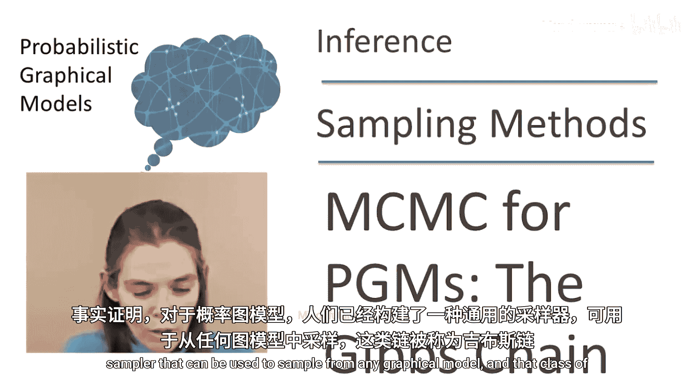
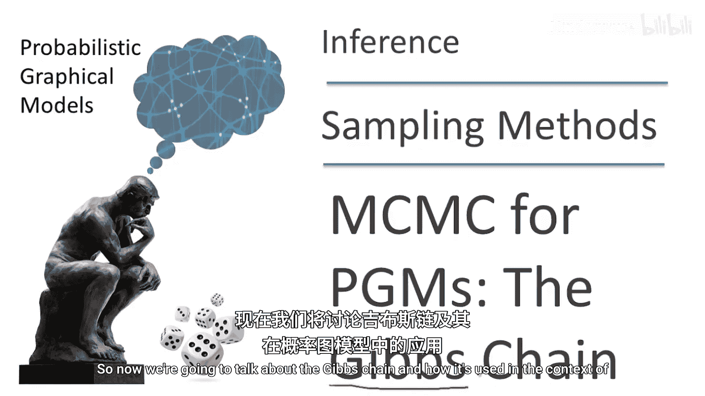
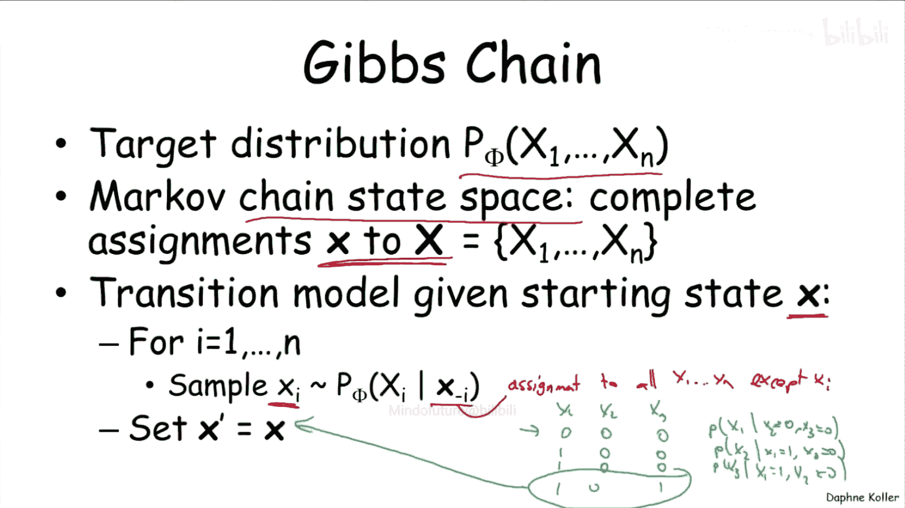
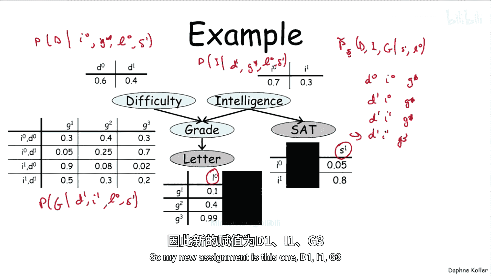
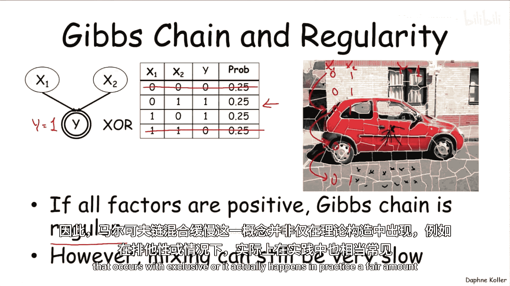
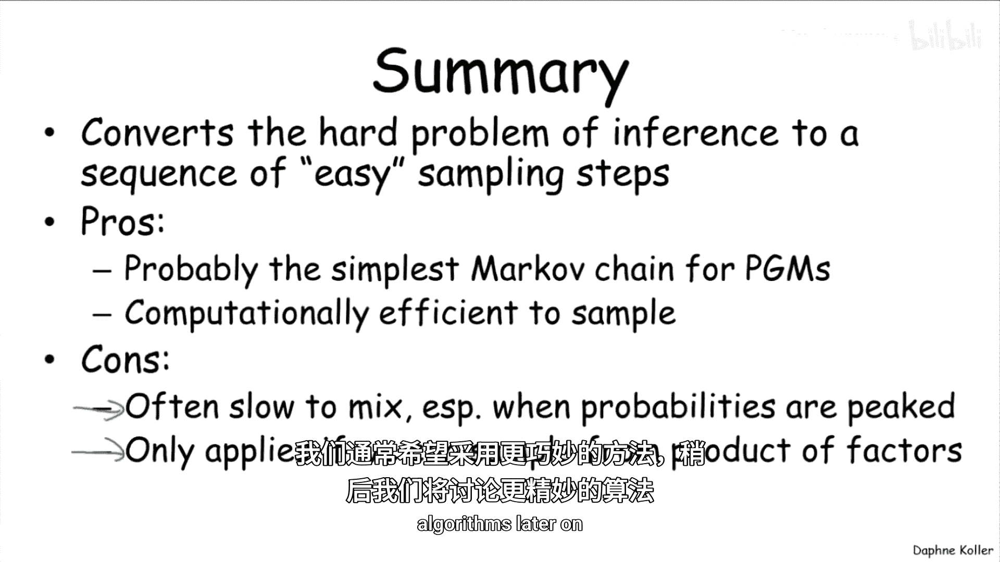

# 【斯坦福】概率图形模型2：推理 ｜ Probabilistic Graphical Models 2 Inference p24 P24_吉布斯抽样_05_01_05 -BV1fY6VBBEyo_p24-

We define a notion of a general Markov chain。 We talked about how certain conditions guarantee that if we sample from the chain。

 we achieve convergence to a stationary distribution。

 We then described how if we then generate samples from the Markov chain。

 We can use that to estimate properties of that stationary distribution like various statistics that we might care about。

 But the question of where the Markov chain might come from was left very vague。

 It turns out that four graphical models， people have constructed a general purposepo sampler that can be used a sample from any graphical model and that class of chains is called the Gibbs chain。

 So now we're going to talk about the Gibbs chain and how it's used in the context of graphical models。

So here our target distribution， the one from which we would like to sample。

 is the good old Gibbs distribution P of phi of x1 up to xn。

And just as a reminder that P of Phi can equally well represent a Gibbs distribution that we got from just a product of undirected factors。

 a Markov net style distribution， or it could as well represent a set of factors that we got from a Bayesian network reduced by evidence。

 so that is the factor set phi and everything that I'm going to say from now on is agnostic to where those factors Phi came from it came from a directed or an undirected model。

So now our Markov chain state space。Is a set of complete assignments。

 little X to the set of variables big X， so we're sampling over note an exponentially large state space。

 the space of all possible assignments of the random variables in our graphical model so those little circles that we saw when we were talking about Markov chains and we were going from one state to the other。

 each of these is now a complete assignment to X1 up to x。

So it turns out that the Gibbs chain is actually a very simple and easy to understand Markov chain。

And heres what it does， assume that I have a starting state little X。

What I'm going to do is I'm going to take each variable in its turn。Using some arbitrary ordering。

And I'm going to sample。A new value for that variable， given values for all of the rest。

 So let me introduce this notation。 This is an assignment。哦。X1 up to Xn。Except Xi。So for example。

 if we had three random variables， x1 x and x3， we would sample x1 given x ton x3。X2。

 given x1 and x3 and x3 given x1 and x2。Okay， so one at a time。So let me。

 let me draw that out because in order to make that clear。

 So here we would have here's my current assignment， let's say。Here's x1， x2。

X and let's say that we have0，0， zeros my initial assignment。So I'm going to start by。

Sampling X1 from the probability of X1 given。X2 equals 0。And x3 equals 0。

And let's say I end up with one。The other two haven't changed yet。I now sample。From P of x2。

 given x1 equals the new value 1。And x3 equals 0。And say that stay zero。Does't。Could。

And then I sample x3。From X。The probability of x3， given x1 equals 1 and x2 equals 0。

And say that changes。To the value1。 And so now this。Is my new assignment 101？

Which gets instantiated into X primeme。That is a single step of the Gibbs chain。It goes， and。

Potentially mod doesn't have to modify because you might end up staying in the same assignment。

Reamples every single variable in its turn， and when all of them are done， that's my new state。

So let's do this example in the context of a real graphical model。

 so here is the good old student Bayesian network and I'm assuming that I have observed two of the values for two of the variables so I've observed L equals L0 and S equals S1。

And so now I have a product of reduced factors that represent the evidence that I've received。

 And only three variables are now getting sampled because the other two are fixed to their observed values。

 So now I'm sampling from。P of Pilde of Phi。 I mean， I'd like to sample from Pilde Phi of D。

I G given little S1 and L0。And so what I'm going to do in this sampling process is I'm going to start out with some arbitrary assignment to these three variables。

 D I and G。 So， for example， since it's arbitrary D0， I0，G0。And now I'm going to go ahead and sample。

Each of these in turn。 and so I'm going to initially sample D。From。Of the。Givenive。I。0ero。G0。嗯。S。

 L0 and S1。And we'll talk about how that's done in just a moment， and that might give me D1 I0。G0。

 and now I continue， and I might sample I。 So I'm going to sample I from probability of I given D1。E。

0。L 0， S1。 And say， I end up with I 1。Finally， I sampled G and it couldn't be G0。

 I apologize because G only goes123， so let's say it was G1。

And now I sample G from the probability of G。Okay， so this was G on here， too。

And this is the probability of a mouses G from the probability of G given D1。I1。

 because that's where I am right now， L0 and S1。They end up with G3。 so my new assignment。

Is this one， D1， I1， G3。

So how do I do this in a tractable way？So here is the trick that， I mean， you might say well。

 you're dealing with this intractable distribution。 I mean。

 you've just moved the problem from the original problem that we had to computing these conditional probabilities。

 Why is that any easier， Well， turns out it is。So let's look at the sampling step over here where I sample Xi from this conditional distribution。

 let's break that down into its constituent definitions。So this distribution。

 this conditional distribution is a ratio。Between the joint distribution。Of。The value X I and those。

Stuff on the right hand side of the conditioning bar divided by the stuff on the right hand side of the conditioning bar。

Now， importantly。Because each of these is an unnormalized measure divided by the partition function。

 the partition function cancels， and so I end up， so if I had a1 over Z here。

The 1 over Z cancels and I end up with the ratio of two unnormalized measures。And the point。

Being now that this。Is。A complete assignment。And therefore， is a product of factors。

So let's look at that in the context of a concrete example and see how that might help us。

So now we're doing an example that's a Markov network in order to demonstrate that this is equally applicable to both。

 so this is our good old misconception network where we have these four factors， Phi1， phi 2。

 phi3 and phi4。And。Let's imagine that we're trying to do p Phi of A given BC C and D。

And we can see that what we have here is pildephi of ABCD。Divided by the sum over a prime。

 and I'm using a prime。To distinguish it from this A over here just to avoid ambiguity。

 P tilde of sum over a prime， P tildehi of a prime BD。Now Im going to。

 since each of these Ptels is a product of factors。

 I'm going to inject that product of factors into each of the numerator and denominator separately and so over here I end up with phi1 of AB times phi 2。

 BCC， phi3 cD， phi4 AD and similarly I end up with exactly the same form of expression and denominator except that I sum out over a prime。

And。What。😮，Do we。Determined by looking at this expression。Well。

 some things are immediately jumped to one's eye， which is that Phi 2 BCC appears in the numerator and in a denominator。

 and therefore I can cancel it。And similarly， with Phi3 of CD。

And so what I end up with here is a product of just two factors， Phi1 of AB and Phi4 of AD D。

Which are the two factors。Then involve a。Well， that's for the numerator， what about the denominator？

Well， the denominator is just our good old normalizing constant。

So really what we have here is that this is proportional to。5 one。Of a。Little B。Times 5，4。Of a。

 little D。So this is a factor over a that I can compute by multiplying two singleton factors in this case over a。

Multiply them together and renormalize and I get a distribution over a from which I can sample。

 and we already talked about how to sample from a discrete distribution。

So what is the computational cost now of this algorithm？

The sampling step for X given all of the others。Is simply this expression over here。

 which is proportional to a product of factors？And not just any old product of factors。

 but just the factors。That involve。Xi。Inve。Just the factor is a hevoc sign in its scope。

Which means that I only care about XI and its neighbors in the graph。

 which for a large graph with tens of thousands of nodes can be a considerable savings。 so only。X。

 I and its neighbors。So do we like the Gibbs chain， We've certainly defined it。

 Does it have the properties that we would like it to have。Well。

 the answer is unfortunately not always， so let's look at， and specifically it is a regular chain。

 do we have guaranteed convergence to unique stationary distribution。

So the answer is unfortunately not， and to that we're going to return to our old enemy。

 the exclusive or network， which as I said in other examples is the counterex to pretty much anything is exclusive or。

 so let's look at the exclusive or network， so here we have Y which is the exclusive or of x1 and x2。

And let's imagine that I observe。😊，Y equals。one。And so， these two。Disappear。

And now I'm going to try and sample。X1 and x2， which I should be able know if。If I were so lucky。

 I would get that each of the two possible states for x1 and x2 occurs with probability a half。

So let's imagine that I start out with this one。And I'm going to now sample x1 given x2 and Y。

 So I have my initial state is 0，1。For x1 and x2。 And， of course， y equals1 is my evidence。

 And I'm going to sample。I'm going to sample x1 given x2 and Y。And that is a deterministic。

Depenence and the only possible value that I get is zero。For X1， well。

 am I going to have any better luck with x2 nope？I'm going to end up with exactly the same zero1 that I started out with。

Then I can do the exact same thing again and you know what。

 it'll work the same way every single time， and I will always end up with01。Conversely。

 if I start out with10， I will never leave 10。 So this is a classical example of a non mixing chain。

On the other hand， if all factors are positive。That is。

 if there are no zero entries in any of the factors。

 then you can show that the Gibbs chain is regular。Now， however。

 it's important to realize that regular doesn't mean good。

So I can make this chain regular by adding a tiny probability epsilon。

Of having why not be the exact exclusive or of x1 and x2。

So now the chain is regular because all possibilities have probability non zero。

And it's still going to mix extremely slowly for values of epsilon that are small。

So regularity remember， is a very weak condition， it says if you sample long enough。

 we will eventually converge， but it doesn't mean it'll happen in a reasonable timeframe。😊。

And one such example of a very slow tom chain actually occurs in practical applications。

 so here is one example here it's an example in our image segmentation domain and imagine that we're trying to resample。

 say the class of let me use a different color of this superpixel here and that we have some fairly strong potentials that tell me that the class of this superpixel should be very highly correlated with the class of its adjacent superpixs because of the appearance being very similar to each other。

 because I have some so I have a pairwise Markov network with some very strong potentials that try and enforce consistency between adjacent super pixels。

So if it turns out that for whatever reason， my initial assignment was actually wrong。

 so for example what is often an error mode for sub segmentegation models is that is that road is often labeled water or sky because the appearance is actually kind of a similar grayish kind of appearance。

 so say that for example， if I happen to label all of these superps as say water。

And now I'm going to use Gib sampling。None of them are likely to move away from their current assignment because each of the super pixels is really constrained by strong pairwise potentials with its neighbors and so this notion of slow to mixed Markov chains is not just a theoretical construct that occurs with exclusive war。

 it actually happens in practice， a fair amount。

So to summarize， what GiB sampling does is it takes the very challenging problem of inferenceferencing a Gibbs distribution and converts it to a sequence of E sampling steps where each sampling step samples one variable given all of the others。

This method has the advantage that it's probably the simplest Markov chain for probabilistic graphical malls。

And it's very efficient to compute each of the different steps。

The cons are that it is actually very slow to mix when the probabilities are peaked and variables are very highly correlated。

And it's only applicable in cases where we can sample from a product of factors now we could always do that in a discrete graphical model if our factors aren't too large。

 but if our samples are but if we have， for example， either very densely connected。

Say Markov network， or we have one with continuous distributions where the。

Product of factors isn't something that has a nice parametric form that we can sample。

 Gib sampling might not actually be applicable。And so there is nontrivial limitations to the applicability。

 of gib sampling， and even when it applies， it is actually very slow to mix and we often want to do something more clever and we'll talk about more clever algorithms later on。

