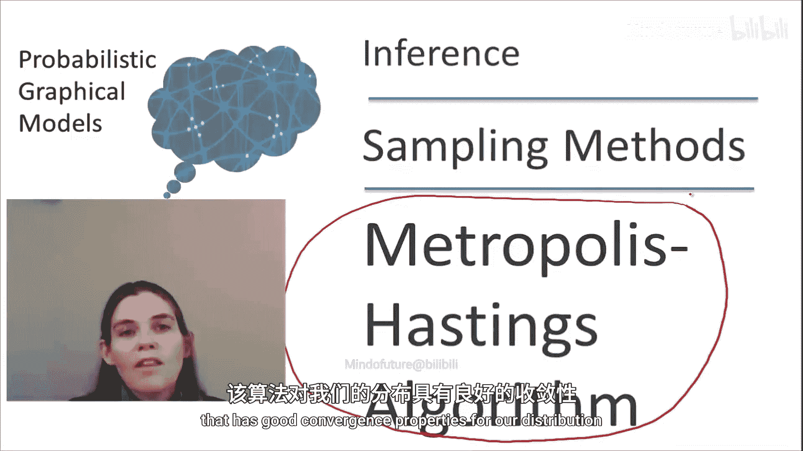
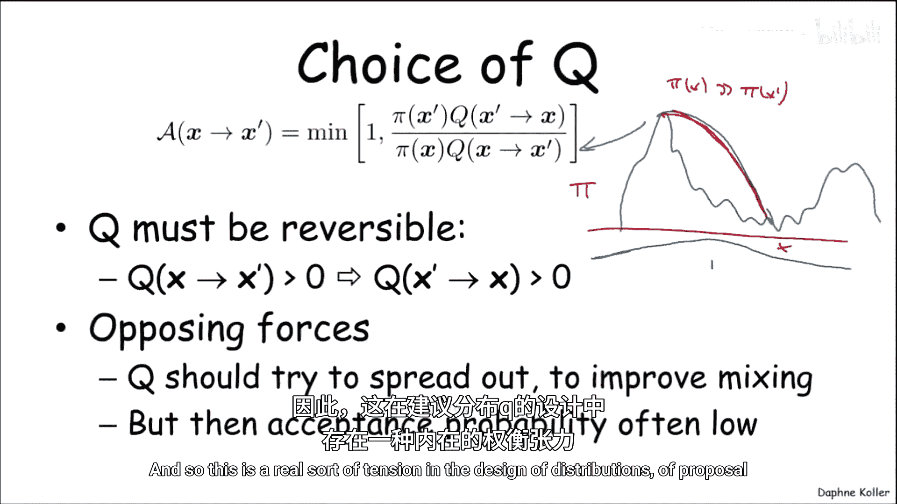
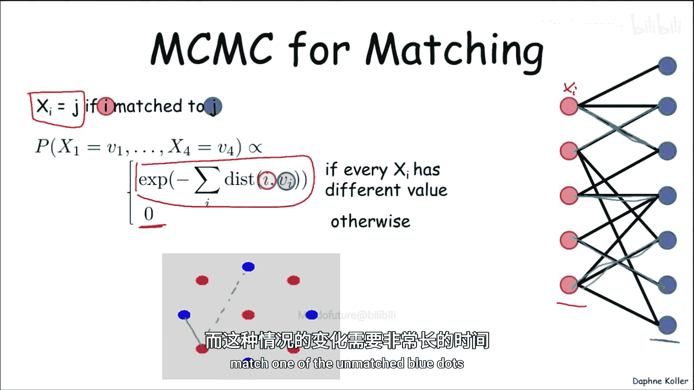
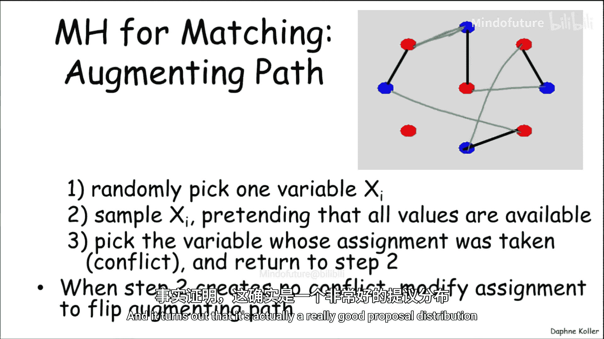
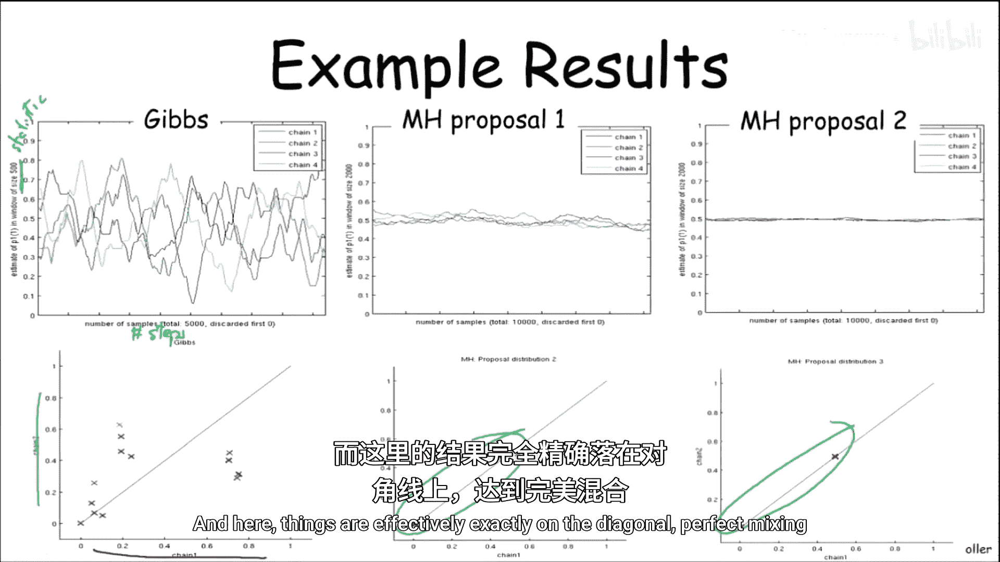
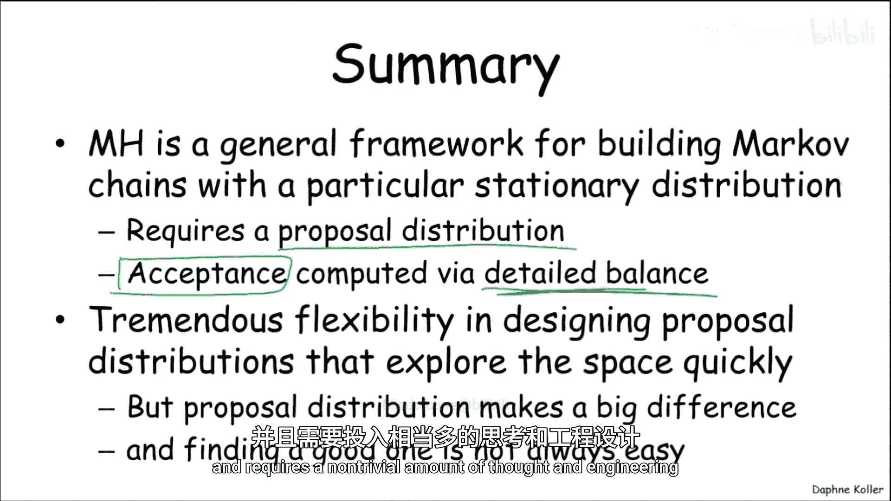

# 【斯坦福】概率图形模型2：推理 ｜ Probabilistic Graphical Models 2 Inference p25 P25_梅特罗波利斯-黑斯廷斯算法_05_01_05 -BV1fY6VBBEyo_p25-

We define the notion of Marcochein Montete Carlo sampling as a general paradigm for generating samples from a distribution from which it is otherwise difficult or perhaps intractable to generate samples directly。

Marovchas gives us a general way of approaching this problem but the framework leaves open the question of where the Markov chain comes from that is how do we design a Markov chain that has the desired stationary distribution we talked about the Gibbs chain as a general solution to this problem in the context of graphical models but we also mentioned that the Gibbs chain has limitations in terms of its convergence rates for certain types of graphical models So what happens if we have a graphical model for which the Gibbs chain doesn't have good convergence properties。

 how do we design a Markov chain for that。Well it turns out that there is a general class of methods called Metropolis Hastings and the Metropolis Hastings algorithm gives us a general approach for designing a Markov chain with a desired stationary distribution in fact for given stationary distribution we can construct a whole family of different Markov chains that explore the space differently and then try and select among those or construct one among those that has good convergence properties for our distribution。

So the key insight behind the metropolis Hastings method is the notion of a reversible chain。

 so what does it mean for a chain to be reversible？

Imagine that we have a chain with a particular stationary distribution pie。

And we're going to consider two different experiments。In the first experiment。

 we're going to pick a point in this space， we're going to a point in the state space。

 according to the probability distribution pi， so saving land on this one。

And then we're going to pick a random edge emanating from the state that we picked according to the transition model defined by the chain T。

 so say we picked this edge， so that's the first experiment。

The second experiment is exactly the same thing。 We're going to basically do this experiment twice。

 so now we're going to pick。A。ate， and once again， we're going to pick。An outgoing。嗯。

Transition from that state。A chain is reversible if when I do this experiment。

 the probability of traversing this edge， this red edge。

Over here is in this process is exactly the same as the probability of traversing this green edge in the other direction。

 that is if picking I and then traversing to J occurs with the same probability as picking J and then traversing to I。

So written in mathematical notation， this tells us that pi of x。

 which is a red state times the transition along the red edge。

 is equal to the probability of x prime that was my green experiment times the probability of transitioning in the opposite direction。

Now it's very easy to construct Markov chains that are not reversible。

 so this is by no means a universal property of Markov chains。

 but it turns out that reversible Markov chains have elegant properties that allow them to be constructed so as to give rise to particular stationary distributions。

And specifically， we can show- and it's not a very difficult proof we'll show in a moment that if this equation。

 which is called the detailed balance equation，If this equation holds。

And T is a regular Markov chain， then T has a unique stationary distribution。

 which we know from the fact that it's regular， but furthermore that stationary distribution is pi。

Let's go ahead and prove this， and it turns out to be actually a very online proof。So here we have。

 we take the two sides of the detailed balance equation， and we put one of them。

On this side and the other one。On this side， and because the two sides are equal。

 if we sum up over x， then the two summations are also equal。

And now we notice by looking at the right hand side that pi of x prime。Doesn't depend on the sum X。

Or on variable x， and so we can move pi of x prime out of the sum。

And so this can now be rewritten as pi of x prime。Times sum over x T of x prime。X。诶。And this。

Tation over here。Because T is a probability distribution over it outgoing over the edges that are outgoing from x prime is necessarily equal to1。

And so if we rewrite what we just proved in this one line derivation。

 we just proved that the thumb over x pi of x t of x to x prime is equal to pi of x prime。

 which is exactly the definition。Of the stationary distribution。

So this is a one line proof that a reversible chain gives me chain that is reversible relative to a particular distribution pi necessarily has pi as a stationary distribution。

Now， why is this a useful transition between the definition of the stationary distribution pi in terms of this equation down at the bottom versus this alternative definition of the stationary distribution pi？

Because this distribution， this definition down at the bottom involves the summation over what is in general an exponentially large space。

 whereas this one。I as we'll see in a minute， much more constructive in that it allows us to construct tea so as to match pie。

And so that is exactly the idea behind the metropolis Hastings。

 the definition of the metropolis Hastings chain。So how does the metropolis Hastings chain work？

Starts out by saying。Well， we want to move around broadly in the state space。

 and so we're going to have a distribution queue， which is kind of like a transition model。

So proposal this is my distribution Q and Q is going to sort of roam freely over the state space unlike the Gibbs chain is not going to necessarily just take little local steps from one state to a state that's very nearby it can look very far away and go into large into very distant parts of the state space now that by itself of course is just going to give me a stationary distribution that has absolutely no relationship to the stationary distribution pi that I care about and so what I'm going to have is a critic the critic is the guy says well wait a minute you can' go there right now because doesnt thiss not going to give you the right stationary distribution。

So what does the critic do， the critic listens to the proposal that was made by the proposal distribution Q。

 so it says， oh， you want to go from x to x prime， well what is the probability with which I'm going to let you do that？

So that's the acceptance probability。And that's a binary random variable for each x and X prime。

 what is the probability that we accept that proposal？So that gives rise to the following process。

 I haven't told you how to pick Q or A or anything yet。

 but let's just understand the process and each state X we sample。

A potential successor state x prime from my proposal distribution Q， so x。

 and we sort of have a proposal to go to x prime and I denoted this using a dashed line。And now。

 the acceptor says。😊，Do I accept that and if the proposal is accepted？

Then I actually make that transition， and if the proposal is rejected。I just stay where I am。

So what transition model does that give rise to because ultimately this just gives us a transition model from x to x prime so there's two cases case number one is if x is not the same so x prime is not x that is x prime is a state other than x。

Well， in this case， the only chance that I have of moving to X prime is if I proposed。

To move to X prime。 and if that proposal was accepted。

 so I need to multiply these two probabilities and that gives me the expression。

This expression for the transition。What about transition from x to X？Well。

 there's two different cases， either I proposed the move to X， and it was accepted。

Or X also get the benefit of all of the transitions that were rejected from other states that were proposed。

 but where the move wasn't accepted。And so what we have here is Q。of x to x。

 which we assume is always accepted， that's sort of one of the assumptions in this model。

 and then we sum up over all possible other transitions of the probability that they were proposed times the probability that they were rejected。

 which is one minus the probability that they were accepted。That gives rise to a transition model。

So this is a general definition of a Markov chain， but as stated。

 there is no reason to expect it to have a particular stationary distribution。

And so now this is where we bring back the intuition from the detailed balance equation。

 and we're going to use the detailed balance to construct an acceptance probability that has the property that we want。

And so here is a detailed balance equation rewritten。

And now let's write down and we're going to assume in this particular example that x is not equal to x prime。

 and so we're going to， because this is trivial for the case， x is equal to x prime。

 this equality always holds， pi of x t of x x is equal to pi of x t of xx。

And so let's look at the case x is not equal to x prime。And our goal is to construct a。

So the goal is to construct a such that。Such that detailed balance。Hold。Or。Q。I'm giving Q。

 the setup is I'm giving a proposal distribution queue。

 and now I'm going to pick a so as to make detailed balance hold。

And if detailed balance holds for Q comma pi， then that is going to guarantee that the process overall has the correct stationary distribution。

So this is the equality that we want to have happen。

And now let's go ahead and just define this as a constraint on the acceptance probabilities。

 so we have acceptance probabilities a occurring on both sides of the equation。

 so I'm going to divide， move both a's to one side， move everything else to the other side。

 and so I get a constraint on the ratios between the acceptance probability from xx prime and the acceptance probability from x prime x。

 and that has to be equal to this ratio over here。And so I'm going to assume without loss of generality that this ratio。

 notice that we can decide this in any way that we want。

 we can either consider the ratio from x to x prime as the numerator or from x prime to x。

 I picked this one under the assumption that this is some value row， sorry this is equal to rh。

 which is less than1。不是。And so now。If we。Pick a。So now we need to pick the values of the two acceptance probabilities。

 x and x prime so as to make。This equality hold， and one simple way to do that is to take the smaller of the two。

 which we assumed was the numerator and we make a。Of x to x prime equal to rh。

And we make a x prime to x。Equal to one。And that gives me immediately that this strain holds。Now。

 of course we could have picked these probabilities to be otherwise， we could have picked。

 for example， a x to x prime to be half of rh and a of x prime to x to be equal to half。

 but notice what that would do that would just reduce the probability that our proposals are accepted。

 which would just make the chain move half as quickly because you end up staying at the same state twice as often as you would if the acceptance probability was higher。

 so these are in fact the highest numbers that we could possibly pick while still making this ratio constraint hold。

And so that gives me when you actually put it together as a general formula for the acceptance probability。

 it gives us this expression， which if you look at it。

 you will see that it gives the right values for both Xx prime and for x prime X。

So that tells me how to pick a given Q and the question is what about Q。

 how do I pick Q Well that turns out to be the $64 million question。

 picking Q is an art and it's not an easy choice in many applications。

 but let's think about some conditions the Q must satisfy before we think about how to pick one。

So one condition on Q is derived simply by looking at the form expression for A。

And we can see that this here involves a ratio。And if you have a ratio。

 then one condition is that you better not have a denominator that's equal to 0。

And so one of the cases that one of the things that we must guarantee regarding Q in order for this to be a valid set of acceptance probabilities is that Q itself must be reversible in the following sense。

 that is if the。If the denominator， if， if the numerator is greater than 0。

 then the denominator is greater than 0 and vice versa。 That is， if you can propose a。

Step from x to x prime， you better be able to propose a step from x prime to x with nonzero probability。

 which guarantees that this ratio is always well defined。Now。

 the problem with constraint on Q is that it actually induces an attention in the design of Q。嗯。Now。

 on the one hand， you'd like Q to be very broad。 So if you're at this state over here。

You'd like you to sort of go really far away from a current state because the further away you can go。

 the faster you move around in the state space， you don't want to stay local。

 you don't want to make the same mistakes that the Gibbs chain does by staying very near to the current assignment。

 you want to move around quickly and that improves mixing。On the other hand。

 if you look at the implications that this formula has when the proposal distribution is very broad and so that you have one state that for example。

 has low pi and the other state has a very high value of pi。

Which is what you get when you move around from a hilly part of the space。To a low part of the space。

 you have very big differences。In terms of the height of the two。Stationary。

 so what I'm drawing here is the height of pi， and this is my state space X。

And if I move around very far， I'm liable to get into situations where pi of one state x might be considerably larger than pi of x prime。

 and if you think about what that implies regarding the acceptance probability。

 the acceptance probability can get very， very low， which in turn。

impmplies slow mixing again because might you might be taking very global steps but you're taking very few of them。

 and so this is a real sort of tension in the design of distributions of proposal distribution cu。

So's take an example of a Markov chain where proposal distributions can make a very big difference。

 and this is a problem that you wouldn't necessarily immediately think of as a graphical model but can be formulated as one and it's a matching problem and we'll see it in other settings as well。

So here we have a bunch of red dots as we see over here and we have a bunch of blue dots and we want to match the red dots to the blue dots and there is some sort of preference function。

 so these edges over here are annotated and I'm going to mark in green are annotated with some kind of weights that tell us how happy is this red dot to be matched with this blue dot。

And this happens a lot， for example， in various correspondence problems where we're trying to match sensor readings to objects。

 for example， in a tracking application， it also happens in image problems where you want to match features and one image features another。

 so it's a very common problem。So one formulation of the matching problem as a graphical model is that we have a variable  X for each red dots。

 so the red dots are going to be the variables， the blue dots are going to represent values。

 and we're going to have that Xi is equal。To J， if I match the I to J。Yeah。

So that can now be written as a probability distribution。Over a space。

And so we can consider the probability of。An assignment of。Values to。To variables。

 and we're going to say that， first of all， it has to be a matching。So if we don't have that every X。

 every red dot is matched to a different blue dot。That's probability zero assignment。

So this would be the case if you had two red dots that matched。To the same blue dot。And otherwise。

 we're going to define。Some kind of weighted combination of sorry。

 it's going to be an exponential of the sum of the quality of the matches between the red dots and the blue dots。

So we're summing up the quality of the edges that participate in the matching， so for example。

 if this is my matching over here。And notice that I didn't get to match all the red thoughts。Well。

 actually here， I'm going to match all the red thoughts。So now we have a matching。For each red dot。

 we assign the blue dot as a value。But now， the。Now the overall quality is the total sum of the。

Of the quality of the matching and that defines and that can be exponit to define a probability distribution。

So。And we're going to represent these qualities visually in this example as distances so that we're going to assume。

 for example， that this red dot prefers to be matched to this blue dot more than it prefers to be matched to this further away blue dot。

So one can imagine running a Gibbs sampling distribution on this model by taking a variable and say one of the red dots。

Picking a new value for it that is a new blue dot that it wasn't matched to。

This is going to change things very， very slowly because most of the blue dots。

Are going to be taken by a different red dot。 And so those assignments where red dot is matched to a previously taken blue dot are going to have very low probability。

 zero probability。 In fact， And so those are going to be impossible。

 So the only thing I can do is I can make the red dot match different blue dot。

 but match one of the unmatched blue dots。 and that's going to take a very long time for things to change。

Here is a different way of doing this， which is the metropolis Hastings。

 which is one way of constructing a proposal distribution and using metropolis Hastings and that's called an augmenting path proposal distribution so what that does is let's assume that this is my current match I'm going to define the following proposal。

I'm going to pick one。Of the variables， Xi， say this one。And I'm going to say， I'm going to pick。

Another value for it pretending that everything is available。

So I'm going to ignore the fact that this guy is already matched。

 and I'm going to pick this one with I'm picking it probabilistically， so I could have picked。

A different one， I could have picked the same one that I was matched to before。

 I could pick a further away one， but I picked this one。Well， now this guy， poor guy。

 this one is unmatched。So， this red guy over here， so it has to pick an new partner。

And so say it picks this one。This red guy is unmatched now。

 and so it might pick one and say it picks this one。

And that leaves me with this red guy and say this red guy picks this one and notice that now I have a new legal matching。

Every。I've closed the loop and I've defined what's called an alternating cycle。

Where basically I can switch all of the black edges to green edges。

And that gives me a new legal matching。And that's my proposal。

And with a little bit of a numerical calculation， one can figure out the acceptance probability for this proposal distribution。

 and it turns out that it's actually a really good proposal distribution。

 so let me show you some examples on the next slide。

So， this is。The results on the chain， if I just apply Gib sampling。

And you can see over here four chains， so the four colors represent the four chains and what you see on and the X axis is number of steps。

And on the Y axis is some kind of statistic。That I'm tracking in order to gauge whether the chain is mixing as it happens。

 it's the probability that the first red dot is matched to the first blue dot but it doesn't matter any statistic would have illustrated the point here。

And you can see that。There's a lot of long range fluctuations in the chain。

 that is the probabilities change over time， the probabilities。

 by the way are computed over windows of size 500。From the samples in that window and you can see that the chain shakes。

That the chain takes a long time to move from one region of the space to the other。

The proposal distribution that I just showed you by contrast is totally different。

 you can see that the probabilities are almost totally flat and that there's basically all four chains are the same and there's almost the same and there is very little change in windows over time。

And there's an even better proposal distribution that I didn't show you that modifies the augmenting path by just a little bit。

And that gives you effectively。Perfect mixing across the entire time。

If we look at the other metric that we defined for evaluating mixing。

 we can compare the probabilities of these different statistics of different statistics across the two chains。

 so for example， this might be just for example， the red chain。

And this might be the green chain and what we see here are the statistics that you get for different kinds of probabilities for the probability that this variable is match this dot is matched to that dot for example。

 and you can see that the gibbs chains， the estimates that you get are very noisy and the different chains give you divergent estimate。

 the second metropolis hasting sorry the first of the metropolis hastings gives you things that are almost on the diagonal and here things are effectively exactly on the diagonal perfect mixing。

So to summarize， metropolis Hastings is a very general framework for building Markov chains so that they are designed to have a particular stationary distribution。

It requires that you come up with a proposal distribution and that proposal distribution needs to have certain properties in order to be valid。

But once you give me such a proposal distribution， the detailed balance equation。

 which is this nice simple equation， tells me how I can construct the acceptance distribution so as to enforce the fact that we get the right stationary distribution。

😊，So this is great in some ways because it gives us this huge flexibility in designing proposal distributions that explore the space quickly and move around to faraway parts of the space。

 But as we saw， picking the proposal distribution is actually an important design point and it makes a big difference to performance。

 and it's not there isn't like a science of how you should do this effectively。

 and so there are and so this is something that is really an art and requires a nontrivial amount of thought and engineering。

😊。

