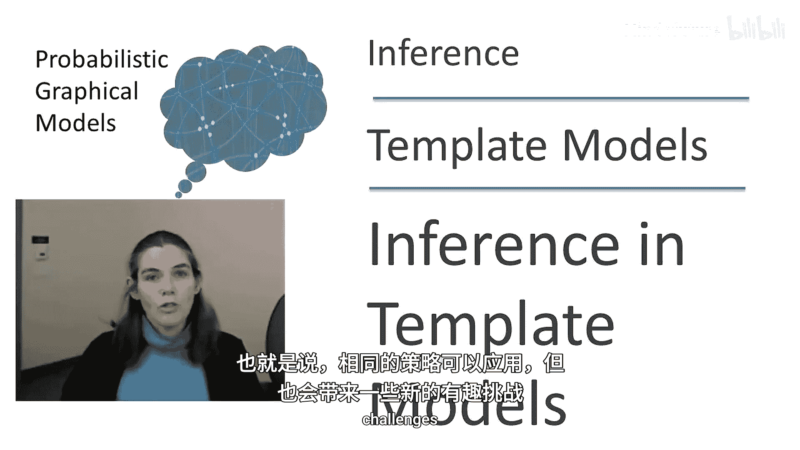
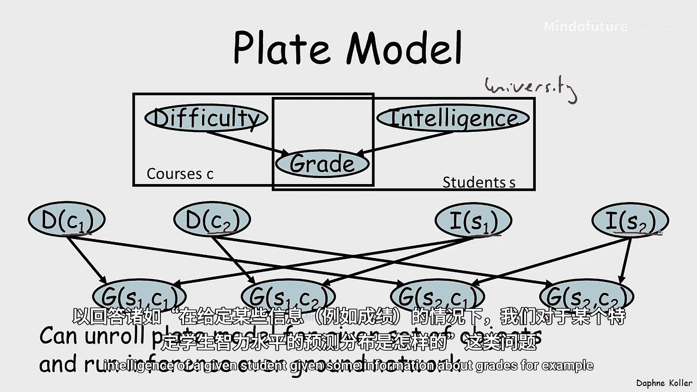
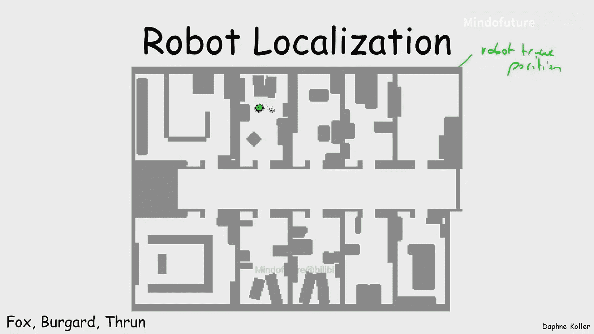
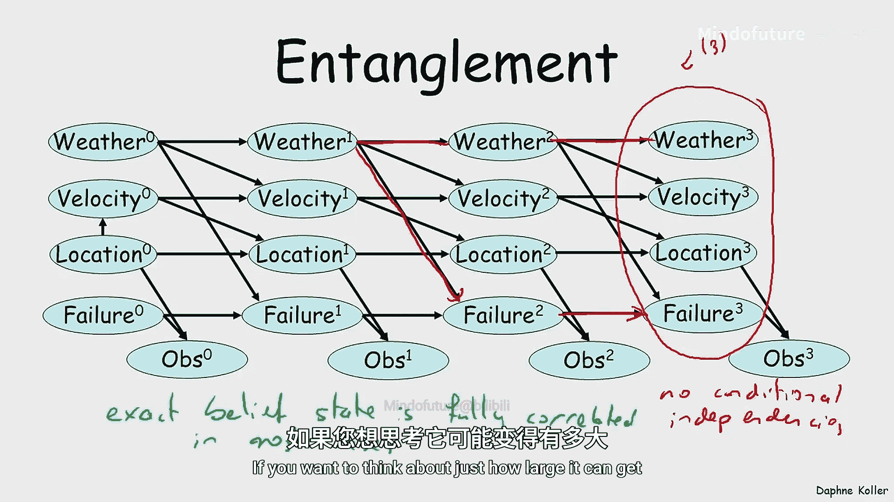
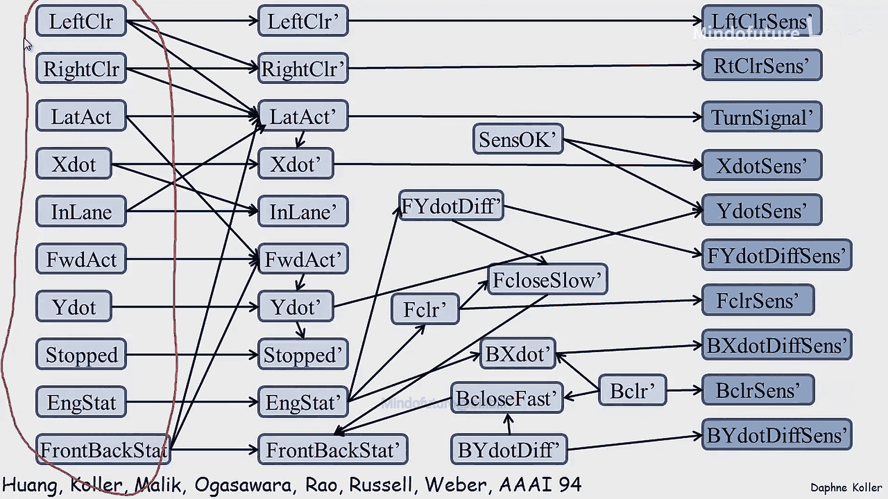
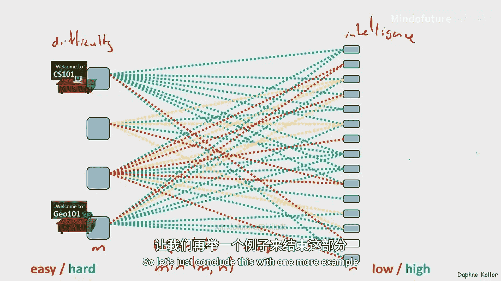
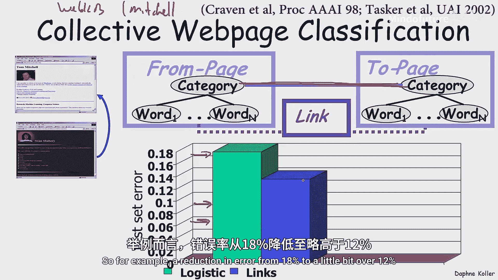
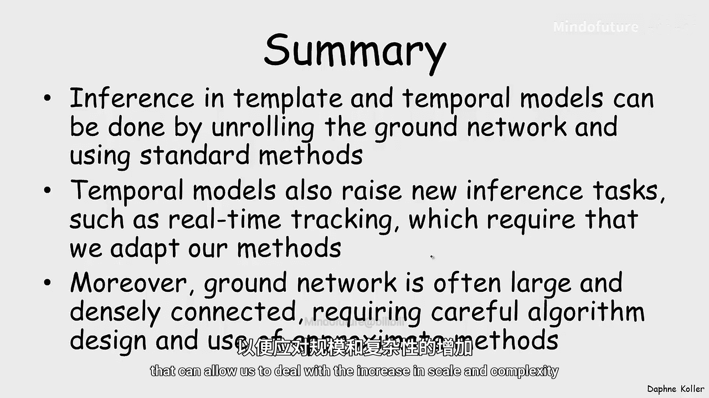

# 【斯坦福】概率图形模型2：推理 ｜ Probabilistic Graphical Models 2 Inference p26 P26_时序模型中的推断_06_01_01 -BV1fY6VBBEyo_p26-

So over the course of the last few lectures， we've talked about a number of different inference strategies and how they might be applied to a range of different graphical models。

One question that comes up is whether the same strategies can be used for the kinds of template based models that we defined earlier in the course。

 models that are defined via say dynamic Bayesian networks or via plate models or one of the other representations that uses repeated structure。

So as we'll see， the answer to that is both yes and no， that is the same strategies can be applied。

 but there are also some interesting new challenges that arise from this。

So first let's remind ourselves of how， for example， a dynamic Baynet is specified， so as a reminder。

 dynamic Baynet is specified using a initial time zero distribution which is usually a Bayesian network is well as the to TBBN that tells us the transition model and it's certainly the case that one can take those two pieces and construct and unroll or ground Bayesian network and once we've done that that ground Bayesian network is a Bayesian network just like any other and so whatever inference techniques we have developed for answering queries for any Bayesian network can be used in this context as well so specifically once we unroll the DBN for given trajectory length we can run your favorite inference algorithm over the ground network to answer questions such as what is the location of the car at time two given whatever evidence we might be we like to give it so observations up to time two or observations for the entire。

Duration of the sequence。The same thing happens when we look at plate models。

 if this is the simple plate model that we've done for a university example where we have students and courses and grades。

 then we can unroll that network to produce a ground network over a subset of students in this case。

 it's a very simple example to courses and to students and that unrolled network is once again a Bayesian network just like any other。

 and so we can run inference over that network to answer questions about what is our predicted distribution over the intelligence of a given student given some information about grades for example。

😊。

What are some of the challenges though So part of the difficulty or new dimensions that are offered by some of these models is the fact that they establish new problems this is particularly true in the context of temporal models where we might often be interested in what you might call belief state tracking that is keeping track over the state of the system as it evolves Now in some ways this is just a traditional probabilistic inference task because it corresponds to asking what is our probability distribution over the state at time T given the observations that the agent has had access to up to time T so this over here what we see is01 colon T is just a shorthand 401 comma02 up to Ot。

And so this is an inference task that can be answered using standard probabilistic inference techniques over the unroll network。

 but there is a challenge that needs to be addressed if we want to keep track of this probability distribution over the course of a long trajectory without having a potentially unboundedly large network that we have to keep running inference over。

So it turns out fortunately that one can do this in a dynamic way without keeping track of the huge unrolled network at all points in time and this just comes directly out of the consequence of the Markov properties of the graphical model So specifically we're going to do this is a two stage process where the first thing we're going to compute is this sigma dot t plus1 and the position of the dot indicates that although it's a distribution over the state at time t plus1。

 it's a distribution that doesn't take into account the time t plus1 observation and so this is defined to be as written here。

 the probability of the state of time t plus1 given the observations up to time T and so now we can do fairly straightforward manipulations of this probabilistic expression So the first thing is we inject S of T into the righthand side of the conditioning bar and sum out over it。

 So this is now probability of S T plus1 given st and。

obbservations up to time t times the probability of ST given the observations up to time t。

 and now we can apply inencies that arise from the structure of the graphical model。

 and specifically the fact that the state of time t plus1。

 is independent of everything that occurred before given the stateta time T。

 which is going to allow us to use conditional independence to basically simplify the expression as follows。

 just the probability of ST plus1 given SFT， which is just our transition model。And the second term。

 which is probability of S of t given01 to T。 This is just our previously computed belief state as it's called the sigma T that we're trying to keep track of and so this allows us to take sigma t and produce sigma dot t plus1 the second step is now to account for the observation model at time t plus1 so let's look at what that would involve so now we have sigma dot of t plus1 which we defined on the previous slide and so now we want to condition that on the new piece of observation of the observation at time t plus1 and this is defined so just and from that to derive the belief state sigma t plus1 and so here we're just going to take that definition probability of S T plus1 given。

All of the observations is the ones that went for T and the new one。

And we're going to apply Bayes rule to define this and to reformulate this and that gives us the probability of Ot plus one given st plus1 and the previous observations times the probability of st plus1 given o of 1 through t divided by the probability of Ot plus1 given o 1 through t this is a straightforward application of basees rule and once again we can now examine each of the terms in this expression and see what it corresponds to and looking first at this。

First term in the numerator， we can see that this is the probability of the observation a time T given the state of time T and a bunch of things that happened in the past and once again conditional independence tells us that the stuff that happened in the past not is irrelevant and be removed because of conditional dependencies。

The second term。Wwhich is this one is the one that we just computed， it's sigma dot t plus1。

 and so that gives us this expression over here， which is very easy to deal with because each term numerator is either something that is part of our model。

 the observation model in this case， or something that we've computed before， Sigma dot t+1。Now。

 you might wonder about how we get this somewhat scary looking denominator。

 but the important thing to remember is as in previous examples that we've seen。

 this denominator is simply a normalizing constant。Which can be derived by computing the numerator。

And then normalizing。And so， it's not really。Scary at all。

So going back to an example that we've seen before， let's look at the example of robot localization。

 this is a model that we've already discussed， so we're not going to talk about it anymore。

 but now let's see how this might manifest in the context of an actual belief state tracking problem。

So here is a situation where this model might be applied。

 so let's first explain what we're seeing before we see a demo， what you see in the green circle？

Is the robot true position， which is not known？To the robot。

 because the robot's trying to localize itself。 These blue lines are the observed。

Soar readings that the robot gets at each point in in the process。

 and so you can see that the returned length of the sonar readings correspond roughly to the distance of the robot from the wall。

 but there is some noise here。 So for example， sometimes for whatever reason。

 the sonar appears to go through the wall， even though it should have been given giving us a reading that is considerably closer because it should have been reflected from the surface。

 So this is sons are quite noisy and the visualization that we see reflects that。

The red dots that you see is a visualization of the robot's beliefs over where it is and the initial stage。

 this is a uniform probability distribution and because the robot doesn't know where it is and as we'll see this gets clumpier and clumpier over time as the robot's belief state over where it's likely to be becomes more and more definitive。

So let's look at。This what this looks like over time。

So what we're going to see is the robot's beliefs as it gets more and more observations。

We can see that the distribution becomes clumpier and clumpier。

And pretty sure the robot's sure that it's in the hallway， but because of symmetries。

 it's not sure which side of the hallway it is， so we have these two clumps。

representing these two modes of the distribution， but now the robot's going to walk into this room and notice that this room over here is different from the room at the bottom。

 so right now the robot has localized itself with certainty or close to certainty because only one position is consistent with the observations that it's received over the course of its trajectory。

The second challenge associated with these template based models are computational issues。

So sure we can produce an unroll Bayesian network and compute a posterior over any subset of variables using standard inference techniques。

 but one of the consequences of being able to produce these very large probabilistic graphical models from a fairly small template is that we can produce very large probabilistic graphical models from a very small template and large probabilistic graphical models can pose new inference challenges in terms of the ability to scale inference to models of that size。

So specifically if we look at the unrolled model that arises from an unrolled DBN and thinking back to some of the analysis that we did regarding the complexity of probabilistic inference for a particular probabilistic graphical model。

 we remember， for example， that if we want to run inference， say exact inference。

 say a clique tree over this unrolled network， then for example。

 if we want to have a clique tree where say the time zero variables or in one part of the model and the time T variables for some future T are on other in some other clique in all。

 so they're not altogether in one big cl， then the minimal subset。

Needs to separate these variables over here。 say the blue variables。

 at times 0 variables from the green variables。 So the subset must separate them。

 And if you think about what separation imposes on us in this setting。

 we can see that the only way to separate the for example， these variables。

 the blue variables over here from the green variables over here is to put in the subset。

 at least the persistent variables。 That is the ones where。

There is an edge from the variable of time T to its incarnation of time T plus one。

And so the minimal subset in this context， the smallest subset that we can construct that would allow us to have different cliques for say。

 time zero and time two is something that involves all of these variables in the middle。

And so that can potentially involve a significant computational cost for exact inference。

 especially when we have a large number of persistent variables。A different。

of understanding this is via the concept of entanglement if we're thinking of beliefs state tracking。

So if our goal is to maintain a belief state over say the variables time 3。

 And we're trying to think about how can we maintain this probability distribution。

 the sigma of time 3 in a way that doesn't involve maintaining a full explicit join distribution over the variables time 3。

 we quickly realize that really we have no choice because there are no conditional inencies。Within。

Time 3。Now， you might say， how is that， This is a nicely structured model。

 Why wouldn't there be conditional dependencies， Well， look at what's going on here。

 Can we say that whether is a time 3s conditional independence， a failure time 3， Well， in locally。

 they're not connected to each other within the time slice。

 but they're certainly an active trail between them that goes， for example。Like this。

From weather time 3， whether time 2， whether time1 failure time 2 to failure time 3。

 And so this is an active trail between these two variables。

 which means that they are when you consider only the variables at time 3。

 not conditionally independent of each other， given any of the other variables of time 3。

 And so this entanglement process occurs very rapidly over the course of tracking a belief state in a dynamic Bayisian network。

 which eventually means that the belief state， if you want to maintain the exact belief state。

Its just。Fully correlated。In most cases。And so this is a computational consequence of the fact that we have a very large Bayesian network。

And if you want to think about just how large it can get。

 we can go back to the real vehicle tracking example that we talked about in a previous lecture and note that all of these variables over here are all persistent variables and so beliefs state tracking would have to maintain if were to be done exactly a full joint distribution over all of these variables which is likely to be intractable。

 certainly if you want real-time performance and probably not even without that constraint and so there has been a lot of work on approximate methods in the context of say temporal models because of the computational issues that they raise。

Computational issues like that also occur in plate models。

 so here is the plate model unrolled for our student example with the difficulty over here。

And the intelligence。On the right and the grades in the middle and these are all observed so have' not put in the actual variables because it would just clutter things up and we've talked about the computational complexity of this bipartite。

MRF， which is what we really have here where you have the variables on the left are connected to the variables on the right and in general。

 assuming that the grades are fairly dense， we mentioned before that for exact inference。

 the lowest cost that we can expect is if you have M variables on the left and N variables on the right it's the minimum of M and N So the minimum of the number of courses and the number of students and again you can come up with cases where this is going to be lower than that but in general for bipartite MRF like this that that's what you're going to get and assuming that the university has a reasonably high number of courses and presumably even more students this can become intractable very quickly giving rise to the need for approximate inference methods。

That said， approximate inference methods can be very successful。

 so let's just conclude this with one more example。

Here is an example from in this case， an undirected template model where we have repeated structure。

 so here the task is to classify web pages into categories where you want to categorize web pages。

 this is a project called webKB。That was。Constructed by Tom Mitchell in his group at Carnegie Mel University and what we see here is that you'd like to categorize web pages as corresponding to students。

 faculty courses and so on and while one can use standard machine learning techniques to categorize web pages individually say by the words that they contain。

 it turns out one can get significant improvement in performance by，Considering the connections。

Between the web pages。 so specifically by considering。Edges。Between， in this case。

 undirected edges between the category of pages that are linked to each other。So for example。

 we see and this is a model that was learned from D that students are quite likely to point to faculty and faculty are somewhat less likely to point to students and faculty are even less likely to point to other faculty and so that gives us some information about the correlations between labels of web pages that are linked to each other and gives rise to improvements in performance that one gets that are actually quite considerable so for example。

 a reduction in error from 18% to a little bit over 12%。

To summarize。Inference in temporal models can be done in principle by enrolling the ground network and using standard inference methods。

However， temporal models specifically raise new inference tasks。

 such as real time belief state tracking， which requires a certain adaptation in our methods。

And furthermore， a second source of complexity here is that the ground network that we get by enrolling these models is often very large and sometimes quite densely connected。

 requiring careful design of algorithmic methods and use of approximate methods that can allow us to deal with the increase in sc complexity。

