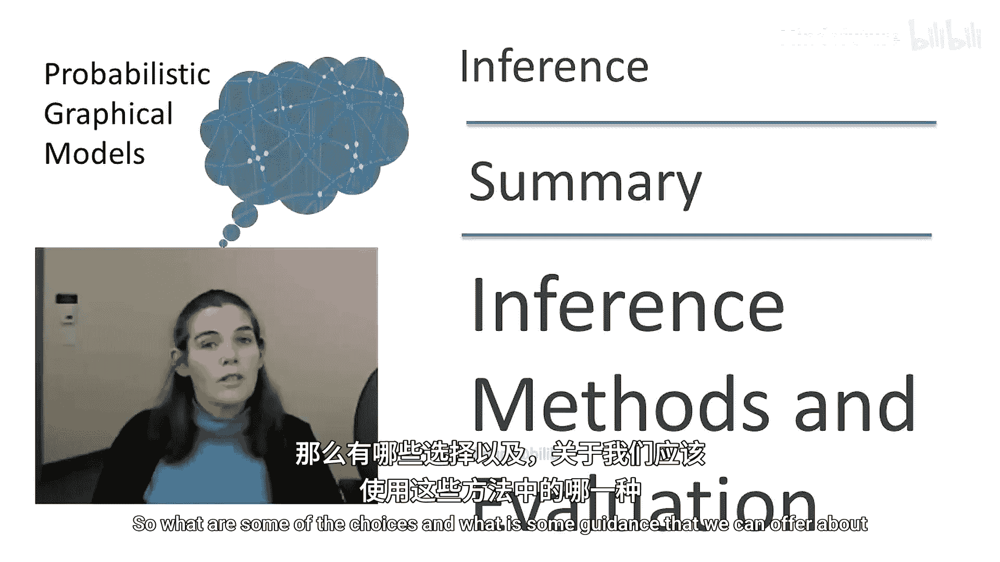
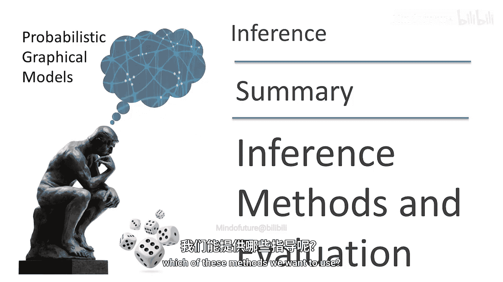
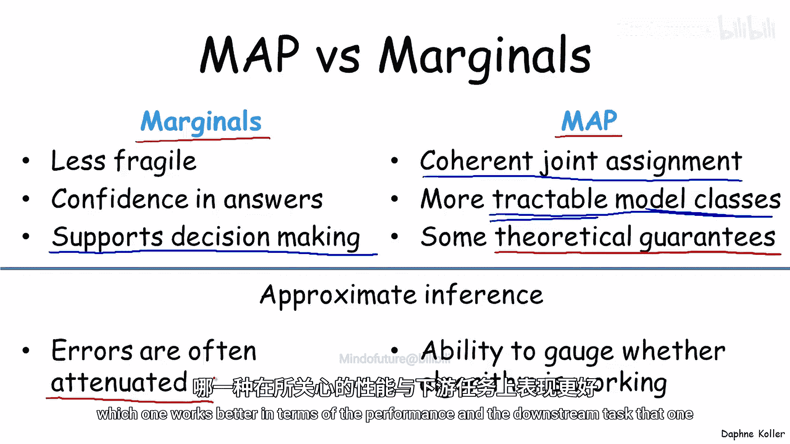
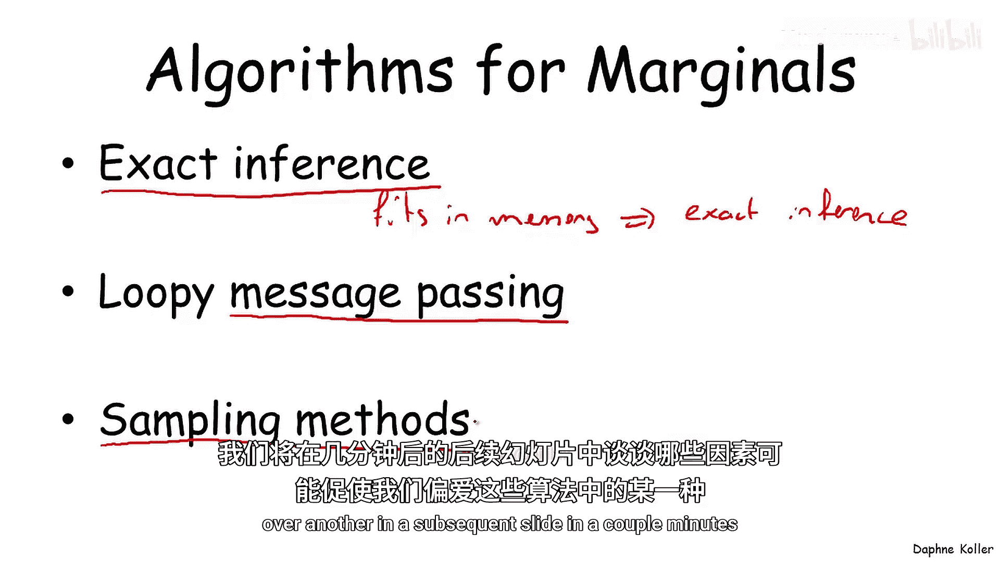
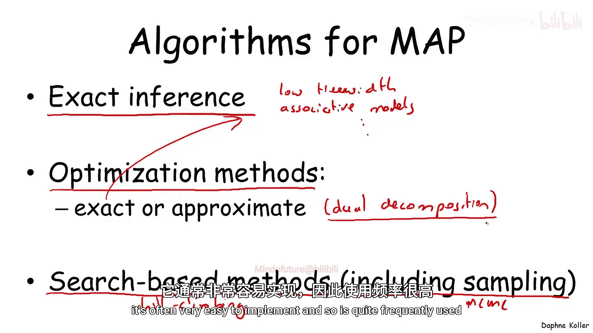
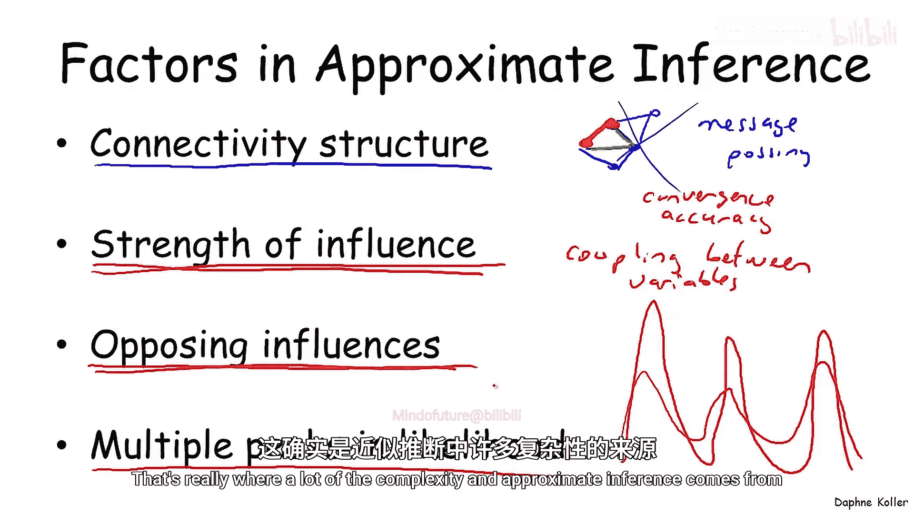
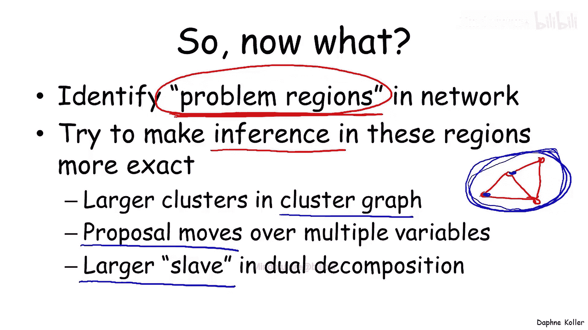

# 【斯坦福】概率图形模型2：推理 ｜ Probabilistic Graphical Models 2 Inference p27 P27_推断总结_07_01_01 -BV1fY6VBBEyo_p27-

Over the course of the last unit that we've covered in the class。

 we've discussed a range of different inference methods， some exact， some approximatex。

 sometimes solving the problem of computing marginals， sometimes for computing map assignments。

 And the question is， if we're faced with a particular tasks that we're trying to deal with。

 and we've designed a graphical model， Which inference algorithm should we use。

 So what are some of the choices and what is some guidance that we can offer about which of these methods we want to use。

The first question we should answer for ourselves is which task is more suitable for our problem。

 are we trying to solve the problem of computing a map assignment or are we trying to solve the problem of computing marginals and these offer sometimes non obvious tradeoffs in terms of what's right for our application。

So computing marginals by and large is a less fragile way to go because we don't pick just a single hypothesis。

 we compute a probability distribution over a range of different options and we can see， for example。

 is our top option a little bit more likely than the second best are a lot more likely than the second best and that gives us some guidance as to how robust our inferences are。

That also gives us some amount of confidence that we can provide in our answers and maybe give to the user as guidance in terms of how much to trust the answer is produced by the system。

And as we've also seen， computing probabilities is important for supporting decision making once we need to integrate。

 for example， with the utility model。On the other hand， map is suitable in its own set of contexts。

 for example， if we're trying to compute a coherent joint assignment， for example。

 in the context of a speech recognition problem or an image segmentation problem is sometimes more important that we get something that makes sense as a whole than that we get the best possible answers to individual pieces of the inference problem like individual pixels or individual phones。

 but in a way that doesn't make sense in the context of the larger problem。

 and so the notion of coherence is sometimes important and is worth the tradeoff of reducing the robustness。

We've also seen that from a computational perspective。

 MA has a range of model classes that are more tractable than in the case of computing marginal。

 so for computational reasons we might sometimes adopt the use of a map solution just for improved efficiency。

And we've also seen that， especially when using approximate inference。

 the map assignment often provides us with some theoretical guarantees in terms of how close our answers are to the correct answers。

 for example， in the context of dual decomposition， we've seen that。

 whereas it's difficult to get a similar level of confidence in terms of our the accuracy of approximate inference for computing marginals。

So on the other hand， when running approximate inference。

 there are again different tradeoffs for these two classes of problems。

 so in when computing marginals one often in gets for approximate inference algorithm。

 the fact that errors just by being。Soft， but just by having soft assignments。

 errors often kind of are attenuated and the source of inaccuracy in one part of the inference is often doesn't make its way significantly into other parts of the model and so you often get more robust answers in approximate inference when computing marginals。

On the other hand， on the map side， one can at least gauge in many cases。

 at least in some algorithms such as dual decomposition。

 whether the algorithm is working or not by looking at the value of an assignment that we get from the algorithm so again somewhat different trade off and in some applications people actually try both and see which one works better in terms of the performance in the downstream task that one cares about。

So what are some algorithms that we've discussed for doing marginal inference。

 So first is just good old exact inference， say variablelimination and cl tree。 And by and large。

 if the problem is small enough that exact inference fits in memory。

In terms of the sizes of the cliques and the subsets。It's probably good to use exact inference。

You run into less problems this way， and if it fits in memory， it's probably going to be very fast。

If one is not in this fortunate situation， we've discussed different types of algorithms that are approximatex。

 there is the range of algorithms do message passing over the graph of which loopy message passing is one of the more common ones but not the only one。

 and then there is the class of sampling methods that sample from the distribution。

And these are different categories of algorithms and frankly it's often difficult to tell in advance which of them is going to work better for a given class of models。

 and we'll talk a little bit about factors that might favor one of these algorithms over another in a subsequent slide in a couple minutes。

What about algorithms for map？Once again， we have algorithms that perform exact inference。

 and in this case， it's actually a broader spectrum than in the case of computing marginals。

 So in addition to cases where we have low tree width。

Which is the category for which marginal algorithms work。 We've also seen other examples。

 such as those with associative or regular potentials。And multiple other cases。 And once again。

 if you can perform exact inference， that's really often the best way to go。

're it's often going to give you the best performance if it's tractable。

Then there is the class of methods that are based on optimization and those can be exact methods which puts us in this category。

 but more often we're going to find ourselves in the case where we have to use some kind of approximatex methods。

 such as the dual decomposition algorithm that we've talked about。And those methods often。

 as we've said， lend themselves to some kind of at least being able to estimate the performance of our algorithm relative to the optimal answer。

 even if we can't get to the optimal answer。Finally。

 there is the range of algorithms that perform search over the space。

 and this can be simple hill climbing。Search， which is a fairly straightforward application of standard search methodologies。

 but also it's。Quite common to use some kind of sampling like at Markov chain Monte Carlo sampling to explore a range of different assignments in the space and then select among those the ones that have the highest or the one that has the highest score。

 the highest。Yeah the highest log probability and that is a quite commonly used technique it doesn't provide the same set of guarantees that you might get from the optimization methods。

 but it's often very easy to implement and sos quite。

Frequently used。So if we're resorting to the use of approximate inference。

 what are some of the issues that might make our lives more complicated or might favor one algorithm versus the other so one complication has to do with a connectivity structure just how densely connected the model is and by and large the more densely connected the model is the worse it is for message passing algorithms so message passing algorithms don't like densely connected models because the messages are propagated over very short cycles and that can cause both issues with convergence。

As well as with lack of accuracy， so lack of convergence and lack of accuracy。

Sampling methods are less affected by the connectivity structure。

The second complicating factor is the strength of influence。

 That is the extent to which nodes that are connected to each other have tight coupling in terms of the preference for certain combinations of values。

 In general， the stronger the influence， the harder it is for both categories of algorithms。

 because it creates stronger coupling。Between variables。

Which can complicate both message passing algorithms， as well as sampling algorithms， because。

 for example， if you think about plain gib sampling。

 it makes it very difficult to move away from the current configuration to a different one。

Strength of influence becomes an even worse problem when the influences go in different directions。

 So， for example， if you have loops where one path it's tending to make these variables take on one configuration and a different path is trying to make them take on a different combination of configurations。

 So for example， as we saw in the misconception that work。

 one path wants a pair of variables to agree on their values and the other wants them to disagree on their values。

 that really does create significant problems for both classes of methods。

 and the reason for that and this， I think， is at the heart of what makes approximate inference hard is when you think about the shape of the likelihood function。

 if you have multiple peaks in the likelihood function that makes life difficult for most approximate algorithms and the sharper these peaks。

The more complicated things get and so that is and multiple peaks are generated by strong influences that go in opposite direction。

And so that's really where a lot of the complexity and approximate inference comes from。

Okay， so now what， assuming you have a model that has these these problematic issues。Well。

 so how do we address them first is to look at the network and identify the problem regions that is subsets of variables that are tightly coupled and maybe are subject to opposing influences。

And then we try and think of how we might make the inference in these problem regions。More exact。

 So if here we have some tightly coupled region with maybe opposing influences， how do we。

Prevent our approximate inference algorithm from。Fling into the trap of this particular area being giving imprecise answers or lack of convergence。

 So， for example， if we're doing cluster graph methods。

 we can put this entire problem region in a cluster it costs of something on the computational side because we have to deal with larger clusters。

 but it might be well worth it in terms of the improvement and performance。In sampling methods。

 we might consider having proposal moves over multiple variables。

 so instead of sampling individual variables， we can sample this entire block using again a somewhat more expensive sampling procedure。

 but again that might end up being well worthwhile in terms of the overall performance profile of the algorithm。

And finally， if we're thinking about this in the context of a map problem。

 we can put this entire set of variables in a single slave。

 which again costs us something on the computational side。

 but can significantly improve the convergence profile of the algorithm。没。

So really when we're faced with a problematic model。

 one that doesn't immediately succumb to traditional inference techniques。

 it turns out that the design of inference is often a bit of an art。

 that is we need to study our model and depth， think about how to deal with different pieces of it and which inference method is best equipped to handle the different pieces。

 and we often find that complicated models， you can get the best performance by a combination of different inference algorithms where some pieces are handled using exact inference such as these larger blocks in the context perhaps of an approximate inference methods such as sampling or belief propagation and so one needs to think creatively about the inference problem in the context of these more problematic models。

