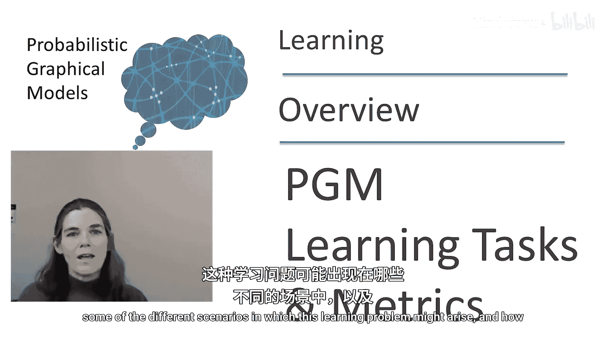
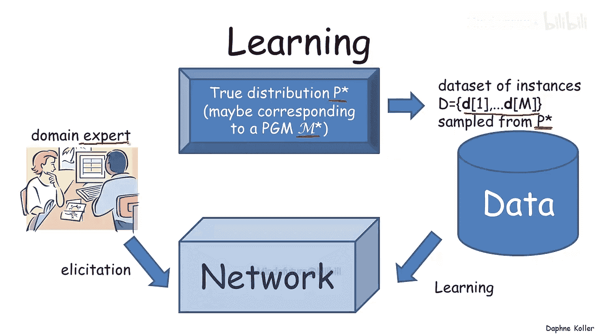
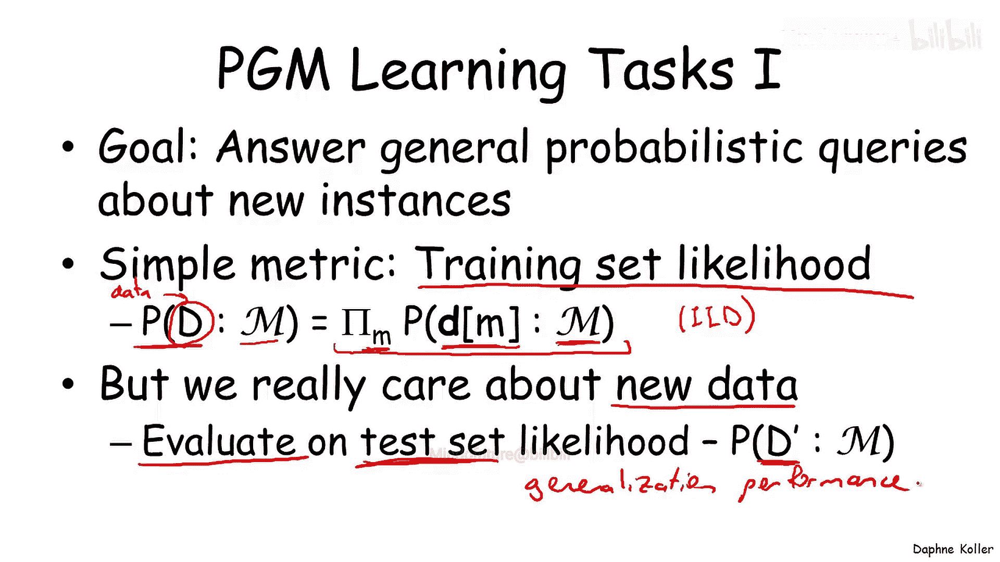
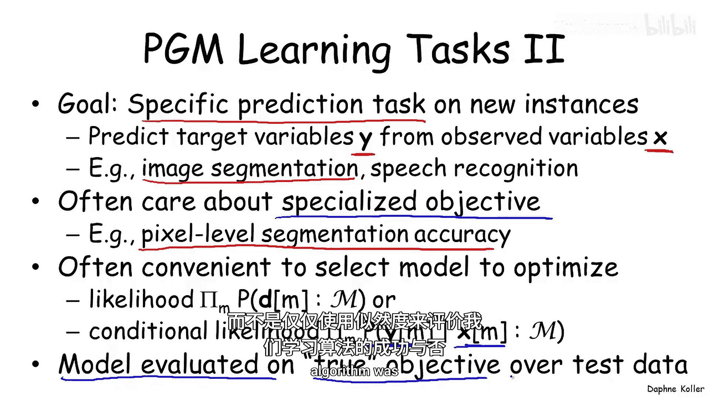
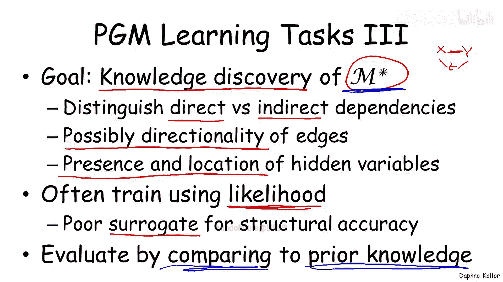
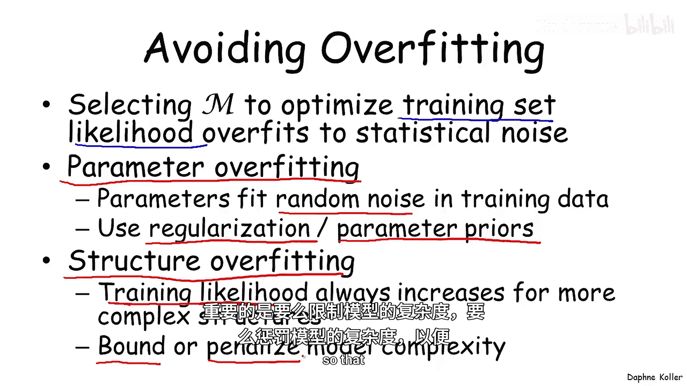
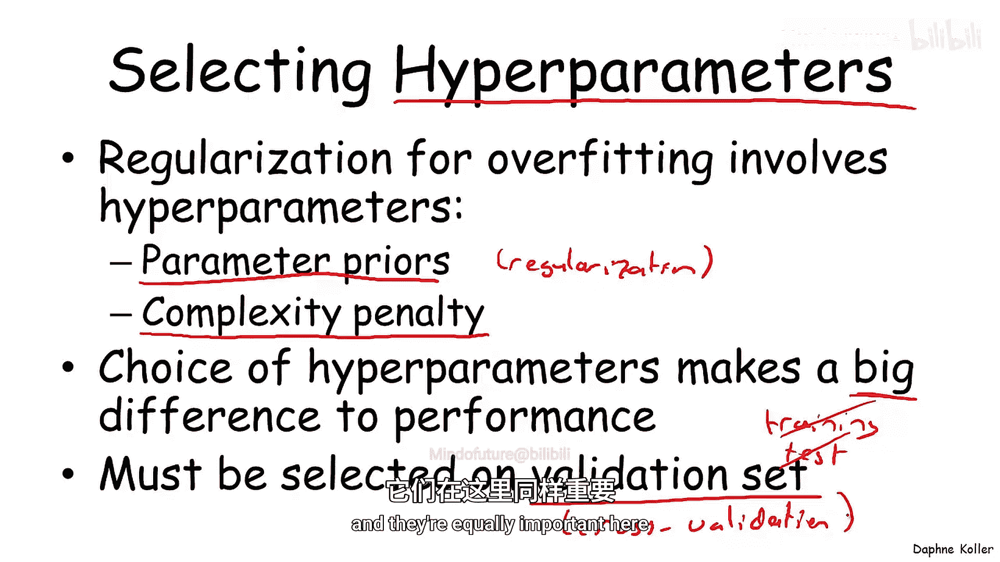
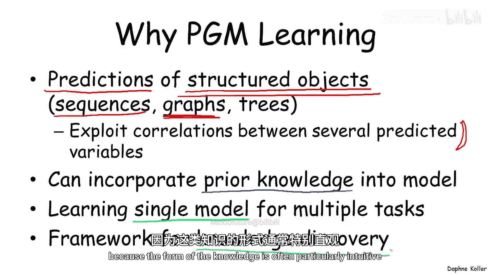

# 【斯坦福】概率图形模型3：学习 ｜ Probabilistic Graphical Models 3 Learning p01 P01_学习概述_01_01_01 -BV1MH6LBREqD_p1-

Our final big module in this course is that of learning a probabilistic graphical model from data Before we delve into the details learning of specific learning algorithms。

 let's think about some of the reasons why we might want to learn a probabilisticographical model from data。

 some of the different scenarios in which this learning problem might arise。

 and how we might go about evaluating the result of our learning algorithm。

So the setup here is that we assume that we have some kind of true distribution。

 which is typically denoted by P star， and in many cases， although not always。

 we might assume that P star is actually generated from a probabilistic graphical model M star。

 and that assumption allows us to talk about the differences between the learned model and the ground truth model M star that generated the distribution。

Now。We're assuming that from this distribution P star， we get a data set D of instances D1 up to D M。

And we're assuming that those are sampled from the distribution P star。Now， in addition to the data。

 we may or may not have some amount of domain expertise that allows us to put in some prior knowledge into the model。

 and in fact， the ability to put in prior knowledge is one of the strengths of probabiltoographical model learning as compared to a variety of other learning algorithms where this is not always quite as easily done。

So combining elicitation from an expert and learning。

 what we end up with is a network that we can then look at and use for different purposes。

So to make this a little bit more concrete， let's look at the different scenarios in the context of the Bayisian network。

 the issues in a Markov network look fairly identical。

 so in the case of known structure and complete data we have a network which we assume to be true。

 we have input data which is nice and clean， you see that all of the variables have values in every single instance and our goal is to produce。

This set of CPDs for the network。In the case of unknown structure and complete data。

 we have the same type of。Data set but notice that now the initial network has no edges in it。

 and we now need to infer the edge connectivity as well as the Cs。

Incomplete data arises when notice that here we have some of the variables。

Are not observed in the training data， and as we'll see this can actually complicate the learning problem quite considerably。

And finally， the unknown structure in completete data。Now。In the latent variable case。

 notice that we have a situation where we know about three of the variables， X1， x2 and Y。

 but our final model has in addition to x1 x2 and Y。

 an additional latent variable H that we didn't even know about it might have been here。

 but we didn't observe any of the values for it， and we didn't even know of its existence。

 and we want to learn a model that involves not only x1 x2 and Y， but also the variable H。

So now let's think about the reasons why we might want to learn a probabilistic graphical model。

 And the most obvious one is that we want a model that we can use in the same way that we would use one that we elicited by hand to just answer probabilistic queries。

 whether conditional probability queries or map queries about new instances that we haven't seen before。

Now， introducing concepts that we'll study in more detail a little bit later on。

 the simplest possible metric that we might envision for training a PGM is basically how probable are the instances that we've seen relative to a given model？

So this metric is called training set likelihood and it's formalized as the following。

 it's the probability of the data that we've seen our data set D。Relative to a given model M。

 and the intuition behind this is that if a model makes the data more likely。

 that is it was more likely to have generated this data set then it's a pretty good model or pretty good assumption about the process that generated our data。

And in this just opening up this definition， this just turns into the product over instances M of the probability of the individual instances given the model。

 given the candidate model M， and this is assuming that the instances are IID。

 independent and identically distributed from the model M。

So one important notion that will accompany us throughout this discussion is that while training set likelihood seems intuitively like a pretty good surrogate for a pretty good scoring function for picking a model。

 it isn't what we actually care about because what we really care about is new data。

 not the data that we got before we care about making conclusions about data that we haven't seen。

 and so what we really want to do is evaluate our model。On a separate test set。

 and you've all already seen the notion of test sets in the context of other learning problems and the same idea is fundamental here in PGMs as well。

 is that our evaluation really should care about not the original dataset set D。

 but rather a new data set D prime， which gives us a surrogate for what's called generalization performance。

A related but somewhat different variant than the notion of an learning task that you might want a PGM to perform is when we have a specific prediction problem that we care about。

 so for example， we might so where we specifically care about predicting a particular set of target variables Y from a set of observed variables X。

 and we've seen multiple examples of this such as image segmentation where we have， for example。

 X being the pixels in the image and y being the predicted class labels。

 speech recognition is another such example where we have an acoustic signal as X and and a sequence of phonemes as y。

 so all of these are cases where we have a particular prediction task。Now， although in this case。

 we often care about a specialized objective。 So， for example。

 a pixel level segmentation accuracy in the context of the image segmentation or in the context of speech recognition might care about the word accuracy rate。

Even though that's often the case， it turns out that in many cases。

 it's convenient for algorithmic and mathematical purposes to select our model to optimize the same notion of either likelihood or conditional likelihood where we try and predict where we're computing the probability of the Y given the X's。

 And although that likelihood is not always a perfect surrogate for the objective that the specialized objective that we actually care about。

 it turns out to be mathematically convenient and that's why it's often done。 however。

 it's important to evaluate the model performance on the true objective over test data as opposed to just use likelihood as the evaluation of how successful our learning algorithm was。

A third setting where one might want to use PGM learning is actually qualitatively quite different。

 In this case， we might not care about using the model for any particular inference task， but rather。

 we care about inferring the structure itself。 That is what we care about is knowledge discovery or structure discovery where our goal is to try and get as close as possible to the generating model and start。

Using PGM learning for this task might help us distinguish between direct and indirect dependencies。

 So if we see a correlation between X and Y in the data。

 we want to infer whether that corresponds to a direct probabilistic interaction between them or something that proceeds via a third variable Z。

 for example， In some cases， when we are learning a Bayesian network。

 we might be able to infer the directionality of the edges and thereby get some intuition regarding causality。

And in other cases， when we learn models with latent variables。

 the existence of those latent variables， their location。

 and often the way in which the values of the latent variables get assigned to different instances gives us a lot of information about the structure of the domain。

In many cases， although not always， we solve this learning problem by training using the same ideas that use a likelihood based objective for training。

Now， we know that that is not a particularly good surrogate for structural accuracy。

 but from a mathematical and algorithmic perspective， it's a very convenient optimization objective。

 and therefore it's often used in practice， although there are also other ideas out there。However。

 it's important not to use likelihood， even likelihood of the test set as the sole objective for evaluating model performance and in many cases。

 as we'll see in the context of some examples， the evaluation here needs to be done by comparing to whatever limited prior knowledge we have about the model and star。

 so we can compare prior knowledge that was not given to the algorithm and see whether the algorithm was able to adequately reconstruct this。

😊。

。Now we talked earlier in this module about the fact that the training likelihood tends to overfit the model。

 and that in fact is a general observation that when you select the model M to optimize the training set likelihood。

 then that tends to overfit badly to statistical noise。

 random fluctuations that happen when we generate our training set。

That happens in several different ways， it happens by overfitting at the level of parameters。

So where the parameters fit random noise in the training data。

 and that can be avoided by the use of regularization or parameter priors over the parameters and we'll see how that gets done。

It also happens when we overfit the structure and specifically one can show that if we optimize the training set likelihood then complex structures always win。

 that is we would always prefer the most complicated structure that our model allows and so if we're training if we're trying to fit structure it's important to either bound the model complexity or penalize the model complexity so that we don't learn models that are just ridiculously complicated for no good reason。

Now， all of these different choices that we talked about are called hyperparameters。

So hyperparameter include things like the parameter priors or the regularization over parameters。

The strength of the regularization， if we're doing complexity bounds or complexity penalties。

 that's another hyperparameter。 All of these are things that we need to pick before we could actually apply our learning algorithm。

 and so how does that happen Well， we need to figure out a way to select that And it turns out that that decision makes a huge difference in many cases to the performance of our learning algorithm。

And so how do we pick these hyperparas， well one obvious choice is to pick them on the training set。

A few seconds of thought ought to convince us that that is a terrible idea because we just talked about the fact that on the training set the optimal thing to do is to have maximum complexity。

 and so if we pick these hyperparameters in the training set。

 they're going to effectively become totally e vacuous。

Another obvious choice is to pick them on the test set that turns out to be another terrible idea because that basically us makes our performance overly optimistic because we picked these very important parameters so as to optimize performance on the test set。

So training set is bad。Test is bad。 And so the correct strategy is to use what's called a validation set。

 which is a set that is separate from both our training set on the one hand and our test set on the other。

 A variant on this is to use what's called cross validation on。

The training set where we split the training set iteratively into a training and a validation component and use that to pick hyperparameters and these are all concepts that you've seen before in the context of other learning algorithms and they're equally important here。

Finally， let's talk about and when you might want to use PGM learning as opposed to a generic machine learning algorithm。

PGM learning is particularly useful when what we're trying to do is make predictions not over a single output variable such as a binary outcome。

 the positive class or the nightive class， but rather we're trying to make predictions over structured objects。

 for example， labeling entire sequences， as in when we're trying to do for example。

 sequence labeling in speech recognition or in natural language processing。

 or when we're trying to label entire graphs， for example。

 in the case of image segmentation where we have there's a grid of pixels and we're trying to label all the pixel simultaneously。

This allows us to exploit correlations between multiple predicted variables。

 often giving us significant improvements to performance。😊。

A second reason to use PGM learning is that allows us to incorporate prior knowledge into our model in a way that many other algorithms have a bit of a difficulty in in allowing。

And finally， this is particularly useful when we're trying to learn a single model。

A single say PGM model for multiple different tasks。

 whereas traditional learning algorithms you learn a particular XY mapping here you can learn a single graphical model and use it in multiple different ways for answering different kinds of queries。

And finally， the idea of using learning for knowledge discovery useful is also possible in the context of other learning algorithms。

 but is particularly useful in the context of PMs because the form of the knowledge is often particularly intuitive。

