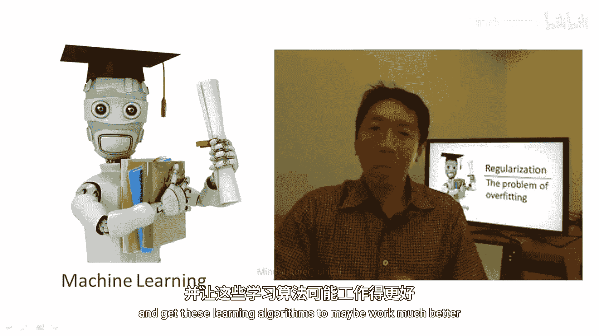
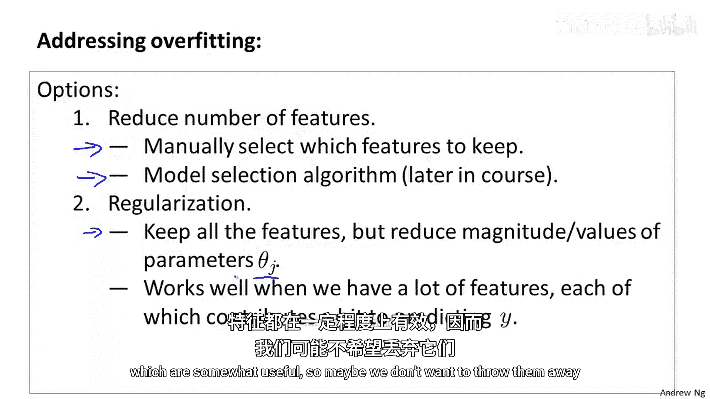
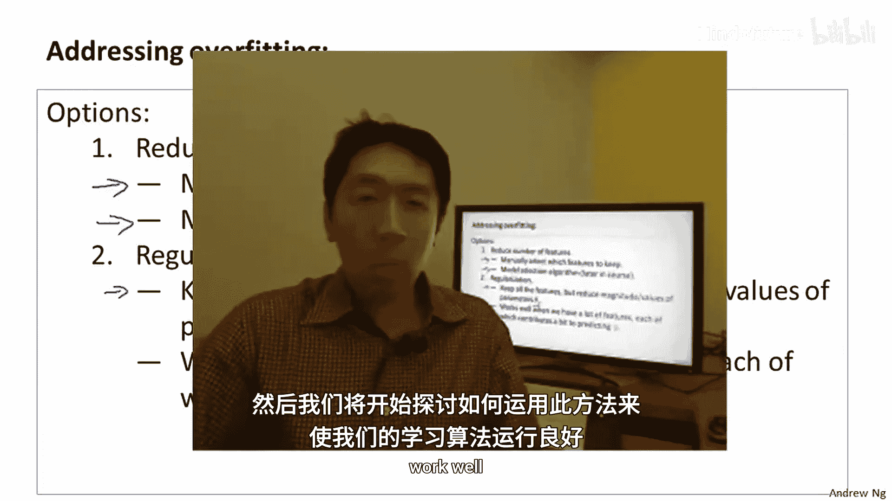

# 【斯坦福】概率图形模型3：学习 ｜ Probabilistic Graphical Models 3 Learning p02 P02_正则化-过拟合问题_02_01_01 -BV1MH6LBREqD_p2-

By now， you've seen a couple different learning algorithms。

 linear regression and logistic regression that work well for many problems。

 but when you apply them to certain machine learning applications。

 they can run into a problem called overfitting that can cause them to perform very poorly。

What I'd like to do in this video is explain to you what is this overfitting problem and in the next few videos after this we'll talk about a technique called regularization that will allow us to ameliorate or to reduce this overfitting problem and get these learning algorithms to maybe work much better。

So what is overfitting？Let's keep using our running example of predicting housing prices with linear regression。

 where we want to predict the price as a function of the size of the house。

One thing we could do is fit a linear function to this data。 And if we do that。

 maybe we get that sort of straight line fit to the data。But this isn't a very good model。

 looking at the data， it seems pretty clear that as the size of the housing freezes。

 the housing prices plateau kind of flattens out as we move to the right。

 And so this algorithm doesn't fit the training set very well。 And we call this problem underfitting。

And another term for this is that this algorithm has high bias。

Both of these roughly mean that is just not even fitting the trading data very well。

 The term bias is kind of a historical or technical one。

 but the idea is that if a fitting a straight line to the data then it's as if the algorithm has a very strong preconception or a very strong bias that housing prices are going to vary linearly with their size and despite the data to the contrary。

 despite the evidence to the contrary is preconceptions or bias still causess it to fit a straight line and this ends up being a poor fit to the data。

Now in the middle， we could fit the quadratic functions in the data and with this data set。

 we fit the quadratic function， maybe we get that kind of curve and that works pretty well。

And at the other extreme would be if we were to fit， say a fourth auto polynomial to the data。

 So here we have 5 parameters theta 0 through theta 4。 And with that。

 we can actually fit the curve that passes through all five of our training examples。

 We might get a curve that looks like this。That， on the one hand。

 seems to do a very good job fitting the training set。 as it passes through all of my data， at least。

 But this is still a very wigly curve， right So I going up and down all over the place。

 And we don't actually think that's such a good model for predicting housing prices。😊。

So this problem we call overfitting。And another term for this is that this algorithm has high variances。

The term high variance is another sort of historical or technical one。

 but the intuition is that if we're fitting such a high order polynomial。

 then the hypothesis can fit， you know， it's almost as if it can fit almost any function and the space of possible hypotheses is just too large is too variable and we don't have enough data to constrain it to give us a good hypothesis So that's got overfitting and in the middle there isn't really a name。

 but I'm just going to write， you know just right where a second degree polynomial quadraity function seems to be just right for filling this data。

To recap a bit。The problem of overfitting comes when if we have too many features。

Then the learn hypothesis may fit the training set very well。

 So your cost function may actually be very close to 0 or maybe even 0 exactly。

But you may then end up with a curve like this that， you know。

 tries too hard to fit the training set so that it even fails to generalize to new examples。

 that it fails to predict prices on new examples well。 And here。

 the term generalized refers to how well a hypothesis applies even to new examples that is to data to houses that it hasn't seen in the training set。

On this slide， we looked at overfitting for the case of linear regression。

 A similar thing can apply to logistic regression as well。

 Here's a logistic regression example with two features X1 and x2。

 One thing we could do is fit logistic regression with just a simple hypothesis like this where。

 as usual， G is my sigmoid function。 And if you do that。

 you end up with a hypothesis trying to use maybe just a straight line to separate the positive and the negative examples。

 And this doesn't look like a very good fit to the hypothesis。 And so once again。

 this is an example of underfitting or of a hypothesis having high bias。In contrast。

 if you were to add to your features， these are quadratic terms。

 then you could get a decision boundary。That might look more like this。 And， you know。

 that's a pretty good fit to the data。 probably what probably about as good as we could get on this training set。

And finally， at the other extreme， if you were to fit a very high auto polynomial。

 If you were to generate lots of high auto polynomial terms and speeches。

 then logistic regression may contort itself， may try really hard to find a decision boundary that。😊。

Fits your training data or go to great lengths to contort itself to fit every single training example well。

 And， you know， if the features X1 the next two are predicting maybe the to the cancer is a malignant。

 benign breast tumorours。 this doesn't， this really doesn't look like a very good hypothesis for making predictions。

 And so once again， this is an instance of overfitting and of hypothesis having high variances and not really and being unlikely to generalize well to new examples。

Later in discourse， when we talk about debugging and diagnosing things that can go wrong with learning algorithms will give you specific tools to recognize when overfitting and also when underfitting may be occurring。

But for now， let's talk about the problem of if we think overfitting is occurring。

 what can we do to address it？In the previous examples。

 we had one or two dimensional data so we could just plot the hypothesises and see what was going on and select the appropriate degree polynomial。

 So earlier for the housing prices example， we could just plot the hypothesis and you know maybe see that it was fitting this sort very wigly function that goes all over the place separate housing prices and we could then use fingers like these to select an appropriate degree polynomial。

So plotting hypothesis could be one way to try to decide what degree polynomial to use。

 but that doesn't always work， and in fact， more often we may have learning problems that when we just have a lot of features and there is not just a matter of selecting what degree polynomial and in fact when we have so many features。

 it also becomes much harder to plot the data and it becomes much harder to visualize it to decide what features to keep or not。

So concretely， if we're trying to predict housing prices。

 sometimes we can just have a lot of different features。 And all of these features seem， you know。

 maybe they seem kind of useful。 But if we have a lot of features and very little training data。

 then overfitting can become a problem in order to address overfitting。

 there are two main options for things that we can do。

The first option is to try to reduce the number of features Conly。

 one thing we could do is manually look through the list of features and use that to try to decide which are the more important features and therefore which are the features we should keep and which are the features we should throw out。

Later in this class， we'll also talk about model selection algorithms。

 which are algorithms for automatically deciding which features to keep and which features to throw out。

This idea of reducing the number of features can work well and can reduce overfitting。

 and when we talk about model selection， we'll go into this in much greater depth。

But the disadvantage is that by throwing away some of the features is also throwing away some of the information you have about the problem。

 For example， maybe all of those features are actually useful for predicting the price of a house。

 So maybe we don't actually want to throw some of our information or throw some of our features away。

The second option which we'll talk about in the next few videos is regularization。

Here we're going to keep all the features， but we're going to reduce the magnitude or the values of the parameter state the J。

And this method works well。 We'll see when we have a lot of features。

 each of which contributes a little bit to predicting the value of why like we had。

 like we saw in the housing price prediction example， where we could have a lot of features。

 each of which are you know somewhat useful。 so maybe we don't want to throw them away。

So。This describes the idea of regularization at a very high level and I realize that all of these details probably don't make sense to you yet。

 but in the next video we'll start to formulate exactly how to apply regularization and exactly what regularization means and then we'll start to figure out how to use this to make how learning algorithms work well and avoid overfitting。

