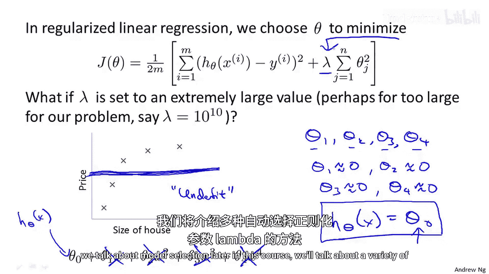
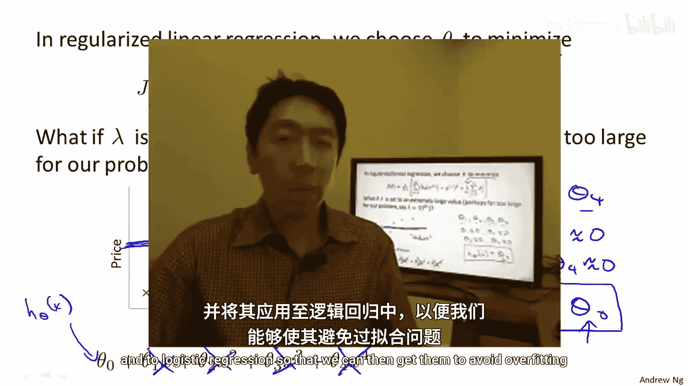

# 【斯坦福】概率图形模型3：学习 ｜ Probabilistic Graphical Models 3 Learning p03 P03_正则化代价函数_02_01_02 -BV1MH6LBREqD_p3-

In this video， I'd like to convey to you the main intuitions behind how regularization works and will also write down the cost function that we'll use when we're using regularization。

With the hand drawn examples that we have on these slides。

 I think I'll be able to convey part of the intuition。

 but an even better way to see for yourself how regularization works is if you implement it and sort of see it work for yourself and if you do the programming exercises after this。

 you get a chance to sort of see regularization in action for yourself。So here's the intuition。

In the previous video， we saw that if we were to fit a quadratic function to this data。

 it give us a pretty good fit to the data， whereas if we were to fit an overly high order degree polynomial。

 when end up of a curve， they may fit the trading set very well。

 but really not not but overfit the data poorly and not generalize well。Consider the following。

Suppose we were to penalize and make the parameters Theta 3 and theta 4 really small。

 Here's what I mean。 Here's our optimization objective。

 or here's our optimization problem where we minimize our usual squared error cost function。

 Let's say I take this objective。 and I modify it and add to it plus 1000。

Say the three squared plus 1000， say the four squared，100。

 I'm just writing down as some some huge number。Now， if we were to minimize this function， well。

 the only way to make this new cost function small is if theta 3 and theta 4 are small。

 right because otherwise， if you have1 thousand times theta 3。

 over this new cost function is going to be big。 So when we minimize this new function。

 we're going to end up with theta 3 close to 0 and theta 4 close to 0。

And that's as if we're getting rid of these two terms over there。And if we do that， well。

 then if theta 3 and theta 4 are close to 0， then we're basically left with a quadratic function。

 And so we end up with a fit to the data。 That's， you know。

 a quadratic function plus maybe tiny contributions from small terms， theta 3。

 theta 4 that maybe very close to 0。And so we end up with essentially a quadratic function。

 which is good because it's a much better hypothesis。In this particular example。

 we looked at the effect of penalizing two of the parameter values being large。 More generally。

 here's the idea behind regularization。The idea is that if we have small values for the parameters。

Then having small values for the parameters will somehow will usually correspond to having a simpler hypothesis。

 So for our last example， we penalize just theta 3 and theta 4。

 And when both of these were close to 0， we wound up with a much simpler hypothesis。

 that was essentially a quadratic function， but more broadly， if we penalize all the parameters。

 usually that we can think of that as trying to give us a simpler hypothesis as well。

 because when you know， these parameters are close to 0 in this example that gave us a quadratic function。

 but more generally。Is possible to show that having smaller values of the parameters corresponds to usually smoother functions as well。

 the less simpler， and which are therefore also less prone to overfitting。

I realized that the reasoning for why having all the parameters be small。

 why that corresponds to simpler hypothesis。 I realize that reasoning may not be entirely clear to you right now。

 and it is kind of hard to explain unless you implement it yourself and see it for yourself。

 But I hope that the example of having theta 3 and theta 4 be small。

 and how that gave us a simpler hypothesis。 I hope that helps explain why。

 at least give some intuition as to why this might be true。 Let's look at the specific example。

For housing price prediction， we may have our 100 features that we talked about。

 where maybe X1 is the size， X is the number of bedrooms， X is the number of floors and so on。

 and we may have 100 features。And。Unlike the polynomial example， we don't know， right。

 We don't know that Theta 3， Theta 4 are the high auto polynomial terms。 So if we have just a bag。

 if we have just a set of 100 features， iss part to pick in advance which are the ones that are less likely to be relevant。

 So we have， you know，100 or 1011 parameters， and we don't know which ones to pick to we don't know which parameters to pick to try to shrink。

So in regularization， what we're going to do is take our cost function。

 Here has my cost function for linear regression。 And what I'm going to do is modify this cost function to string all of my parameters because。

 you know， I don't know which one or two to try to string。

 So I'm going to modify my cost function to add a term at the end。😊，Like so。

 let me add square brackets here as well。 we'm going to add an extra regularization term at the end to shrink every single parameter。

 And so this term will tend to shrink all of my parameters Theta 1， theta 2， theta 3 up to theta 100。

By the way， by convention the summation here starts from 1。

 so I'm not actually going to penalize theta 0 being large。

 that's sort of a convention that the sum is from i equals 1 through n rather than i equals 0 through n。

 but in practice it makes very little difference and whether you include you know theta 0 or not in practice make very little difference of results。

 but by convention usually we regularize only theta 1 through theta 100。

Writing down our regularized optimization objective。

 our regularized cost function again here it is here J of theta。

 where this term on the right is the regularization term。

 and Lada here is called the regularization parameter。

And what Lada does is it controls a trade off between two different goals。

 The first go captured by the first term and the objective is that we would like to train is that we would like to fit the training data well。

 We would like to fit the training set well。And the second goal is we want to keep the parameters small and that's captured by the second term by the regularization objective。

And by the regularization term， and what Lada， the regularization parameter does is it controls the trade off between these two goals between the goal of fitting the trading set well and the goal of keeping the parameter small and therefore keeping the hypothesis relatively simple to avoid overfitting。

For our housing price prediction example， whereas previously if we had fit a very high auto polynomial。

 we may have wound up with a very weeklyly or curvy function like this。

 if you still fit a high auto polynomial with all the polynomial features in there。

 but instead you just make sure to use this sort of regularized objective。

 then what you can get out is in fact， a curve that isn't quite a quadratic function but is much smoother and much simpler and maybe a curve like the magenta line that know fits that gives a much better hypothesis for this data。

Once again， I realize it can be a bit difficult to see why shrinking the parameters can have this effect。

 But if you implement this album yourself with regularization。

 you will be able to see this effect first hand。In regularized linear regression， if the parameter。

 if the regularization parameter lambda is set to be very large。

 then what will happen is we will end up penalizing the parameters theta 1 theta 2 theta 3 theta4 very highly that is if our hypothesis is this one down at the bottom and if we end up penalizing theta 1 theta 2 theta 3 theta 4 very heavily。

 then we'll end up with all of these parameters close to0 theta 1 we close to0。

 Theta2 close to 0 theta 3 and theta 4 will end up being close to0 and if we do that is as if we're getting rid of these terms and a hypothesis so that we're just left with a hypothesis that looks's say that it says that well housing prices are equal to theta 0 and that is akin tofi a flat horizontal straight line to the data。

And this。Is an example of underfitting and in particular， this hypothesis， this straight line。

 it just fails to fit the trading set。 Well， it's just a flat straight line。 It doesn't go go near。

 it doesn't go anywhere near most of our trading examples。

 And another way of saying this is that this hypothesis has too strong a preconception or too high bias。

 that housing prices are just equal to theta 0。 And despite the clear data that the contrary you it chooses to fit the sort of flat line。

 just a flat horizontal line。 I didn't draw that very well。

 fits just a horizontal flat line to the data。So for regularization to work well。

 some care should be taken to choose a good choice for the regularization parameter la as well。

And when we talk about model selection later in this course， we'll talk about a way。

 a variety of ways for automatically choosing the regularization parameters to La as well。

So that's the idea behind regularization and the cost function we'll use in order to use regularization in the next two videos。

 let's take these ideas and apply them to linear regression and to logistic regression so that we can then get them to avoid overfitting problems。

