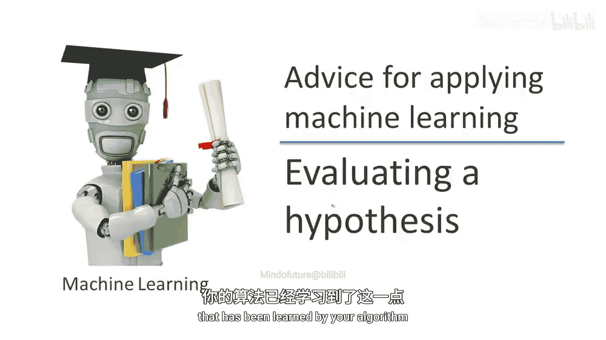
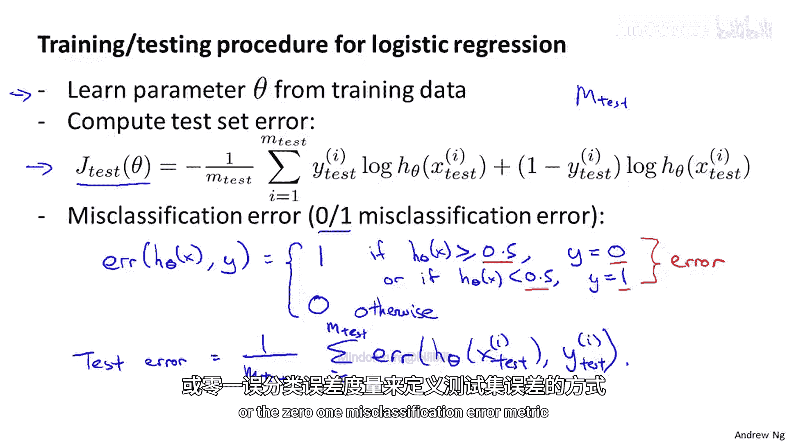
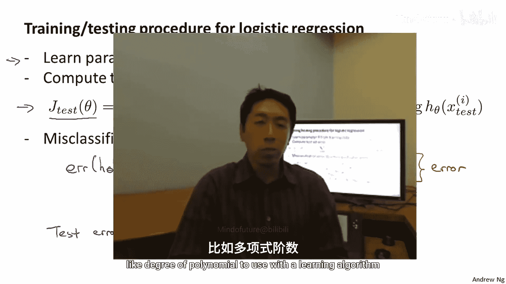

# 【斯坦福】概率图形模型3：学习 ｜ Probabilistic Graphical Models 3 Learning p04 P04_评估假设_02_01_03 -BV1MH6LBREqD_p4-

In this video， I'd like to talk about how to evaluate a hypothesis that has been learned by your algorithm In later videos we'll build on this to talk about how to prevent the problems of overfitting and underfitting as well。

When we fit the parameters of our learning algorithm。

 we think about choosing the parameters to minimize the training error one might think that getting a really low value of training error might be a good thing。

 but we've already seen that just because a hypothesis has low training error that doesn't mean it necessarily a good hypothesis and we've already seen the example of how a hypothesis can overfit。

And therefore fail to generalize the new examples not in the training set。

So how do you tell if a hypothesis might be overfitting in this simple example。

 we could plot the hypothesis H of x and just see what was going on。 But in general。

 for problems with more features than just one feature for problems with a large number of features like these。

 it becomes hard or maybe impossible to plot what the hypothesis function looks like。

 And so we need some other way to evaluate a hypothesisses。

 The standard way to evaluate a learned hypothesis is as follows。

 supposeupp we have a data set like this here， I've just shown 10 training examples， but of course。

 usually we may have dozens or hundreds or maybe thousands of training examples。

 In order to make sure we can evaluate our hypothesis， what we're going to do is split。

The data we have into two portions， the first portion is going to be our usual training set。

And the second portion is going to be our test set。

And a pretty typical split of this of all the data we have into a training set and test set might be around。

 say， a 70%。30% split with more of the data going to the training set and relatively less to the test set。

And so now if we have some data set， we might assign only， say 70% of the data to our training set。

 where here M is as usual our number of training examples。

 and the remainder of our data might then be assigned to become our test set and here I'm going to use the notation M subscript test to denote the number of test examples。

And so in general， this subscript test is going to denote examples that come from my test set so that x1 Subscript test comma y1 Subscript test is my first test example。

 which I guess in this example might be this example over here， Finally， one last detail。

 whereas here I've drawn does as though the first 70% goes to the trading set and the last 30% to the test set。

If there is any sorted ordering to the data， it'll actually be better to send a random 70% of your data in the training set and a random 30% of your data to the test set。

 so if your data were already randomly sorted， you could just take the first 70% and last 30%。

 but if your data were not randomly order， it'd be better to randomly shuffle or to randomly reorder the examples in your training set before sending the first 70% of the training set in the last 30% of the test set。

Here then is a fairly typical procedure for how you would train and test a learning algorithm。

 maybe linear regression。 First， you learn the parameters theta from the training set so you minimize the usual training error objective J of theta where J of data here was defined using that 70% of all the data you have there's only the training data。

And then you would compute the test error， and I'm going to denote the test error as J sububscript test。

 and so what you do is you take your parameter data that you've learned from the training set and plug it in here and compute your test set error。

 which I'm going to write as follows。So this is basically。The average。Square error。

As measured on your test set。It's pretty much what you expect run every test example through your hypothesis with parameter theta and just measure the squared error that your hypothesis has on your M subscript test test examples。

And， of course， this is the definition of the test set error。

 If we are using linear regression and using this squared error metric。

How about if we were doing a classification problem and say using logistic regression instead？

In that case， the procedure for training and testing say logistic regression is pretty similar。

 First， we would learn the parameters from the training data that first 70% of the data and it will compute the test error as follows is's the same objective function as we always use for logistic regression。

 except that now is defined using our M subscript test。

Test examples while this definition of the test set error J subgroup test is perfectly reasonable。

 sometimes there's an alternative test set metric that might be easier to interpret and as the misclassification error is also called the 01 misclassification error with 01 denoting that you either get an example right or you get an example wrong。

Here's what I mean。Let me define the error of a prediction。That is H of x。And given the label Y as。

Equal to one。If my hypothesis output is a value greater than equal to5 and y is equal to  zero。哦。If。

My hypothesis outputs a value less than 0。5 and y is equal to1 right so both of these cases basically correspond to if your hypothesis mislabel the example。

 assuming your thresholded at 0。5， so either thought it was more likely to be one。

 but it was actually 0 or your hypothesis thought it was more likely to 0。

 but the label was actually1。And otherwise， we define。This error function to be 0。If方。

Your hypothesis basically classified the example Y correctly。We could then。Define the test error。

Using the misclassification error metric to be。One of the M tests of sum from I equals 1 to M。

Subscripte test of the error。Each。嗯。All test。Com and so that's just my way of writing out that this is exactly the fraction of the examples in my test set that my hypothesis has mislaled。

And so that's the definition of the test set error using the misclassification error。

All these zero one is consification errormetric。

So that's the standard technique for evaluating how good a learned hypothesis is。And the next video。

 we'll adapt these ideas to helping us do things like choose what features like the degree of polynomial to use with a learning algorithm or choose theregularization parameter for a learning algorithm。

