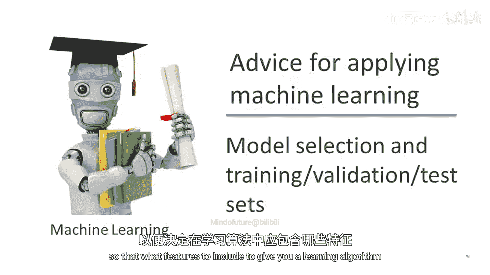
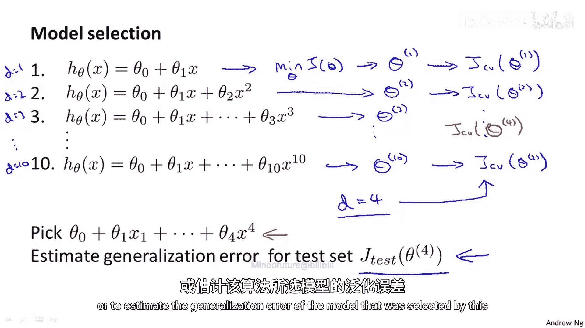
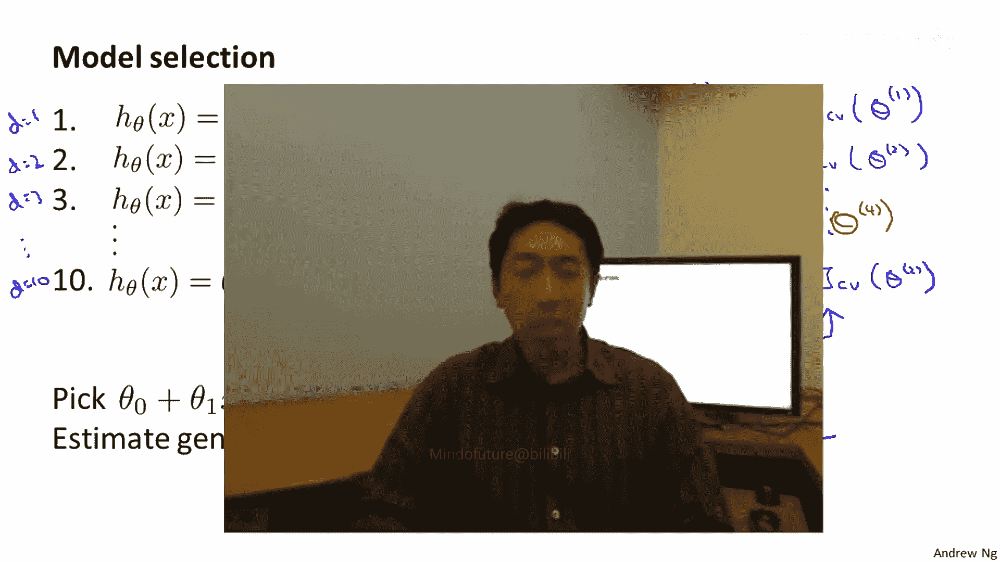

# 【斯坦福】概率图形模型3：学习 ｜ Probabilistic Graphical Models 3 Learning p05 P05_模型选择与训练-验证-测试集_02_01_04 -BV1MH6LBREqD_p5-

Suppose youd like to decide what degree of polynomial to fit to a data so of what features to include to give you a learning algorithm。

 or suppose you'd like to choose the regularization parameter Lada for learning algorithm。

 how to do that， these are called model selection problems。 And in our discussion of how to do this。

 We'll talk about not just how to split a data into a train and test set。

 but how to switch a data into what we'll discover is called the train validation in test set。

 We'll see in this video， just what these things are and how to use them to do model selection。

We've already seen a lot of times the problem of overfitting in which just because the learning algorithm fits a training set well。

 that doesn't mean is's a good hypothesis。More generally。

 this is why the training set error is not a good predictor for how well the hypothesis will do on new examples concretely if you fit some set of parameters say zero theta one theta two and so on to your training set。

 then the fact that your hypothesis does well on the training set。

 while this doesn't mean much in terms of predicting how well your hypothesis will generalize to new examples not seen in the training set。

And the more general principle is that once your parameters were fit to some set of data。

 maybe the training set， maybe something else， then the error of your hypothesis as measured on that same data set。

 such as the training error。 that's unlikely to be a good estimate of your actual generalization error。

 That is how well the hypothesis will generalize to new examples。 Now。

 let's consider the model selection problem。 Let's say you're trying to choose what degree polynomial to fit to data So you choose a linear function。

 a quadra function， a cubic function all the way up to a1th or the polynomial。

So it's as if there's one extra parameter in this algorithm， which I'm going to denote D。

 which is what degree of polynomial？Do you want to pick So it's as if in addition to the theta parameters iss as if there's one more parameter D that you're trying to determine using your dataset set。

 So the first option is d equals1。 if for the linear function。

 we can choose D equals2 equals 3 all the way up to D equals 10。 So we'd like to fit this extra。

 So the parameter， which I'm denoting by D and concretely let's say that you want to choose a model that is choose a degree of polynomial。

 choose one of these 10 models and fit that model and also get some estimate of how well your fitted hypothesis will generalize to new examples。

Here's one thing you could do， what you could first take your first model and minimize the training error。

 and this would give you some parameter vector theta。And you could then take your second model， the。

quadratic function and fit that to your training set and this will give you some other parameter vector theta in order to distinguish between these different parameter vector I'm going to use a superscript 1 superscript2 there where theta superscript1 just means the parameters I get by fitting this model to my training data and theta superscript 2 just means the parameters I get by fitting this quadratic function to my training data and so on and by fitting a cubic model I get parameters Theta3 up to say theta 10。

And one thing we could do is then take these parameters and look at the test set error so I can compute on my test set。

 J test of one。J test。阿发。Sa the two and so on。J tests of theta 3。And so on。

So I'm going to take each of my hypotheses with the corresponding parameters and just measure their performance on the test set。

 Now， one thing I could do then is in order to select one of these models。

 I could then see which model has the lowest test set error。

 And let's just say for this example that I ended up choosing the fifth order polynomial。

 So this seems reasonable so far。 But now let's say I want to take my fit hypothesis。

 this fifth order model。 And let's say I want to ask， how well does this model generalize。

One thing I could do is look at how well my fifth order polynomial hypothesis had done on my test set。

But the problem is， this will not be a fair estimate of how well my hypothesis generalizes。

And the reason is。What we've done is we fit this extra parameter D that is this degree of polynomial and with fit that parameter D using the test set。

 namely， we chose the value of D that gave us the best possible performance on the test set。And so。

The performance of my parameter vector theta 5 on the test set that's likely to be an overly optimistic estimate of generalization error so because I have fit this parameter D to my test set is no longer fair to evaluate my hypothesis on this test settings because I fit my parameters to the test set I've chosen the degree D of polynomial using the test set and so my hypothesis is likely to do better on this test set than it would on new examples that it hasn't seen before and which is why I really care about So just to reiterate on the previous slide。

 we thought that if we fit some set of parameters you know say theta0 theta 1 and so on to some training set。

 then the performance of the fitted model on the training set is not predictive of how well the hypothesis would generalize the new examples is because these parameters were fit to the training set so they're likely to do well on the training set。

 even if the parameters don't do well on。There are examples。

And in the procedure I just described on this slide。

 we just did the same thing and specifically what we did was we fit this parameter D to the test set。

And by having fit the parameters to the test set， this means that the performance of the hypothesis on that test set may not be a fair estimate of how well the hypothesis is likely to do on examples we haven't seen before to address this problem in a model selection setting。

 if we want to evaluate the hypothesis， this is what we usually do instead。Given a data set。

 instead of just splitting it into a training and test set。

 what we're going to do is instead split it into three pieces。

And the first piece is going to be called the training sets as usual。So let me call this first part。

The training set。And the second piece of this data， I'm going to call the cross validation set。

Trust validation。And I'm going to abbreviate crossvalidation at CV。

 Sometimes it's also called the validationation sets instead of crossvalidation set And then the last part I'm going to call my usual test set and a pretty pretty typical ratio in which to split these things would be to send 60% of your data to your trading set。

 maybe 20% to your crossvalidation set and 20% to your test set and these numbers can vary a little bit that this sort of ratio would be pretty typical and so our training sets will now be only maybe 60% of the data and our crossvalidation set or our validation set will have some number of examples I'm going to denote that M subscript CV so that's the number of a crossvalidation examples。

Following our earlier notational convention， I'm going to use X I。

 CV comma Y I CVV to denote the I cross validation example。

 and finally we also have a test sets over here with M Sub tests being the number of test examples。

 So now that we've defined the training validation or cross validation and test set。

 we can also define the training error， cross validation error and test error。

So here's my training error and I'm just writing this as J sububgroup train of data。

 this is pretty much the same thing it's usually the same thing as the J of data that we've writing so far it's just a training set error as measured on your training set and then JSubscript CV is my transvalidation error it's pretty much what you expect just like the training error except measured on the transvalidation data set。

And here's my test set error， same as before。So when faced with a model selection problem like this。

 what we're going to do is instead of using the test set to select the model where're instead of going to use the validation set or the cross validation set to select the model。

Concretely， we're going to first take our first hypothesis。

 take this first model and say minimize the cost function。

 and this would give me some parameter vector theta for the linear model。

 And as before I'm going to for the superscript one just to denote that this is the parameter for the linear model。

We do the same thing for the quadratic model， get some pro of vector data too。

Ging parameter vector theta 3 and so on down to say， the 1fold the polynomial。

And what I'm going to do is instead of testing these hypotheses on the test set。

 instead I'm going to test them on the cross validationidation set。

 I'm going to measure J' subscript CV。To see how well each of these hypotheses do on my cross validation set。

And then I'm going to pick the hypothesis with the lowest cross validation error。

 So for this example， let's say for the sake of argument that it was my fourth order polynomial that had the lowest cross validation error。

 So in that case I'm going to pick this fourth order polynomial model。And finally。

 what this means is that that parameter D， remember D was the degree of polynomial right so d equals 2 d equals 3 up to d equals 10。

What we've done is we' fit that parameter D and we've set D equals4。

 and we did so using the crossvalidation set， and so this degree of polynomial。

 so the parameter is no longer fit to the test set。

 and so we've now saved away the test set and we can use the test set to measure or to estimate the generalization error of the model that was selected by this algorithm。

So that was model selection and how you can take your data split into a train validation and test set and use your cross validation data to select the model and evaluate it on the test set。

One final note， I should say that in the machine learning as of this practice today。

 there are many people that will do that earlier thing that I talked about and said that isn't such a good idea of selecting your model using the test set and then using the same test set to report the error as though selecting your degree of polynomial on the test set and then reporting the error on the test set as though that were a good estimate of generalization error That so the practice unfortunately many people do do it if you have a massive massive test set is maybe not a terrible thing to do but many practitioners most practitioners of machine learning tend to advise against that and it better practice to have separate training validation and test set。

 but I just warn you that sometimes people do use the same data for the purpose of the validation set and for the purpose of the test set you only have a training set in the test set that' that' good practice。

 but you will see some people。But if possible， I would recommend a against doing that yourself。

