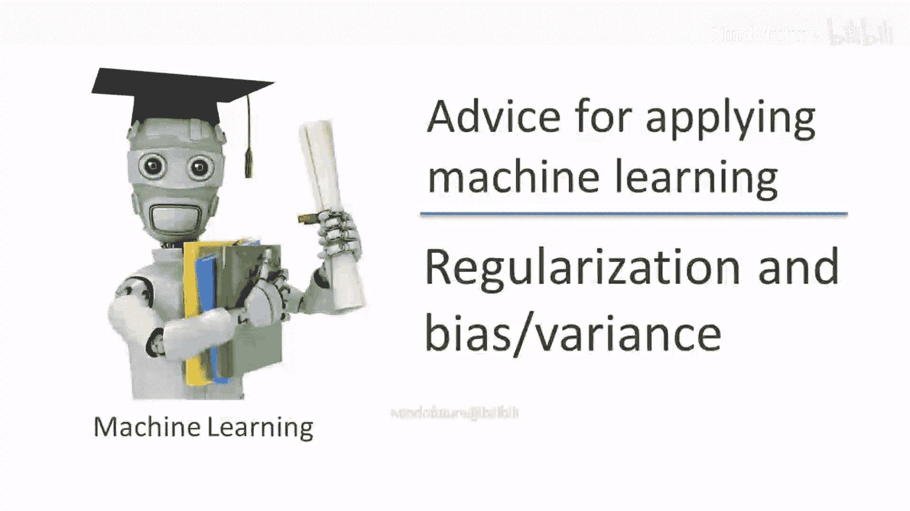
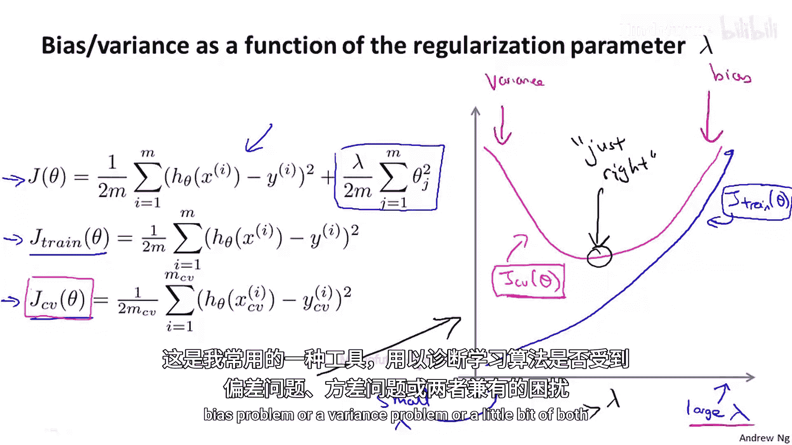

# 【斯坦福】概率图形模型3：学习 ｜ Probabilistic Graphical Models 3 Learning p07 P07_正则化与偏差方差_02_01_06 -BV1MH6LBREqD_p7-

You've seen how regularization can help prevent overfitting。

 but how does it affect the bias and variances of a learning algorithm？In this video。

 I'd like to go deeper into the issue of biasers in variants and talk about how it interacts with and is affected by the regularization of your learning algorithm。

Suppose we're fitting a high auto polylynomial like that shown here， but to prevent overfitting。

 we're going to use regularization like that shown here。

 so we have this regularization term to try to keep the values of the parameter small and as usual。

 the regularization sums from J equals 1 to n rather than J equals0 to n。Let's consider three cases。

 the first is a case of a very large value of the regularization parameter to Lada。

 such as if lambda were equal to 10，000 some huge value。In this case， all of these parameters。

 theta1， theta 2， theta 3， and so on， will be heavily penalized， and so will end up。

With most of these parameter values being close to  zero and the hypothesis will be roughly h of x just equal or approximately equal to theta0。

 and so we end up with a hypothesis that more or less looks like that。

 so more or less a flat constant straight line。And so this hypothesis has high bias and it badly underfis this data set。

Horizontal straight line is just not a very good model for this data set at the other extreme is if we have a very small value of lambda。

 such as if lambda were equals to zero。In that case。

 given that we're fitting a high order polynomial， this is our usual overfitting setting。

In that case， given that we're fitting a high order polynomial。

 basically without regularization or with very minimal regularization。

 we end up with our usual high variance overfitting setting。 It's basically if longer is equals0。

 we're just fitting it without regularization。So that overfis the hypothesis。

And it only if we have some intermediate value of Lada that is neither too large nor too small that we end up with parameters theta that give us a reasonable fit to this data。

 So how can we automatically choose a good value for the regularization parameter Lada just to reiterate。

 here is our model and here is our learning algorithms objective for the setting where we're using regularization。

 let me define J train of theta to be something different to be the optimization objective but without the regularization term。

Previous， in an earlier video when we were not using regularization。

 I define J train of theta to be the same as J of theta as a cost function but when we're using regularization when this is extra Lada term。

 we're going to define J train my training set error to be just my sum squared errors on the training set or my average square error on the training set。

 we're taking to count that regularization。And similarly。

 I'm then also going to define the cross validation sets error and the test set error as before to be the average summerscreen errors on the cross validation and the test sets。

So。Just to summarize， my definitions of J train JCV and J test are just the average squared error or one half of the average squared error or my training validation sets without the extra regularization term。

 So this is how we can automatically choose the regularization parameter lambda。

 What I usually do is maybe have some range of values of lambda1 to try out。

 So I might be considering not using regularization or here a few values I might try I might be considering lamb equal 01010020104 and so on。

 and know I usually step these up in multiples of two until some some maybe larger value。

 if I were doing this in multiples of2， I end up with 10。

24 instead of 10 exactly this is close enough。 And the third and4 decimal places won't affect your result that much。

 So this gives me maybe 12 different models， then I'm trying to select amount corresponding to 12。

Vals of the regularization parameter la。 And of course， you can also go to values less than 0。

01 or values larger than 10。 but I've just truncated it here for convenience。

Given each of these 12 models， what we can do is then the following。

 we can take this first model with normally equals0。And minimize my cost function J of the。

 And this would give me some parameteremptive vector data。 And similar to the earlier video。

 let me just denote this。As he the superstar won。And then I can take my second model with Lada set to 0。

01 and minimize my cost function now using lambda equals 0。01， of course。

 to get some different parameters of vector theta。 let me denote that theta 2 and for that I end up with theta 3 So if this is for my third model and so on until for my final model with Lada set to 10 when I 10 or 10。

24 I end up with this theta 12。Next， I can take all of these hypotheses。

 all of these parameters and use my cross validation set to evaluate them so I can look at my first model。

 my second model fits with these different values of the regularization parameter。

And evaluate them on my cross validation sets and basically measure the average squared error of each of these perun vectors datata on my cross validation sets。

And I would then pick whichever one of these 12 models gives me the lowest error on the trust validation set。

And let's say for the sake of this example that I end up picking theta5。

 the fifth ordered polynomial because that has the lowest crossvalidation error， Having done that。

 finally what I would do if I want to report to test set error is to take the parameter theta5 that I've selected and look at how well it does on my test set and once again here is as if we fit this parameter theta to my crossvalidation set。

 which is why I'm saving aside a separate test set。

That I'm going to use to get a better estimate of how well my parameter vector theta were generalize to previously oneen examples。

 So that's model selection applied to selecting the regularization parameter Lada。

 The last thing I'd like to do in this video is get a better understanding of how crossvalid and training error of the A as we vary the regularization parameter Lada。

 And so just a reminder right， that was our original cost function J of theta。 But for this purpose。

 we're going to define training error without using the regularization parameter and crossval error without using the regularization parameter。

And what I'd like to do is plot this J train and plot this JCV。

 meaning just the how well does my hypothesis do？For on the training set and how well does my hypothesis do on the cross validation set as I vary my regularization parameters to La。

So as we saw earlier if。Laer is small， then we're not using much regularization。

 and we run a larger risk of overfitting， whereas if La is large。

 that is if we were on the right part of this horizontal axis。Then with a large value of Lada。

 we run a higher risk of having a bias problem。 So if you plot Jtrain and JCV。

 what you find is that for small values of Lada， you are you can fit the training set relatively well because you're not regularizing。

 So for small values of Lada， the regularization term basically goes away and you just minimizing pretty much your squared error。

 So when Lada is small， you end up with a small value for Jtrain whereasas if Lada is large。

 then you have a high bias problem and you might not fit your training set wells。

 you end up with value up there。 so。J train。A theta will tend to increase when lambda increases because a large value of Lada corresponds to high bias。

 where you might not even fit your training so well。

 whereas a small value of Lada corresponds to if you can freely fit a very high degree polynomial to your data。

 let's say As for the transvalidation error， we end up with a figure like this。Where。

Where over here on the right， if we have a large value of Lada， we may end up underfitting。

 And so this is the bias regime whereas and so the cross validation error will be high。

 let me just label that。 So there's JCV of data because with high bias。

 we won't be fitting we won't be doing well on the cross validation set。Whereas here on the left。

 this is the Hivariians regime。Where if we have too small value of La。

 then we may be overfitting the data and so if we're overfitting the data。

 then the cross validation error we're also behind。

And so this is what the cross validation error and what the training error may look like on a training sets as we vary the virtualization。

Ler and so once again， it will often be some intermediate value of launder that you called just right or that works best in terms of having a small cross validation error or a small test set。

And whereas the curls I've drawn here are somewhat cartoon notions somewhat idealized。

 So on a real data set， the curveows you get may end up looking a little bit more messy and just a little bit more noisy than this。

For some data sets， you will really see these broad source of trends。

 And by looking at the plot of the holdout cross validation error。

 you can either manually automatically try to select a point that minimizes。

the cross validation error is select the value of Lada corresponding to low cross validation error when I'm trying to pick the regularization parameter Lada for a learning algorithm。

 often I find that plotting a figure like this one shown here helps me understand better what's going on and helps me verify that I am indeed picking a good value for the regularization parameter Lada。

So hopefully that gives you more insights into regularization and this effects on the bias and areass of a learning algorithm。

By now， you've seen bias and variants from a lot of different perspectives。

And what I'd like to do in the next video is take a all of the insights that we've gone through and build on them to put together a diagnostic that's called learning curves。

 which is a tool that I often use to try to diagnose of a learning algorithm。

 maybe suffering from a bias problem or a variance problem or a little bit of both。

