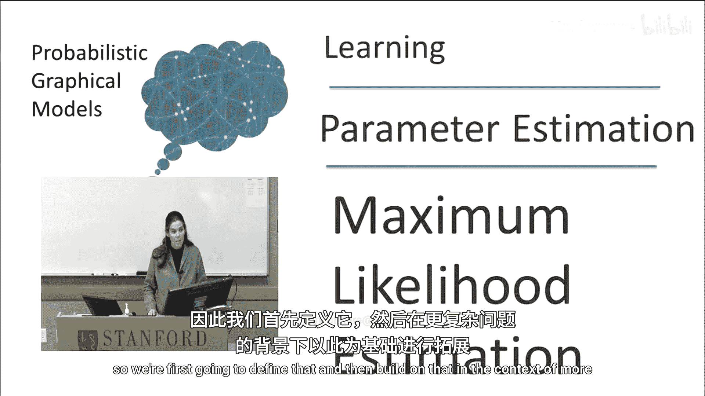
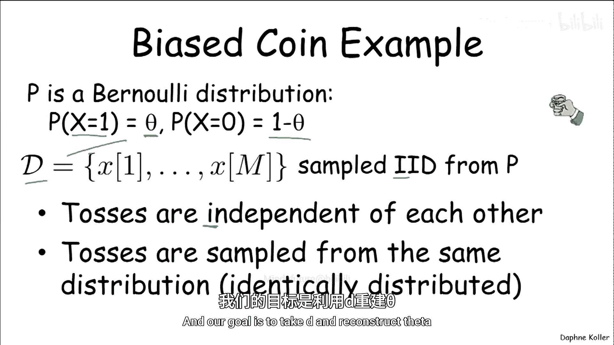
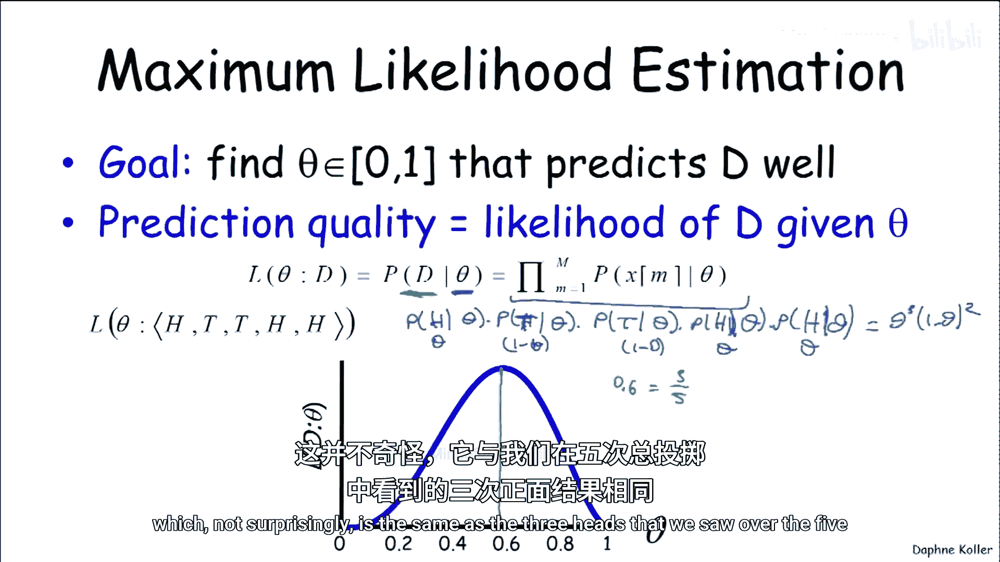
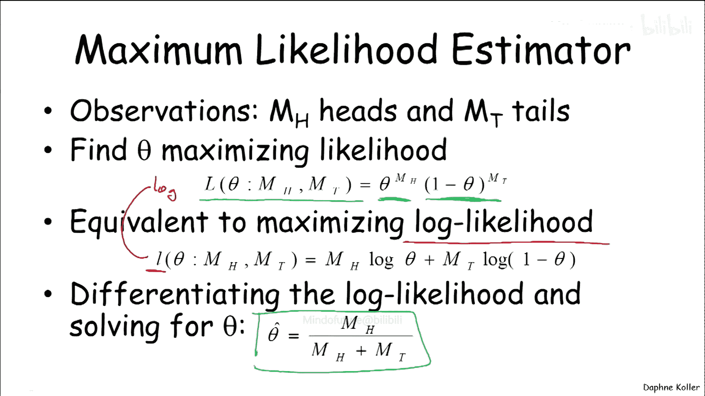
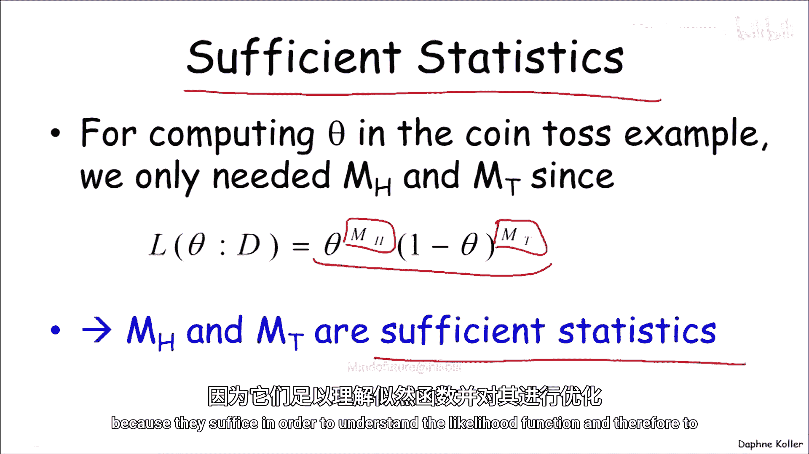
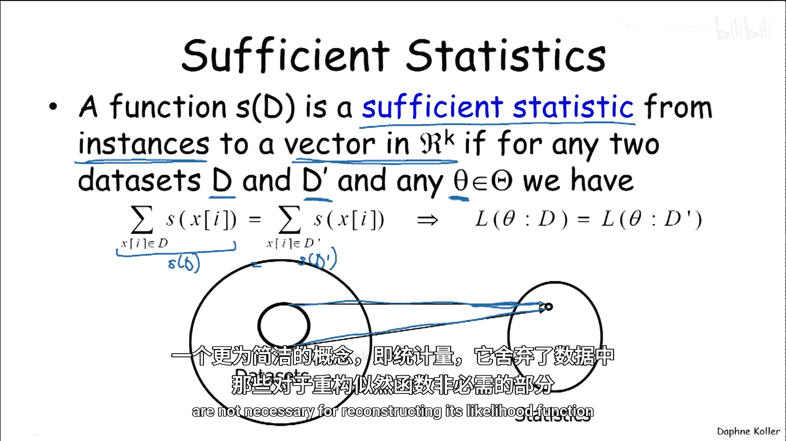
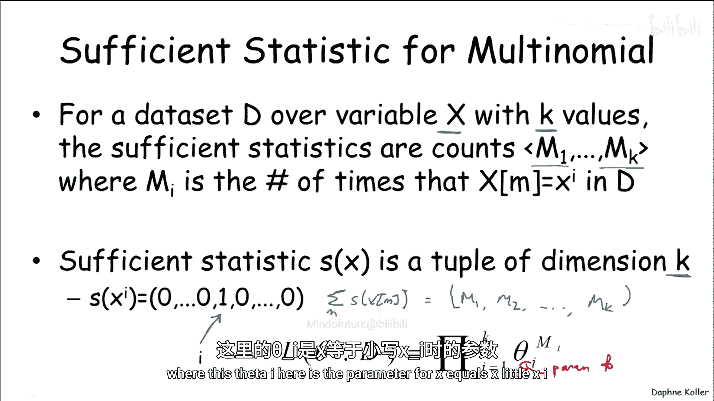
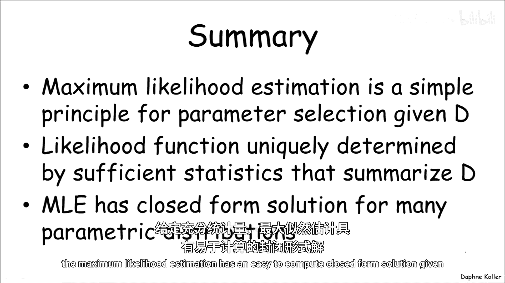

# 【斯坦福】概率图形模型3：学习 ｜ Probabilistic Graphical Models 3 Learning p08 P08_最大似然估计_03_01_01 -BV1MH6LBREqD_p8-

We begin by discussing the simplest learning problem。

 which is that of estimating a set of parameters。 and the key building block for parameter estimation is what's called maximum likelihood estimation。

 So we're first going to define that and then build on that in the context of more interesting problems。

So let's go back to the simplest possible learning problem where we are generating data from a biased coin。

 which is a Bnouli distribution， and the probability that x takes the value 1 is defined by some parameter theta。

 and the probability that it takes the value zero is therefore one minus theta。

And let's imagine that we're given access to a data sub D， which is a bunch of instances。

 x1 up to XM that are sampled IID from the distribution P。

Let's remind ourselves what it means for what the IID means， so first。

 the first I means that the tosses are independent of each other。

And the ID means that they're identically distributed。

 which means that they're all sampled from people。And our goal is to take the and reconstruct the。

So let's think about this as a probabilistic graphical model and in fact it's a probabilistic graphical model that we've seen before when we first talked about plate models。

So here we have a parameter of Thena and a bunch of replicates of the same experiment。

 which are these x's over here。Whi are sampled from Theta independently。

 and we can see that if you think about this as a graphical model as written over here。

 we can see that each X depends on theta and that they're conditionally independent of each other once theta is known。

 so they're independent and identically distributed given Theta。

And if you think about this as a graphical model， well it better have CPDs and so the CPD for the m toss。

Given fena is the is。That the x takes the value x1 with probability theta and the value x0 with probability 1 minus theta。

 and that's a completely legitimate CPD， it's a CPD whose parent is the value Thena。

 which is the parent of the x variable， it's a continuous variable， but we've done those before。

So now that we've specified this as a probabilistic graphical model。

 we can go back and think about how maximum likelihood estimation would work。

And so the goal is to find the parameter of theta， which is in interval 01 that predicts D well。

So the quality of our of a particular parameter theta is how well it predicts D。

 which can also be viewed as how plausible is the given a particular value of theta。

 So let's try and understand what that means。 We can ask， what is the probability。

Of the D that we saw， given a particular value of theta。

And since the tosses or the instantis Xi are conditionally independent given theta。

 we can write this as a product over all of the M instances of the probability of the m instance given theta。

 and so now let's think about what that is in the context of a concrete example。

 let's assume that we have tossed this coin five times and we have three heads and contails or three ones in two zeros。

So if we actually write down what this probability function looks like。

 we can see that that's going to be。The probability of getting heads。

Givenive Saena finds the probability of getting given Saena timess the probability of the second tail。

Ands the probability of heads。Finds another probabilityity of heads。

And the probability of the first head given theta is theta， one minus theta for the tail。

1 minus theta。Tta， theta or theta to the power of 31 minus theta to the power of  two。

And that is exactly the function that's drawn over here。Now。

 if we're looking for the theta that predicts the well。

 we just define that as the theta that maximizes this function with the draw line。

From this maximum down to the bottom， we can see that this function is maximized at the 00。6。

 which not surprisingly， is the same as the three heads that we saw over the five total tosses。

So generalizing that， let's assume that we have observed in this context MH head and Mtails。

 and we want to find the theta that maximizes the likelihood and just as in a simple example that we had this likelihood function。

Is going to have theta appearing MH times and one minus theta appearing mt times and so that's going to give us a likelihood function that looks just like the likelihood function that we saw on the previous line and if we think about how we can go about maximizing such a function。

 then usually we take the following steps first it's convenient to think about not the likelihood。

 but rather what's called the log likelihood denoted by small L， which is simply the log。

Of this expression over here and that has the benefits of turning a product into a summation and now that we so that gives us a simpler optimization objective。

 but one that has the exact same maximum and we can now go ahead and do the standard way of maximizing a function like this which is differentiating the log likelihood and solving for theva and that's going to give us an optimum which is exactly as we would expect that is。

 it's the fraction of heads among the total number of point houses and that's the maximum of this log likelihood function and therefore of the likelihood as well。

Now， an important notion in the context of maximum likelihood estimation that's also important when we develop it further is the notion of a sufficient statistic。

😊，So， when we。Computed Theta in the coininthss example。

 We defined the likelihood function as an expression that has this form。

 and notice that this expression didn't care about the order in which the heads and the tails came up。

 It only cared about the number of heads。And the number of pills。

 and that was sufficient in order to define the likelihood function and therefore sufficient for maximizing the likelihood function。

And so in this case， MH and M are what's known as sufficient statistics for this particular estimation problem because they suffice in order to understand the likelihood function in the therefore to optimize it。

The more generally a function of a data is a sufficient statistic。If it's a function from instances。

To some vector in Rcade。If。It has the following property， if this function。

 S of D has the following property。For any two data sets。

 D and D prime and any possible parameters data， we have that the following is true if。S of D。

Is equal to S of v prime。Then the likelihood function for those two data sets is the same。

But what's S of D， S of D is the sum of the sufficient statistics for all of the instances in。

So let's make this a little bit。嗯。More crisp。 what we're trying to do is we're trying to look at a bunch of data sets。

 for example， all sequences of point housesses， and we're trying to summarize。

Data sets using a smaller， more compact notion， which is statistics that throw out aspects of the data that are not necessary for reconstructing its likelihood function。

So let's look at the multinoial example， which is the generalization of the Bernouli example that we had before。

 so assume that what we have is a set of measurements of a variable x that takes on k possible values。

Then in this case， the sufficient statistics， just like before。

 whereas before we had the number of heads in the number of pales， here we have the number of values。

 the number of times that each of the k values came up， so we have M1 M2 up to MK。 so for example。

 if you're looking for for sufficient statistics for a six sided die。

 you're going to have M1 up to M6 representing the number of times that the die came up1 up and the number of times that it came up2。

3，4，5， and 6。And so what is the sufficient statistic function in this case， it's remember。

 it's a twople of dimension k， which are the different numbers of values。

 which are the number of different values of the variable and the sufficient statistic for the value X I is。

1 where。We have a one， only。In the I position and0 everywhere else。 So if we sum up。S of X， M。

Overall instances in our data， you're going to get a vector。

Where you only get a one contribution when the instance， when the when the M data instance comes up。

That particular value。 And so that's going to be M1。Andto family。

And this is a sufficient statistic because the likelihood function can then be reconstructed as a product of theta I M。

 where this theta I here is the parameter。Or。

X equals。Little Xi。Let's look at a different example。

 let's look at the sufficient statistic for a Gaussian distribution。So as a reminder。

 this is a one dimensional Gaussian distribution that has two parameters， mu。

 which is the mean and sigma squared， which is the variance， and that can be written。

As in the following form， which is one that we've seen before。 And we can rewrite the exponent in。

In the following way， we can basically blow out the quadratic term in the exponent and you end up with a likelihood function that has minus x squared times a term plus x times the term minus a constant term and the sufficient statistics。

Or Gaussian can now be seen to be x squared。X。And one。

 because when we multiply P of x for multiple occurrences of x。

 we're going to end up adding up the x squared。For the different for the different data cases。

 adding up the x's for the different data cases， and then this is just going to be the number。

Of data cases。 So the S of data set D is going to be the sum over M。X of M squared。The sum over end。

With and just and off。And from that， we can reconstruct the likelihood function。

How do we now perform maximumim likelihood destination？So as we talked about。

 we want to choose theta so as to maximize the likelihood function。

And if we just go ahead and optimize the functions that we've seen on previous slide from multinomial。

 that maximum likelihood estimation turns out to be。Simply， the fraction。

So for the value X is going to be the fraction of X in the data， which， again， is a perfectly。

Very natural estimation to use。For a Gaussian， we end up with the following as the maximum likely estimates。

 the mean is the empirical mean。In the distribution。

 that is the average over all of the data cases and the standard deviation is the empirical standard deviation。

So to summarize， maximum likelihood of estimation is a very simple principle for selecting among a set of parameters given the data set D。

We can compute that maximum likelihood estimation by summarizing a data set in terms of sufficient statistics。

 which are typically considerably more concise than the original data D。

 and so that provides us with a computationally efficient way of summarizing a dataset so as to do the estimation。

And it turns out that for many parametric distributions that we care about。

 the maximum likelihood estimation has an easy to compute closed form solution given the sufficient statistics。

😊。

