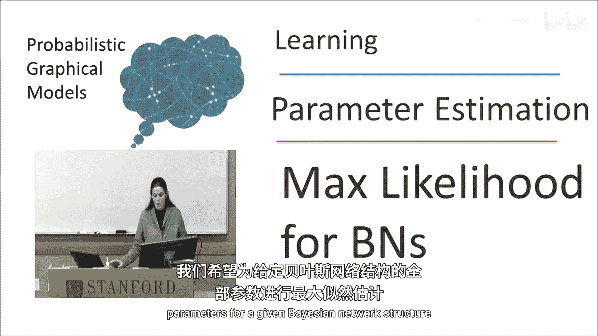
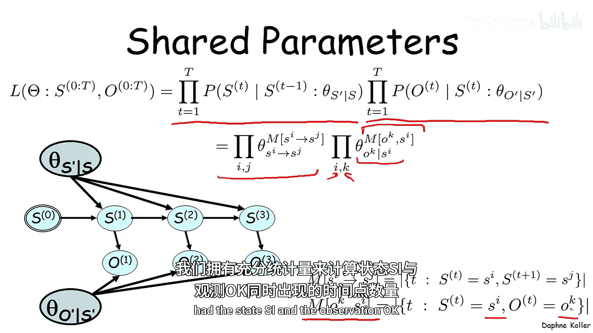
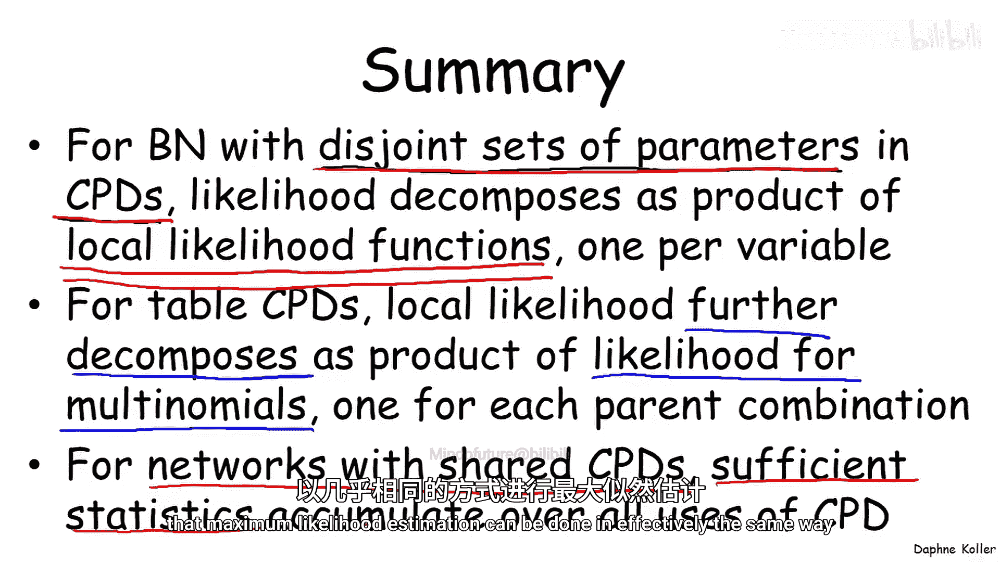
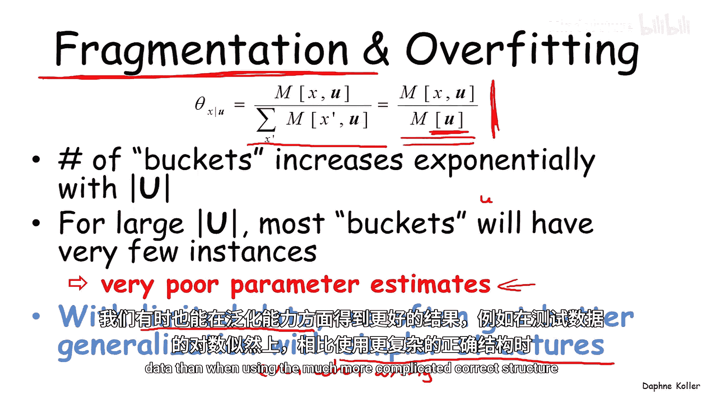

# 【斯坦福】概率图形模型3：学习 ｜ Probabilistic Graphical Models 3 Learning p09 P09_贝叶斯网络的最大似然估计_03_01_02 -BV1MH6LBREqD_p9-

Having defined the principle of maximum likelihood estimation for a single parameter。

 we can now consider the more complicated scenario where we're interested in doing maximum likelihood estimation for the full ensemble of parameters for a given Bayesian network structure。

So let's look at the more general case where now we have a general Bayesian network not necessarily binary valued。

 and our parameters now consist of a set of parameters theta x for all possible values of the variable x。

 and the set of parameters theta y given x for all values of the parent X and the child Y。

 and that's the parameterization of this Bayesian network in the general case。Of table CDs。

Now let's think about the likelihood of the parameters， this set of parameters theta。

 what does the likelihood function look like， well the likelihood function， remember。

 is the probability of the data given the parameters which decomposes because the parameters or IID as the product of all data instances XM andYM relative to the parametersization Theta。

Well， so we're going to break that probability up using the chain rule。For Bayesian networks。

And that's going to give me decomposition of this joint。

This probability as a product of the probability of the parent X times the conditional probability of y given x。

 which is， just again， the application of the chain rule in this very simple example。

And now I'm going to。Basically break this up first into two separate products so I'm going to move this product here。

 so I have one product over just the first set of terms and then a second product over the Y given X terms。

And then I'm going to observe that the first。Se of terms。

 the probability of Xm only depends on the parameter theta x。

And the probability of Ym given xm only depends on theta y given x。

And so now I've broken up the likelihood function into a product。

Of two what are called local likelihoods。Where a local likelihood。

Is the likelihood of just the variable x or just the variable y given its parents， in this case， x？

So more generally。I can do this exact same process in a somewhat more general case where if we have。

A set of variables， x1 up to xn。Then we can once again look at the product overall data instances。

Break this up using the chain rule。Her Bayesian network as for each instance。

 the product of XI given its parents where I'm assuming that UI are the parents。Excellent。

Wwitch the order of the product。So that instead of doing， sorry， switch it here。

 So instead of doing M。First I do the first the product over variables。

 then the product over data cases， and that gives me。Once again。A product of terms。

 which I'm going to call LI。Oh。B。CPD for Xi。And if we're willing to assume that variables that the different CPDs don't share。

Any parameters so that each CPD is effectively an independent entity that can be estimated separately。

 Then I can now。Est， I can now optimize theva of。The I variable separately from all other variables by optimizing this local likelihood term。

If we have table CPDs， it turns out that we can further decompose。So。Remember。

we started out with the probability now we're looking at the local likelihood for variable x。

 given its parents U， and as it depends on the CPD for x given U。

And what we're going to do now is we're going to break up the data cases into separate buckets。

So for every value， little x of x。And every value， little U of the parents you were going to multiply separately all of the instances。

 M。For which the m instance takes that value little x and that value little U。

And so what I've basically done is I've divided all of my instances into these disjoint buckets。Now。

 the point is we know what this is。The probability that Xm takes the value， little x。

And Im given that， you am。Takes the value little U。

Is simply the appropriate CPD entry theta x given U？And so this turns into this expression over here。

And so now the question is， how many occurrences？Of theta x given E do I get， Well， the answer is。

How many times I multiply it in the number of times that little U comma X occurs in the daum？

And so this turns out to be simply a product over all possible values of the child X and the parent H。

Of。The appropriate CP entry， P of little x given you to the power of the number of occurrences。

Of little X comm U。And if we now。Consider maximum likelihood estimation。

 It turns out that the maximum likelihood estimate of。

X of theta x given you is simply as one would expect。The fraction。Of x equals x among。Ps。Where。

New equals will you。So what happens with maximum likelihood estimation。

 We have a model with shared parameters。 Let's consider that question in the context of a hidden Markov model where initially we're actually just going to look at a Markov chain。

 That is a case where we have just a single state variable S。

 and we transition from one state to the other。 So let's look at the likelihood function in this context before we consider what max likelihood estimation would look like。

 So the likelihood function of the parameter vector theta， which dictates the transition model。

 given a set of observations of the states between time 0 and time t decomposes using the markov assumption as a product of T from one to T of the probability of the state at time t。

 given the state at time t plus one。Now we can further reformulate this product by looking at how it decomposes across specific pairs of states。

 S and SJ， so we can first multiply over all possible pairs of states I and J。

 and then consider all of the time points in which we transition from SI to SJ。

And then we have the probability of that transition from SI to SJ。

Now the critical observation is that this probability is the same regardless of the time points。

 this is because of the time andvariance assumption that we have in these models。😊。

And so the parameters specifically that we would be multiplying in this context is simply the transition parameter theta S to SJ。

😊，Now if we look at this expression， which has all these product in it， the product of IJ。

 and then the product of the time points consistent with the transition or in which the transition from I toJ took place。

 we end up with the product over here， which multiplies over all IJ of the parameter associated with that transition exponentiated by the sufficient statistics。

 MSI to SJ， which is simply the number of times in which in the data stream that we saw。

 we had a transition between those two states。Now， if we now consider what maximum likelihood estimation would look like for this parameter theta hat for the parameter theta S to SJ。

 the maximum likelihood estimate theta hat S of SJ would be exactly what we would expect。

 the number of transitions in which SI transition to SJ divided by the number of total occurrences of the state S within time sequence。

Let's now elaborate this to the context of a hidden Markov model just to see what it would look like。

 so here we have in addition to the first component of the likelihood function。

 which is the same one that we had before， just the transition probabilities of the state sequence。

 we also have an additional component which looks at every state from1 to big T of the probability of the particular observation O of T given the state S of T。

And we can just do the exact same process of reformulating the likelihood function。

 we've already seen what the first term looks like。

 it's exactly the same as the one that we had on the previous slide。

 theta Si to SJ expentiated with sufficient statistics and we have an very analogous term that looks for over pairs of state I and observation K of the parameter that corresponds to the K observation in the state I expentiated with the sufficient statistics。

 which is the number of times that we saw in the same state in the same time point。

 the observation K and the state I。And so adding now to our set of sufficient statistics。

 in addition to the counts of going from SI to SJ， we also have sufficient statistics that count the number of times。

 time points in which we had the state SI and the observation okay。

So to summarize maximum likelihood estimation in the case of discrete graph Bayesian networks for a Bayesian network that has disjoint sets of parameters in the CPDs。

 that is where each CPD has its own set of parameters。

 the likelihood function decomposes as a product of local likelihood functions。

 and this is important because we're going to use that later on one per variable。

 so the likelihood function is a product of small likelihoods or local likelihoods one per variable。

😊，Now when we have table CPDs， we get a further decomposition。Specifically。

 even the local likelihood now decomposes as a product of likelihoods for specific multinomials。

 one for each combination of the parents， and so now we get a further decomposition that is basically going to allow us to estimate each of those multinomials separately via the same max likelihood estimation that we had in the original case of estimating parameters for a single multinomial because if you just have a product of these likelihood functions。

 each of them can be optimized separately。Finally， in the very common case of networks that have shared CPDs。

 so this is a case unlike the first bullet where we had disjoint sets of parameters here。

 we have shared CPDs， we simply accumulate the sufficient statistics over all occurrences or uses of that CPD and then once we do that maximum likelihood estimation can be done in effectively the same way。

Now， one important observation that arises from the form of maximumim likely estimation is worth remembering and thinking about when one uses this。

😊，So let's look at the form of the maximum likelihood estimate for parameter theta x given u。

And as we've seen， that is a ratio between the number of accounts of the instantiation little x and the parent assignment little U divided by the sum of all Mx prime U for different values of x prime。

Or written otherwise， it's MXU divided by mu。Now， what are the consequences of this expression when the number of parents grows large？

When the number of parents grows larger， the number of buckets that is the number of different possible assignments。

 little U increases exponentially with the number of parents。

 if you have two parents it grows exponentially with to the number of different buckets U but if you have 15 or 20 parents。

 then the number of buckets into which we need to partition the data increases very quickly。

 and that means that most buckets that is most assignments。

 little U will have very few instances assigned to them。

 which means that effectively most of these estimates which divide M of xu divided by M of U will be done with few or even zero instances M of U at which point any estimate is just totally bogus and specifically that means that the parameter estimates that we're going to get in most of the multinoial parameters once U gets large are going to be very poor。

So this concept is called fragmentation of the data。And it has the following important consequence。

 if the amount of data is limited。Relative to the model dimensionality。

 we can often get better estimates of the parameters with simpler structures。

 even when these structures are actually wrong， that is we even if we make incorrect independence assumptions。

That are。Making that a removing edges that really ought to be there。

 we can sometimes get better generalization in terms of say log likelihood of test data than when using the much more complicated correct structure。

