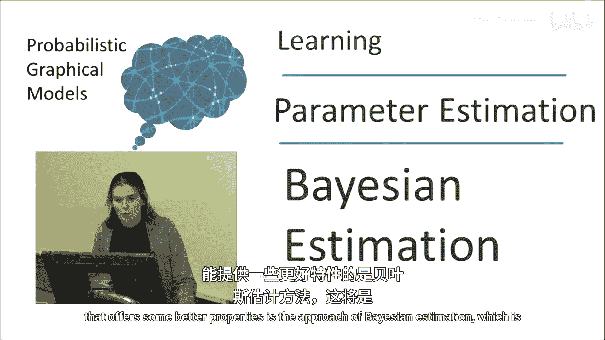
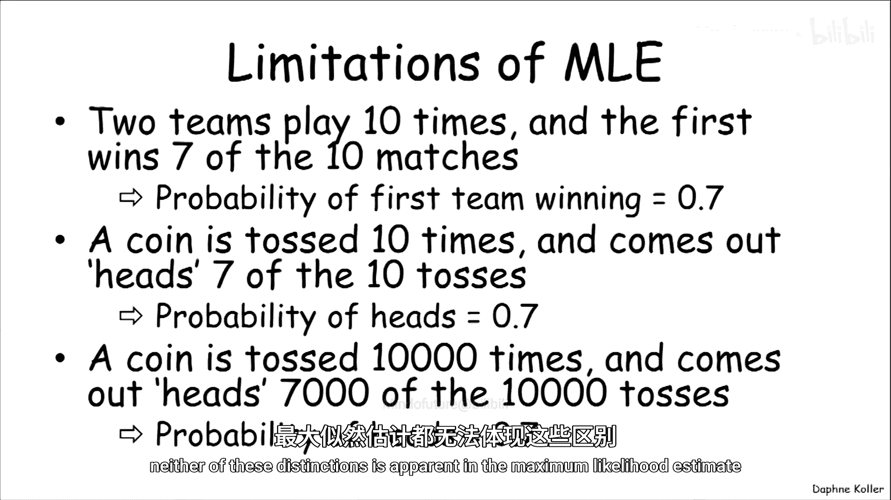
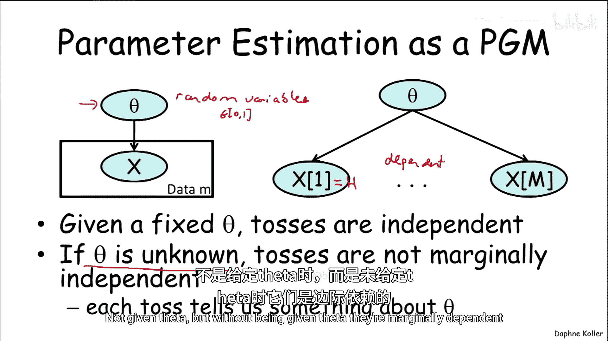
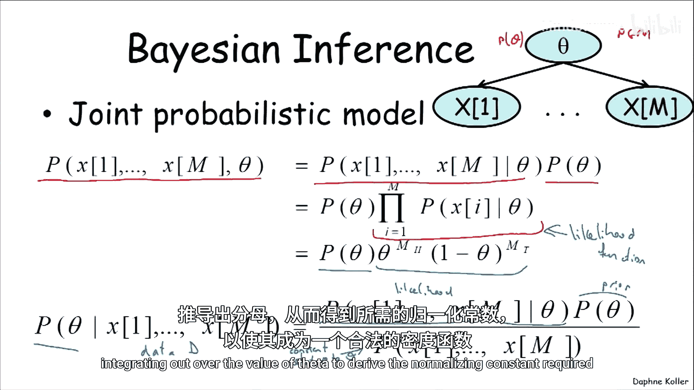
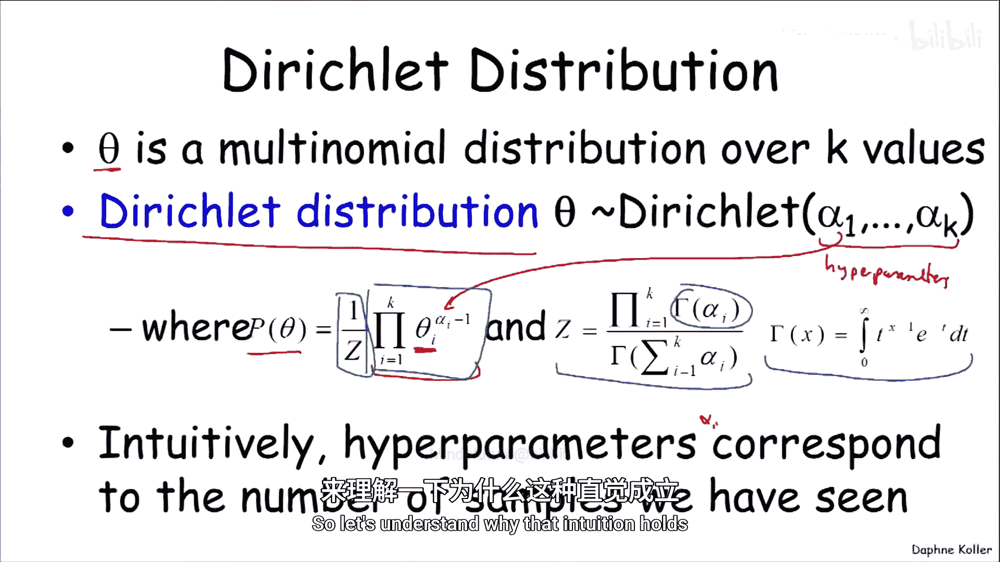
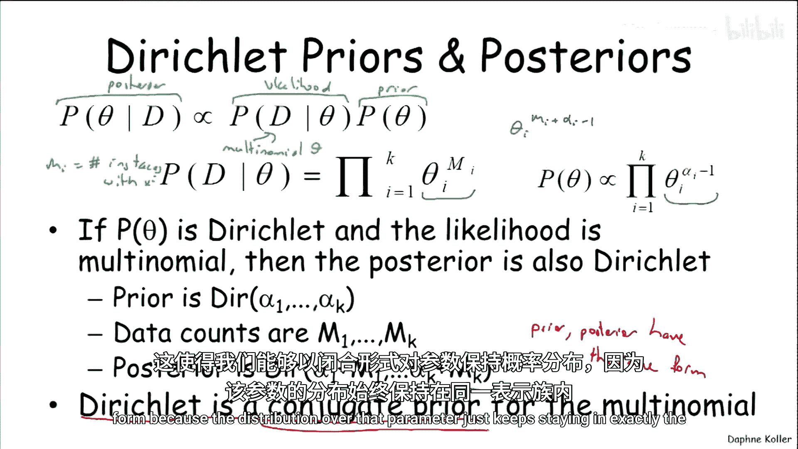
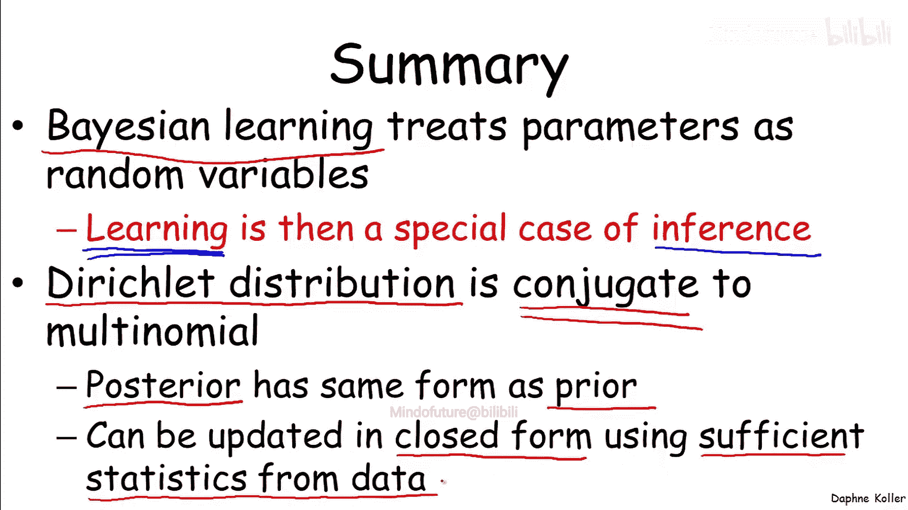

# 【斯坦福】概率图形模型3：学习 ｜ Probabilistic Graphical Models 3 Learning p10 P10_贝叶斯估计_03_02_01 -BV1MH6LBREqD_p10-

Continuing in our discussion of parameter estimation。

 previously we talked about maximum likelihood estimation。

 which tries to optimize the likelihood of the data given the parameters and an alternative approach that offers some better properties is the approach of Bayesian estimation。

 which is what we're going to talk about today。

So first， let's understand why maximum likelihood destination isn't perfect。

So consider two scenarios in the first one， the team you have two teams that play 10 times and the first team wins seven out of 10 matches。

 so if we're going to use maximum likelihood estimation。

 the probability of a first team winning is 0。7 which seems like an not unreasonable guess going forward。

On the other hand， we take a dime out of our pocket and we toss it 10 times and it comes out heads。

 seven out of the 10 tosses， maximum likelihood estimation is going to come out with exactly the same estimate。

 which is of the probability the next coin coming out heads is also 0。7 in this case。

 that doesn't seem like quite as reasonable an inference to make based on the results of these  ten0 tosses。

To elaborate the scenario still further， let's imagine that we take that same dime and now we patiently sit and toss it 10。

000 times and sure enough it comes out head 7000 out of the 10。

000 tosses Now the probability of heads is still 0。7。

 but now it might be a more plausible inference for us to make than in the previous cases where we only had 10 tosses to draw。

And so maximum likelihood estimation has absolutely no ability to distinguish between these three scenarios between the case of a familiar setting such as a coin versus an unfamiliar event such as the two teams playing on the one hand and between the case where we toss a coin 10 times versus toing a 10。

000 times neither of these distinctions as apparent in the maximum likelihood estimate。

 so to provide an alternative formalism， we're going to go back to our view of parameter estimation as a probabilistic graphical model。

Where we had the parameter Theta over here， and we had the data being dependent on the parameter Theta。

But unlike in the previous case where we were just trying to figure out the most likely value of theta。

 now we're going to take a radically different approach and we're going to assume that theta is in fact。

 a random variable by itself， It's a continuous valued random variable， which in this case。

 in the case of the coin sauce takes on value in the space01 but in either case。

 it is a random variable and therefore something over which we maintain a probability distribution。

 Now this in fact is at the heart of the Bayesian formalism。

 anything about which we are uncertain we should view as a random variable over which we have a distribution that is updated over time as data is acquired。

So let's understand the difference between this view and the maximum likelihood estimation view。

So certainly we have， as before， that given theta， the tosses are independent。

But now that we're explicitly viewing theta as a random variable， we have that if thema is unknown。

 then the tosses are not marginally independent。 So for example。

 if we observe that x1 is equal to heads， that's going to tell us something about the parameter is going to increase our probability that the parameter favors heads over tail。

 it therefore it's going to change our probability in other coin tosses。

 So the coin tosses are dependent。Margiinally， not given sata， but without being given sata。

 they're marginally fee pen。

So that really gives us a joint probabilistic model over。

All of the coin pulse and the parameter together。So if we break down that probability distribution using this PGM that we have over here。

 it breaks down using the chain rule for that Bayesian network that we have drawn there。

 so we have P of theta， which is the parameter for the roots of this network。

 and then the probability of the x's given theta， which because of the structure of the network。

 we have that their conditional independence given theta。

 and so we have we can decompose this as a prior over theta times the product of the probabilities of the individual data in given theta。

Which this over here is just our good friend from before the likelihood function。

Which is just the probability of the data given the parameters， and we've already specified。

 computed what that is in the context of this coin tossing example。

 and that is data to the power of the number of heads times one minus datata to the power of the number of tails。

But now we have an additional term， which is the probability of theta。

 which we obtained from the prior that we have over theta。And now we can。

 by virtue of having a prior and in fact， join distribution。

 we can now go ahead and compute a posterior over my parameter Theta， given my data set B。

 so this is after having observed the values of M coinin classes。

 I have a probability distribution over a new probability distribution over the parameter and by a simple application of bases rule that is going to be equal to the probability of the data given。

Data， which is， again， my likelihood function。Times the prior。Divided by the probability of the data。

 which importantly， just as in other applications of bases rule， is a normalizing constant。

And constant here means relative。The fatal。Which means that if I know how to complete the numerator。

 I can derive the denominator by simply， in this case。

 integrating out over the value of say that to derive the normalizing constant required to make this a legal density function。

So the most common parameter distribution to use when we have a parameter that describes a multinoial distribution over k different value。

 such as this parameter theta is what's called the deerschlet distribution。Now。

 the dechle distribution is characterized by a set alpha1 of the alpha K of what are called hyperparameters。

And that is to distinguish them from the actual parameters data。

So the probability distribution that is defined using these hyperparameters is a density over theta p is theta。

 which has the following form， let's first look at this part over here。

 which is the part that actually depends on the parameters theta。

 and what we see here is that we have for each of the entries， theta I in the multinomial。

 we have an expression of the form theta I to the power of alpha I minus1。

 where alpha I is the associated hyperparameter。In order to make this a legal densitys。

 we have addition， a normalizing constant a partition function， which in this case。

 and this is something that we'll come back to has the following form that we're not going to dwell on right now。

 it's a ratio of these things called gamma functions。

Where a gamma function is defined via the following integral。 And for the moment。

 we don't really need to worry about this， because the only thing we really care about for the moment is the form of this。

Internal expression over here， knowing that it needed to be normalized in order to produce density。

Now， intuitively， and we'll see this in a couple of different ways。 these hyper parametersa。

 these alphas。😊，Correspond intuitively to the number of samples that we've seen so far。

 So let's understand why that intuition holds。

But before we do that， let's look at a couple of examples of dele distributions and this is a special case of the deishle distribution where we have just two values to the random variable。

 so it's really a distribution for a Bernoulli random variable。 and in this case。

 dechle is actually known often as a data distribution， but a beta is just a dechle with two。

P for parameters。So here we have several examples of a D layer beta distribution。

 this one is the D layer beta 11 and notice that that corresponds to a uniform distribution。

As we the number of increase the hyperparameters， for example， we go to this green line。

 which is Dele22， we notice that we get a peak。In。In the middle。

 So theres there is an increase around 0。5。 and that corresponds to a stronger belief that the parameters is centered around the middle。

 that probability increases yet further when we go to the deerslay 55 or beta 55。

 where now we have an even bigger peak around the value in the middle。

 And as we shift the amount of data that we get and its mix。

 this distribution is going to get to move to the left and the or to the right。

 depending on the mix between head your tails in this case。 And as we get more and more data。

 the distribution becomes more and more peaked。 So， so roughly speaking， we have that the mix。

Between alpha heads and alpha tail， the balance determines。There a position of the peak。

And the total alpha。Theters。How sharp it is。So now that we know a little bit about what the deersle distribution looks like。

 let's see how it's updated as we have obtained data。

 so let's consider a case where we have a prior which we're going to assume is deerchle。

 we have a likelihood。Which is for a data set， B derived from a multinoial。

From the multinomial phenna。 And now we'd like to figure out the posterior。

He'll say the given D after having seen the data to B。So the likelihood we've already seen before。

 this is the probability of a data set that has， in this case， MI being the number。Of instances。

With value little Xi。And so this is just a likelihood function。

 And the prior has the form of a delet with associated hypoparameters。

And what's important to see looking at this is that the theta I term in the likelihood and the theta I term in the prior have exactly the same form。

 So when you multiply the likelihood with a prior， you can bring together like terms those with theta I at the base of the exponent and you're going to end up with a posterior that looks exactly like a deishle distribution as well because it's going to have the form。

😊，Theta I。For the power of Mi plus alpha I-1。So if our prior was deerchle alpha 1 up to alpha K and the data count M1 of the Mk。

 then the posterior is simply a deerchle with。Hyperparas， alpha 1 plus M1 of the alpha K plus Mk。

And that again suggests that the hyperparameter of a distribution represent counts that we've seen if a priori are counts for X were alpha。

 and now we saw an additional MI counts for alpha， then now in the posterior we have alpha I plus MI counts that we've seen for that particular event。

Now， from a formal perspective， this is a useful term to know this situation where the prior。

And the posterior have the same form。Is called a conjugate fri。So in this case。

 the derichle distribution is a conju prior for the multinomial because if we have a derichle prior and a multinoial likelihood。

 we have a derile posterior。And it turns out that many parametric families have a nice conjugate prior that allows us to maintain a probability distribution over the parameters in closed form because the distribution over that parameter just keeps staying in exactly the same representational family in this case of Deerschlas。

So to summarize， we've presented the framework of Bayesian learning。

Baesian learning treats parameters as random variables， continues variables， random variables。

 but still random variables， which then allows us to reformulate the learning problem simply as an inference problem because what we're doing is we're taking a distribution over the random variables and updating it using evidence。

 which in this case is the observed training data。😊，Now。

 specifically in the context of discrete random variables over which we have a multinoial distribution in the likelihood and a deishle distribution as the prior。

 we have this very elegant situation where the prior。

 the dele distribution prior is conjugate to the multinoial distribution。

 which as we just discussed means that the posterior has the same form as the prior。

And that in turn allows us to keep a closed form distribution on the parameters。

 which has the same form all along as we keep updating it。

 and that update uses the sufficient statistics from the data for the update process。

 usually in a very efficient form。

