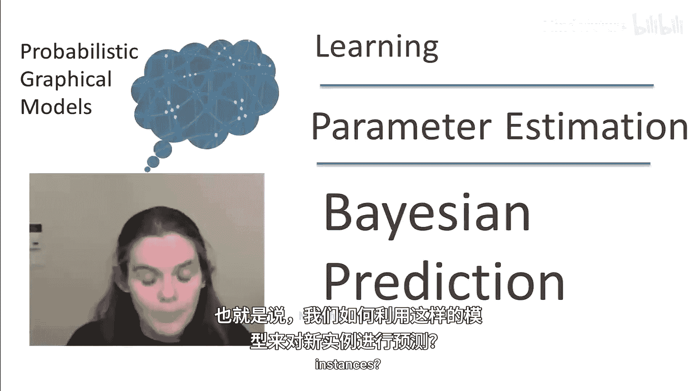
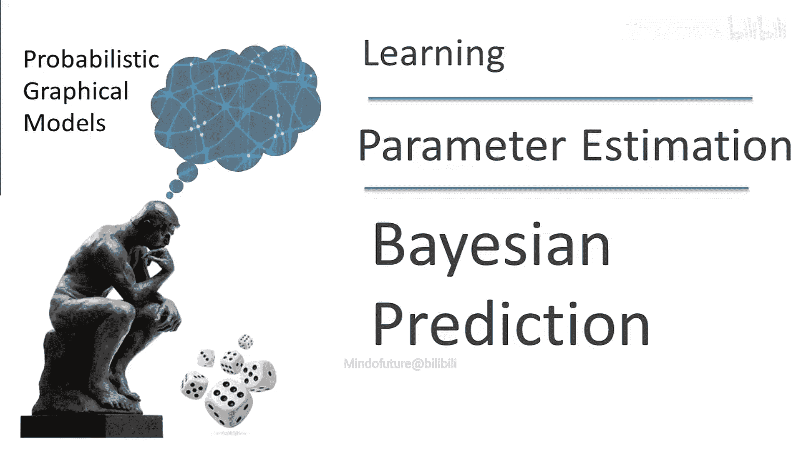
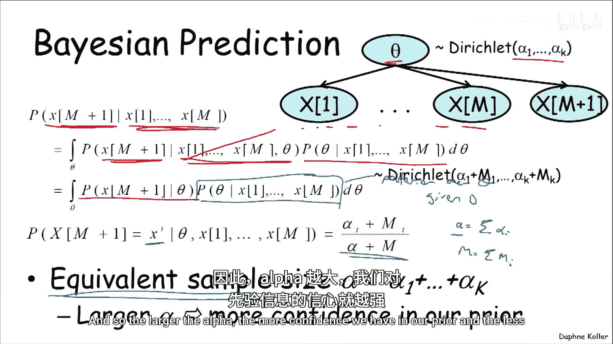
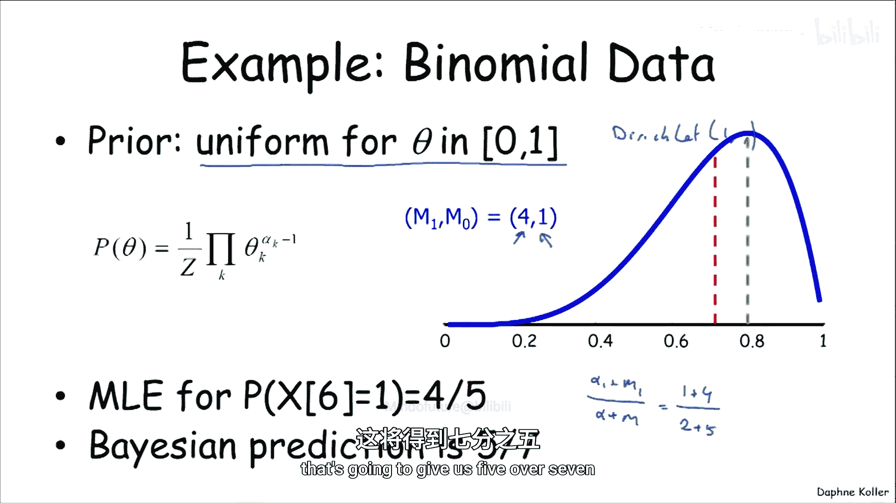
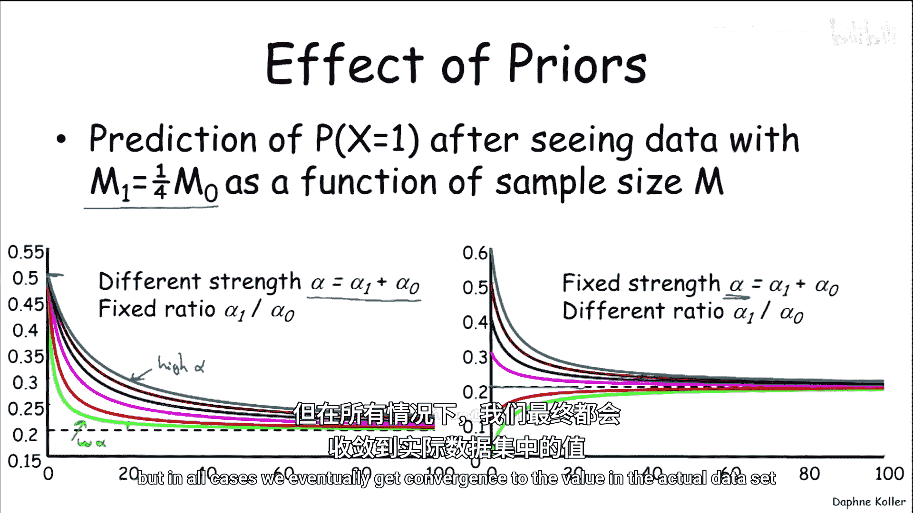
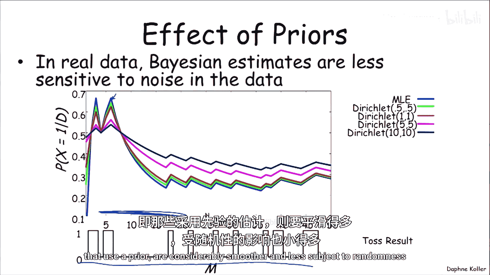
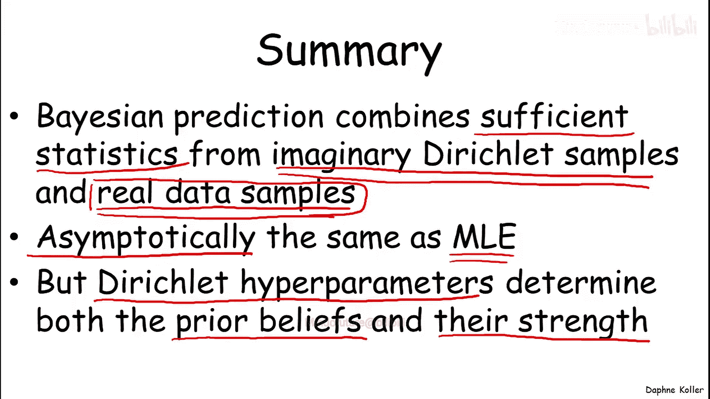

# 【斯坦福】概率图形模型3：学习 ｜ Probabilistic Graphical Models 3 Learning p11 P11_贝叶斯预测_03_02_02 -BV1MH6LBREqD_p11-

We previously defined the notion of Bayesian estimation in which we have a prior over the parameters and we continue to maintain a posterior over the parameters as we accumulate new data。

What we haven't discussed though， is how one might use a model in which we have a distribution over the parameters。

 that is how do we take such a model and use it to make predictions about new instances？

So now let's think about how we use a deish s distribution once we have it。

So assume that we have a model where our parameter sta is distributed de Schle with some set of hyperparameters。

Now， if we're trying to make a prediction over the value of a variable x that depends on the parameter of theta。

 well， we're just， this is just now a probabilistic inference problem。 And so the probability of x。

Is simply the probability of x given thena。Marnal times the prior over theta。

 marginalizing in this case， corresponding to an integration。Over the values of Ph。

And that gives us this integral over here。So if we plug through the integral。

 what we're going to get is the following form， and I'm not going to go through the integration by parts that's required to actually show this。

 but it's really a straightforward consequence of the properties of integrals of polynomials in this case we have that the probability that x takes a particular value X I。

Is one is1 over z times the integral over all of the parameters theta of theta I。

 which is the probability given the parameterization theta that x takes the value little X times this thing over here。

 which is the prior。And we multiply the two together， integrate out over the parameter vector theta。

 which in this case is a k dimensional parameter vector。

 and it turns out that when one does that you end up with alpha over the sum of all Js alpha J a quantity typically known as little alpha。

 and so we end up with a case where the prediction over the next instance represents the fraction。

Of the instances that we've seen。As represented in the hyperparameters of the dersle。Where。

We have X little Xi。So if alpha I represents the number of instances that we've seen where where the variable took the value littlexii。

 the prediction very naturally represents is simply the fraction of the instances with that property。

And so once again， we see that there is a natural intuition for the hyperparameter as representing motion of counts。

Now， let's put these two results together and think about Bayesian prediction as a function of as the number of data instances that we have grows。

 So here we have a parameter theta， which initially was distributed as a dechle with some set of hyperparameters。

 And let's imagine that we've seen M data instances， X1 up the XM。😊。

And now we have the M plus first data and we want to make a prediction about that。

So the problem that we're trying to solve is now the probability of the M plus first data instance。

 given first the M instances that we've seen previously。

And so we can once again plug that into a probabilistic inference equation。

So this is going to be the probability of the M plus first data instance， given。Everything。

 including theta times the probability of theta given X1 of to X。

 So we've introduced the variable theta into this probability。

 and we're marginalizing out over the variable theta。Well。

 one thing that immediately follows is because of the structure of the probabilisticographical model here。

 we have that Xm plus one is conditionally independent of all of these previous x's given Thena。

 and so we can cancel these from the right hand side of the conditioning bar。

 which gives us over here probability of x M plus one given theta。

 And over here we have the probability of Theta。Given x1 of the Xm。

And so now let's think about the blue equation， the blue expression over here。

 which is just the posterior。Over say no。Given the。Which are X of the Xm。

And we've already seen what that looks like that， as we showed just on the previous slide。

 is simply a Deer Schle whose hyperparameters are alpha 1 plus M1 up to alpha K plus Mk。

And so now we're making a prediction of a single random variable from a deerchlet that has a certain set of hyperparameters。

 and that was the thing we showed on the slide just before that。

 which is simply the fraction of the the fraction of the hyperparameter corresponding to the outcome X I as a fraction of all of the sum of all of the hyperparameters。

 where again， just to introduce notation， alpha is equal to the sum of the alpha I and M to the sum of the Mis。

😊，Now， notice what happens here。This parameter alpha that we just defined。

 which is the sum over all of the alpha I' that I have is a parameter known as the equivalent sample size。

 And it represents the number of， if， if you will， imaginary samples that I would have seen prior to receiving the new data。

 X1 up to X M。Now， look what happens If we multiply alpha by constants。

 So say we double all of our alphas， then we have。 we're going to let the Ms affect。Our estimate。

 a lot less than for smaller values of alpha。 And so the larger the alpha。

 the more confidence we have in our prior and the less we let our data move us away from that prior。

Let's look at an example of the influence that this might have。

 So let's go back to binomial data Bernoulli random variable。

 And let's take the simplest example where a prior is uniform for theta in 0，1。

 And we've previously seen that that corresponds to D。With hyperparameters 11。So this is our。

 So this is a general purpose dele distribution。 In this case， the hyperparameters are1 and one。

 And let's imagine that we get five data instances of which we have four ones。And 1，0。

 And if you actually think about the differences between what the Bayesian estimate gives you for the sixth。

Next coin toss relative in when doing maximum likelihood estimation versus the Bayesian estimation。

 for maximum estimation， we have four heads， one tail， maximum likelihood estimate is four/ fifths。

 so that's going to be the prediction for the sixth instance。The Bayesian prediction。

 on the other hand， remember， is going to do the hyperparameter Alpha 1 plus M1 divided by alpha plus M。

 which in this case is going to be one plus4 divided by2 plus。5， and that's going to give us5 over7。

So let's look more qualitatively at the effect of these predictions on a next instance。

 after seeing a certain amount of data。 And for the moment。

 we're going to assume that the ratio between the number of ones and the number of zeros is fixed so that we have one。

One for every four zeros。And that's the data that we're getting And now let's see what happens as a function of the sample size。

 so as we get more and more data， all of which satisfy this particular ratio。

So here we're playing around with a different strengths。Our equivalent sample 5。

But we're fixing the ratio of alpha1 to alpha 0 to represent in this case， the 50% level。

 So our prior is a uniformliform prior， but of greater and greater or changing strength。

And so this little green line down at the bottom represents a low alpha。

Because we can see that the data get pulled our posterior。

 so sorry the line is drawing the posterior over on the parameter or rather equivalently the prediction of the next data instance over time and you can see that here alpha is low。

 and that means that even for a fairly small amount of data。

 say 20 data points were already very close to the data estimate。On the other hand。

 this bluish line over here， we can see that the alpha is high。

And that means it takes more time for the data to pull us to the empirical fraction of head versus tails。

Now， let's look at varying the other parameter。 We're going to now fix the equivalent sample size。

 and we're going to just start out with different priors。

 And we can see that now we get pulled down to the 0。

2 value that we see in and the empirical data and the further away from it。

 we start it takes us a little bit longer to actually get pulled down to the data estimate。

 But in all cases， we eventually get convergence to the value in the actual data。

From from a pragmatic perspective， it turns out that Bayesian estimates provide us with a smoothness where the random fluctuations in the data don't。

don't cause quite as much random jumping around as they do， for example。

 maximum likelihood estimates。 So if what we have here is the actual value of the coin toss at different points in the process。

 you can see that the blue line， the light blue line， that corresponds to max likelihood estimation。

 basically bops around the fair amount， especially in the low data regime。

 whereas the whereas the ones that use a prior， the estimates that use a prior are considerably smoother and less subject to random noise。

In summary， Bayesian prediction combines two types of you might call them sufficient statistics。

 There is the sufficient statistics from the real data。

But there is also sufficient statistics from the imaginary samples that contribute to the delay distribution。

 these alpha hyperparameters， and the Bayesian prediction effectively makes the prediction about the new data instance by combining both of these。

Now， as the amount of data increases， that is at the asymptotic limit of many data instances。

 the term that corresponds to the real data samples is going to dominate。

 and therefore the prior is going to become vanishingly small in terms of the contribution that it makes。

 So at the limit， the Bayesian prediction is the same as maxim likelihood estimation。But initially。

 in the early stages of destination before we have a lot of data。

 the priors actually make a fairly significant difference。

 and we've seen that the deers Schle hyperparameters basically determine both our prior beliefs initially before we have a lot of data。

 as well as the strength of these beliefs that is how long it takes for the data to outweigh the prior and move us towards what we see in the empirical distribution。

😊，But importantly， even as we've seen here in the very simple examples， and as we'll see later on。

 when we talk about learning of Bayesian networks， it turns out that this Bayesian learning paradigm is considerably more robust in the sparse data regime in terms of its generalization ability。

