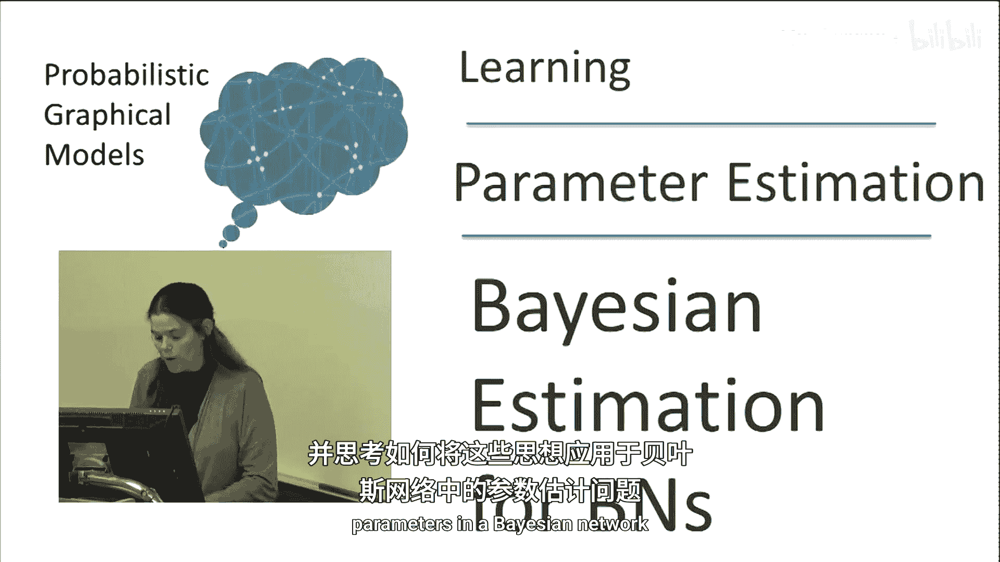
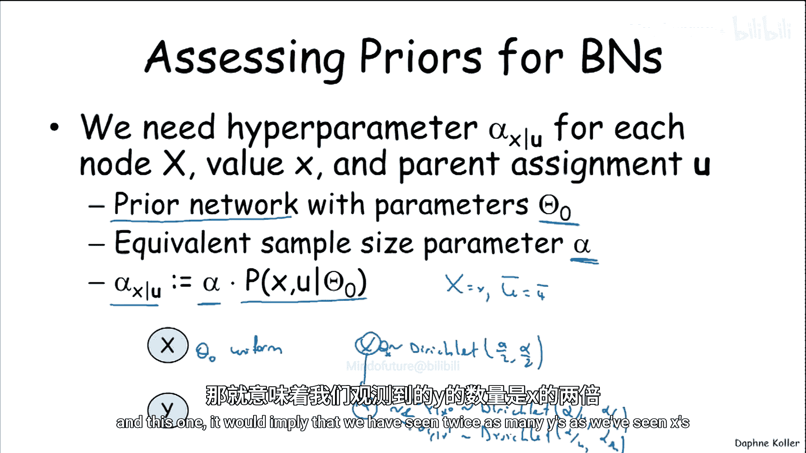
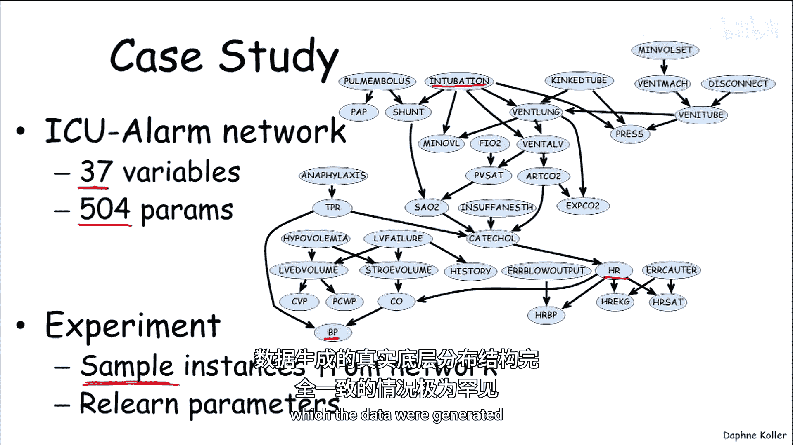
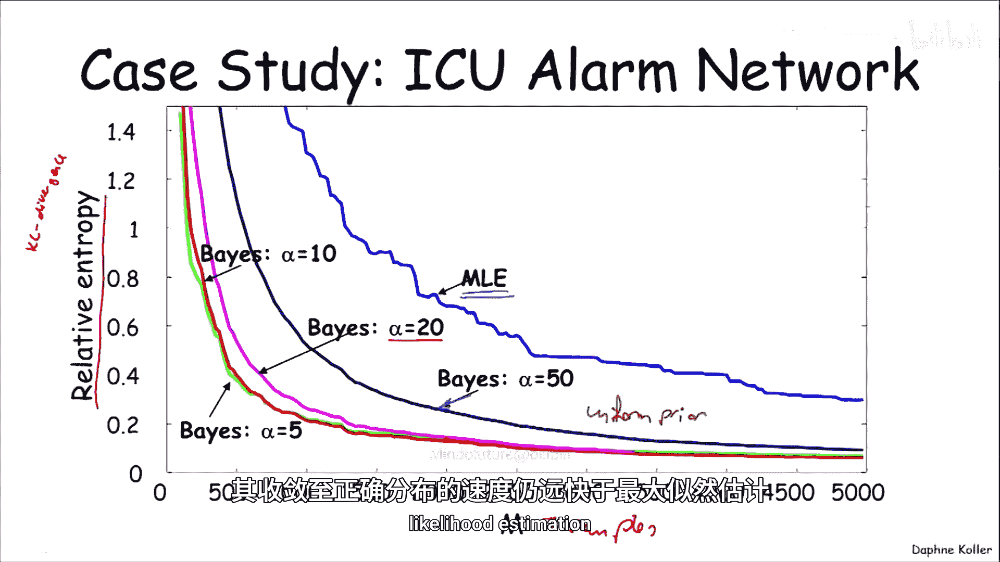
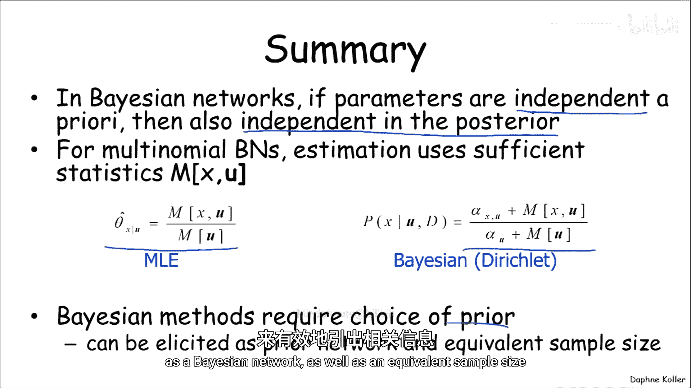

# 【斯坦福】概率图形模型3：学习 ｜ Probabilistic Graphical Models 3 Learning p12 P12_贝叶斯网络的贝叶斯估计_03_02_03 -BV1MH6LBREqD_p12-

We previously defined the notion of Bayesian estimation and showed how it could be applied in the context of a single random variable。

 say a multinoial random variable Now we're going to step back to the world of probabilistic graphical models and think about the application of these ideas to the problem of estimating parameters in a Bayesian network。

So let's draw again the probabilistic graphical model that represents a Bayesian estimation in a Bayesian network。

 so just as before in the single variable case， we're going to inject into the model。

 explicitly the parameters that characterize sorry random variables that define the parameters and so here we have two random variables。

 theta X which represents the CPD。Of X。And theta y given x。

 which represents the CP P of y given x notice that each of these is actually vector valued because there's going to be multiple actual numbers in each of these CPDs。

 but we're going to draw them in single circles。Now， once again。

We can look at this network and read out certain important conclusions。

 so the first important conclusion is that the instances these XY pairs are independent given the parameters。

And we can see that by noticing that if I condition on both theta x and theta y given x。

 then the Xy pairs become desepar from each other， and so we have conditional independence following as a consequence of the structure of the graphical model。

We also have，- and this is another explicit property that we can read from this diagram。

 is that theta x and theta y given x are marginally independent。

So our priori we have that the parameter prior over all of the parameter data can be written as the product over I。

 and in this case， I is being the random variables in the network of the prior over the CPD for XI。

 and so the prior is a product of little priors one for each CPD。Now， it follows from this。

By just writing down the graphical model and looking at what the implications of the expressions are。

 that the posteriors of the theta are also independent， given complete data。

And the reason for that is that complete data deses the parameters for the two CP。

 so if you look at this network over here and assume that we have all of these variables，Conditioned。

Observed， then you can see that there is no active path between theta x and theta y given x。

Because for example， if we look at potentially this。Trail。

 we can see that x2 blocks the trail from theta x to theta y given x。 and so again。

 following directly from the structure of this network， we can see that the posterior distribution。

 theta x comma theta y given x given D decomposes as a product of the posterior over theta x given D times the posterior of theta y given x given D。

Which means that just as a maximum likelihood an estimation where you could break up the estimation problem into one of estimating each CPD separately。

 we can do the same here， only now we can do it using Bayesian estimation where instead of just picking a single parameter setting for the CPD。

 we compute these separate posteriors。Separately， and then put them together into a single posterior。

Now it turns out that we could do even finer breakdown in the context of table CPDs。

 so here we have when we're now looking at the binary case where x is a binary valued random variable。

 so now we have two multinomials in our CPD for y given x1 corresponding to the case of Y given x1 and the other to y given x0。

And it turns out that if。😊，Again， in this model， we're assuming that these are independent。A priori。

Whi is what this diagram says because you notice that there's no edges between them so they're marginally independent。

 theta y given x1 and theta y given x0， if we're postulating that that holds as we are in this diagram。

 it turns out that they are also independent in the posterior。

Now that is a little bit trickier to show because it turns out that you can't read it directly from the diagram because in fact。

 even given complete beta， we have an active trail that goes from theta y given x1 through y1。

 which since it's observed， it activates the V structure into theta y given x0。But it turns out。

That if we go back to some of the examples of context specific independence that we had in the case specifically a multiplex or CPD。

 we can derive that these are， in fact， despite the appearance of an activated V structure。

 conditionally independent。In the posterior as well。And so once again。

We can compute the posterior as a product。Of posteriors of the form。If you say the X given D。

Times the probability of theta。Y given x1， given the。Times the probability of theta 1。Give it x0。

So we can generalize this to a general Bayesian network。

 and let's assume that we have a Bayesian network with table CPDs that's specified in terms of multinoial parameters of the form theta X given you where U is some assignment。

ex's parents。You。Then if for each such multinoial parameter。

 we have a deerchle prior with appropriate hyperparameters then。

We can show using the kind of analysis that we just did。

 combined with the analysis of the posterior for a single multinomial。

 that the posterior is now a dechle with hyperparameters that represents V。

Prior that we had for that multinomial。Plus， the sufficient statistics that represent the counts in the datana of particular combinations of the parents and the child。

 and so for example， for the entry in the multinomial representing the value little x1 for x。

And little you for the parents， you， we have this。Prior parameter plus the counts in the data for that combination of x and U。

So。Now we know how to take a set of priors and use the data to update them， to form posteriors。

Now let's think about where the priors might come from。

 and a priori it might seem very daunting to construct a set of priors for all of the nodes in a Bayesian network。

It turns out， however， that there is a general purpose scheme for doing that that is both easy and has some good theoretical properties and that scheme works as follows。

What we're going to do is we're going to define a prior Bayesian network that has some set of parameters theta0。

And we're going to define a single equivalent sample size。

Which is going to be applicable or applied to all of the nodes in the Bayesian network。

And so in order to specify the parameter， the hyperparameter， alpha x given U。For an assignment。

 x equals little x and u equals little u， we're simply going to compute the probability in this parameterized network of x and U。

 and we're going to multiply it by the equivalent sample size alpha。Now， in many cases。

 you're just going to use theta0 to be the uniform parameters。

And which makes it all a very easy computation， but this provides a simple。

 coherent way to specify all of the hyperparameters simultaneously。And so let's look at an example。

 here is a network XY that has no edge。And。And let's。Imagine that that is our。

That is our prior network， and so we're going to in fact assume a uniform distribution over the values X Y。

 and now let's so theta 0。Hiss uniform。And now let's look at what we would get for different situations in a network where we have X。

Being a parent of mine。Which is the network whose parameters we actually want to estimate。

 And so what we would get for。And let's assume they're both binary。X and y。

 and so x is going to be distributed as a parameter with deerslet with hyperparameters， alpha over 2。

Llf over two。And why？Is going to be distributed。Remember， so not what， not x theta of x。

Is going to be distributed this way and theta of y given x0 is going to be distributed in the following way。

 It's dele with hyperparas， alpha times the probability of x comma y。

Which in the uniform distribution is a quarter。And similarly。

 for theta Y given x1 is going to have the same。Their say distribution。And if you think about this。

 this makes perfect sense because it tells us that we have seen the same number of examples of x as we have of y。

 it's just that in y we had to partition the examples of y over those where we had x equals x0 and those we had x equals x1 if on the other hand we had say dechle of alpha over2 alpha over2 for the two for the two multinoials corresponding to corresponding to y。

 this one and this one。It would imply that we have seen twice as many Y's as we've seen X'es。😡。

So let's see what kind of effect using the Bayesian estimation has in a pseudoreal world example。

 so this is actually a real network， it was developed for monitoring patients in an ICU and we call it the ICU alarm network and it turns out that the ICU alarm network has 37 different variables that represent things like whether the patient was intubated。

 the patient's blood pressure heart rate and various other medical events that might happen and it turns out that overall the network has 504 parameters。

Now there aren't actually data cases here， this was a hand constructed network and so what we're going to do is we're going to sample instances from the network and then we're going to pretend that we don't know the network parameters and see the extent to which we can recover the network parameters via learning from the instances that we sampled from it。

Now， I should say that this is。A pseudoreistic learning problem because the instances that one samples from a network are always cleaner than the instances that one gets in the context of a real world data set。

 because in a real worldorld scenario， it is rarely the case that the network whose structure the network that you're trying to learn has the exact same structure is the true underlying distribution from which the data were generated。

 and so this is a much cleaner scenario， but still it's useful and indicative。

So what we see here are the results of learning as a function of the x axis。

 which is the number of samples。And the Y axis is a distance function between the true distribution and the learn distribution。

 and that distance function， we're not going to talk about this at the moment。

 It's the notion called relative entropy， it's also called kale divergence。

But what we need to know about this for the purposes of the current discussion is that when two distributions are identical。

 it's zero and otherwise it's not negative。So what we see here is that the blue line。

Ororresponse to maximum likelihood destination。And we can see several things about the blue line。

 First of all， it's very jagged。There's a lot of bumps in it。And second。

 it's consistently higher than all of the other lines。Which means that maximum likelihood estimation。

 although it does continue to get lower as we get more datana with as high as 5，000 data points。

 we still haven't gotten close to the true underlying distribution。Conversely。

 let's see what happens with a Bayesian estimation。

 and this is all Bayesian estimation with a uniform prior。And different。Equivalent sample size。

 So this is using the prior network with a uniform network in different values of alpha。

And what we see here is that for alpha equals。5， that's the green line。

Alpha equals 10 are almost sitting directly on top of each other。

 and they're both considerably lower than all of the other lines and also the maximum likelihood estimation。

As we increase the prior strength so that we have a firmer belief in。A uniformform prior。

 we can see that we move a little bit away and now the performance becomes a little worse。

 but notice that by around 2000 data points， we're already pretty close to the case that we were for an equivalent sample size of5 for 50 which is this dark blue line it takes a little bit longer to converge and it doesn't quite make it but even with an equivalent sample size of 50 which is pretty high。

 you get convergeence to the correct distribution much faster than you do for max likelihood estimation。

So to summarize。In Bayesian networks， if we're doing Bayesian parameter estimation。

 if we're willing to stipulate the parameters are independent a priori。

 then they're also independent in the posterior， which allows us to maintain the posterior as a product of posteriors over individual parameters。

For multinoial Bayesian networks we can go ahead and perform Bayesian estimation using the exact same sufficient statistics that we use for maxim likelihood estimation。

 which are the count corresponding to a value of the variable and a value its parent。

 and whereas in the context of maximum likelihood estimation。

 we would simply use the formula on the left， in the case of Bayesian estimation we're going to use the formula on the right。

 which has exactly the same form only it also accounts for the hyperparameters。

And in order to do this kind of process， we need a choice of prior。

 and we've shown how that can be effectively elicited using both a prior distribution specified， say。

 as a BaySA network， as well as an equivalent sample size。

