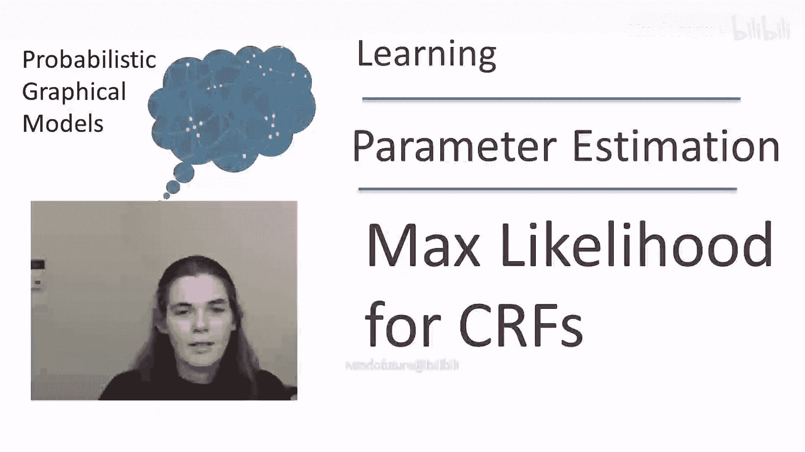
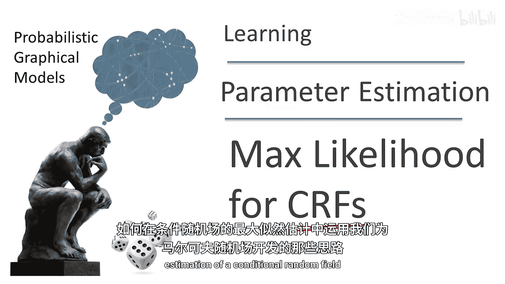
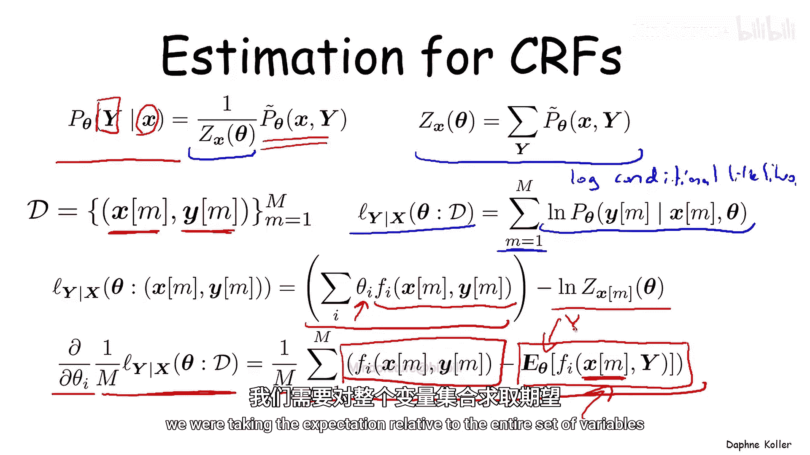
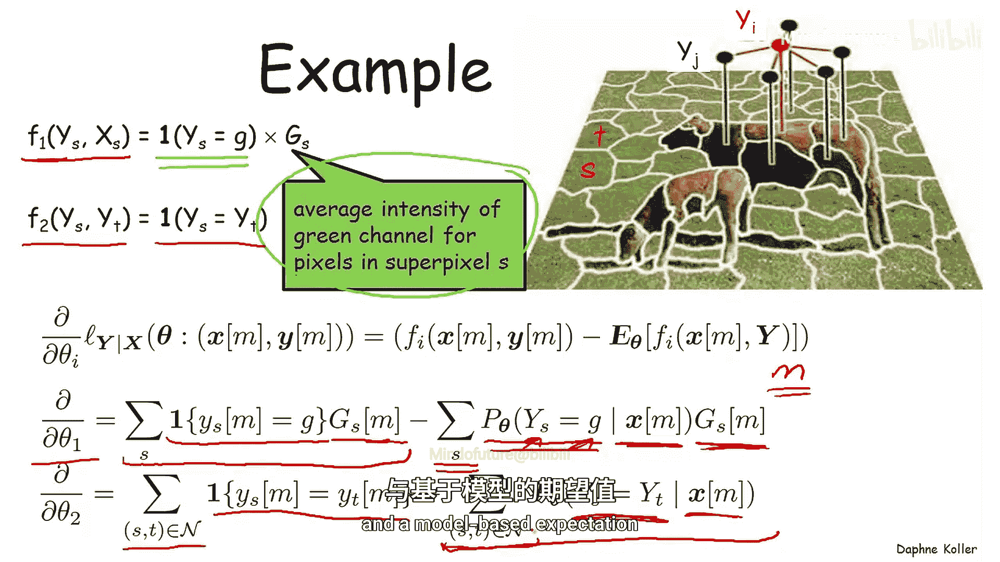
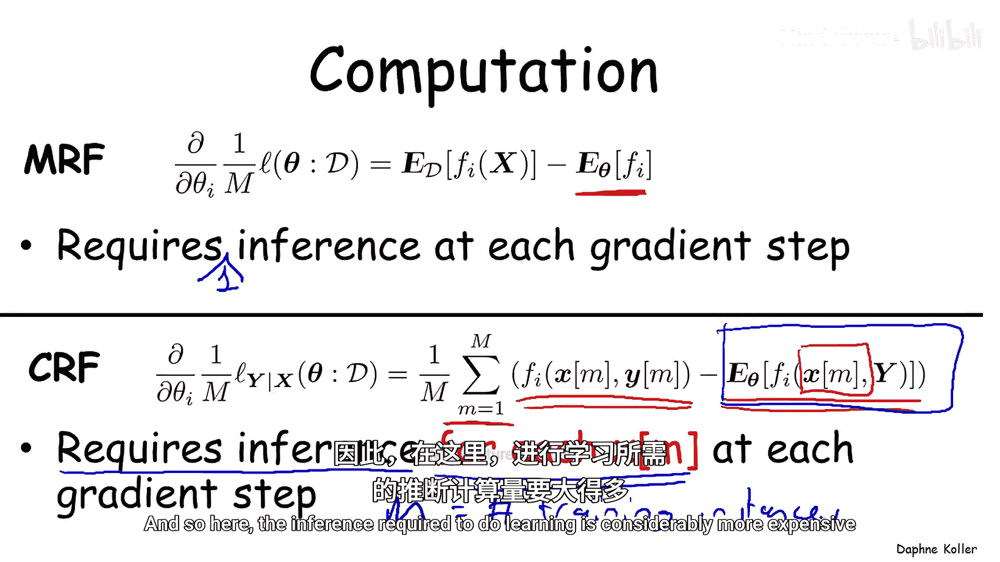
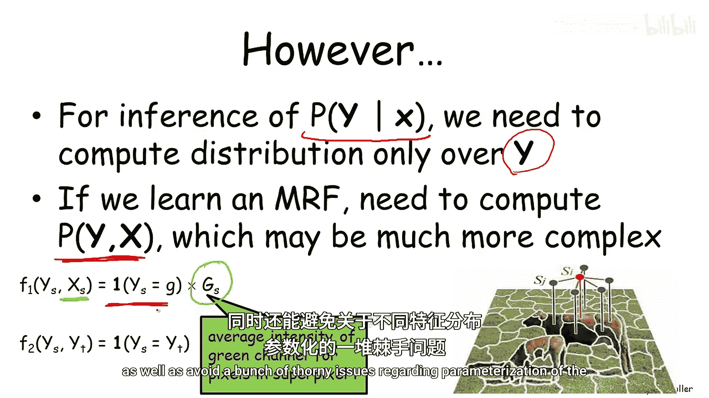
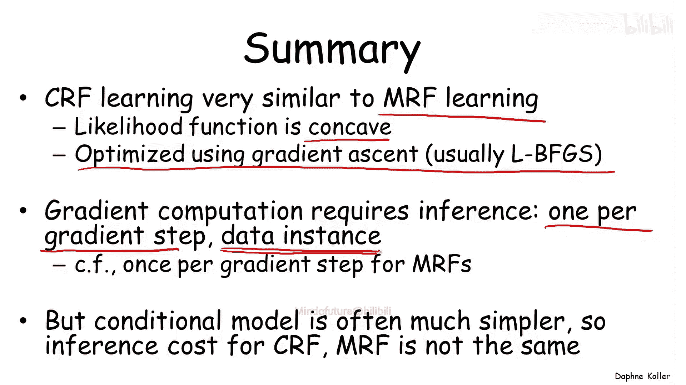

# 【斯坦福】概率图形模型3：学习 ｜ Probabilistic Graphical Models 3 Learning p14 P14_条件随机场的最大似然_04_01_02 -BV1MH6LBREqD_p14-

We previously talked about maximum likelihood estimation for Markov random fields。

 but when we first define Markov random fields， we also defined an extension on MRs called conditional random fields or CRFs。

So now let's think about how the ideas that we developed in the context of MRs can be utilized for the maximum likelihood estimation of the conditional random field。

So as a reminder， the point of a CRF was to compute the probability of a particular set of target variables Y given in a set of observed variables X。

And the idea behind this was that although the unnormalized density。

 P tilde of x comma Y was defined in exactly the same kind of parameterization。

 whether as a product of factors or as a log linear model as in the MRF case。

 the difference here is that we have an x specific partition function that guarantees that what we have is a normalized distribution over the y variables given a particular x。

 so this partition function is the sum over all y's of the unormalized measure P tilde theta of x comma Y。

 and so it normalizedizes only over the Y's and just not the x's。

When learning CRFs our data is now a set of pairs， it's a set of input variables or observed features X。

 and a set of target variables Y， and in the training data both of these are observed and we'd like to use this to learn the conditional distribution of y given x。

So the right objective function that we're going to apply in this context is what's often called the conditional log likelihood。

 but really should be called the log conditional likelihood because the conditioning is inside the log。

And what we have in terms of this objective is the sum overall data instances M of the log of the conditional probability of Y given X。

So if we look at the conditional log likelihood and we basically open it up。

 we end up with an expression that looks very similar to what we saw in the case of MRFs。

 we have a sum over I and this is for the case of a log linear model。

 we have a sum over I of the parameter theta I multiplied by value of the feature F。

 this is for a particular instance XY， so it's theta I F of XM comma YM。

And over here we have in a negative minus log of the partition function for x of them。

And this uses the exact same derivation that we had for the case of an MRF。

And so now we can sum up over multiple data instances M and compute the derivative relative to a particular parameter theta I of the1 over M of the log conditional likelihoodor。

And then what we end up with is a。Again， an average of， in this case， the sum over two expectations。

So what we have in the we have a summation over M and the first term is the value of the feature function。

 F of XM， YM， and the second term is the expected。Expectation of that feature F relative to XM and Y Now it's important to look carefully at the second expression over here。

 E theta of F XM comma Y and note that here the XM is fixed and the expectation is taken only over the variables Y。

And this is in contrast to the case of MRFs， where we were taking the expectation relative to the entire set of variables。

Let's see how this pans out in the context of a particular example。

 so we're going to look at a really brained model for image segmentation where we just have two features F1 and F2 the first feature F1 is a singleton feature。

And it takes the value of the average green value for pixels in a super pixelixel S。

 this is my super pixelixel S， we average out all of the green superps。

 but we only put them into that feature in cases where that pixel is labeled with G for graph。

So and notice that this feature is repeated across all superpixs S in the image。

 so this is a model with shared parameters。The second feature， F2 is a pairwise feature。

 and here we get a1 four cases where two adjacent superpixels S& T are labeled the same value。

 say both grass or both cow， and this allows the model to learn how likely it is for superpixs that are adjacent to each other to have the same class label。

Notice that this model this feature2 is shared both across pairs of superpixs but also across different classes。

 that is we have the same parameter for cow cowow as we do for grass， grass or sky sky。

So let's plug in these two features into the model for the gradient that we had on the previous slide so this is the general equation and let's see what happens for theta1 so the partial derivative relative to the parameter theta1 has the difference of two expectations again an empirical expectation and a model expectation so this is for particular instance M so we're not currently averaging across multiple training images we have a single image that we're working over so here because the model has shared parameters we're summing over all possible superpixs S in the image and the empirical expectation sums up the product of this indicator function for the superpixel S。

Multiplied by this average greenness of the superpel and that's the empirical expectation。

The modelbased expectation has exactly the same form we're also summing up over all superpixs S。

 and we similarly have a product of two terms only here because we don't know whether because in this model based expectation。

 we don't have the y labels， we're computing the probability over the y label taking the value graph。

 that is for each superpixel S， we compute the probability that YS takes the value green， given。

What we know about the image， that is the values x and M。

 and that gets multiplied with the average greenness again。

So that's the gradient for the first parameter， the gradient for the second parameter is very similar in spirit。

 so here we're looking at the sum overall pairs of adjacent superpixels S and T and the empirical expectation just sums that over all those pairs with an indicator function of YS is equal to Yt so we get one if YS is the same as Yt say they're both labeled grass or they're both labeled cow and zero otherwise。

And in the model based expectation term， we have the probability of that event。

 that is the probability that YS is equal to Yt， given the image and once again that' summed up overall pairs of adjacent superpixels S&T so again。

 a difference of two expectations in both cases and empirical expectation and a model based expectation。

Taking that。And thinking about this， let's compare the computational cost of of two models of two training res。

 One is the MRF training， and the second is the CRF training。So in the MRF training。

 remember that our gradient relative to a parameter theta I was the difference of two expectations。

And we've already pointed out that the computation of the second expectation。

 the model based expectation， requires that we run inference at each gradient step and we thought that was pretty expensive or it could be。

😊，But now let's see what happens for CRFs， let's look at that gradient one more time for the case of CRFs and here notice that we don't really have that we have a summation over M。

That is the sumation over all of the data instances of a difference of two terms。

 the second is the feature value in that particular instance。

 and the second is the expected feature value in that particular instance， x of M。😊。

So the important observation to come out of this is that this expectation， the second expectation。

 relative to theta is an expectation that is different for each of our input instances。

 So that means that we need to rerun this inference for each and every one of our Xms at each gradient step。

 So whereas Nfs requires one inference。😊，At each gradient step。

 this requires M inferences at each gradient step where M is the number of training instances。😊。

And so here， the inference required to do learning is considerably more expensive。

However， one needs to weigh in the balance all of the factors that contribute to computational cost。

So when we're doing inference of the conditional probability P of y given x。

 we only need to worry about the y variables。 So the x's are all fixed。

 Their values are instantiated。 and so our factors in the resulting model are factors only over the variables1。

If we were to want to use MRF training because say we decided that CRF training is too expensive because of the additional cost of inference。

 we would need to compute the joint probability P of yx， which might be much more complicated。

 and that might be much more complicated not only because of the fact that we have more variables now in the model both the Y's and the x's。

 but also because in many cases where we would like to apply a CRF。

 the distribution that we might have over the x's becomes quite unmanageable if we want to actually compute a distribution over them。

So to understand that， let's go back to the previous example and consider this very simple image segmentation model and here notice that the x that the variable x sub S implies this。

This average greenness of the superp。Now， in the context of CRFs。

 we don't need to compute a distribution over average greenness because we're conditioning on the x of S and so G ofS is now fixed。

 it's instantiated and we're only computing the probability distribution over the Ys。

 but if we wanted to train this model as an MRF， we would need to somehow maintain a distribution over this average greenness and since that's a continuous quantity。

 it actually requires that we think about parametric forms and is it a Gaussian or mixture of Gaussians and it becomes quite hair to manage and so although the CRF based training in this case might have additional cost。

 it can also reduce the cost in terms of any particular inference step as well as avoid a bunch of thorny issues regarding parameterization of the distribution over various features。

So to summarize， CRF learning in terms of the mathematical formulation is very similar to MRF learning。

😊，The likelihood function has the same form， its's concave。

 it's similarly optimized using gradient scent， usually the same LBFGS algorithm。However。

 the gradient computation is now much more expensive because it requires inference not only once per gradient step。

 but also once per gradient step and data instance。And as a comparison。

 once per gradient step in the context of MRFs。But already as we just said。

 the conditional model is often much simpler， so the inference cost for a CRF and the MRF is not the same so we're not really comparing apples and oranges and so in context of any given model。

 one really needs to think about which of these models more appropriate and not only based on the computational cost of training but also in terms of the overall performance and generalization。

