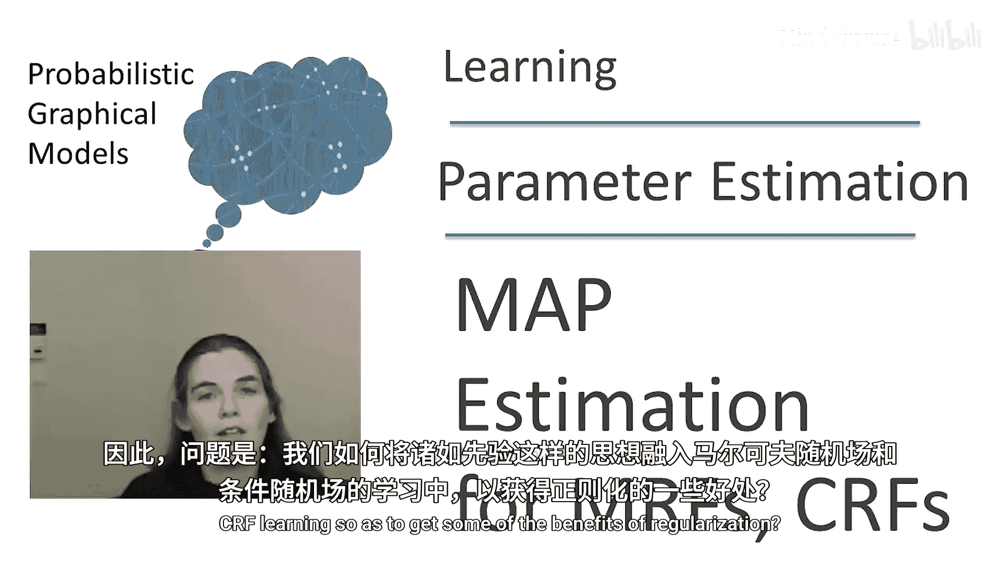
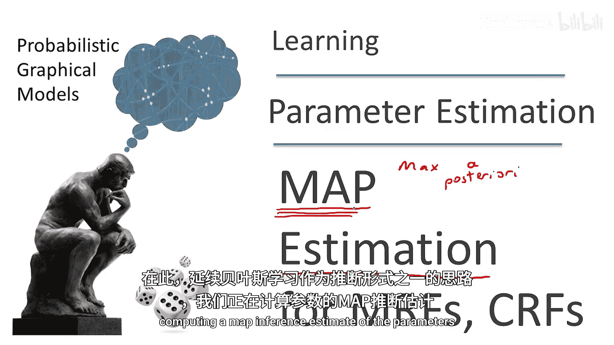
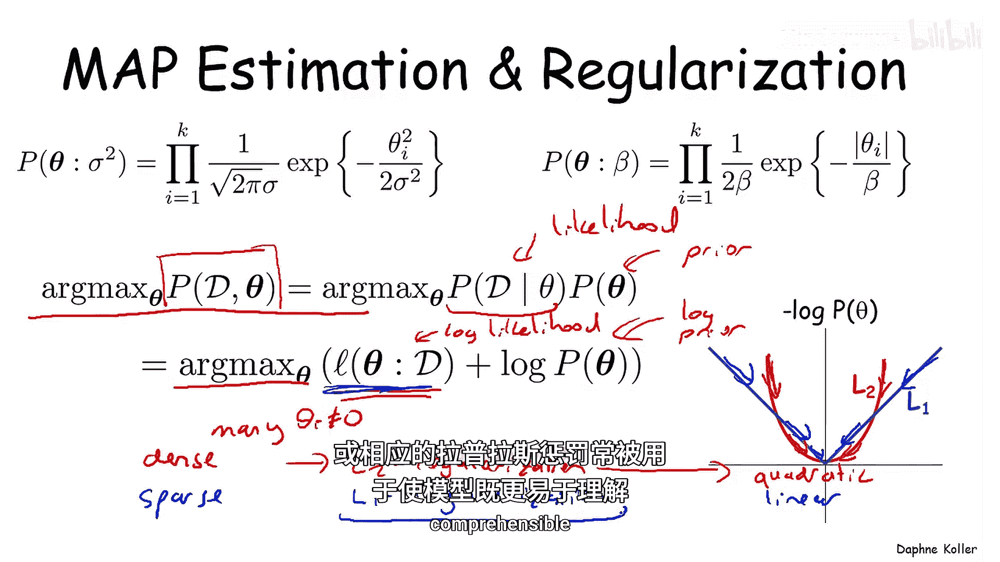
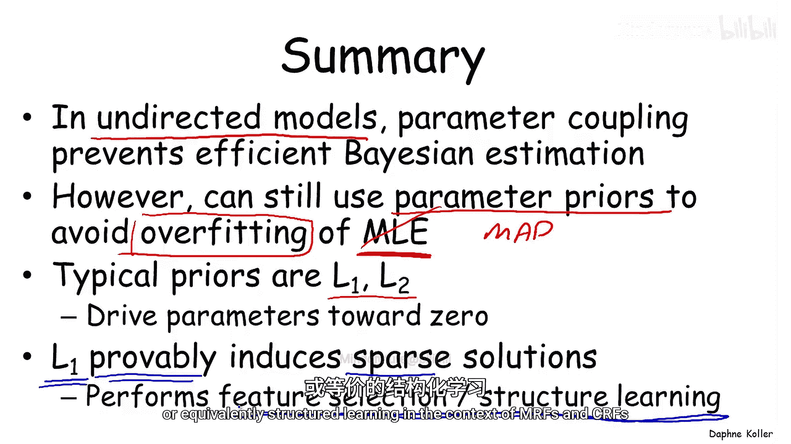

# 【斯坦福】概率图形模型3：学习 ｜ Probabilistic Graphical Models 3 Learning p15 P15_MRF与CRF的MAP估计_04_01_03 -BV1MH6LBREqD_p15-

So far we've talked about MRF and CRF learning purely in the context of maximum likelihood estimation where our goal was to optimize either the likelihood function or the conditional likelihood function。

 but as for Bayesian networks， maximum likelihood estimation is not a particularly good regimen and it's very susceptible to overfintting of the parameters to the specifics of the training data So what we'd like to do is we'd like to utilize some ideas that we exploited also in the context of Bayesian network。

 which are ideas such as parameters priors to smooth out our estimates of the parameters at least in initial phases before we have a lot of data to really drive us into the right region of the space。

So in the context of Bayesian networks， that was all great because we could have a conjugate prior on the parameters such as a dilate prior that we could then integrate in with a likelihood to obtain a close form conjugate posterior。

 and it was all very computationally elegant。But in the context of MRF and CRFs。

 even the likelihood itself is not computationally elegant and can't be maintained in closed form。

 And so therefore， the posterior is also not something that's going to be computationally elegant。

 And so the question is， how do we then incorporate ideas such as priors into MRF and CRF learning so as to get some of the benefits of regularization。

So the idea here in this context is to use what's called map estimation where we have a prior。

 but instead of maintaining a posterior en closed form。

 we're computing what's called the maximum posterii estimate of the parameters and this in fact is the same notion of map that we saw when we did map inference in graphical models where we're computing a single map assignment here continuing in the thread of Bayesian learning as a form of inference we're computing a map inference estimate of the parameters。

So concretely， how is map inference implemented in the context of MR R F or Sif learning。

 A very typical solution is to define a Gaussian distribution over each parameter theta I separately。

 and that is usually a0 mean。Univariiate Gaussian。With some variance。Sigma squared。

And the variance of sigma squared dictates how firmly we believe that the parameter is close to zero。

 so for small variances we are very confident that the parameter is close to zero and are going to be unlikely to be swayed by a limited amount of data whereas sigma gets larger。

 we're going to be more inclined to believe the data earlier on and move the parameter away from zero。

 so we have such a parameter prior over each data separately and they're multiplied together to give us a joint parameter prior。

So the parameter prior over each is going to over each parameter is going to look like this this sigma squared。

Is called a hyperparameter。And it's exactly the same kind of beast as we had for the Deersly hyperparameters in the context of learning Bayesian networks。

An alternative prior that's also in common use is what's called the lapplian parameter prior。

 and the lapplaceian parameter prior looks kind of similar to the Gaussian in that it has an exponential that increases as the parameter moves away from 0。

 but in this case， the increase in the parameter depends on the absolute value of theta I and not on theta I squared。

 which is what the behavior that we would have with the Gaussian。

And so this function looks as we see over here with a much sharper peak around zero that effectively corresponds to a discontinuity at theta i equals0。

And we have again such a prior lapplium prior theta I over each of the parameters of theta I which are multiplied together just like the Gaussian。

 this distribution has a hyperparameter， which in this case is often called beta and the hyperparameter。

 just like the variance in the Gaussian distribution sigma squared dictates how tight this distribution is around zero。

 where tighter distributions correspond to cases where the model is going to be less inclined to move away from zero based on limited amount of data。

So now let's consider what map estimation would look like in the context of these two distributions。

 so here we have these two parameter prior rewritten， the Gaussian and the Laplacesian。

 and now map estimation corresponds to the arggonm over theta of the joint distribution P of the comma theta。

 so to maximize we're trying to find the theta that maximizes this joint distribution。

And by the simple rules of probability theory， this joint distribution is the product of P ofD given theta。

 which is our likelihood。Multiplied by the prior P of theum。

And because of the linearity of the nonlinear， sorry the monothicity of the logarithm function。

 we have that this is the same as doing arc maxs of theta of our log likelihood function。

Which is just the log of the likelihood and the log of the parameter prior。

So now let's look at what these logarithms look like in the context of these two priors。

 and so this is I'm actually drawing the negative log of P of theta and the negative log of P of theta for a Gaussian distribution is simply a quadratic。

And so we have a quadratic penalty that pushes the parameters towards zero。

 and this is the same for those of you who've seen this in the machine learning class， for example。

 as doing L1 regularization。Over the parameter theta I。

The distribution that if we now do the same for the Laplian distribution， we're going to get。

A penalty that pushes the parameter towards zero in a way that depends on the absolute value of the parameter。

 and this is equivalent to L1 regularization， which again some of you might have seen in a machine learning class。

So this is a linear penalty。Now， these penalties， although they both push the parameters towards zero。

 are actually quite different in terms of the behavior。

 So if we look at what L2 does when the parameters is far away from 0 sort of towards the edges。

 the quadratic pen is actually quite severe and it pushes the parameter down dramatically。

 But as the parameter gets small so closer to the case of theta I equals 0。

 the pressure to move down decreases， so effectively it's quite legitimate for the model to have a lot of parameters that are close to0 but not quite zero。

 and there isn't a lot of push at that point to get the parameters to hit 0 exactly。

And so that means that models that use L2 regularization are going to be dense。

 that is a lot of the theta Is are going to be non zero。Conversely。

 when you look at the L1 regularization， you see that there is a consistent push towards zero regardless of where in the parameter space we are。

 and so it's in the interest of the model to continue pushing parameters that don't impact significantly the log likelihood component and push them towards zero。

And so for L1 regularization， we're going to get modelsed that are sparse and sparsity has its own value because the sparser of the model。

 the easier it is to do inference in it in general。

 because sparssity corresponds to in principle removing edges or removing features from the graphical model which in turn can remove edges and make inference more efficient。

 and so L1 regularization or the corresponding lapplaceian penalty is often used to make the model both more comprehensible as well as computationally more efficient。

😊。

So to summarize when we're doing learning and undirected models。

The parameter coupling that we have in the likelihood function prevents us from doing Bayesian estimation efficiently that is maintaining a posterior distribution over parameters。

However， we can still use the the notion of parameter priors to avoid the overfitting that we would get with maximumim likelihood estimation。

 and specifically we're going to use map as a substitute for ME。

The most typical priors used in this context are L1 and L2 or Gaussian and Laplsian。

 and both of these drive the parameters towards zero。

 which has the effect of preventing the model from going wild and using very drastic parameter values that allow us to overfit the specific training data that we've seen。

Now， while this behavior is shared among these two models。

 there's also a significant difference between them in that the L1 or Laplaceian distribution can be shown both empirically and provably to induce sparse solutions。

 and therefore it performs for us a form of feature selection or equivalently structure learning in the context of MRFs and CRs。

