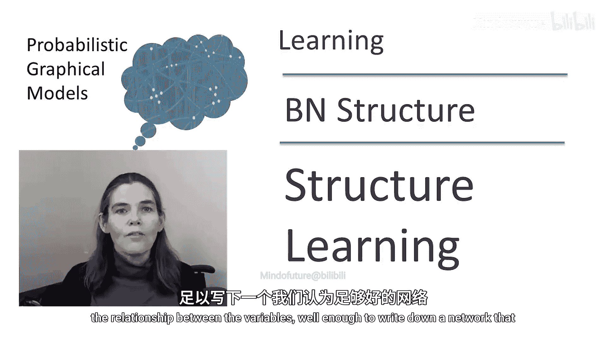
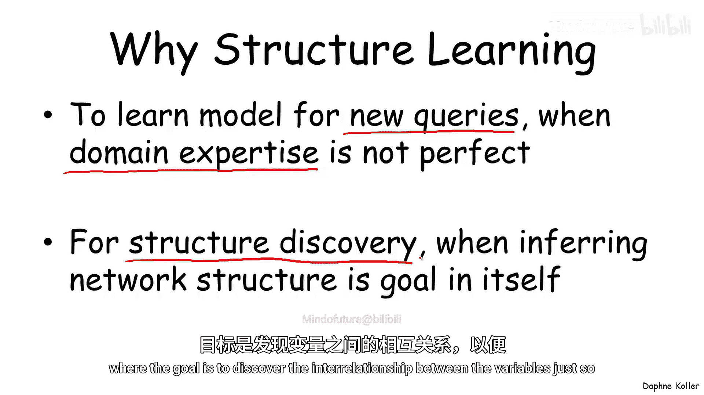
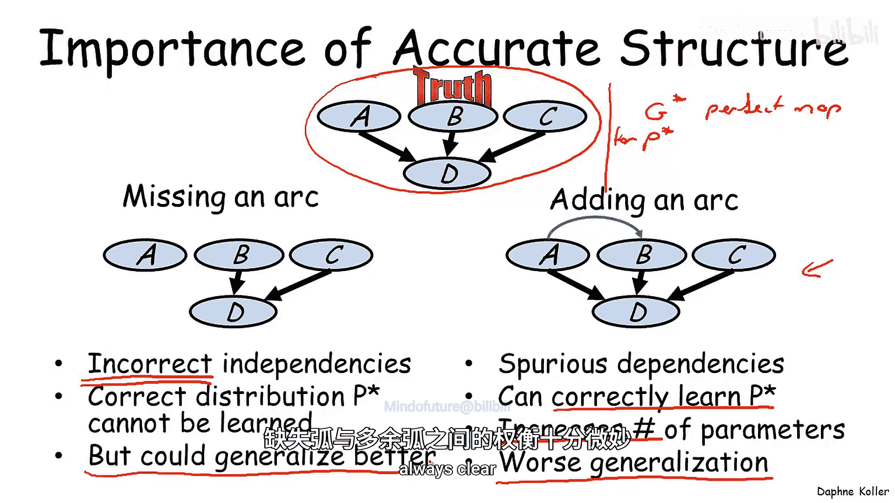
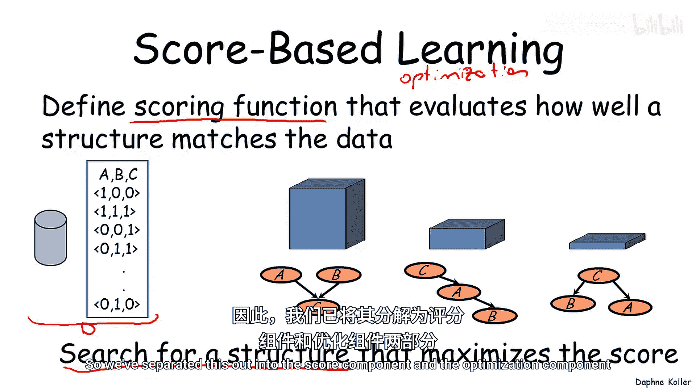

# 【斯坦福】概率图形模型3：学习 ｜ Probabilistic Graphical Models 3 Learning p16 P16_结构学习概述_05_01_01 -BV1MH6LBREqD_p16-

We previously discussed the problem of learning the parameters of a Bayesian network whose structure was given to us。

 but that might not always be the case。 It's not always the case that we have a domain expert who understands the structure of the domain。

 the relationship between the variables well enough to write down a network that we think is good enough。

 So what are some cases where this might happen。 The first is when we actually want to use a network for enteringing new queries of whatever kind。

 for example， new medical queries in a medical domain or or other settings。

So in this case， it still might be the case that although there might be some domain expertise。

 it might not be sufficient to come up with a model that's good enough to use。

 and we might do better by taking data and actually learning the dependencies that the data tell us are the most significant。

A second setting where this might happen is where we don't necessarily even care about using the network。

 we just want to discover the network。And this kind of use model occurs， for example。

 in scientific or biological dataset sets， for example。

 where the goal is to discover the interrelationships between the variables just so that we understand the domain better so let's focus for a moment on the first of these two cases where our goal is to is to learn a network for the purpose of using it and let's think about the kinds of mistakes that might happen and how they affect the ability of the network to apply well to new instances。

So let's imagine that the network that the true network is this one over here。

 and now let's consider different kinds of mistakes that a learning algorithm might make so in one case。

 for example， that the learning algorithm might learn a network that's missing in arc。😊。

On the other hand， it might learn a network to which we've added an arc now of course one can also have cases where we have a bit of each。

 but let's think about these two types of errors separately。If we're missing an arc。

 effectively the inencies that the Learn network tells us is incorrect。

 that is relative to the ground truth network， which is this one。

 which if you remember we called a G star， the network in the network that we learned is making independence assumptions that are not correct relative to G star。

Conversely， in this case， we have spurious dependencies， that is in when we have added an arc。

 there is a spurious dependency in this case between A and B。Now， what are the implications of this？

If we're missing an arc， then the correct distribution P star cannot be learned。

 that is there is no way in general if P star was associated with this network over here。

 that is G star is a perfect map。For P star。Then we can't learn PSaceSt using a network that's missing an edge。

Now， that might seem like a very bad idea。 and we would prefer perhaps the error model on the right。

 which even though it has these excess edges， it does allow us to correctly learn P star。

 That is this additional edge over here between A And B。

 there is a setting of the parameters for which the correct distribution P star can still be。

Estimated on this network structure。So it might seem that this error model is actually error mode is actually better than the one where we're missing an arc。

 but empirically， that actually turns out to be an oversimplified view。 specifically。

 the model where we have excess arcs gives rise to an increase in the number of parameters and the more parameters we have to elicit the harder it is to elicit them correctly given the limited amount of data。

 we've already talked about this when we talked about fragmentation as the number of the data as the number of parents increases。

😊，And so one of the important conclusions from this is that this。

 as we've already seen can give rise to worse generalization。

 which means worse performance on unseen instances。

 and so the fact is that sometimes having fewer edges could actually generalize better than having more edges even though the correct distribution cannot be encoded。

😊，And so the tradeoffs between missing arcs and extra arcs are subtle。

 and it's not always clear is the right， which is going to give us the best performance。

So with that introduction， what is the way in which we typically learn Bayesian network structure from data。

 the general paradigm， which we will refine in subsequent parts of the segment of the course is that we define a scoring function that evaluates for each structure how well that structure matches the data so here we have a dataset set D and we have in this case three example network structures and we're going to define a scoring function that tells us for each of these network structures。

 how good it is relative to the data that we've seen。

And then we have the goal of searching for a network structure that maximizes the score。

 and so we have now turned the learning problem into an optimization problem。

It's an optimization over a comminatorial space， the space of network structures。

 and by defining a score that gives us the objective that we're trying to optimize and now we need to come up with an algorithm that optimizes that score so we've separated this out into the score component and the optimization component and we'll talk separately about each of these in subsequent parts。

😊。

