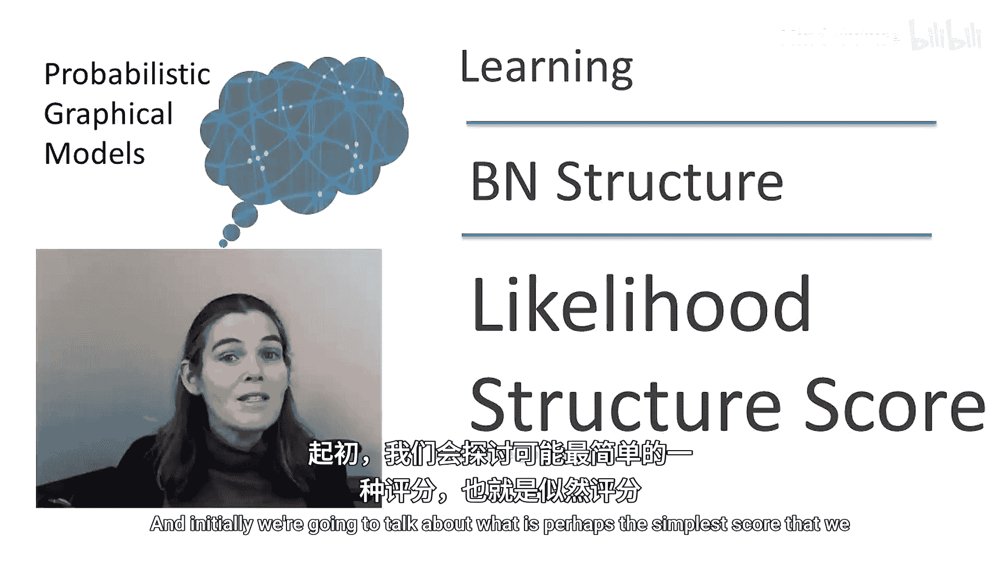
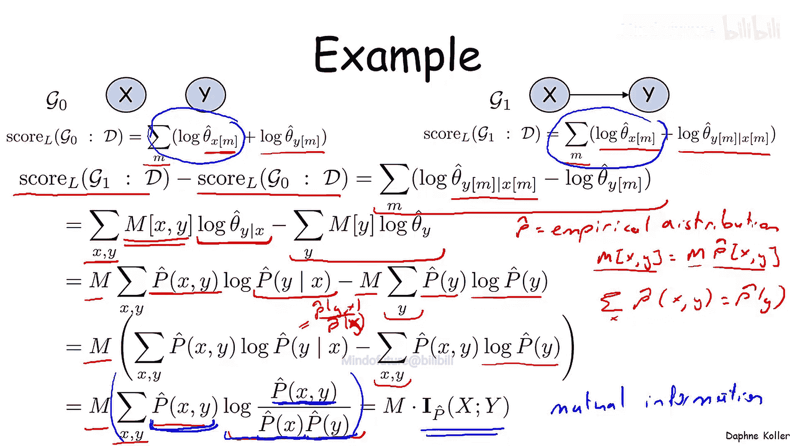
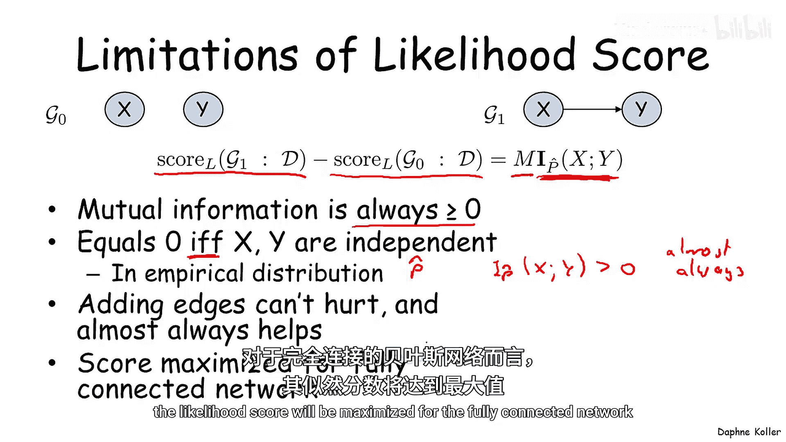
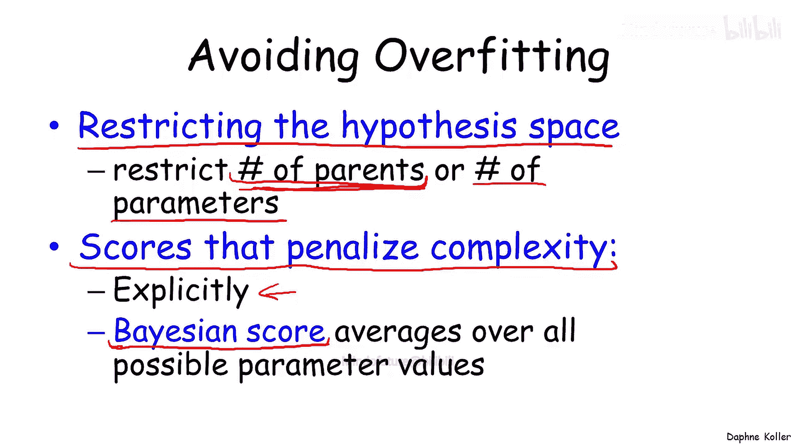
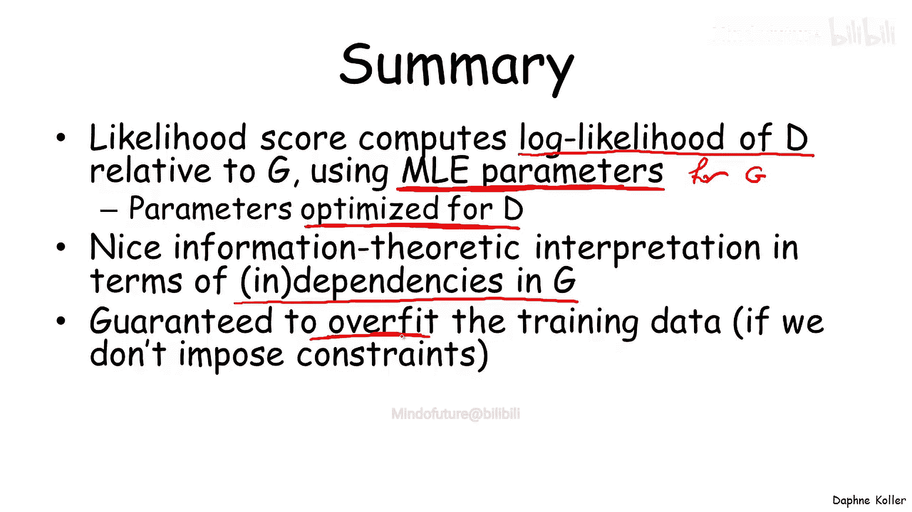

# 【斯坦福】概率图形模型3：学习 ｜ Probabilistic Graphical Models 3 Learning p17 P17_似然分数_05_01_02 -BV1MH6LBREqD_p17-

So we talked about the fact that we can view baselinenet structure learning as two pieces。

 one is defining a scoring function allows us to evaluate different networks。

 and the second is as a search procedure， an optimization procedure that allows us to select among the networks。

 the one that has the highest score。We're going to first talk about scoring functions and initially we're going to talk about what is perhaps the simplest score that we can consider。

 which is the likelihood score。

So we've already talked about likelihood as a way of evaluating the quality of a given network。

 and so here the likelihood score can be defined as the graph and the parameters that maximize the likelihood or in this case。

 the log likelihood of the data。So the score， the likelihood score of a graph。

Is the log likelihood of the graph accompanied by the parameter setting sayta hat。

Which is the maximum likelihood estimate of the parameters。Given the grafti。And data to D。So first。

 so for any graph， we figure out what are the best possible parameters to use for that graph。

 and then we use that as a way of evaluating the quality of the graph that we learned。

So lets at some of the let's look at a simple example to see what the likelihood score looks like so here we have a distribution over two random variables x and y and let's consider two graphs G0 on the left has no edge between x and y and G1 on the right has an edge from x to y and the y to x case would be symmetrical so we're just going to look at these two graphs。

The likelihood score of a graph of this graph relative to D by the decomposition of the likelihood function that we've already seen is the sum overall instances M of the log of the parameter for the value of x in the m theta instance plus the log of the parameter for y for the y value in the m theta instance。

 so this is just the decomposition of the log likelihood that we use when we talked about parameter estimation。

Conversely， when we look at G1， we have a very similar formula where again we sum over all instances and for the x that has no parents we have log of theta hat XM where again xM is the value of x in the M theta instance and for the y value we have log of theta hat of YM given xM and in both cases theta hat are the maximum likelihood parameters in the respective graph so on the left it's theta hat for the graph g0 and on the right it's the maximum likelihood theta hat for the graph g1。

Now let's refine this analysis a little bit more by converting it to somewhat different notation First we're going to look at the difference between these two likelihood scores so we're going to see we're going to look at the score for G1 and subtract away the score for G0 and then we're going to see whether that score is positive or negative。

 that is whether we prefer G1 to G0 or not。So notice that the term over here， the first term。

 the X term is the same in both of these graphs， and so it cancels out and so what we have left over is the sum over M of log of theta hat yM given xM minus log of theta hat of YM。

Now we can reformulate this by looking at the sufficient statistics and specifically we're going to have the term theta hat ym given xM occur recur every time we have a particular value y in a particular value x so we're going to sum up over all values little x and little y。

 and the parameter log of theta hat y given x is going to occur M of Xy times where m of xy is the sufficient statistics or the counts for that particular configuration of events in the data set D。

The second term， the one that we're subtracting is a sum over y of M of y log of theta hat of y。

 where again M of y is a sufficient statistics。Now we're going to rewrite this in terms of this distribution over here called P hatAT。

 P hatAT is what's called the empirical distribution。

It's what happens when we look at our data set D and just look at the frequencies of different events。

 so M of x Y。Is simply the number of data instances m times P hat of Xy。

 because this is the frequency of the event and this is the total number of data instances and so M of Xy is just the product of those two。

So we can write the first term as M times sum of XY P hat of X Y。And interestingly。

 we can also rewrite the maximum likelihood estimation parameters in terms of P hat as well。

 because theta hat of y given x is simply the fraction of the y cases among all the x cases。

 which is exactly the same as P hat of y given x。Similarly。

 the second term turns into M p hat times the sum over y p hat of y， log of P hat of y。

So that now converted all of the expressions， the Ms and the n thetas into a single vocabulary。

 which are these empirical distributions P hat。So now let's take the M out of the equation。

And furthermore， look at the sum over y as the sum over pairs Xy。

 so we've artificially introduced a variable x into the second sumation， sum over y P hat of y。

 and now we're going to rewrite that as sum over X Y， P hat of Xy。

 and because x doesn't appear in the expression log P hat of y。

 we can do that because sum over x P hat of Xy is equal to P hat of y。

So looking at these two expressions together， we can now move around some things by utilizing properties of the logarithm and derive that this is equivalent to the following equation。

This is M times the sum over X Y， P hat of X Y log P hat of X Y divided by P hat of x， P hat of y。

And the reason why that's the case is that P hat of y given x is equal to P hat of y comma x divided by P hat of sorry divided by P hat of x。

 and now by moving around the logarithms， we get exactly this expression。Now， importantly。

 this expression here inside。The summation over here has a name。

And that summation is called the Mu information。And is usually denoted as I sub P hat in this case the distribution P hat between x and y so why is this called mutual information。

 it's because it measures if you look at this， the distance on average between the joint distribution X and y P hat of X Y in the numerator。

 relative to the distribution we would get if the distribution was a product of marginal。

 so P hat of x times P hat of y。So you can think of this term inside the log as a relative error。

 if you will， a distance between the joint distribution and the product of the marginals。

 and now we're taking the average of the log of this expression averaged by how frequent the different cases X YR and so that's so you can think of it as an average distance between the joint distribution and the one that we would get if this was a product of marginals。

So this is an information theoretical property， which as I said， is called the mutual information。

And so if we now generalize this analysis to an arbitrary network。

 it turns out that the likelihood score for any graph。

Can be viewed as can be rewritten as the number of data instances m times the sum over all variables I of the mutual information again。

Between a node。And its parents in the graph。Mineus a constant term。

That is constant relative to the graph structure， the second term is m times the sum of the entroies of the individual variables。

 and this term doesn't depend on G。你题。Now， why is this a significant result？

It's significant because it tells us that the value of a network， the score of the network。

 if we use a likelihood score is higher， so score is higher。If XI is correlated with his parents。

Wwhichch is a very intuitive property， the more a variable is correlated with a parent。

 the better the network structure， which means we would want to put as a parent of a variable。

 a parent that is highly correlated with it， which is kind of exactly the behavior that you would intuitively hope for。

So this is a good result because it tells us that the parents that we pick for a variable are the ones that have the highest correlation with it。

 the ones that have the highest initial information， and that's a very satisfying result。However。

 as we now show， this mutual information result also has some negative consequences。

So to understand that let's go back to our simple example and let's look at the difference between the scores of these two graphs。

 the graph G1 on the left that has the edge and the graph g0 on the right that doesn't and let's look at the difference between those two scores that difference if it's positive suggests that we should pick the graph G1 and if it's negative tells us that the maximum likelihood score pick the graph G0 and that difference is M the number of samples times the mutual information between the variables X and Y in the empirical distribution P hat。

Now， a well known result from information theory is that the mutual information。

 this quantity over here is always non negative。😊，For any distribution P。Furthermore。

 this mutual information is equal to zero， that is this inequality turns into inequ。

 if and only if x and y are actually independent。In the distribution relative to which we're computing the mutual information。

 which in this case is the distribution P hat。Now， even if X and Y were actually independent in the original distribution。

 the one that generated the training instances， it is still very unlikely that we will achieve exact and perfect independence in the empirical distribution just because of statistical fluctuations in the set of samples that are generated and so even if X and Y are independent。

 it is almost never the case that they are independent and P hat。

 which means that in almost all cases。This mutual information between x and y is going to be greater than zero。

 almost always。Which tells us that adding this edge can never hurt and almost always helps。

 and that's true not just in this simple example， but in other cases as well that is it almost always is better in terms of the likelihood score to have more edges rather than fewer edges that will always increase the likelihood score。

Which means that in general， except for very unusual circumstances。

 the likelihood score will be maximized for the fully connected network。

So that gives rise to a very significant overfitting effect because as we've already seen the more edges we have。

 the more difficult it is to fit the parameters because we have fragmentation of our data set into these tiny little buckets。

 each of which has a very small number of instances in it。

So how do we avoid overfitting it turns out that there are several different strategies that are typically employed the first is to restrict the hypothesis space to basically prevent the algorithm from overfitting and we can do that by restricting the number of parents that we allow pernun or some kind of restriction on the number of parameters this is usually easier to enforce and so that's a more common strategy。

A second more flexible strategy is to use a scoring function that makes a better set of tradeoffs。

 that is where there is a penalty on the complexity of the model at the same time that we're trying to get a good fit to the training data and that's a more flexible strategy than a hard constraint on the model complexity because if there is a very strong signal for some correlation between a pair of variables that can eventually outweigh the complexity penalty and allow that edge to be added in。

 whereas if we have a hard constraint， we might never be able to learn a model that is the appropriate one simply because it's never going to be it's not going to fit into the restricted hypothesis space。

These complexity penalizing scores generally fall into two categories。

 there is ones that explicitly penalize complexity。

 and then there is a models called theian a class of scores called the Bayesian scores。

 which as we'll see average overall all possible parameter values following the Bayesian paradigm that says that anything we have uncertainty over we should have a distribution over。

 and as we'll see that gives rise naturally to a score that avoids overfitting。

To summarize， the likelihood score is a score that evaluates a model G by looking at the log likelihood of the data relative to G using the MLE parameters for G。

And that set of parameters was optimized to maximize the likelihood of D and therefore is very。

 very well geared to trying to capture the exact characteristics of the data for better and for worse。

So for better， it gives us a very nice information theoreticalore interpretation of of the set of edges that are chosen。

 the set of parents that are chosen for a given variable in terms of the dependencies that。😊。

That we encode in the graph G。Conversely， that same characterization also shows us that we're guaranteed to overfit the model to the training dataa unless we somehow impose constraints or otherwise penalize model complexity。

