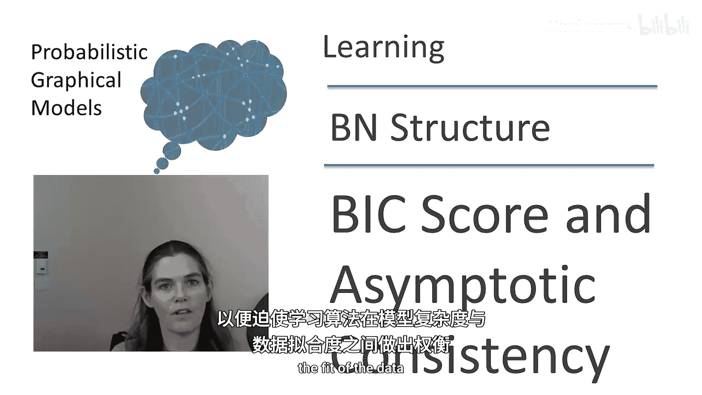
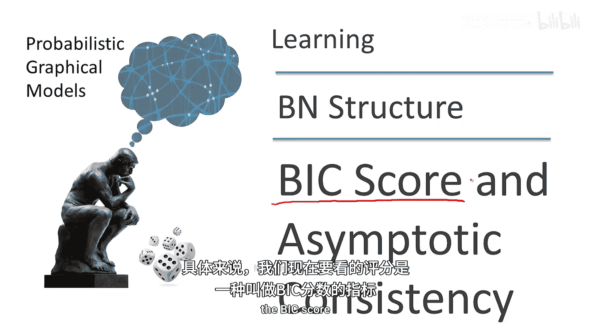
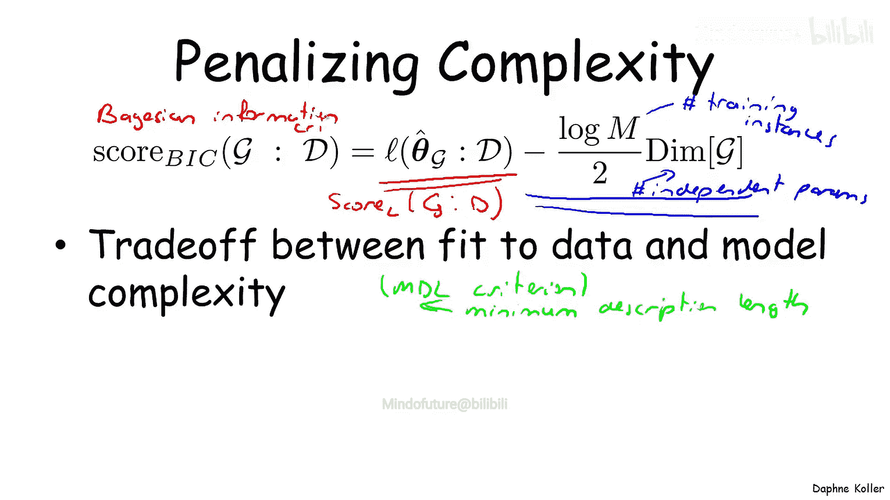
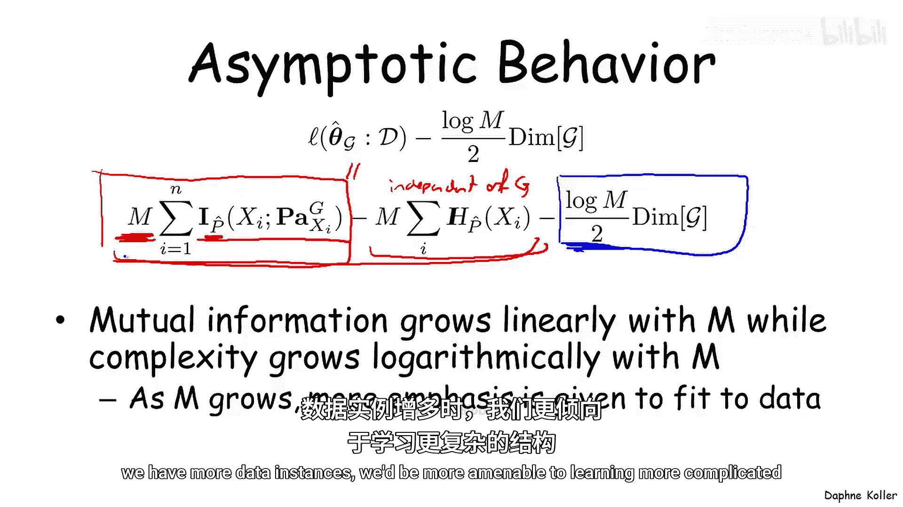
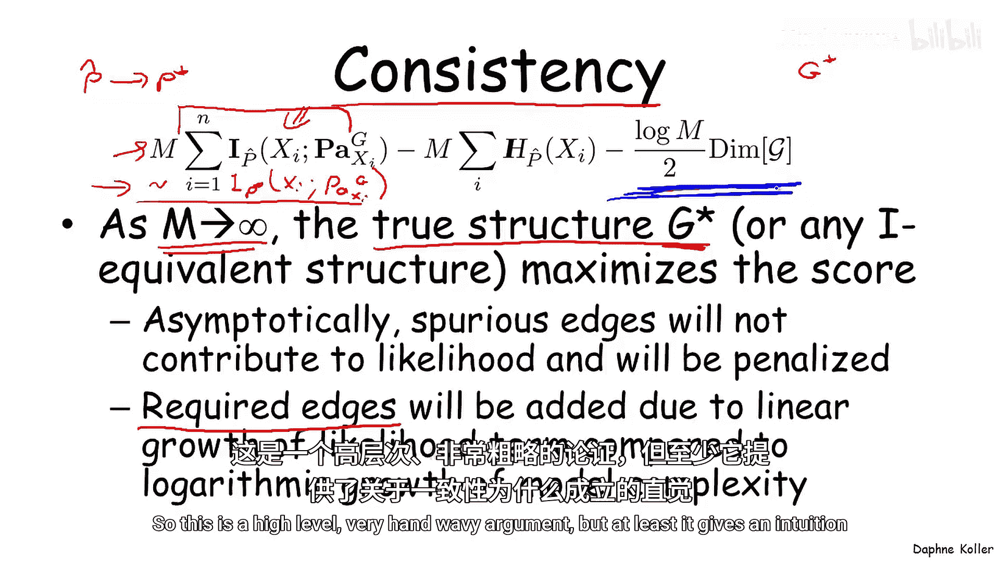
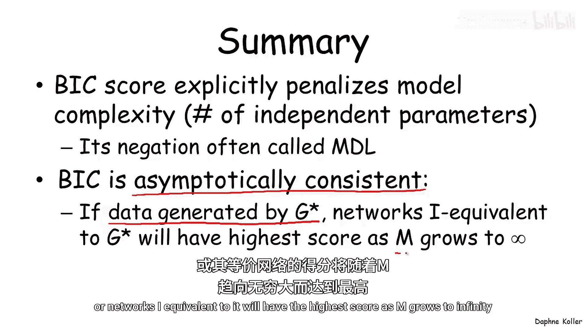

# 【斯坦福】概率图形模型3：学习 ｜ Probabilistic Graphical Models 3 Learning p18 P18_BIC与渐近一致性_05_01_03 -BV1MH6LBREqD_p18-

We talked about Bayesnet structure learning as the task of optimizing a score over space of network structures。

 and one of the big design choices that we have to make in this context is which scoring function to use。

 Our first attempt at that was to use the likelihood score。 But as we've already seen。

 the likelihood score is very susceptible to overfitting and will invariably learn the most complicated network that it can。

 given the constraints that we impose on our space。

We now consider a different approach in which rather than constraining the space。

 or maybe in addition to constraining the space， we're also going to impose a penalty on the complexity of the structure that we learn force the model so as to force the learning algorithm to trade off model complexity with the fit。

 the data。

And specifically the model the specifically the score that we're going to look at at right now is something called the B IC score。

So let's look at one way of penalizing complexity which is the one that the BIC score uses。

 the BIC score has two terms in it， the first is just the likelihood of the graph and its maximum likelihood parameters relative to the data。

This is a familiar term。 This is the term that represents the same thing as the likelihood score。

 So this term is just score L of G relative to D。 And were we to use this in isolation。

 we would get the same overfitting behavior。But we add to this a penalty term。

 this is the second term here on the right， and that term is the subtract log of M over 2 times the dimension of G。

So let's understand what these different pieces are， M is the number of training instances。

And the dimension of G is the number of independent parameters。In the network。

So we talked about the concept of independent parameters in the context of multinoial networks and as a reminder。

 a multinomial distribution has one fewer independent parameters than the number of entries in the multinomial and from that we can compute the number of independent parameters for any multinoial network so this basically counts the number of degrees of freedom that we have in the network in terms of estimating independent parameters in it。

And so these two terms balance each other out。 we've already seen that the term on the left。

 the log likelihood tries to push towards a better fit to the training data。

 whereas the term on the right， the penalty term is going to try and keep the number of independent parameters and therefore the network complexity down。

And so the score provides us with some kind of trade off between fit to data and model complexity。

 Now this is one choice in terms of this trade off。 and in fact。

 there are other scores that use a different trade off between those two terms。

 but this one is one that's very commonly used in practice and has several distinct motivations。

 some of which we'll talk about and others and others not one comment that's worth making， though。

 is that the negation of this score。 So if we negate this entire term that is often called the MDL criterion。

Where MDL stands for minimum。Description。Linkths。And so in fact。

 this notion of minimum description length is an information theoretic justification for this。

 and the other justification for this is one that's derived from a more Bayesian criterion。

 which is why BIC actually stands for Bayesian。Information criterion。

Let's look at the asymptotic behavior of this penali score。

 We've already seen that in the context of the likelihood score。

 it really doesn't matter how much training data we have。

 We will almost always pick the most densely connected network that our assumptions allow。

 But this is no longer the case。 when we have this penalized score。 So let's to understand that。

 let's break down the first of these two terms， which is the likelihood score and remind ourselves that at least in the context of the multinomial networks。

 the likelihood score，Can be rewritten as in the following way so this is the breakdown of the likely score。

 and it has these two terms。 The first is the number of data instances M times the sum over the variables。

 X I of the mutual information between X I and its parents in the network。

And that mutual information is relative to the empirical distribution P hat。

The second term in the likelihood score is a term which is also M times the sum over the variables of the entropy of the variable again in the empirical distribution。

 and as we've already discussed before， this term is independent of G。

And so doesn't affect the choice of which structure is selected because it's the same for all structures。

And so we have these two terms that are playing off against each other。 We have the term over here。

The red term。Whi is M times the sum of the mutual informations， and we have the second term。

 the blue term， which is the log of M over two times the number of independent parameters in G。Now。

 if we consider these two terms， we see that the mutual information term grows linearly with M。

Whereas the complexity term grows logarithmically with them。

And so as we get more and more data instances， we put more emphasis on the fit to data and less emphasis on the model complexity。

 so intuitively we would infer that we would as we have more data instances。

 we'd be more amenable to learning more complicated structures。

So that property gives rise to a very important result that we can state regarding the B I C score。

 and that is a result called consistency。 consistency tells us what behaviour we would get。

 what network we would learn。As the number of samples grows to infinity。

And so here we're going to assume that the data is actually generated from a particular true structure G star。

 so there is a G star because otherwise the result doesn't really make can't really be stated。

 and what the consistency property says is that as M grows to infinity the true structure G star Max is going to be the one that maximizes the score。

Now that by itself is not quite right as we can see because the true structure。

 G star might have several other structures that are i equivalent to it and we've already seen that the likelihood score and in fact it also turns out to be the case that the penalty term are the same for i equivalent networks and so it's not just the true structure alone that will maximize the score it' the true structure or any other structure which is i equivalent to it。

 but as far as we're concerned that's fine because we've effectively learn the correct representation of the probability distribution。

So to understand why this result is true， we're going to give just a very high level intuitive argument。

 we're not going to prove the theem it's a little bit tricky to prove completely formally。

So let's first consider the case of why this is not going to overfit。

 that is why we're not going to have spurious edges learned in maximizing the score as the number of instances grows to infinity。

So here we go back and look at this formula over here， and we see that as the M grows to infinity。

 P hat is going to approach P star where P star is my true underlying distribution。

And so what we're going to have in this first term over here is effectively the mutual information relative to P star between XI and its parents。

And。In that P star， the mutual information between。Xi and its parents is。

 you don't get any benefit from adding additional parents， spururious parents。

 That is the mutual information in P star for spurious parents is not going to grow because in the true underlying distribution。

 P star the there the。There is no。Additional independence。

 There's no additional correlation that we have。And so at that point。

 we're going to have that the more complicated structure is about the same as G star in terms of this first term。

 but the spurious edges are going to cost us in terms of the number of parameters in the blue term。

 and so the spurious edges will not contribute to to the data likelihood term。

 but will be penalized more， and so we will choose the Sprser network that corresponds to G star。

Conversely， why do we not underfi， That is， why do we eventually learn all correct edges。

And that is because the data likelihood term tells us that edges that are required。

 that is edges that are in G star， for example， or in the I equivalent network。

 will if we don't have them there， this mutual information term will be lower than it could be and so we will have a higher score by including those terms in the model and because this mutual information term grows with M linearly versus the penalty term which grows logarithmically。

 then eventually the first term will dominate and we will have and it will be beneficial for the learning algorithm to add that edge。

That the required edge and G star。 So this is a high level， very hand wave argument。

 but at least it gives an intuition as to why consistency holds。

So to summarize。The BIC score is a very simple score。

 that trades off model complexity with the fit to data。

 and therefore has the important property of asymptotic consistency。

 which means that if the data were actually generated by a network G star for which is a perfect map for the distribution。

 then either G star or networks I equivalent with， will have the highest score as m gross to infinity。

