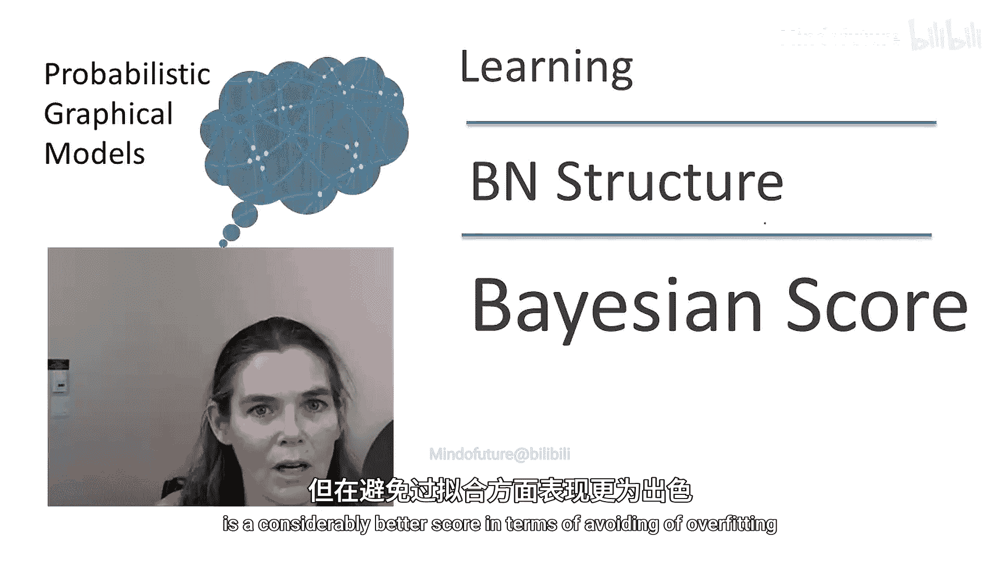
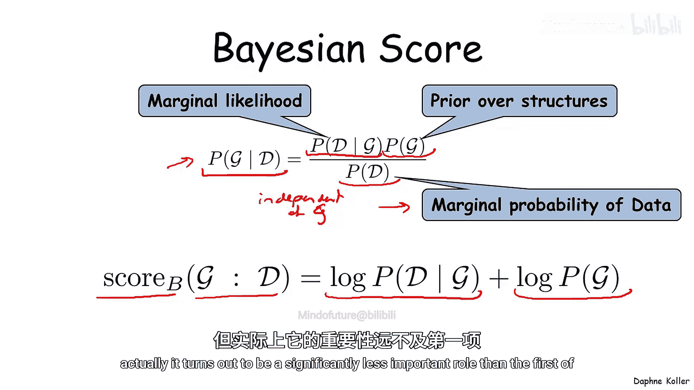
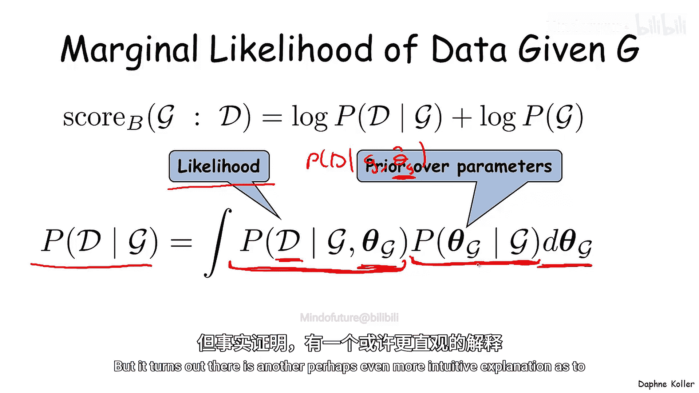
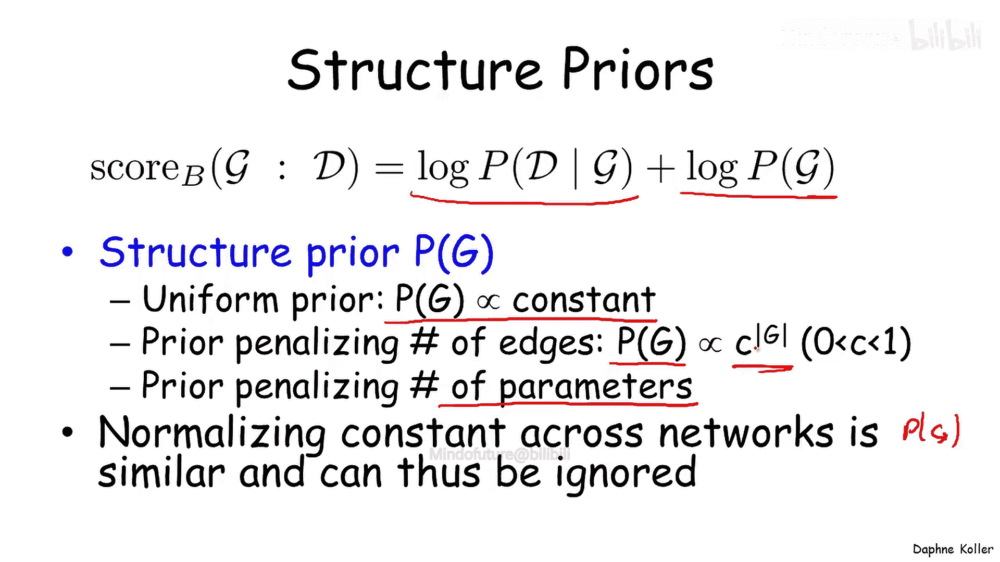
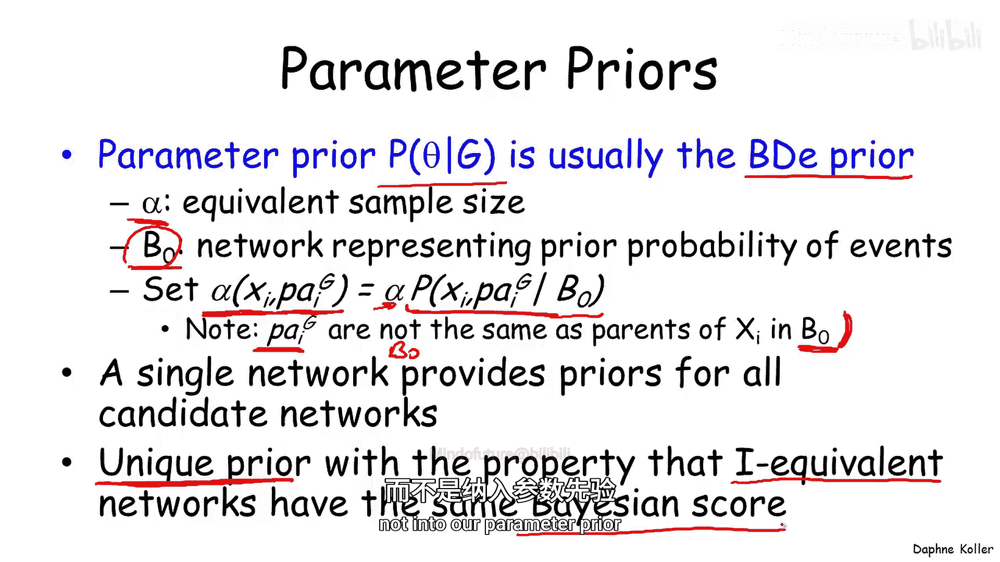
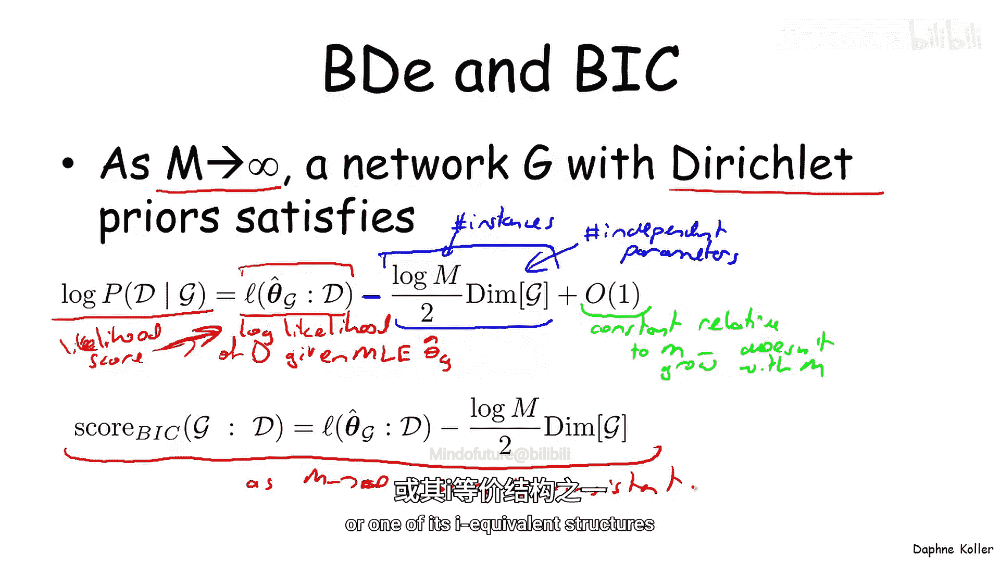
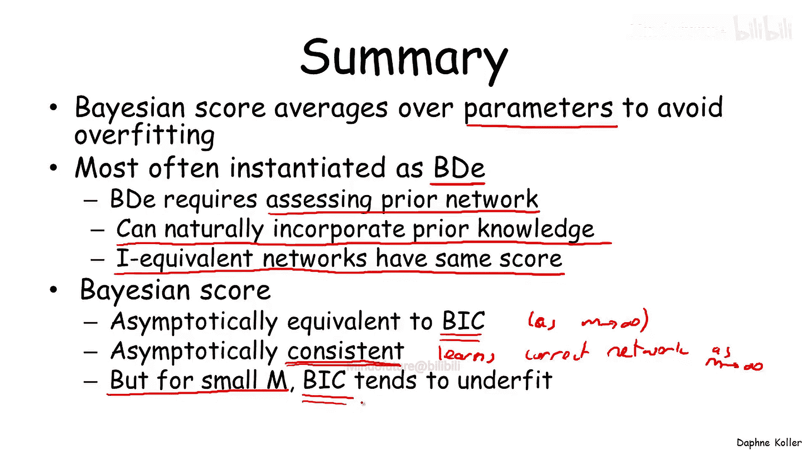

# 【斯坦福】概率图形模型3：学习 ｜ Probabilistic Graphical Models 3 Learning p19 P19_贝叶斯分数_05_01_04 -BV1MH6LBREqD_p19-

We talked about Besnet structure learning as the problem of optimizing a scoring function over the space of network structures。

 and we also talked about how the likelihood score。

 which is the simplest score that one could come up with。

 has significant issues relative to overfitting。We're now going to look at a different score that's derived from Bayesian principles。

 and we're going to see how that score， although it has some surface similarity to the likelihood score is a considerably better score in terms of its avoiding of overfitting。

So the Bayesian score is derived from the Bayesian paradigm that says that anything that we have uncertainty over needs to have a probability distribution over it。

And so if we have uncertainty over graphs， then we need to have a prior over graphs and if we have uncertainty over parameters。

 we need to have uncertainty over parameters as a probability distribution。

And so if we now define our optimization problem as that of finding the graph G that maximizes the probability of G given D。

Now， if we rewrite the probability of G given D using Bes rule。

 we end up with the following expression P of D given G times P of G divided by P of D so let's look at each of those terms separately。

The first of these is a term called the marginal likelihood P of D given G is the probability of the data given the graph。

The second of these terms， P of G is a prior over graph structures。And the final term， P ofD。

 the denominator is called the marginal probability of the data。Now， importantly。

 this marginal probability of the data is independent。😊，Of G。

And so is not going to affect the choice of which graph we select。

 and therefore we can ignore it in the context of a model selection problem that is a finding the single graph or a graph that maximizes the score。

And so we're going to define the Bayesian score score B of G relative to a data set D as the log of the numerator of this expression。

 so the log of the marginal likelihood plus the log of the prior over graphs。Now。

 we might think that this score is going to avoid overfitting because of its the use of the prior over graphs。

 And although that prior can play a role， actually turns out to be a significantly less important role than the first of these terms。

 which is the marginal likelihood。 So let's look at the marginal likelihood in a little bit more depth。

So the marginal likelihood， P of D given G is not as it happens the same as the log likelihood。

 because that marginal likelihood is something that integrates over all possible settings of the parameters。

 And so from a mathematical perspective， what we're going to do is we're going to introduce the variable theta G into the probability expression。

 and then we're going to integrate it out， which is the same as summing it out only it's a continuous space So we're going to use integrals。

So P of d given g is the integral over all possible model parameterizations。

 theta G of the probability of d given G and theta G times the probability of theta G given g。Now。

 the first of these two terms is the likelihood。Which is exactly the component that we used in the log likelihood score。

But importantly， unlike the likelihood score， we're not computing P of D given G and theta G just for the maximum likelihood parameters。

 theta Ha G， rather， we're computing this probability averaged out over all possible parameter settings。

 which gives us a considerably less optimistic assessment of the probability of the data given a particular structure。

 because we have to take into consideration not just a single parameter of setting that is geared exactly to our data set。

 which is the theta hat set of parameters， but rather averaging out over all possible parameter settings。

 theta G using the prior over parameters。So that less optimistic assessment is sort of one intuition as to why this might not overfit as much。

 but it turns out there is another perhaps even more intuitive explanation as to why this score reduces overfitting。

So let's look at this marginal likelihood term P of D given G。

And just rewrite it as the probability of all of the instances， x1 up to XM given G。

And what we're going to do is we're going to now break up this joint distribution using the chain rule for probabilities。

 not the chain rule for Bayesian networks， just the chain rule for probabilities。

 and we can write that as the probability of x1 given G times the probability of x2 given x1 and G times the probability of x3 given x1 and x2 times blah。

 blah， blah up to the probability of xM given all of the previous ones x1 up to xm minus1 and G。

And if we look at each of these terms， each of these is effectively making a prediction over an unseen instance。

 say X M， given X1 up to X M -1。So you can think of it as almost doing some kind of cross validation or generalization or estimate of generalization ability。

 because we're estimating the ability to predict an unseen instance given the previous ones。

And so the probability of。D， in some sense， incorporates into it some kind of analysis of generalization ability。

Now you might say well， surely the likelihood does the standard likelihood score does exactly the same thing。

 but a little bit more thought reveals that if we want to do this kind of analysis for the maximum likelihood set of parameters。

 that maximum likelihood set of parameters， theta had G depends。On all。Of the。

All of the instances thee。Indeed， and so we can't break it down in this way because because。

D because if we had theta had G on the right hand side。

 it's already incorporating into it all of the instances， including the unseen ones。

 which is yet another intuition as to why that like the maximum likelihood score tends to overfit。

Now， the maximum， Now， the Bayesian score might look a little bit scary because it has all this integral in it and。

 and who knows how we would ever compute it。 It turns out that for the case of multinoial Bayesian networks。

😰，The the likelihood， the Bayesian score can actually be written in closed form using a function called the gamma function。

The gamma function is as written over here， it's also an integral。

 but it turns out that the gamma function is really just a continuous extension of the factorial function because gamma x satisfies the quality gamma x is equal to x times gamma x minus1 and most computers have an implementation of the gamma function in them。

So with the gamma function， we can actually rewrite the probability of D given G as a product that looks as follows。

 The first is first， we have a product over all variables， I。😊。

And then we have two different products included in this big this big outer product。

 The first is a product over。The parent set U I of。

Multiplying overall possible values of the parent set。

And here we have an expression involving gamma functions。

 where this expression involves both the dechele prior parameters。The alphas。

 as well as the sufficient statistics。So the first product enumerates over all possible assignments to the parents。

 and then we have an inner product， yet another inner product。

 which enumerates over all possible values of the variable itself。

 so variable all possible values XI J of the variable XI。And once again。

 we have gamma terms that involve both the prior。As well as the sufficient statistics。

And while this expression might look still a little bit scary。

 it's something that one can just plug into the computer and compute quite easily。

Another valuable property of this marginal likelihood。

 if we look at it a little bit more and now we also take its logarithm is we see that this expression is。

 which was originally a product over variables I of some complicated expression relating to XI is actually something that if we take the log turns into a sum over I of the family score of something that can be viewed as the family score for a variable XI and its parent set。

Together。And so just like other scores that we've seen before。

 the scoring function decomposes as a sum over eye of terms involving only X I and its parents。

 and we'll see that this property can be quite important from a computational perspective。

How do we so now building up from the marginal likelihood。

 the second term in this expression is log of P of G and so in order to accommodate for that。

 we need to have a prior over P ofG and there is a variety of different priors that people have used。

 it turns out that a quite common choice is to simply make P ofG constant and that although it doesn't impose explicitly any penalty on complexity。

 it turns out that it works quite well because of the penalty imposed on complexity by the marginal likelihood。

But if we want to build in additional penalties on complexity。

 we can make the prior be something that exponentially penalizes the number of edges or penalizes the number of parameters。

 and that induces additional sparsity。Now， importantly。

 we don't actually want to define a prior probability over graph structures and make sure that it correctly normalizes over all possible structures and even more so over all possible acyclic structures。

 but fortunately we don't have to because the normalizing constant in this distribution P ofG。

Is the constant across different networks and can therefore be ignored completely。

 and we only need to consider the term that changes with the graph structure and ignore the normalizing constant or partition function。

That's the structure prior， what about the parameter prior？

The parameter prior that we use in the context of the Bayesian score。

 the one that's most commonly used is something called the BDE prior。

And the BDE prior is something that we've actually seen before when we were talking about parameter estimation for Bayesian networks。

 and as a reminder the BDE prior is defined by two components。

 one is an equivalent sample size alpha， which is the total number of instances that we might have seen in some imaginary universe。

 and the second is a probability distribution p0 typically encoded by a prior Bayesian network B0。

 which encode sort of our prior beliefs about the universe。

And so we define now the imaginary counts that we might have seen for a particular combination of values for little XI and a particular assignments for its parents to be alpha。

 which is the total number of counts that we've seen times the probability of that particular event X comma PI of G in the network in the prior network B0。

Now an important note is that the parent of the variable Xi in the graph G is not the same as the parents of Xi in the prior network B0。

 in fact in many cases we choose the network in the network B0 to be one that has no edges where all variables are independent。

 but we compute the probability distribution in B0 and then use that to compute the hyperparameter alpha that are used in the context of the。

Of the learning problem for a given graphy。And the important thing is now that the single network be zero。

Provides us with priors for all of the candidate networks。

 so we don't need to elicit priors for exponentially many networks。

 we have a single network B0 in a single equivalent sample size and we can use that to compute the parameter prior P of theta given G overall possible networks that we're interested in evaluating。

Now， other than its convenience， why this prior is opposed to others。

 it turns out that one can show that this prior is the unique。

Prior over multinoial Bayesian networks with the important property that if two networks are i equivalent。

 then they have the same Bayesian score。 That is if we use a different set of deishlay priors other than one that fits this mold。

 we would have a situation where you might have two networks G and G prime that were I equivalent that have different Bayesian scores。

 and there's really no justification for that in terms of incorporating that into the parameter priors。

 because these networks are completely equivalent in their ability to represent the probability distribution or the same set of probability distributions。

 So why would we have one of them have a different Bayesian score than others or。Rather。

 if we do have some prior knowledge that one of these graphs is more suitable than the other。

 we should put that into our structure prior and not into our parameter prior。

One interesting property of the BDE score has to do with its asymptotic behavior。

 so let's consider what happens to the BDE score as or in fact a Bayesian score in general as M goes to infinity。

And it turns out that as M goes to infinity and network G with Derile priors satisfies the following in terms of the marginal likelihood that the log of the marginal likelihood is equal to the sum of these three terms。

 the first of these。Is just the log likelihood。Of the data。Given the maximum likelihood parameters。

C的 haveG。So this is just the likelihood score。Which we've already seen has some good properties in terms of trying to fit the data。

 but on the other hand， is also liable to overfit。The second term， however， is log of M over2。

 where M is the number of instances。Times Dm G， which is the number of independent parameters。Which。

 as we've seen in the context of a multinoial distribution is the number of entries in the distribution minus1。

And this term has a negative sign， which means that we are going the log of the marginal likelihood is going to be decreased as we increase the number of parameters and so there is a tension between those two terms。

 the first of these tries to have more complicated networks in order to maximize the fit to data as we've already seen and the second tries to reduce the complexity of the model by decreasing the number of parameters。

The third term。Is this term O of one， which indicates in a formal notation that this third term is effectively constant。

Relative to M， which means it doesn't grow。With M。With the number of instances。

Which means that as the number of instances grows， only these first two terms are going to play a role in terms of evaluating which structure is going to be selected。

Now these first two terms as it happens have a name and that name is something called the BIC score。

 which really looks just at the likelihood component and the penalty term and in a different part of this course。

 we talk about the BIC score and some of the properties that it has specifically， for example。

 the fact that as M grows to infinity。The score is consistent。

Which means that the graph or the correct graph or one of its i equivalent graphs is going to have the highest score among all possible graphs that we're considering。

So this is yet another demonstration that the Bayesian score is a way of avoiding overfitting because at the large sample limit。

 we will learn a correct graph， either the correct graph or one of its eye equivalent。

Stuctures。To summarize， the Bayesian score uses Bayesian principles。

 specifically averaging out over parameters that we have uncertainty over to avoid overfitting。

The Bayesian score is most often instantd as a particular variant called BDE。

 which requires that we assess a prior network in order to compute the prior over parameters。

 but that also allows us to a natural place to incorporate prior knowledge into the learning algorithm。

And the BDE prior has the important property that I equivalent networks have the same score。

The Bayesian score is at the large sample limit。Equivalent to a difference score called BIC。

 which we analyze separately in this course， and as a consequence of this equivalence。

 one can show that it's asymptotically consistent in that it learns the correct。Network。

As M goes to Infindi。Now， while this asymptotic behavior is an important one。

 it's also important to realize that we don't often have a very。

 very large number of samples or at least not a large number of applications。

 and so it's important to consider also the behavior for a more reasonable number of samples M。

 and in this case it can be shown that the BIC score tends to underfi to underfi the model structure in the sense that it'll learn models that are too sparse。

