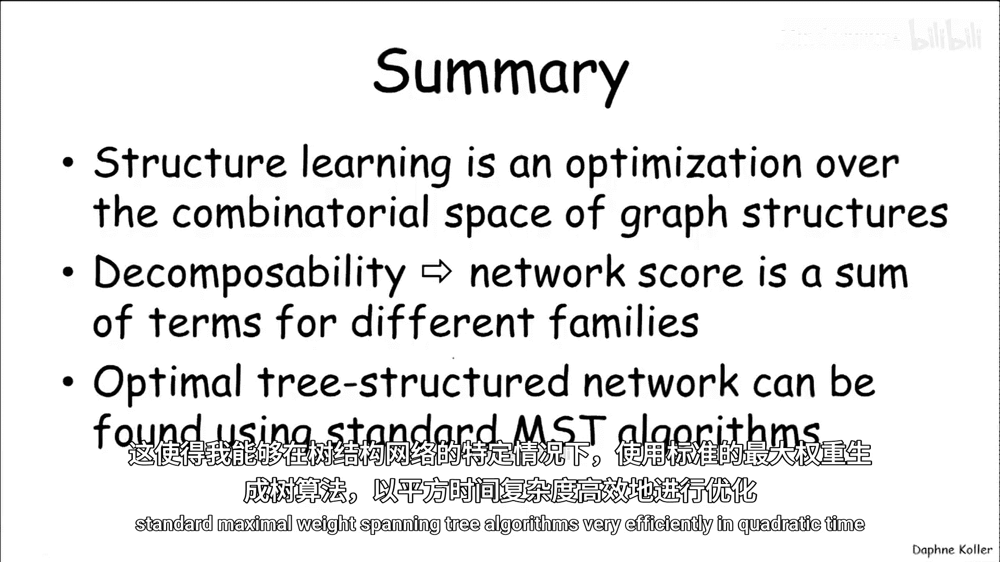
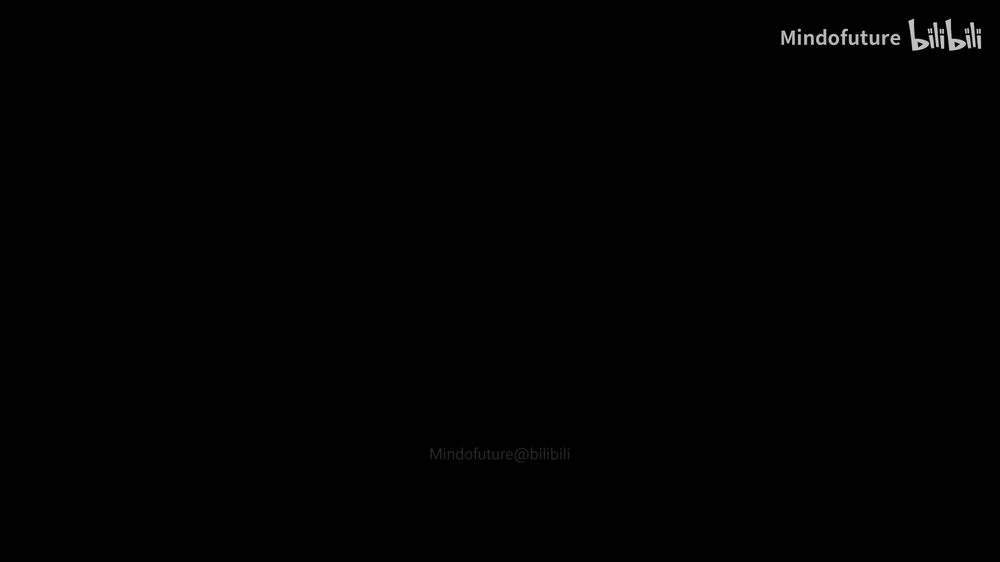

# 【斯坦福】概率图形模型3：学习 ｜ Probabilistic Graphical Models 3 Learning p20 P20_学习树结构网络_05_02_01 -BV1MH6LBREqD_p20-

Having defined a set of structure scoring criteria。

 we now turn to the problem of trying to optimize that structure score over a set of possible candidate structures。

 and we're first going to consider the specific case of tree。So just as a reminder。

 we defined a scoring function that evaluates how well a structure matches the data。

 so here is a set of different structures and here is a graphical depiction of our score and we would like to search for a structure that maximizes the score。

So this is an optimization problem。Where the input is a training set， a scoring function。

 and a possible structures， and the output is a network。

And it turns out that absolutely the key property for computational efficiency is decomposability of the score。

 which is the decomposition of a score as a sum of family scores， which we've seen before。😊。

So the first problem that we're going to focus on is that of learning either a tree or a forest。

 So what is what is a forest， A forest is at most one parent per variable。 So here， for example。Is。

One forced。And notice that a force doesn't have to be connected。That is， it can be suffered。

Disconnected components。A tree， on the other hand， would require that the graph be connected so we might have this edge for example as well。

 and notice that it's still directed tree。So why should' we care about learning trees。

 given the trees are so degenerate as a you know they're so restricted in their expressive power Well there are reasons there's different types of reasons why we like trees。

 first of all， it turns out that the math is very elegant now that might not be a convincing reason。

 but that elegant math gives rise to what turns out to be a very efficient optimization over the set of trees that allows me to solve it extremely effectively even for very high- dimensionional problems。

嗯。And then finally， the third reason is that trees are limited expressive power。

 but that also implies that their parameterization is very sparse and because their parameterization is sparse。

 it means they're less susceptible to overfitting。And therefore。

 at least in cases where M is small relative to the network complexity。Elta to n。

Then it turns out that it can provide better generalization。

 even though it doesn't capture the full expressive power that we would hope to cave at our network。

So。Let's now talk about the problem of learning force and we're going to define a little bit of notation。

 we're going to define P of I。For variable I to be the parent of Xi or zero in case Xi has no parents。

So note that each variable has its most one parent， so this works。

So let's look at our decomposable score and again this can be any of the three scores that we talked about because they all have this property。

 so the score is a sum of score of individual families XI and their parents。

 and now the parents are very simple because we have only at most one parent per variable and so we're going to divide this into two cases。

 the first case is nodes that have a parent。And the second one is no the don't。

And so for the nodes that have a appearance， what we have is the score of X given it's one parent。

 and for the nodes that don't have a appearance it's just the score of XI as a standalone variable。

Now we're going to shuffle things around a little bit， and we're going to do the following。

 We're going to introduce。Into this expression。A score of Xi。 And then we're going to add it back in。

Over here。So now we have sum over all variables， so notice this is I equals one to n of a score of X in isolation。

 but for the X's that have a parent I've subtracted that off in the first summation。

 and so I've compensated for it on both sides。The important property of this expression is that this is the same for all trees。

And so it doesn't affect the comparison between one tree and the other。

 and so the only expression that I need to consider when comparing to three is this expression over here。

 which is the sum over I of the score of X with its parent minus the score of X without its parent。

So you can think of this as the score of the empty network and the first expression。

 the first animationation is the improvement that a tree gives me over the empty network。

And so the score now turns into a sum of edge scores where each of these is a score of an edge。

From Pi。Why。Plus， a constant that doesn't affect the selection of the networks。

And that turns out to be the critical piece for doing the optimization efficiently。

So let's see how this all works out。So first of all。

 we can define the weight of an edge from i to J to be the score of Xj with its parent Xi minus the score of Xj。

 this is exactly the term that we saw on the previous slide in the first of the twoinations。Now。

 for the likelihood score， if we go back and plug in the likelihood score。

 we can see that this weight。Turns out to be M times the neutral information。Between。I andJ。

So the extent to which they're correlated with each other。

And because mutual information is always non negative。

 it means that all edge weights are always non negative。

And that means that the optimal structure is always a tree， that is there's always benefit。

 or at least there's no penalty for including additional edges。For BIC or BDE。

 we know that there is a penalty score， so even if introducing an edge from Xj to Xi increases the likelihood we might end up paying for it more in the penalty score than what we gained。

 and so the weights， this weight can actually be negative。

At which point the optimal structure might actually be a forest。

 that is it might be detrimental to our overall score to make the graph fully connected。

Not fully connected， to a graph connected， that is a tree rather than a forest。Okay。

Now the second observation。A score， remember satisfies score equivalentences。

 this is a property that define we defined before if I equivalent structures have the same score。

And all of the scores that we talked about are score equivalent。

It turns out that for a score equivalent score， we can show that the weight from I to J is equal to the weight from J to I。

That is， we can compute this expression。Over here。For J to I or for I to J。

 we're going to get the exact same value。And you can see that in the likelihood score directly because mutual information doesn't have any kind of directionality associated with the mutual information of XI to XJ is the same as mutual information from XJ to XI。

 so for likelihood score you could just see that and it turns out that for the other cases it's also it also follows。

And so that means that we can define an undirected graph where it doesn't really matter whether I go from I to J or from J to I。

And because the weight is the same for both。And so for score equivalent scores。

 we therefore get the following algorithm。 We can define an undirected graph。

With nodes being the variables in my graphical model。

And then I define a weight WIJ to be the max of the score X between Xi and Xj and zero。

 and remember that it doesn't matter whether I do I JI here。

 we're going to get the exact same thing for score equivalent networks。The0。

Is going to be a way of eliminating negative edges so that I can optimize things efficiently without having to worry about negative edge costs。

Now I can go ahead and find a forest or a tree that has the maximumimal weight。

And the nice thing is it turns out that you could use any of the standard algorithms for maximum weight spanning trees in order to do this。

 so for example either primms or crustcos algorithm can be used to solve this。

 and we can in fact find the solution in time that is all n squared。

 which is an inevitable cost given them considering all n squared combinations in terms of pairs of edges。

And then if I end up having edges of weight zero that indicates that the edge there potentially contribute was derived from a negative component of the score。

 I remove all of the edges whose weight is zero to produce a forest。

 and that is an O of n square time algorithm for finding the absolutely optimal tree relative to any of these three score equivalentron scores that we've defined。

So let's look at an example， this is the ICU alarm network again。

 this is a picture of the original network， and if we apply this tree learning algorithm we end up with the following structure。

Where the edges that have been marked in red are edges that existed in the original network and the blue ones are edges that are spurious。

 that is they weren't in the original network， so this blue one over here， for example。

 isn't in the original network。And so we see that although many。

 most even of the edges that we end up with are edges in the original network， some aren't。

 some are derived from correlations that went through indirect paths in the original network。

And the other thing that's important to see looking at this is that the inferred edges in the tree are intrinsically undirected。

 it doesn't mean that I can't force a direction on them。

 but the direction isn't determined by my optimization algorithm。

 and that means that I'm not able to determine what came before what in the original graph when I'm learning a tree。

So to summarize， structure learning is an optimization problem over the comminatorial set of space of graphs。

 the decomposability property allows me to break that up as a sum of terms for different families。

And that allows me to optimize in the specific case of tree structured networks using standard maximum weight spanning tree algorithms very efficiently。

In quadratic time。

