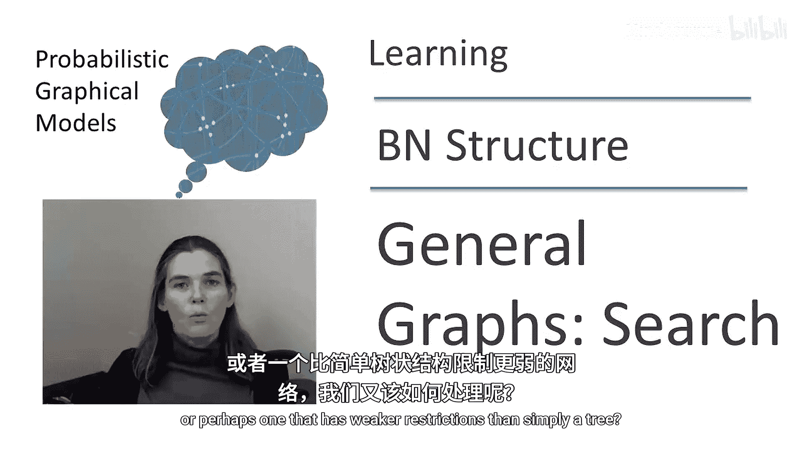
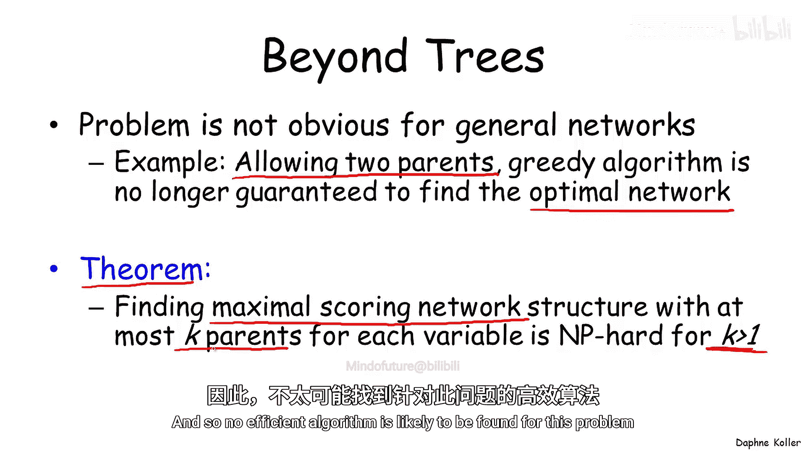
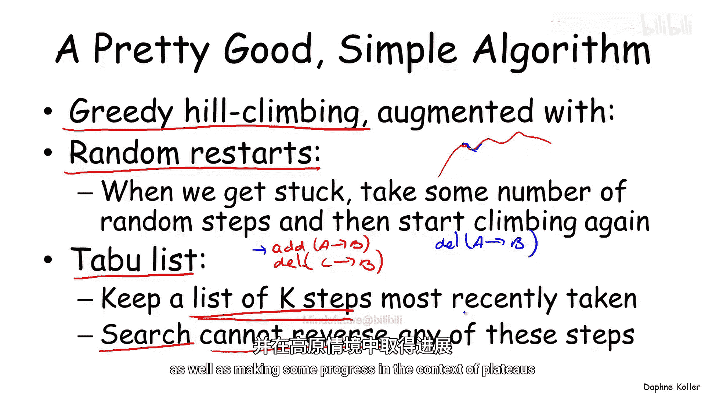
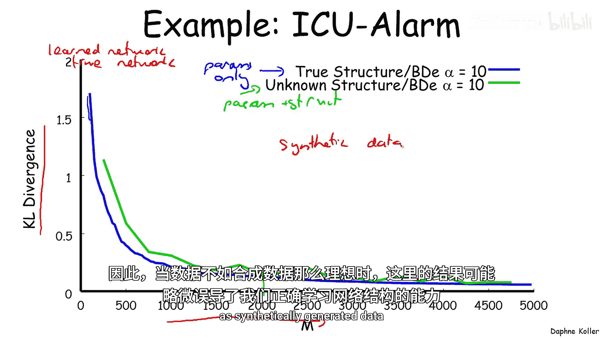
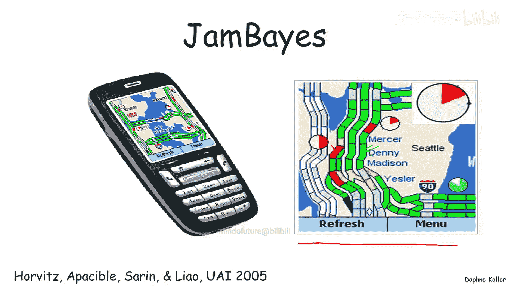
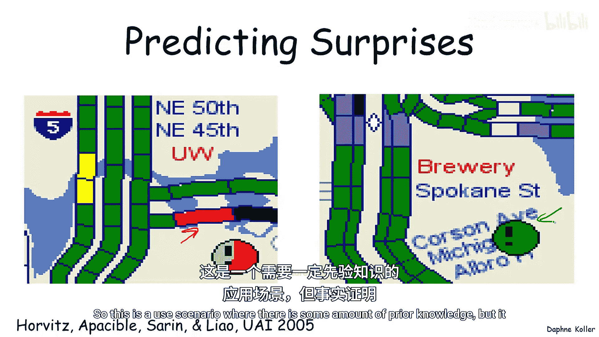
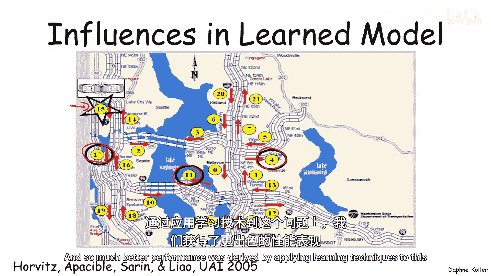
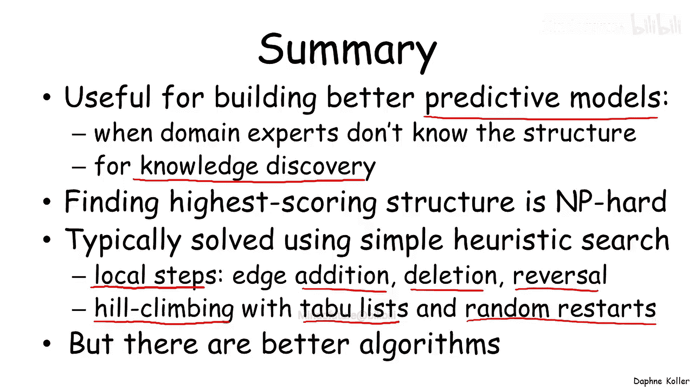

# 【斯坦福】概率图形模型3：学习 ｜ Probabilistic Graphical Models 3 Learning p21 P21_学习通用图-启发式搜索_05_02_02 -BV1MH6LBREqD_p21-

We previously described the problem of baynet structure learning as an optimization problem。

 where we separated the problem into two pieces。 One is defining a scoring function。

 and the second is coming up with an algorithm that optimizes that scoring function。

 We talked about how the optimization problem can be solved in the case where we're trying to learn a network structured as a tree or rather a forest where each variable has at most one parent。

😊，But what about the more general case where we are trying to learn an unrestricted network or perhaps one that has weaker restrictions than simply a treat？

So how do we address that problem？So first as a reminder， our input is a training set。

A scoring function and some set of possible network structures。 And the output， the desired output。

 is some kind of network structure that maximizes the score within the set of families structures that we're willing to consider。

So what happens if we try to solve this optimization problem in the case where the network restricted network structure is not the class of trees？

Well， in the context of trees， we could apply a simple greedy algorithm for finding the maximum weight spanning tree。

But when we have a more general network， even ones where we allow it most two parents pernde。

 this greedy algorithm that builds up a tree no longer works。

 is no longer guaranteed to find the optimal scoring network。Now， in fact。

 it turns out to be not surprising that that a simple algorithm is not going to work because of the following theorem。

 The theorem states that the problem of finding the best network， the one that has the highest score。

 with at most K parents is an empty hard problem for any K bigger than one。

 So for K equal to one where back in the context of trees or forest。

 and we have the polymomial time algorithm， but even for K equals 2。

 the problem turns out to be empty hard。 And so no efficient algorithm is likely to be found for this problem。

So what do we do？It turns out that the standard solution is some kind of heuristic hill climbing search。

 so we have a current network which is the one that we're trying to improve and we'll talk later about where we start this process。

And now we look at different changes that we could make to this network。 So we can consider。

 for example， making local perturbations that may or may not improve the quality of the network relative to the score。

 What we see here， this bar represents the score。So for example。

 this transition adds an edge from B to D， and we can see that here that turned out to improve the score because this bar。

 as we see is larger than this bar， we can consider other changes， for example。

 this transition removes the edge from B to C and also gives rise to a slight improvement in the score but not as large as the one where we added the edge from B to D on the other hand。

 reversing the edge from B to C。😊，Which is this transition gives rise to a decrease in the score。

And so we can look around us and see which。Changes to the network。

 improve the score and which ones don't， and then probably try and go in a direction that generally improves the score。

There are two main design choices that one needs to decide on when doing a heuristic search algorithm The first is the set of operators that is the set of steps that we can take in pertuurrbing one network to the other。

So for example， in the example that we just saw， we were taking local steps， we were adding edges。

 the leading edges or reversing edges， and these are fairly small perturbations of the network。

There's also algorithms that use much larger global steps where we take an entire node out of the network and stick it in somewhere else。

 and that's a larger step that is more costly but also takes larger moves in the space of networks。

So this is one set of design choices。 The second set of design choices is which search technique we end up using so do we do what's called greedy hill climbing where we're just trying to climb up as quickly as we can。

 or do we adopt a different type of local comminatorial search algorithm of which there are many different kinds。

 some of which are listed here and there's many others and we're not going to talk about those。

Very much。So let's start by talking about greedy hill climbing。

Which is the basis for most of the basementnett learning algorithms that are in use today。

So how does greedy Hill climbing work we start with a given network initially often this is just the empty network and the reason for starting with the empty network is that it induces sparsity。

 we don't have too complicated a network and one that's likely to overfit。

We could also start with the best tree which we get from one of the efficient tree learning algorithms that we talked about we could also start with a random network。

 this is a way of exploring the space more broadly instead of starting out from a fixed starting point。

 we can start from multiple random starting point or in cases where we have an expert that has some knowledge of the domain we might use prior knowledge in order to initialize the process。

Having initialized， we now iteratively try and improve the network so we consider the different steps that we can take based on the operators that we defined as being legitimate。

 and then for each of them， we consider the score that we obtain from all possible changes。

 and then we apply the change that most improves the score。 so this is the greedy component。

 That is we look at all possible changes and we greedily pick the one that improves the score。

That gives us a new network， which we can now again update by again。

 considering possible next step changes that we could apply to this new network。

And this process continues until we get stuck。 That is when none of the modifications that we have at our disposal improves the score。

 And when that happens， we are at what's called a local maximum。

That is a place in the space of network where no change gives rise to an improvement in the score。

What are some of the pitfalls of this greedy hill climbing process？Well。

 the first is that this local maximum is potentially a local maximum。

 That is one that is not the global maximum。 So if we pictorially draw the space of of possible networks。

 we're going to draw it as continuous， even though it's discrete。

 What we have is sort of a space that looks like this。

And if we start out from a point over here and we just take small hill climbing steps。

 we might end up at a position that is a very poor local maximum compared to the global maximum。

 which could be considerably better。And this is quite common in the kind of comminatorial search that we use in this type of situation。

A second problem is what's called a plateau。 A plateau。

 if we go back to this kind of visualization that we have here is a case where looking around us。

 there is a whole bunch of networks that are all effectively the same score。

 and while some of the directions might give rise to eventually after a certain number of steps to a hill。

 others might not and the problem is that we don't know which direction to go because they all look exactly the same in terms of the score。

This happens quite often in the case of Bayesian network structure learning。

 because whenever you have a network， for example， like this。

Other networks that are equivalent to them， for example。

 the one where we just reverse this edge and we have a parent that has two children as opposed to a chain。

 This network is equivalent to this one I equivalent and therefore it's going to have the same score。

 and in general， we're going to have a lot of neighbors when you have more complicated graphs。

 a lot of networks that are equivalent and therefore have the same score and moving around between them。

 It's not clear which of those is going to eventually give rise to a move that breaks us out of the plateau into into a network that actually has a higher score。

So these are significant issues in terms of using greedy hill climbing search for optimizing the sport。

The issue of local maximum plateau also relates to the question of search operators that we used。

 and we talked about edge edition edge deletion and edge reversal and the question of that one might ask is why on Earth would we need edge reversal。

 because after all， edge reversal can be subsumed by an edge deletion and then an edge addition。

 So why do we need to to add a whole new set of operators into into the pool that we have to evaluate。

So this， it turns out has to do with the greedy nature of our search。

So to understand that let's look at this example let's assume that this is our graph G star that generated the data and now let's assume that we're going to try and learn a network from this from the distribution derived from this graph and so here we have initially our empty network which we're going to start out with and we have two strong correlations in this network。

 the one from between A and C and the one between B and C and let's say that we pick the one between B and C as being stronger and therefore we're going to add it first。

 and now there is complete symmetry between the edge that might go from C to B and the edge that might go from B to C these two networks are equivalent and they're going to have the same score and so we can arbitrarily choose the edge that goes from C to B because it's as good as the other one。

Now that that edge is in， we might go ahead and add the other one。

 say we're going to add the edge from A to C。And the question is。

 now what The edge from C to B is wrong。 And really， we'd like to reverse it。

 But if we don't have an edge reversal operation， the only way to do that would be to remove that edge。

And then add in the edge in the other direction。But removing that edge is going to cost us a lot in terms of score。

 because this was a really good edge。 In fact， it was the first one that we added。

 So removing it is going to cause a hit in terms of the score。

 and it's going to be a suboptimal move。 It's not going to be a greed move。

And so if we don't have an edge reversal operation， this red network。

 the one that has the edge from A to C and the edge from C to B， is now going to be a local maximum。

And we're not going to be able to break out of it by looking just greedily within one step unless we have an edge reversal step。

 so edge reversal is a way of avoiding these very common local maxima。

But it doesn't address all local maxima， specifically not the bigger ones that that we've also discussed。

 So what is the algorithm people typically use for addressing this problem without falling into this local maxima that common that frequently。

So it turns out that a pretty good， simple algorithm is the following。We do use greedy hill climbing。

 but we augment it with two strategies that are attempts at avoiding local maximum and plateau。

 The first is what's called random restarts， which is if you're climbing up and you get stuck you take a certain number of random steps and then start climbing again and the hope is that if we're at a local maximum that's fairly shallow。

 then the small number of random steps will move us into the attraction area of a better maximum and we will continue to climb to a better optimum。

A second strategy， which is useful for both local maxima and plateaus， is what's called a tabooist。

A tabooist is a way of avoiding treading the same ground over and over again。

So here we have a set of steps that we have taken， for example， adding an edge from A to B。

Or deleting。An edge from C to B。 And these are the steps that we've recently taken。

 We keep a list of the case steps that we've recently taken。

 and we constrain our search that it cannot reverse any of these steps。 So specifically。

 if add A to B is on our list， then on our taboo list， we have that delete。

The edge from A to B is not something that we can do while the add step is still in the list of the key most recent steps。

And that forces us to make forward progress rather than doing the same step， reversing it。

 trying a different version of it， reversing that。 and that turns out to be helpful both in avoiding local maxa as well as making some progress in the context of plateaus。

So with how well does this work in practice， let's first look at a synthetic example。

 this is the ICU alarm network that we've seen before in the context of BaysNe parameter estimation and what we see here are two learning scenarios。

 one in the blue line。Down here is learning parameters only。With the true structure given。

And the green line。😊，Is where we're trying to do both parameters and structure at the same time。

 So trying to learn both。And we can see on the X axis。

 the number of data instances M and on the y axis， the distance between the distance measured as k divergence or relative entropy between the learned network。

And the true network。And what we can see here is that it's certainly the case that when we're trying to learn only parameters。

 we do better， at least initially， that is for small numbers of samples。

 the case where we have the true network performs better in terms of learning and distribution that's close to the right one。

 but as we get more and more data。Even with as few as around 2000 samples。

 we're actually pretty close in performance。Now， this is very promising because it says that the structural learning problem is not intrinsically that much more difficult than that of parameter estimation alone。

Now this result， however， should be taken with a grain of salt because the problem of learning from synthetic data。

 which is what we have here， this is data that is generated from the network is actually easier than the problem of learning from a real data set。

 because synthetic data has a much clearer and stronger signal about the correlation structure than real data and so the performance here is probably a little bit misleading in terms of our ability to learn the network structure correctly when we don't have when the data is not quite as nice as synthetically generated data。

However， there is a lot of applications where even with real data based and structural learning has given significant advantages。

One of those is this application for Microsoft Research。

 which aims learn to to predict where traffic jams are going to take place。

 as well as where we might have surprises in terms of having less traffic or more traffic than normal。

So here the idea is that we have some number of sensors on certain major freeways and we know。

 for example， that certain areas of the freeway have a lot of traffic。

 other areas have less traffic and we're trying to use that data to predict parts of the road system that don't have these sensors observed in them。

 as well as to predict how the traffic would look in 30 or 60 minutes。

So in particular， we'd like to predict， for example。

 parts of the road where there's going to be more traffic than we expect。

 so predicting a surprise as well as a good surprise， such as less traffic than we expect。

So this is a use scenario where there is some amount of prior knowledge。

 but it turns out that expert knowledge is not really adequate for understanding how different sources of information。

 different pieces of the road system are intertwined with each other and much better performance was derived by learning a Bayesian network structure from data that shows how these different accident reports。

 the hour of the day， and different areas in the freeway system are related to each other。

And we can see that some of the correlations that were learned might not be quite as obvious as a human might have inferred。

 so for example， the influences on this traffic in location 15。

 the most significant factors are the ones marked here4 11 and 17 and you might not have necessarily predicted that something that's all the way across the bridge in Seattle is the most indicative factor on this particular prediction problem and so much better performance was derived by applying learning techniques to this problem。

A very different application of structure learning is in the context of this application。

 which aims to do scientific discovery In this context。

 a data set was acquired that measures for different proteins in a cell， the level of those proteins。

 And this was done at the level of single cells。 So there were tens of thousands of measurements。

 each one corresponding to a protein profile in in an individual cell。 Now。

 the goal from this experiment was to discover the control mechanism of how the level of one protein can influence the level of another。

 So to learn， for example， that a change in the protein level some of a protein such as PKC can influence the level of the protein called PK and the level of the protein called RA as part of the regulatory network of the cell。

So this data was acquired and Bayesian network learning was applied to this problem in order to try and understand this regulatory network within the cell and what we see here are the edges that were learned by by the BayesNe learning algorithm and we can see that many of the edges specifically all of the ones that are marked in blue we ones that were known in the literature before now while that might seem perhaps less interesting to reiscover something that was already known this is an important validation for the BayesNe learning algorithm because it shows us that the network is learning something valuable and correct。

 and furthermore it shows that in a single experiment Bayesian network learning applied to the right kind of data can reconstruct a cellular network that took biologists many。

 many years to put together。Now not all of this is right。

 so for example this pink edge over here is an edge that was learned in one direction and really should have been learned in the other direction that is its reversed relative to our current biological understanding and some other edges。

 specifically the ones that are these dashed lines for example。

 this one or that one or that one we're omitted from the network that is they should have been there but we're not correctly learned so this is definitely not perfect but nevertheless it's a surprisingly impressive success story in the context of taking just a single data set and reconstructing many years of learned biology。

What's also important is that some of these edges that were learned， these two red ones。

We're ones that had some very weak support from the literature。

 that is they were known to exist in a different cell type than the B cells in which these data were acquired。

 but were not known to exist in B cells。And one of these。

 specifically this one was subsequently tested in a wet lab and found to be true in these cells as well。

 and so the network revealed to biologists a connection that had not previously been established in the context of these cells and turned out to be of importance because it corresponds to what's called crosstalk or communication between two different biological pathways。

And so this is a very nice example of how Bayesian network structure learning can be used in this different paradigm where not only do we not necessarily have expert knowledge and we want to improve performance。

 but rather discovering the network structure is a goal in and of itself。😊，To summarize。

 Bayesian network structure learning is a useful tool for building better predictive models when domain experts don't know the structure and that can be useful both for making predictions about new instances but also as we saw in this most recent example for knowledge discovery as well so for these very two different purposes。

😊，We've shown that in general， finding the highest scoring network structure outside the context of forester trees is an NP hard problem。

And that that is typically used solved using simple heuristic search。

 and most commonly this is done using local steps that modify the network using small local perturbations such as edgeju。

 deletion or reversal， and in order to avoid the local optima that one would get from this。

 we typically use not just simple hill climbing， but modify that using both tabooists that avoid sort of undoing recent changes as well as random restart so as to explore different parts of the space。

While this is a surprisingly successful strategy， it turns out that there are actually much better algorithms out there that make much larger changes in the space simultaneously。

 these are computationally more expensive， are harder to implement。

 but can make much larger moves in the space and therefore especially for large spaces where the signal isn't immediately clear can find better structures than the simple grid research。

