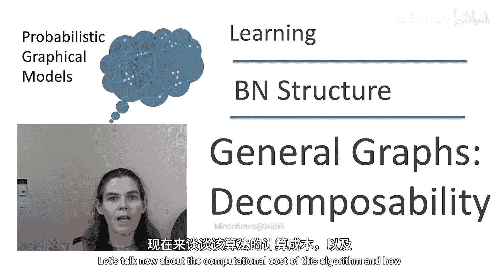
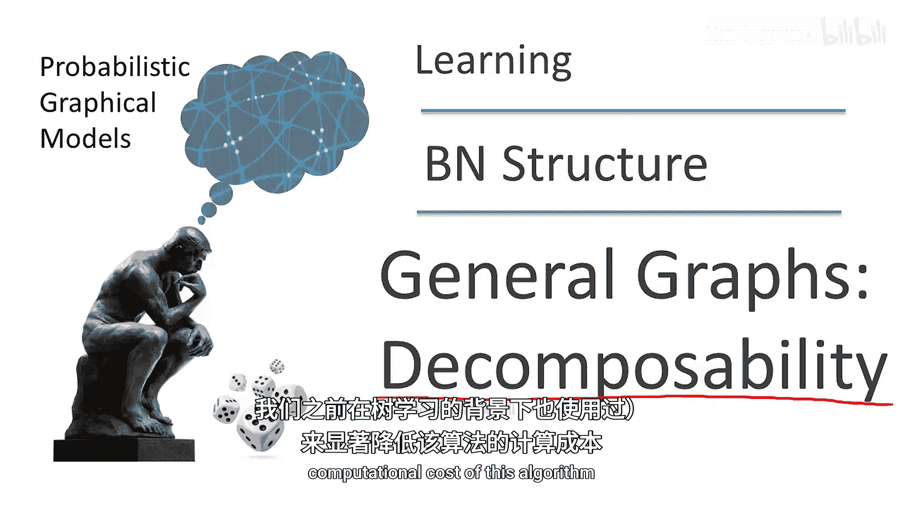
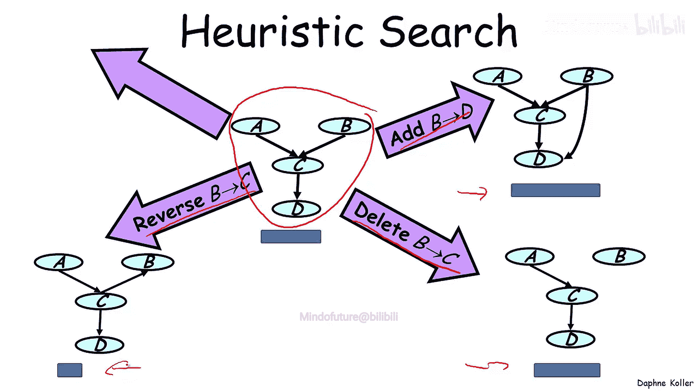
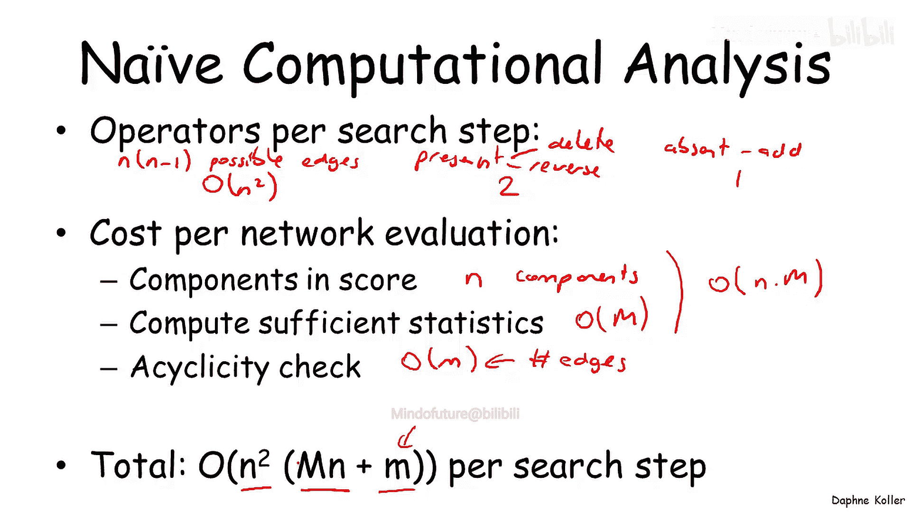
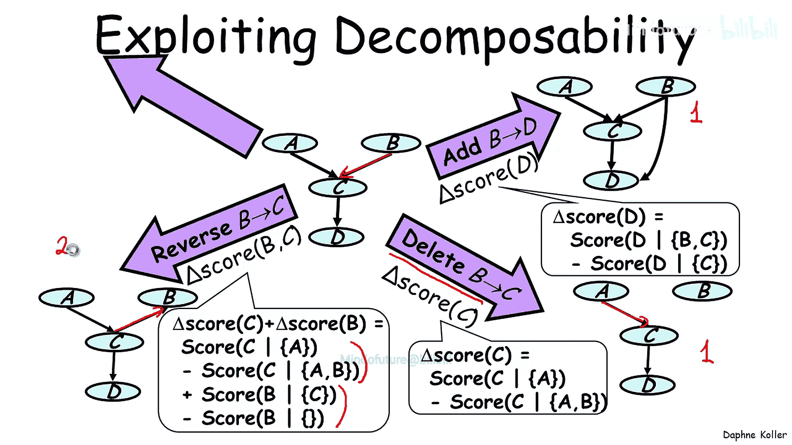
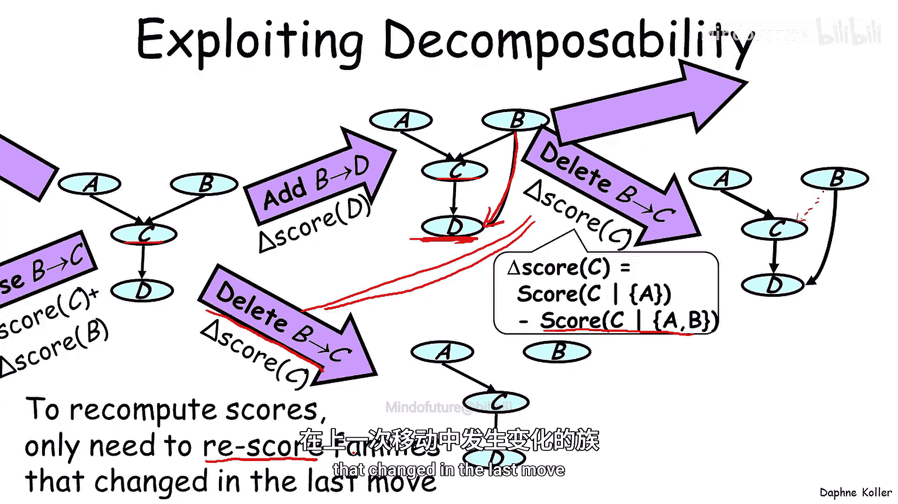
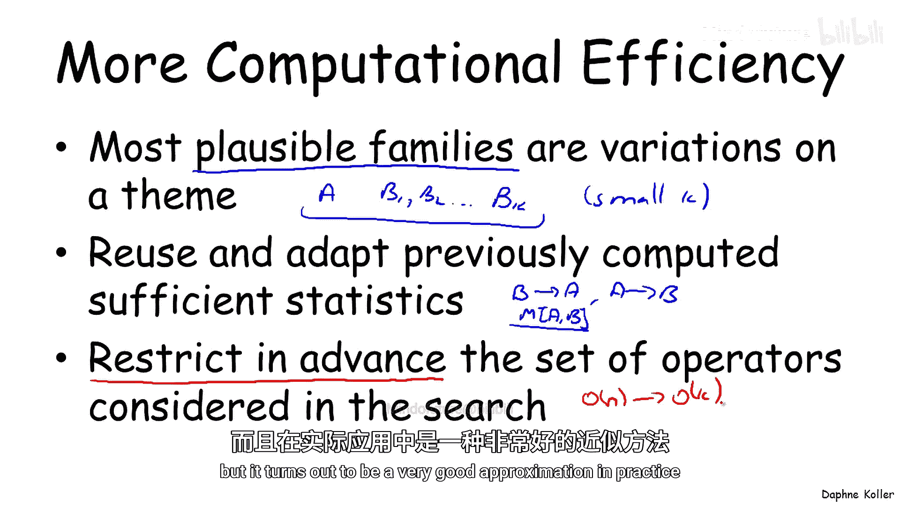
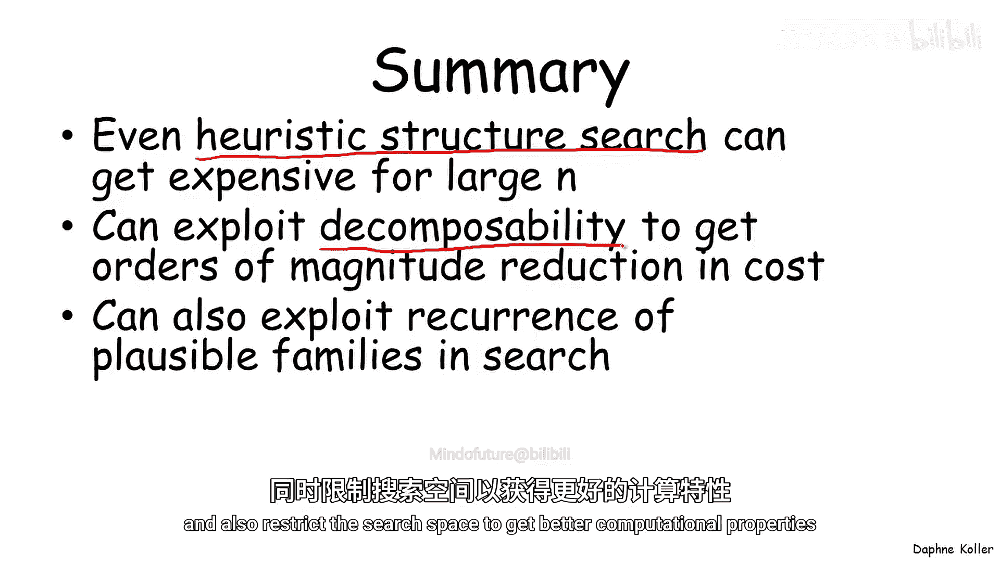

# 【斯坦福】概率图形模型3：学习 ｜ Probabilistic Graphical Models 3 Learning p22 P22_学习通用图-搜索与可分解性_05_02_03 -BV1MH6LBREqD_p22-

We talked about how the problem of learning a general BNe structure can be viewed as a combinatorial optimization problem in which we are trying to find a high scoring network structure and how that problem that problem is usually solved by some kind of heuristic search over the space of Bnet structures。

Let's talk now about the computational cost of this algorithm and how we can use the property of decomposibility。

 which we also previously used in the context of tree learning to considerably reduce the computational cost of this algorithm。

So as a reminder， the heuristic search procedure that we discussed iteratively moves over the space of networks and so if this is the network that we're currently at。

 we need to evaluate several different moves away from that network that perturb it usually in local ways by adding deleting or reversing an arc we then score each of these subsequent networks and see which of those has the highest score and take that move and one can also have other algorithms that evaluate that don't necessarily make the greedy move at each point。

 but basic ideas the thing。

So what is the computational cost of this algorithm？Let's do the naive computational analysis。

 what we would get if we were to do the naive implementation of this。

So how many operators are there in each search step that we need to evaluate？

So in a Bayesian network with N nodedes。We have。N times n-1， different possible edges。one。嗯。Now。

Each of those edges is either present in the graph or not present in the graph。

 If the edge is present in the graph， we can either delete it。Reverse it。And if it's absent。

We can add it。Which means that effectively we have either two or one possibilities for each of those n times n minus one possible edges。

 and so we have O of n squared。Possible operators that we need to evaluate at each point in the step。

It it step in the algorithm。What is the cost of evaluating each of the candidate's successors that we would get by taking one of these operators？

So reminding ourselves that there are multiple components in the score。

 one for each variable in the network because of the decomposability property。 So we have N。

Different components。And for each of those， we have to look at the sufficient statistics and compute the resulting entry in the score corresponding to that variable。

 Computing sufficient statistics requires a traversal over the training data。

 And so that's something that takes O M。Time where m is the number of training instances。

 So altogether， this step requires O of n times M。Now， we haven't。Talked about this。

 but one also needs to make sure that the resulting graph from this operator is in fact acyclic。

 and so we need to do an ascycllicity check， this is something that in general requires O of little M time where M is the number of edges in a graph。

So altogether， if we sum up all these different pieces of the cost。

 we end up with computational cost， which is O of n squared times Mn plus little M。

 where by and large little M is usually dwarfed by big M times n。

And that is the cost per search step。Now if you think of a network。

 that's not even necessarily that large， something that has 50 or 100 variables。

 so that n is 50 to 100， and the number of training instances is 10，000， this can get really。

 really large and generally intractable to do in a lot of situations。

So how can we improve on this？Let's see how we can exploit the decomposability property to get a significant computational savings in the search process。

Let's first look at a single small operator， such as the one where we add an edge between B& D to this network where such an edge did not exist before。

And let's consider the score that we had for the original network。Which in this cases。

 because of the decomposability property is the sum of family scores for the individual variables。

 so we have a component that lists the score of A relative to its empty set of parents。

 the score of B relative to the empty set， C relative to its parents A and B。

 and D relative to its parent C。Let's compare that to the score of the network following the move。

And we can see that this score for the new network is actually very similar to the score of the original network。

 because for the same decomposability property， we can break up the score into these little components。

 And since most families haven't changed， that component in the score is going to be the same。

 specifically， we're going to have the exact same score for a relative to its empty parents that the same score for B。

 the same score for C。 And only this， only this last score for B is now going to be different because of。

The fact that we've modified the family for D， but that immediately suggests that we don't really need to recompute these earlier components of the score because they haven't changed。

 we only need to compute the last component corresponding to D。In fact。

 we can do better than that by instead of considering the absolute score。

 instead we're going to compute what's called the delta score。

 which is the difference between the score of the network， following the change。

 this network and the score of the original network and we're going to compute the difference between those two scores。

 which as we can see is just the difference between the scores of the two families for D the BC family in the following in the new network versus the C family and the original network。

And that deelta score is going to be something that we can compute just looking at a single family。

 ignoring the rest of the network。The same thing happens for other local operators， so for example。

 if we consider now the deletion operator that deletes an edge between B and C。

 and we look at the delta score， that delta score only cares about the family C because that's the only family to have changed and that's going to be。

 again， the difference between the score of C with a single edge A minus the score of C with the family AB。

So again， only one family gets affected by this change。For an edge reversal。

 the situation is a little bit more complicated because we can see that by flipping the edge from B to C and making a go from C to B。

 there's actually two families that are affected， the B family and the C family。

 but that's still just two as opposed to the entire network。

 and so we can see that that deelta score is going to have two components。

 one is the deelta score for the C family and the second is the deelta score for the B family。

But in either case， we only end up affecting either one family in the of edge edition or in the case of edge deletion。

 or at most two families in the case of edge reversal。

And so that means that we only have to consider a much smaller fraction of the network when computing the delta score。

A second use of the decomposability property comes up when we consider multiple consecutive steps of the search algorithm。

 so let's imagine that in the previous step we decided to take that step that added the edge from B to C and now we have to consider the next step in the search。

Well， what are the operators that are conceivable this in this next step of the search， for example。

 one such operator is to delete the edge from B to C。This one。

And notice that that edge deletion operation is in fact。

 an operator that we also considered in the previous step of the search before we decided to add the edge from B to D。

Now not only is this operator the same， notice that the family of C hasn't changed between those two cases in both of these cases when we're considering the move。

 C has the parents at A and B， and so the delta score for that particular move is not going to change either。

 specifically if in this case， the delta score was the score of C given family A minus the score of C given the family A B。

 we have exactly that same score。The same delta score in the previous step。

 that is these two delta scores in the previous step in the new step are exactly the same and so there is really no point to recompute it。

So which scores do we need to recompute the only scores that we need to recompute are the ones that were affected by the step that we currently that we just took。

 so specifically if we took a step that modified the family of D than any step that involves an additional change to the family of D well have a different delta score because the family is now different in doing the comparison。

However， families that were not affected by the move don't need to be recomputed。So to summarize。

 we only need to recore Delta moves， deelta scores for families that changed in the last move。

So let's summarize the computational cost of this procedure。What's the cost per move？

Having decided to take a move， we have only one or two families that were affected by that move。

That means that only O of n delta scores need to be computed because for a given family。

 there is only n possible edges that impinge on that family。

 so only O of n delta scores need to be computed and for each of those we need to compute sufficient statistics which takes O of M time so altogether we have O of little n times m as the cost of doing this step。

 which is actually two orders of magnitude better than the O of n cubed times m that we had for the original naive computation。

Now， this house us the cost after we pick a move。What about the cost of picking the move？

Now naively we might say that there's n squared possible operators that we can consider in any given move and so we need to evaluate each of them and pick the best one or consider each of them and pick the best one。

 but in fact we can do considerably better by the use of clever data structures。

 specifically we can maintain a priority queue of operators sorted by their delta scores。Now。

 when we res those O event operators。In this step over here。

 we need to modify the score of those operators and reinsert them into the priority queue in their appropriate place。

 but that's a computation that requires of and log n time because there's only n of them。

And once we have done that， the best operator will be at the top of the list。

 which we can then take identify and take in constant time。

And so this priority queue saves us complexity by taking us from O of n squared time for picking for traversing the set of operators to something that requires O of N login。

And so altogether， we've actually saved a considerable cost in both of these steps。😊。

ItTurs out that one can get an even higher level of computational efficiency based on a different observation。

So。It's a fact that in most network learning algorithms， the plausible families。

 the ones that have some chance of being selected are variations on a theme。

 That is for a given variable， A， there might be some number of variables， you know， B1， B2。

Up to B K for a very small K。That are reasonable parents。To be selected as parents for a。

And so how do we exploit that property in computational to get computational savings。

 turns out there's two different ways that one can utilize this。

 The first is the fact that because we have the same set of variables being constantly considered as being candidate families。

 It means that we can use sufficient statistics that we computed in one step and reuse them in a different step if we cache them because because we're likely to encounter the same family more than once。

 we might encounter B as a parent of a and a as parent as a possible parent for B。

 and for both of these， we have the sufficient statistics。

A B that are going to be utilized for both of them。

 And so if we compute this once and then cache it these sufficient statistics。

 we don't have to recompute them again。 That turns out to make a huge difference in terms of the computational cost of this algorithm。

The second way in which this could be used is that if we can identify in advance the set of B1 up to B K that are reasonable parents to consider for a。

 we can restrict in advance that set and not consider other parents at all。

 which reduces our complexity from O N to O K， where K is some bound on the number of plausible parents that we're willing to consider。

Now this now is heuristic in the sense that this is a restriction that could actually change the outcome of our algorithm。

 it's not just a way of reducing the cost， but it turns out to be a very good approximation in practice。

To summarize。It turns out that even the fairly simple heuristic structure search that we employ in such as greedy hill climbing can get expensive when N is large because the naive implementation has a cubic dependence on N。

But we can exploit the decomposability property that we also exploit in the context of tree learning to get several orders of magnitude reduction in the cost of the search。

We can also exploit the recurrence of plausible families at multiple steps in the search algorithm to get further computational savings and also restrict the search space to get better computational property。

