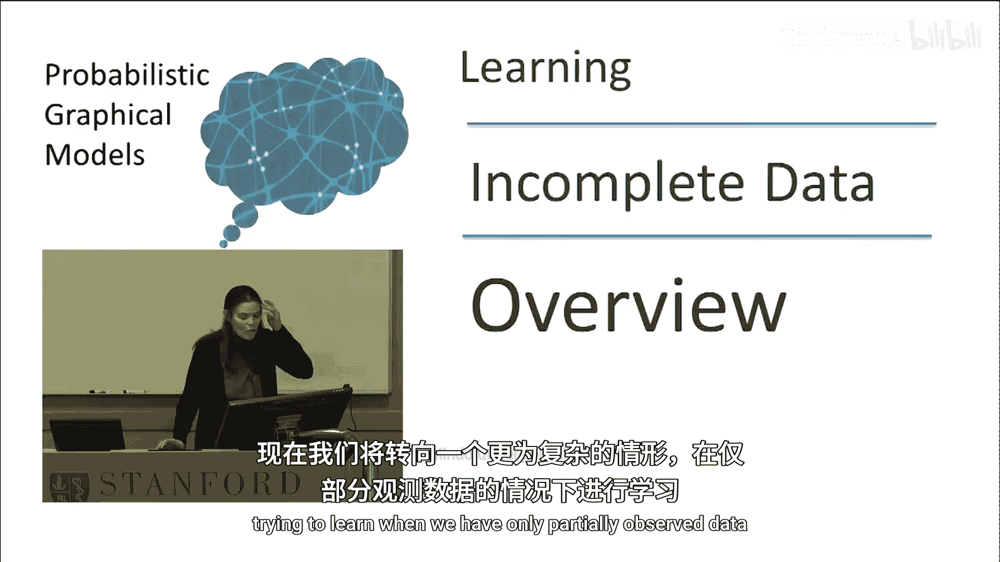
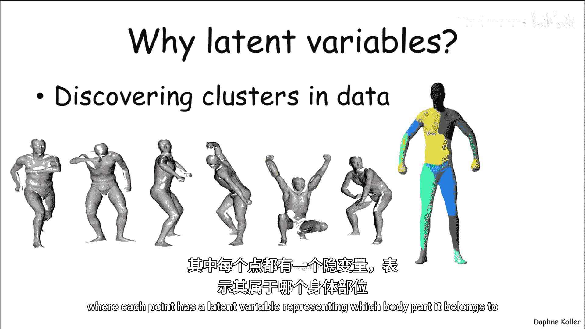
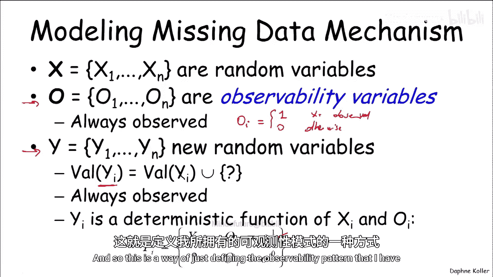
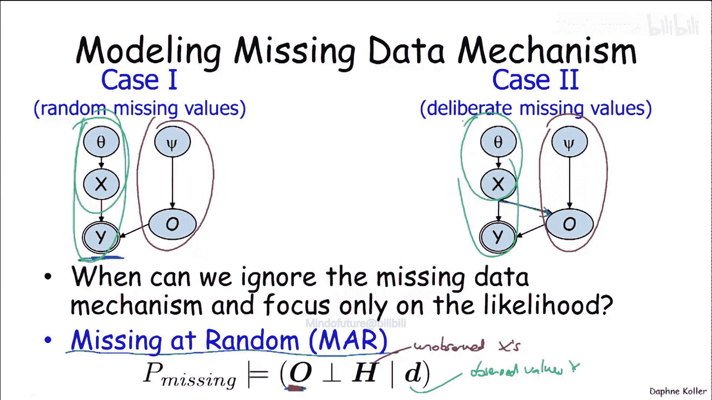
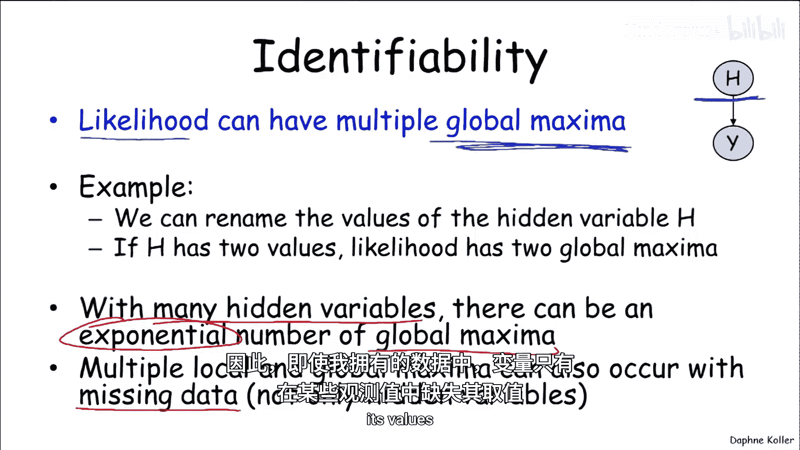
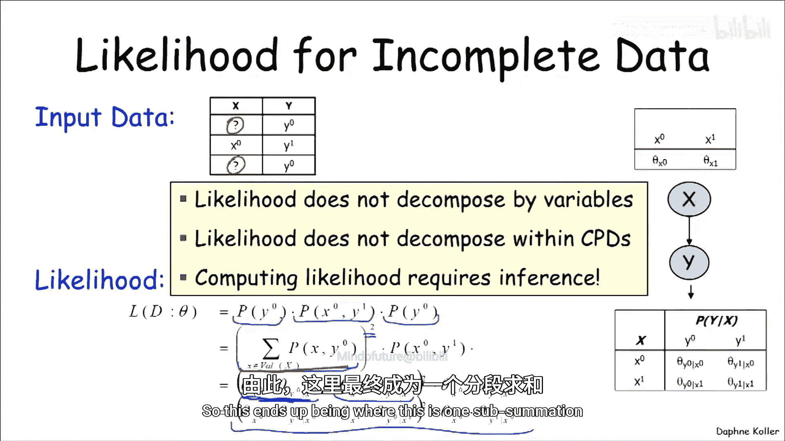
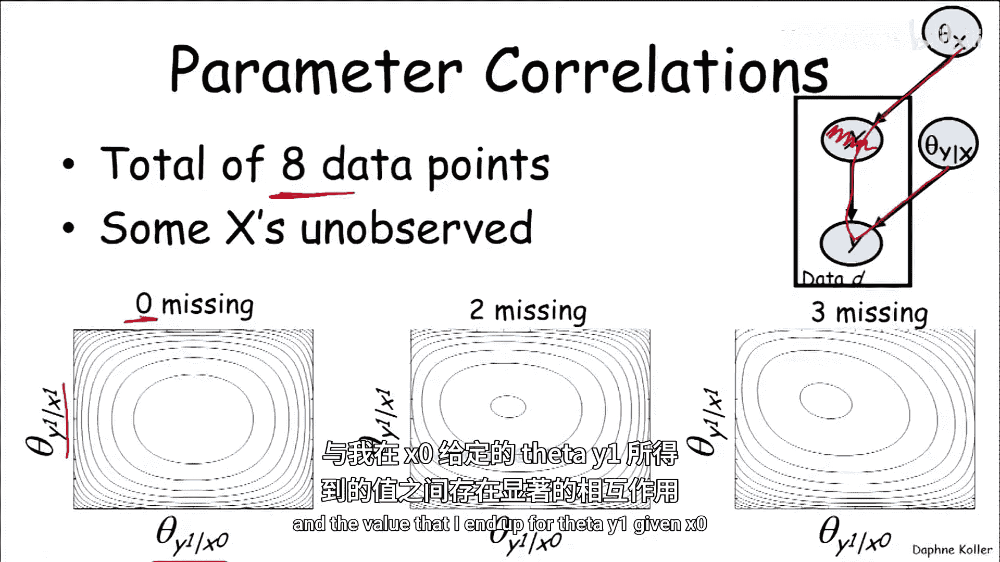
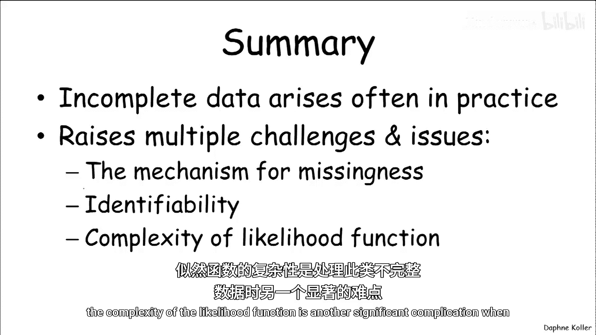

# 【斯坦福】概率图形模型3：学习 ｜ Probabilistic Graphical Models 3 Learning p23 P23_不完整数据学习概述_06_01_01 -BV1MH6LBREqD_p23-

Until now we've tackled the problem of learning a model。

 structure or parameters from the case of complete data。

 we're now going to move to what turns out to be a much harder situation where we're trying to learn when we have only partially observed data。

that this arises in a variety of settings， it arises when we have a scenario where some variables are just never observed。

 they're hidden or latent， it also occurs when some variables are just missing because some measurements weren't taken。

It turns out， as we'll see that these settings。Provide significant challenges。

Both in terms of the foundations。Defining the learning task。In a reasonable way。

 and from a computational perspective， where， as we'll see。

 the computational issues that arise in this incomplete data setting are considerably more challenging。

I mentioned latent variables， let's try and argue why we might care about latent variables。

 So one reason is that latent variables can often give rise to Sprser and therefore easier to learn models。

 So let's imagine that this is my true network。G star。

where we have three variables leading into this variable H。

 and then the three variables at the bottom， and if all variables are binary。

 then this is a network that can be parameterized with 17 independent parameters。

But now let's imagine that I've decided that H is latent。

 and I'm just going to learn a network over the observable variables， which are the x's and the Y's。

And so what is the network that correctly captures the structure of the distribution P over x1， x2。

 x3， y1， y2， and y3？And it turns out that this network， if you think about it， has。First。

 because H is not there， an edge from every x to every y。And， furthermore。

Because the Y's are no longer conditionally independent given the x's。

 because they're only conditionally independent given the H that I don't observe。

 then I have also edges between the Y directly， so the spaghetti actually turns out to look like this。

With a total of 59 parameters in the network。So by dropping this one latent variable。

 I've created a model that is much harder to learn now of course。

 learning a model with the latent variables is by itself a problematic situation。

 but it may well be worth the trade off。So the other reason why we might care about learning latent variables is because they might be interesting。

 they might provide us with an interesting characterization of structure in the data and I'll give examples of that in a later module。

 but for the moment just as a teaser， imagine that we have a data corresponding to 3D point clouds that are scans of a human body and we would like to discover from that what is the limb structure of the person to which the scans correspond。

 that is we want to identify clusters in the data clusters in a point cloud that correspond to body parts。

And so we want to basically end up with an output where each point has a latent variable representing which body part it belongs to。

So having motivated why we might care about missing data。

 let's think about some of the complexities that arise。

So let's imagine that somebody gives us this sequence over here and says， you know。

 here's these question marks that correspond to missing data。How do we treat this？

And the answer is if you don't know why these data are missing。

 you have no idea how to proceed and so to understand that let's consider two different scenarios。

 the first one is an experimenter is asked to toss the coin and occasionally the coin misses the table and drops on the floor and the experimenter is too tired to go crawl under the table to see what happened and so they don't record the value of the coin in the cases where it fell on the floor。

Pse2 is the coin is tossed， but the experimenter doesn't like tails。

 for some reason tails are to give them the HeBGBs and so tails are not reported sometimes。

Note that in these two cases really should give rise to very different estimation procedures if we're trying to learn from this data set。

 specifically in the first case， we should probably just ignore the question marks and just learn from the sequence of observed instances。

 HTHH， because the other ones， the fact that they're missing that it doesn't tell us anything about the coin。

In case two， on the other hand， we can't really ignore the missing measurements。

 We need to learn from the sequence H T， T T， H TH。

 because ignoring the missing values is effectively ignoring something that is。

Predominance theory entirely tails。 and so we would get incorrect estimates if we just ignored them。

So in order to correctly learn with missing data， we need to actually consider the mechanism by which the data was made to be missing。

And so how do we model the notion of missing data？So let's imagine that we have a set of random variables that define our model。

 and in some instances we may observe some but not others。

And so we're going to define a set of observability variables which are always observed。

 and basically O sub I tells us is one。If X is observed。And zero， otherwise。

And so we always know whether we observe the variable or not， and so OI is always observed。

And now we're going to add a new set of random variables， which are also always observed。

These are the variables that we're going to call Yi， which have the same。Value as Xi。

 so each y has the same value space as Xi， except that there is also the。

 I didn't get to observe it value。And so in the real data case， in the real scenario。

 we basically get to observe the Y's， but we get to observe the O's， and the x's are not observed。

Now the Ys are the deterministic function of the x's and the O's。

 so y is equal Y I is equal to Xi when O is observed and is equal to question mark when O is not observed。

 so in the cases where I have OI is equal to1， I can reconstruct the value of Xi。

 but for the cases where I don't have the observation I can't。

And so this is a way of just defining the observability pattern that I have。

With this set of variables， I can now model the two different scenarios that we had before。

In this scenario which corresponds to the coin falling on the ground every once in a while。

 we have a separate model over here that represents our observability pattern。

 and we see that a variable is sometimes observed by chance and that the target and observed value y depends on x and on O。

 but there is no interaction between the value of the coin and whether I end up observing it or not。

By comparison， in the case where the experimenter doesn't like tails。

 we see that the true value of the x variable。Effects whether it's observed or not。

 And so we have an edge from x to O。So in which of those cases can we ignore the missing data mechanism and focus only on the likelihood of the stuff that I get to observe？

And the answer is one can define a notion called missing at random。

Missing a random is a way for me to say I can ignore the mechanism。

For the observability and focus only on this piece。Over here。well， say， the observed peace。

So one can show that it suffices。For this question， for focusing only on the likelihood。

This distribution。Over。X。And why。And O， have the following characteristics。That。

Observation variables O。哦。Are independent of the unobserved x'es。Which we're going to denote H。

 given。The observed values。Why。Which are my data。Instances。Which means that if。

You tell me the values that you observed， then the fact that something may or may not have been observed doesn't carry any additional information。

 Now this is a little bit of a tricky notion。 So let's try and give an example。Imagine that a。

 a patient comes into the doctor's office and the doctor chooses what set of tests to perform。

 for example， the doctor chooses to perform or not perform， say a chest X ray。

The fact that the doctor didn't choose to perform a chest X-ray probably indicates that the person didn't come in with a deep cough or some other symptom that suggested tuberculosis or pneumonia。

 and therefore the test wasn't performed。So the observation or lack thereof of a chest Xray。

 the fact that a chest Xray doesn't exist in my patient's record is probably an indication that the patient didn't have tuberculosis or pneumonia。

 so these are not independent。So in that model， we do not have the missing at random assumption holding because the observability pattern tells me something about the disease。

 which is the unobserved variable that I care about。On the other hand。

 if I have in my medical record things like the primary complaint that the patient came in。

 for example， a broken leg。Then at that point， given that the primary complaint was a broken leg。

 I already know that the patient likely didn't have tuberculosis or pneumonia。

 and therefore given that observed feature， observed variable， which is the primary complaint。

 the observability pattern no longer gives me any information about the variable that I didn't observe。

And so that is the difference between a scenario that is missing at random and a scenario that isn't missing at random。

For the purposes of our discussion， we're going to make the missing random assumption from here on。

What's the next complication with？The case of incomplete data。

It turns out that the likelihood can have multiple global。Maximal。So intuitively。

 that's almost almost obvious because if you have a hidden variable。It has two values，0 and1。

 the value 0 and1 don't mean anything， we could rename the one and0 and just invert everything。

 and it would basically give us an exactly equivalent model to the one with01 because the names don't mean anything。

And so that immediately means that I have a reflection of my likelihood function that occurs when I rename the variables。

And it turns out that this is not something that happens just in this case。

 when I have multiple hidden variables， the problem only becomes worse because the of local the number of global maxima becomes exponentially large in the number of hidden variables。

And so now we have a function with exponentially many reflections of itself。

And it turns out that this can also occur when you have missing data， not just with hidden variables。

 so even if all I have are data where only some occurrences of a variable are missing its values。

 even that can give me multiple local and global maximum。

So to understand that a little bit in more depth， let's go back to the comparisons between the likelihood in the complete data case and the likelihood in the incomplete data case。

So here is a simple model where I have two variables x and y with x being parent of y。

 and I have three instances and if we just go ahead and write down the complete data likelihood。

 it turns out to have the following beautiful form which we've already seen before where we have。

The product of probabilities for the three instances and each of these can be well we've omitted writing the parameters for clarity and that's going to be equal to here is。

Probability for theta x0， y0， given the parameters， the second instance and the third instance。

And the point is this ends up being a nice decomposable function of the parameters。

As in terms of a product， which when we take the log ends up being a sum。

So the likelihood it decomposes， it decomposes by variables and it decomposes within the CPD。

What about the incomplete data case， let's make our life a little bit more complicated and whereas before we had these complete instances。

 now notice that both of these instances have an incomplete observation regarding the variable X。

And now let's write down the likelihood function in this case。Well。

 the likelihood function is now the probability of y0， which is the first day in an instance。

Times the probability of x0 y1， which is the second data instance。Times another probability of y0。

So since P of y0 appearsed twice， we've squared this term over here。

 and the probability of y0 is the sum over x of the probability of x comma y0。

 that is we have to consider both possible ways of completing the data。

 x for the different values of x， x0 and x1。And so if we unravel this expression inside the parentheses。

 it ends up looking like this， theta x0 times theta y 0 x0。Theta x1， theta y0， given x1。

And the important observation about this expression is that it is not a product of parameters in the model。

 which means we cannot take its log and have it decompose over parameters as a summation because a log of as summation doesn't decompose。

And so that means that our nice decomposition properties of the likelihood function have disappeared in the case of incomplete data。

 it does not be composed by variables， notice that we have a theta for the X variable sitting in the same expression as an entry from the P of y given XCPD。

 it does not be composed within CPDs， and even computing this likelihood function actually requires that we do some product computation。

 so it requires effectively a form of probabilistic inference。

So what does that imply both of these properties that we talked about in the previous slides。

 what does that imply about the likelihood function？

The four our likelihood function has the form of these gray lines over here， so for example。

 like this。This is a likelihood function of a complete data scenario。

When we a multi we have a case of incomplete data， we're effectively summing up the probability of all possible completions。

Of the unobserved variables。And so the overall likelihood function ends up being a product of。

So I end up being a summation， sorry， a summation of likelihood functions that correspond to the different ways that I had to complete the data。

 So this ended up being where this is one such summation。

So the likelihood function ends up being a sum of。Like some of these nice concave likelihood functions will log concave likelihood functions。

 But the point is when you add them all up， it doesn't look so nice at all。

 It ends up having multiple modes and is much harder to deal with。

The second problem that we have in addition to multi modality is the fact that the parameters start being correlated with each other。

So if you remember when we were doing the case of complete data。

 we had the likelihood function being composed as a product of little likelihoods for the different parameters。

What happens when we have an incomplete data scenario？When you look at this， you can see。

 for example， that when x is not observed。So when x is not observed。

You have an active V structure that goes from theta Yx。Rwei。All the way to theta x。

And so intuitively that suggests to us that there is a correlation and interaction between the values that I choose for theta y given x。

And for theta x。And when you think about the intuition for that， it makes perfect sense because。

 for example， if theta x chooses to make x0， very， very likely。

Then most of the instances where x is unobserved will be assigned to the x0 case。

 and that's going to basically have me。嗯嗯。Assign the data instances to the x0。

 and that's going to change the estimates of theta y given x0 relative to theta y given x1。

 because most of the instances now correspond to x0 rather than x1。

So that's a correlation between them and to see that correlation manifesting。

 let's look at some graphs and so what we're seeing here is actually the correlation between two entries in the CPD theta y given x。

 so over here we see theta y given x0， and here is theta1 given x1。

What you see here is the contour plot of the likelihood function has a theta points and zero missing measurements。

 and you can see that this is a nice。Product likelihood function with a nice peak in the middle。

 and there's no interaction between the two parameters。

But as we start to gain more and more missing measurements。

 you can see that the curves the contour plots start to deform。

 and even with three missing measurements， you can see that there is significant interaction between the value that I end up picking for theta y given x1 and the value that I end up for theta y1 given x0。

So to summarize， incomplete data is actually something that arises very often in practice。

 and it raises multiple challenges and issues， how are the missing values generated。

 what makes the missing， turns out to be very important。

The fact that there are certain components of the model that are just unidentifiable because there are several equally good solutions。

 so if you pick the best one， you better realize that there's others that are equally good out there。

And finally， the complexity of the likelihood function is another significant complication doing this kind of when trying to deal with incomplete data。

