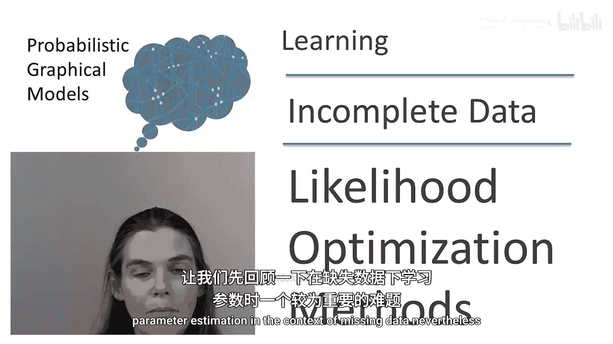
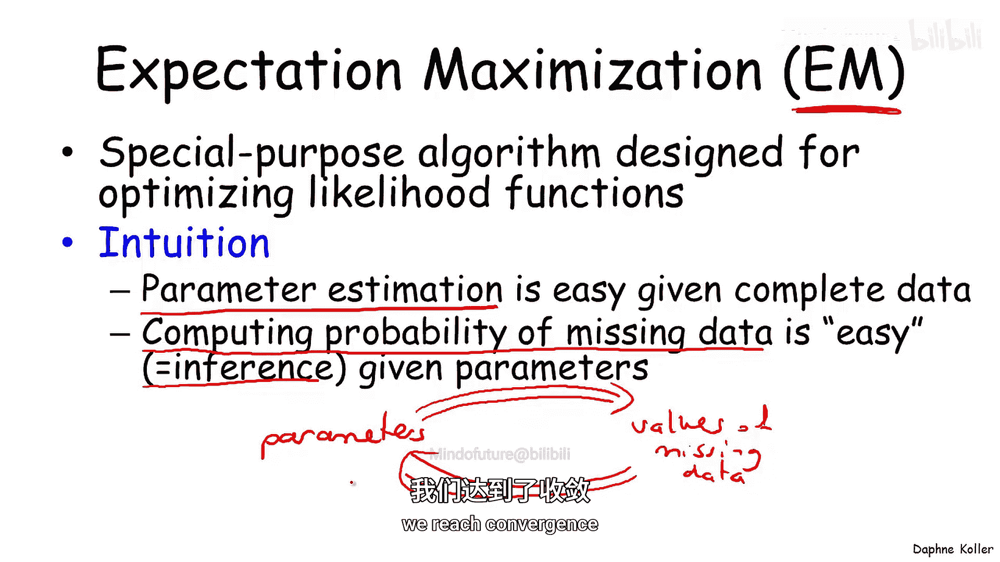
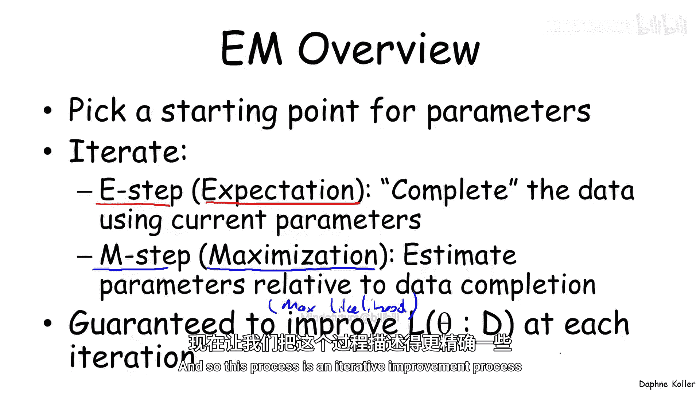
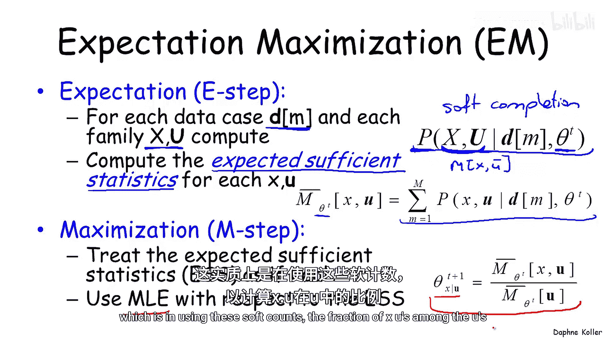
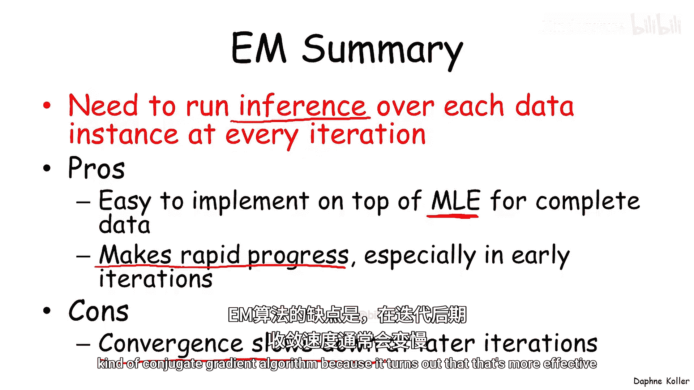

# 【斯坦福】概率图形模型3：学习 ｜ Probabilistic Graphical Models 3 Learning p24 P24_期望最大化简介_06_01_02 -BV1MH6LBREqD_p24-

We talked about the problem of learning models with missing variables。

 missing data and discussed some of the complexities of that learning problem。

 So now we're going to basically bite the bullet and try and understand how one might go about doing say parameter estimation in the context of missing data nevertheless。

So let's remind ourselves of one of the more important difficulties in learning parameters with missing data。

 so let's draw here the likelihood function that we might have so the x axis here is is a pictorial description of the parameter vector theta and it's the one dimensionmensional depiction but usually of course it'll be multidimensional and what we see here on the Y axis is the likelihood function。

In the context of complete data， as we might remember。

 the likelihood function had this really nice form， it was a nice log concave function。

 and in the context of Bayesian networks it could actually be optimized in closed form using using a simple formula。

In the context of missing data however， the situation became considerably more complicated and the likelihood function looks more like this。

 it's this nasty complicated multimodal function which is really impossible to optimize en closed form so how do we go about optimizing a function that looks like this is it turns out to general classes of strategies the first is to use a generic optimization methods such as gradient ascent so here for example。

 we have a pictorial depiction of gradient ascent we might start out with a particular point in the parameter space and we compute the gradient at that point and we go in the direction of steepest ascent which might take us to the next point at which point we compute the gradient and we continue until we reach what is going to be a generally a local optimum of the function that we're trying to optimize。

😊，Now what I described right now is a very simple gradient ascent over parameter space。

 but in general， there's more efficient methods for improving the convergence。

 the rate of convergence of these algorithms methods such as line search or conjugate gradient methods that basically are going to get us faster to whatever global optimum。

 whatever local optimum we're going to end up at。So a key question when applying gradient ascentta functions such as this is how difficult it is to compute the gradient in this high dimensional space。

Fortunately in the context of Daian networks， we can actually come up with a closed form solution for that gradient。

 and that solution takes the following form。 So the gradient of our log likelihood function。😊。

Relative to a particular parameter， theta of X I given UI。

 so this is in the context of the standard say multinoial Bayesian network and little X is a particular assignment to big X Y and little UI is some assignment to its parents。

 that gradient has the following form。It's one over the value of the parameter at the point at which we're computing the gradient times a summation over data instances。

M。Of the probability of that particular assignment， X I and U I to the node in its parents。

 that particular joint assignment， given all of the evidence in。The M。Instance。

Add the current value of the parameter。So we basically look at each and every one of the data instances。

 compute the probability of this event， X comma UI。

 given whatever observations I happen to have seen whether XI and UI are observed or not。

 and then I compute that probability add the all up and divide by the value of the parameter。

So that's a nice sort of usable formula except that we have to understand some of the repercussions of that。

 specifically this requires that we compute this probability over a node in its parents that is a family given the data M。

 and we need to compute that for all variables I and for all data instances M。😊。

So this effectively means that we have to run inference for every instance。And furthermore。

 we need to compute the probability for every family in the Bayesian network。Now。

 fortunately we can at least reduce the second part of this computational cost。

 which is the fact that we need to run this for all I by remembering the fact that we have。

 if we say calibrate a clea tree or even a cluster graph when we're done with a calibration because of the family preservation property。

 a node and its parents are all going to be in the same cleaique or in the same cluster。

 so a single calibration process is going to give us all of these probabilities。At once。

But that's only true for a given data instance M， which means that effectively what we end up with is the following computational cost。

 which is that we need to run inference for each and every data instance at every iteration of the gradient process。

Which is a very costly computation。Now what are the pros of gradient ascent as an optimization algorithm。

 it's a very flexible strategy， so whereas we just showed how the formula applies to table CPDs。

 it can also be extended to nontable CPDs via the chain rule for derivatives。

Which is not the same as the chain rule for Bayesian networks。However。

 it also has some significant cons First， it turns out to be a little bit tricky， not horrible。

 but a little bit tricky to ensure that the parameters define legal CPDs。

 so this gives rise to a constrained optimization problem where we need to make sure that the entries in the CPD are all greater than or equal to zero and sum to1 and that imposes some additional burden on the optimization problem。

And then it turns out that if you want to get any kind of reasonable convergence。

 you can just do straight gradient asscent， one needs to do something more clever。

 like a conduit gradient or search， which again tends to increase the computational cost。

The second strategy that one typically uses for optimizing the likelihood function is a strategy that is specifically geared for likelihood functions。

 so it's a special purpose algorithm that doesn't optimize any old function。

 but rather just specifically for likelihood functions。😊。

What's the intuition behind this algorithm called expectation maximization or EM for short？

The intuition is that really we have a chicken and an egg problem here。If we had complete data。

 then parameter estimation would be easy because we know how to do maximum likelihood parameter estimation and Daisian networks。

 in fact it's a closed form problem。Conversely， if we had those full set of parameters。

 then computing the probability of the missing data would also be easy。

 easy in the sense that it requires that it can be done using straight probabilistic inference。

 which Mary may not be computationally easy， but conceptually computing the probability of the missing data is an easy。

 well definedfined problem。So we have two。Setets of things that we need to infer or estimate one is the parameters。

And the other is the values of the missing variables。Missing data。

And each of those is easy given the other， and so what the EM algorithm does is effectively an iteration process or in fact one can formally show a coordinate as process where we start out with some set of parameters。

 use that to estimate the values of the missing data and then use that completion to reest the parameters and so on and so forth until we reach convergence。

😊。

So more formally， we pick some starting point for the parameters。

 in fact one can also initialize on the values of the missing data。

 it's more standard to in many applications to initialize with the parameters。

 but both are completely legitimate。So say we pick a starting point for the parameters and then we iterate these two steps the first is what's called the ETP EEPs transfer for expectation in which we complete the data using the current parameters and the second is the M stepP standing for maximization and that estimates the parameters relative to data completion and maximization comes from basically something like maximum likelihood that's。

That's where the M in maximization comes from。And it turns out that this iterative process is guaranteed to improve the likelihood function at each iteration。

 that is at each iteration the likelihood function is going to be better than it was before the previous one and so this process is an iterative improvement process。

Let's make this process more precise。So let's consider each of those E step and M steps separately。

 so the expectation or E step， remember this is going from the parameters to the missing variables for each data case D and each family x comma U。

We are going to compute the probability of X comma U。Given the observed values in。

In that data instance， and given the current parameter sending theta T。With that completion。

 which note is a soft completion。Because it's a probability distribution over the parameters。

 over the missing variables， not a single assignment to X and U。With that soft completion。

 we're going to compute what is called the expected sufficient statistics。

The expected sufficient statistics is very similar to the sufficient statistics that we had before when we were computing sufficient statistics we were counting the number of times that we saw particular combination X comma U remember we had M of X comma U as being our sufficient statistics now we have a soft completion and so we have expected or soft sufficient statistics which we're going to denote with an M hat。

😊，Subscripted by the parameter vector that gave rise to the completion。

 and M hat sub theta T for a particular assignment x comma。

 U is going to be simply the sum over all the data instances of the probability that we just computed the probability of x comma U given the assignment d subM and the parameter theta T。

And that is a notion of expected counts or expected sufficient statistics。

 which we're now in the context of the M stepP going to use as if they were real sufficient statistics。

 and so we're going to take these expected sufficient statistics and used them to perform maximum likelihood estimation using the exact same formula that we would have used had these been real sufficient statistics。

 so specifically for example， in the context of multinoial Bayesian networks。

 we would have that the next value of the parameters theta t plus1 given Xu is M hat M bar of theta T Xu divided by m bar theta t of U。

 which is in using these soft counts， the fraction of Xs among the U。

Let's consider a concrete very simple example， which is that of Bayesian clustering so what we see here is your standard naive Bayes model where we have a single class variable and a bunch of observed features and the assumption here is that the class variable is is missing that is it's。

😊，Sometimes are never， in most cases， never observed in the data and so effectively we're trying to identify what are the categories or classes of instances in this data under the assumption that within each class the feature values are independent。

 that is the features are conditionally independent giving the class as in a naive based model。

So iniing our formula from the EM algorithm for this setting。

 we get the following very natural formula， so the sufficient statistics for the class variable。

 is simply the sum over all of the data instances of the probability of the class variable given the observed features for that datas for that data instance and the the current value of the parameters。

 that is it's the soft counts of how many instances fall into each category when each instance is allowed to divide itself up across multiple categories so to use a soft assignment。

😊，The second set of sufficient statistics， which represent the dependency between one of the features in the class variable is M hatAT subtheta of X I say comma C。

 and that once again sums up over all of the data instances and simply looks at the probability of a particular class variable in a particular feature a particular feature。

 given instance the observed features at that particular instance。Now with these expected counts。

 we can now go ahead and do maximum likelihood destination。

 and that gives rise to the following very simple equations。

 which is that the theta C' is equal to M hat sub theta of C divided by M。

 which is a total number of data instances and theta of little X given C is going to be assigned M hat theta X comma C divided by M hat theta of C。

 which again is the standard formula， but using soft rather than heart counts。

So to summarize the EM algorithm。😊，We have， in this case。

 the exact same problem that we had in the context of the gradient ascent algorithm。

 which is that we need to run inference the probability of X comma C for each data instance at each iteration。

As for the gradient ascent algorithm， this only requires a single calibration because of the same family preservation property that was useful there applies equally here。

What are the pros of the EM algorithm it's very easy to implement on top of an existing maximum likelihood estimation procedure that one might have for complete data。

 so having implemented in an MLE procedure one can easily build on top of that by adding a separate E step for computing the expected sufficient statistics。

😊，Empirically， it turns out that the EM also makes very rapid progress in terms of converging to a better and better set of parameters。

 especially in early iterations。And we'll see some empirical results for that in a bit。

The cons of VM algorithm is that the convergence generally slows down at later iterations and so it requires sometimes that later iterations might use。

 say， some kind of conju gradient algorithm because it turns out that that's more effective there。😊。

