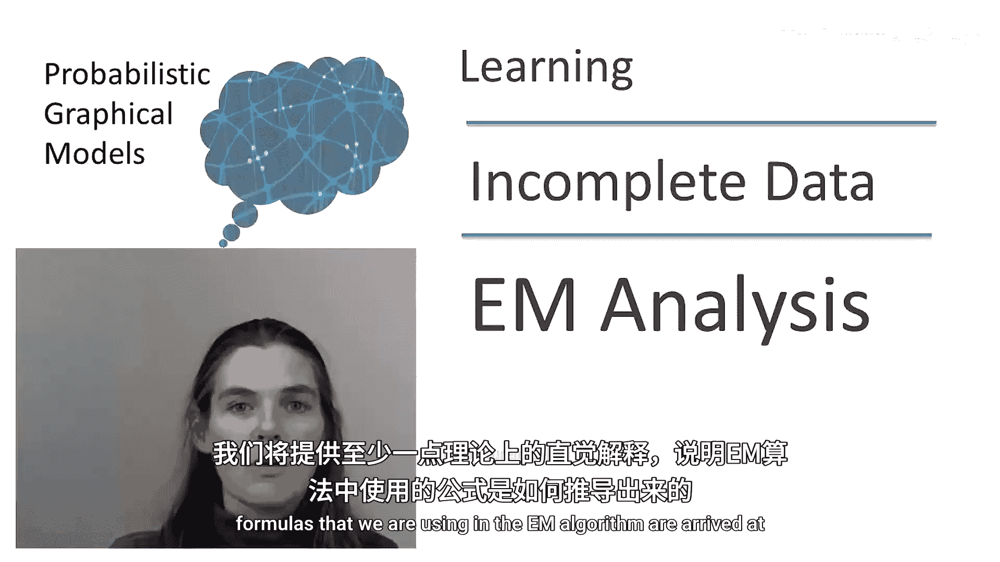
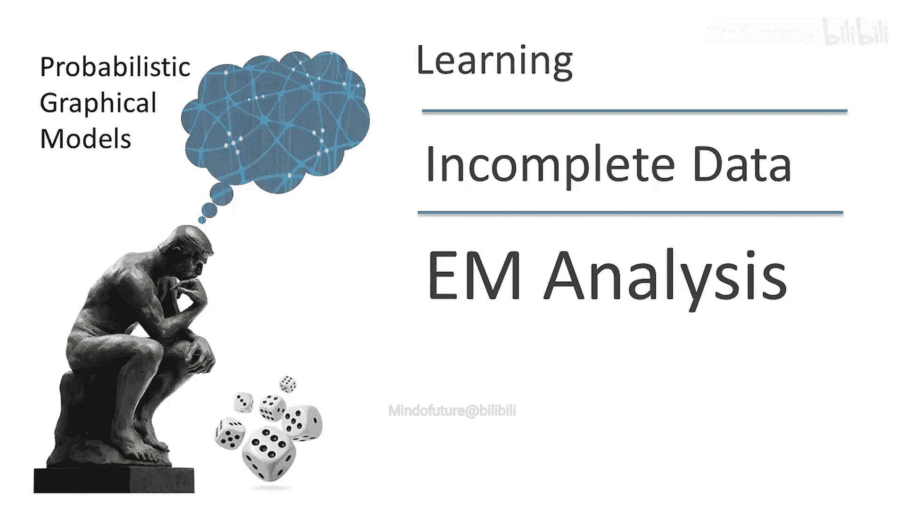
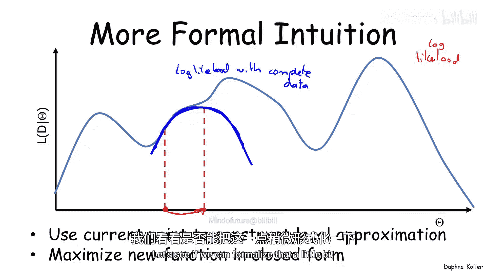
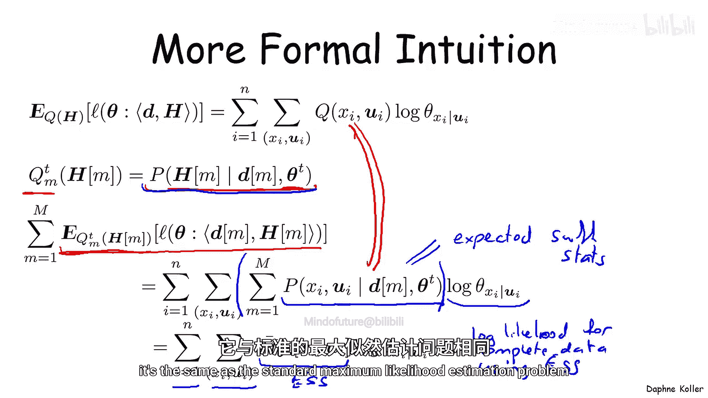
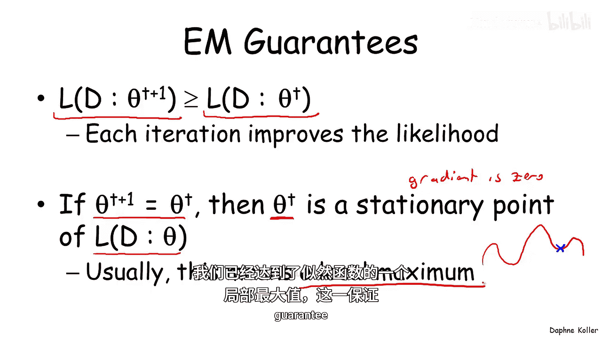

# 【斯坦福】概率图形模型3：学习 ｜ Probabilistic Graphical Models 3 Learning p25 P25_EM算法分析_06_01_03 -BV1MH6LBREqD_p25-

We previously defined the EM or expectation maximization algorithm。

 which as it happens is one of the algorithms that's most commonly used in practice because of its simplicity and because it's so effective in dealing with missing variables。

 missing values。But we didn't give much justification for why the algorithm works。

 so what we're going to do now is we're going to give at least a little bit of theoretical intuition as to how the formulas that we are using in the EM algorithm are arrived at。

So let's start with providing a little bit of a more formal intuition。So in some sense。

 EM is also like gradient ascent， a local search procedure。

But unlike gradient ascent it uses a less local approximation to the likelihood function。

 so specifically if this is our likelihood function as we had before。Or rather the log likelihood。

 really。In in practice。What we're going to do is we're going to approximate the we're going to take the current point that we're at because remember this is a local iterative search。

 we're going to take that point and we're going to approximate the function at that point using this blue line。

Over here。Now gradient asccent approximated the function at this point using a straight line。

 a linear approximation， EM approximates the function at this point using this nice curvy function。

 which as it turns out is， as we'll see a log likelihood itself。It's。

 in fact the log likelihood with complete data。And having constructed this approximation。

 it now jumps。To the maximum of this function， which because this is a log likelihood with complete data。

 can be maximized in closed form using maximum likelihood estimation。

So this is the intuition behind theM， let's see if we can formalize that a little bit。

So for some location D is the observed data in a given instance and we're going to do one instance for the moment。

 H is the hidden variables in that instance and we're going to assume that somehow from somewhere we have a distribution over the values of the hidden variables within that instance so there's no distribution over the value I mean when we're not going to impose a distribution over D D is observed but for the hidden variables we have some kind of distribution over the values that they might take。

😊，So now let's remind ourselves what the log likelihood function looks like when we have complete data。

So the log likelihoodlude function for the parameters theta given now a pair decoma H where H is an assignment to big H。

So the hidden variables？Is simply by the definition of the log likelihood and decomposition of the likelihood。

Over the chain rule for Bayesian networks， it's a sum over the variables in the network。

The sum over all possible assignments to a node and its parents of an indicator function。That says。

In this particular。A pair dcoma H does do the variables Xi and UI take on this particular values little Xi and little UI？

And if so， we're going to multiply in the log of the parameter。

Corresponding to that entry in the CPD。Now this is a really complicated way you might think to write what is effectively some of the log of theta of a node given its parents in the assignment and thecom age。

 but there is a reason why we're going to write it this way and which will become clear in a moment。

So now let's imagine that what we have is the distribution over Q， the distribution Q over H。

 and now we're going to look at the expectation of this log likelihood function relative to the distribution over H。

 So now rather than H being given， we have a distribution over H。

 and we're going to look at the average or expectation of the log likelihood relative to the distribution Q sub H。

Now， importantly， because of the linearity of expectation。

That expectation is going to push its way past the first summation， the sum over I。

 past the second summation， which is the sum over assignments littlexi and little UI。

 and we're going to end up with a following equation which is the expectation relative to Q of this indicator function that we had on the previous line。

 and notice that we can also take log of theta X given UI out of the expectation because that's fixed relative relative to H。

 which is exactly why we wrote the formula in this complicated form。

So the one final step of this derivation is now to simplify this expectation over here。

 the expectation relative to Q。😊，And this expectation when you're taking an expectation of an indicator function。

 which is simply an event， in this case it's the indicator function of the event。

 X equals little X and UI equals little UI that expectation of an indicator function is simply the probability so this turns out this entire expectation it turns out to be equal to the probability of little X comma little UI under the distribution queue。

😊，And so we have now converted this expected log likelihood into this summation that utilizes probabilities relative to the distribution queue。

😊，So working forward from this formula， now let's consider the case where we have multiple data instances。

So now we have a set of distributions， one for each data instance。

 and that also depends on the current parameter setting theta T。

 so now we're in the midst of an EM iteration， and we're going to use the current parameter setting theta T to define the probability distribution over the hidden variables and that's going to be defined as the probability of the hidden variables given the observed variables and given the current setting of the parameters theta T。

We now look at the sum of these expected log likelihood， so the sum of overall the data instances。

 little m equals 1 to big M of the expectation of the hidden variables relative relative to this distribution that we just defined QT sub M of this log likelihood。

We can now。Plug in the equation that we had up here， but substituting for P。

 the definition of Q for for what we see here， the P of H given。A P of H given D and theta。

 And that gives us this equation over here。 the sum over I， sum over little X， I comma little U I。

 All possible assignments to the family， sum over the beta instances of the probability of X I give a comma U I。

 given the theta instances。And the current parameters times the log of the current parameter value。

Taking this one step further， specifically looking at this summation over M as a separate entity。

 we can see that this is really the expected sufficient statistics。

That we defined in the context of the EM algorithm。 and so we now have that our log。

 that this expected log likelihood function。Is the sum over I。

 the sum over little Xi Ui of the expected sufficient statistics？F。

X I comma U I times the log parameter value。And the important point here is that this is just like a log likelihood function。

For complete data。Using the expected sufficient statistics。

So the function that we're optimizing is this expected log likelihood and just a simple mathematical derivation tells us that that is the same as optimizing a log likelihood function using these expected sufficient statistics and we know exactly what that optimum looks like because it's the same as the standard maximum likelihood estimation problem。

😊。

And so going back to the diagram that we started out with， the function。

 this blue function that we're using here as an approximation is this expected。Log likelihood。

And this optimization that we're doing here。Basically uses the expected sufficient statistics to do maximum likelihood estimation。

 which is exactly the M step。 So the E step constructs this function by computing the expected sufficient statistics and the M step。

Gives us this maximum from which we now proceed to the next iteration。Using this kind of intuition。

 we can actually prove two very important results regarding the expectation maximization algorithm。

The first is that the likelihood function or the log likelihood function improves at every iteration。

 that is the log likelihood at iteration theta t plus1 is greater than or equal to the log likelihood at iteration theta T or commurately for the likelihood。

😊，The second result that we could prove is that at convergence that is at the point where theta t plus 1 is not changed relative to theta t。

 then we can be guaranteed that theta t is a stationary point of the likelihood function What is a stationary point means it means a point where the gradient is 0。

Which in principle。Can be either a local minimum， a local maximum or saddle point。

 but it's very difficult when you're doing hill climbing to actually land exactly at a local minimum because that's the only time that that we will converge a local minimum is if a step of EM so if here is a function。

 it's very difficult to imagine having an EM step that lands us exactly at this local minimum because that's the only point at which we won't continue to make progress and so de facto when we're doing this kind of climbing and we achieve convergence。

 it means that we have achieved a local maximum of the likelihood function。

 which is the same guarantee on satisfyatiing as it might be that we have for gradient descent。

