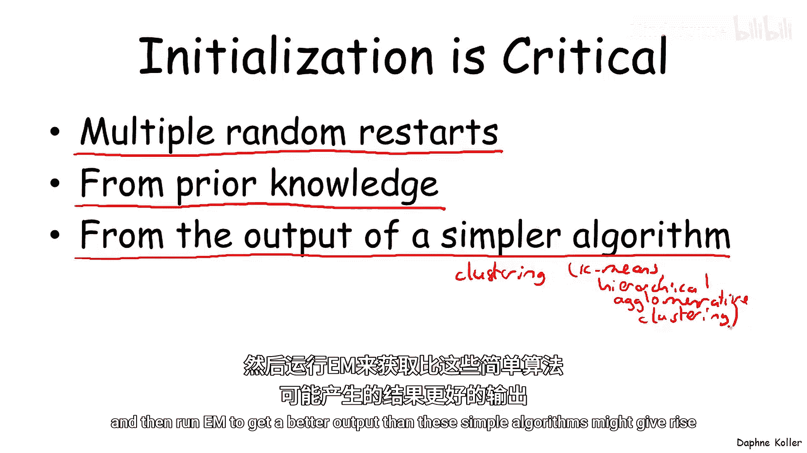
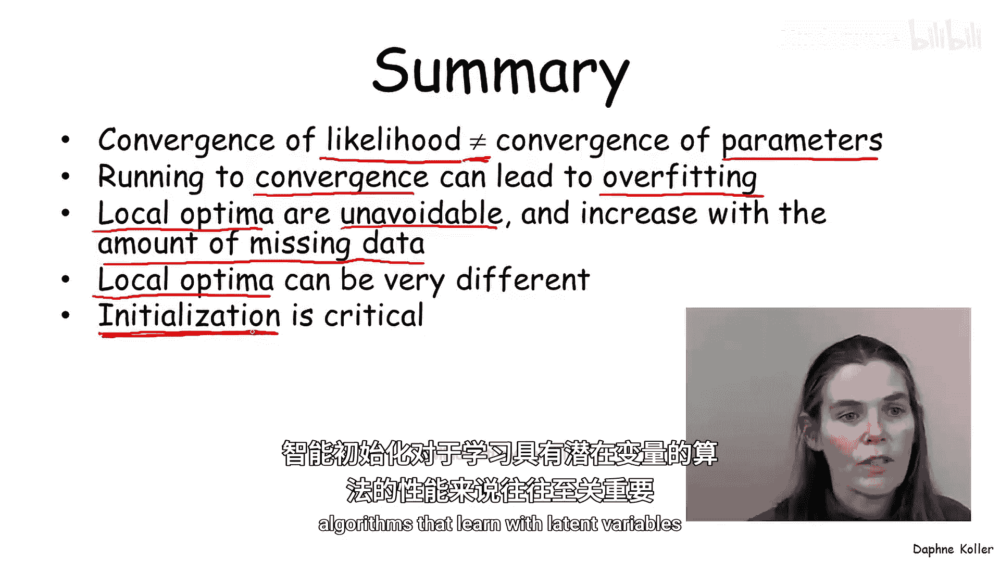

# 【斯坦福】概率图形模型3：学习 ｜ Probabilistic Graphical Models 3 Learning p26 P26_实践中的EM_06_01_04 -BV1MH6LBREqD_p26-

We described the expectation maximmization algorithm and gave the formulas for how to use it。

 but we didn't talk about how it might perform in practice。 So let's talk about that a little bit。

So first let's look at how EM behaves as a function of the number of iterations。

 so over here on the x axis， we see the number of iterations going from zero to 50。And on the Y axis。

 we have the log likelihood。Of the average training instances。

 so averaged over all of the training instances。Which is the objective that the EM algorithm is trying to optimize remember EM is the maximum likelihood optimization algorithm。

 so what we're showing here is effectively how the objective improves and so the first observation that we have is that as we effectively stated as a theorem so this shows that the theorem is true the log likelihood increases。

Consistently。Ormontonically。Over durations。So that's good， so it shows that our theorem is correct。

But let's understand what happens now as the algorithm continues to evolve。

 we see that in the early iterations， so up to about， oh。

 I don't know iteration eight or 10 in this context， the algorithm。

 the log likelihood exhibits very sharp。😊，Improvement。But then it ascertt。

And so we might think that when we get to iteration 10 or so right around here。

 maybe there's no point continuing to run because there's no more increase and we've achieved convergence and we might as well stop。

Turns out it's not quite right。😊，What we see here is for the same model with the same graph。

 the x axis is iterations and the y axises the value of different parameters in the model。

 and over here we see the same iteration 10 and we see that although the log likelihood no longer continues to improve after iteration 10 as we can see in the left hand graph。

😊，Various parameter values actually exhibit extremely sharp changes after durationeration pen。

 specifically the blue parameter goes down significantly。

 the black parameter goes up and significantly and so and so we see that convergence in the likelihood space。

 which is what we have on the left， is not the same as convergence and parameter space。😊。

Which means that if we're trying to gauge convergence。

 we probably also look at convergence on parameter space。However。

 it's also important to realize that carrying EM through the convergence is not necessarily the best idea So what we see here is the same graph of the training log likelihood per instance。

 but on the right hand side we can see the log likelihood per instance on test instances。

 that is instances that the algorithm was not trained on and what we see is that while the log likelihood of test instances also increases sharply。

Up to about iteration 10， after that it starts to decrease gradually and so in fact。

 as the algorithm is continuing to modify its parameters and slightly improve the training log likelihood。

 the test log likelihood in this particular case actually goes down。

So this is an example of overfitting， in this case， it's numerical overfitting to the specific。😊。

Data instances that we have or the noise in those data instances and in order to avoid that there's two main strategies that people adopt。

 the first is to use a validation set or cross validationation to determine the time T at which we should stop doing iterations and so we basically measure log likelihood in a test set and say okay at this point we can see that it's starting to go down and so we should just stop doing iterations。

This is potentially a computationally costly procedure， however。

 because evaluating the test log likelihood means that we need to run inference。

On the test instances。And that can be expensive， so a cheaper strategy is to use some kind of map assignment rather than maximum likelihood estimation with the same benefits that we saw when doing estimation for the complete data case。

 basically a prior smoothes out the estimates and makes them less susceptible to noise in the training data。

So that's one aspect of the behavior of the expectation maximization algorithm， and by the way。

 the same phenomena will also happen if we use gradient as。

 so this is really orthogonal in many ways to the specifics of the optimization algorithm。

Except the very sharp increase at the beginning， which is very characteristically。

A very different problem that we already mentioned before is the fact that both EM and gradient ascent effectively achieve only a local optimum of the log likelihood function。

So what we see over here is on the X axis， the number of samples m that we're training on。

 so this is not iterations anymore， this is the number of samples and the Y axis is the number of distinct local Opima that the algorithm found over 25 iterations。

 so sorry 25 applications of the EM algorithm I initialized the different random starting points。

So what we see here is we have three lines， the blue line represents 25% missing data。

 the red line is 50% missing data so 50% of the entries randomly were omitted and the black line is when you have a hidden variable。

 so in this case the fraction of missing data is actually not perhaps as large。

 but there is one variable that we never get to observe in any of the instances。

And what we see in both the blue line for the 25% and the red line for the 50% is that initially we have a very large number of local optima。

 in fact， initially the pretty much every iteration of EM finds a distinct local optimum。

 but then as we have more and more training instances。

 the algorithm begins to be able to better identify a global a smaller number of optima come to the forefront。

 the other ones kind of become less dominant or disappear。😊，Now the more missing data we have。

 so in the red line， the' slower this process to reduce the number of local optimum。

And when we have hidden variables， which is this black line over here。

 the local optima never go away。Now you might say that fine， we have local optimum。

 but maybe we don't care maybe these local optim are all about the same and doesn't really matter which one we land at unfortunately that doesn't turn out to be the case so here we have on the X axis sorry on on the Y axis rather the law a particular log likelihood value that might be achieved on the training set by。

By a run of expectation maximization， and then the Y axis。

 we have the percent of runs that achieve a particular log likelihood value。

And we can see that there are。😊，That there are a huge variation in the log likelihood values that are achieved by different runs of the expectation maximization algorithm。

Which brings us to the point that initialization is absolutely critical to the performance of an algorithm such as expectation maximization。

 and there's different strategies that people adopt in order to try and get to a better local opt。

So first and perhaps easiest to implement in some sense is the use of multiple random restarts。

 so we randomly sample parameters， for example， and we initialize EM at these different points and we run EM to convergence and then we pick the run of EM that has the highest training log likelihood which have to all with the objective that we're trying to optimize。

In some cases， we might have some amount of prior knowledge that we might use to initialize the algorithm。

 for example， we can have some prior knowledge about the parameters。

 or if we're initializing on the E step， we might have some prior knowledge about the assignments say of variables cluster of instances to clusters。

 for example。From some other source。Maybe demographic data for people or something like that。

And finally， a common and quite effective initialization strategy is to use a simpler algorithm rather than full scum because it turns out that while EM is very powerful。

 that also makes it more susceptible to getting stuck in certain local optima。

 whereas some simpler algorithms， for example， in the context of missing hidden variables。

 we might use a simpler clustering algorithm。😊，嗯。That you might have heard about in a different context。

 K means or hierarchical aggloorative clustering。Which is a simpler algorithm not as powerful。😊，But。

But is also somewhat less susceptible to。Local optimum。

 and so we might initialize from that and then I'll runM to get a better output from than these simple algorithms might give rise to。

So to summarize， we've seen that convergence of the likelihood function is not the same as convergence of the parameters。

 And so we have to decide which one we actually care about。

We've also seen that running the algorithm to convergence all the way to convergence can lead to numerical overfitting。

 we talked about strategies to avoid this problem。We talked about local optima and the fact that they're unavoidable。

And furthermore， they increase with the amount of missing data， so the more missing data we have。

 the more local optima we have， and furthermore they decrease with the total amount of data。

 but not if we have hidden variables at which point you're stuck with them no matter how much data you have。

We also showed that local optimum are not a fake problem。

 that is which local optimum you land in can actually be a significant factor in terms of the performance that the algorithm achieves in terms of log likelihood。

 and therefore smart initialization turns out to be often critical for the performance of algorithms to learned with latent variables and with missing data。

