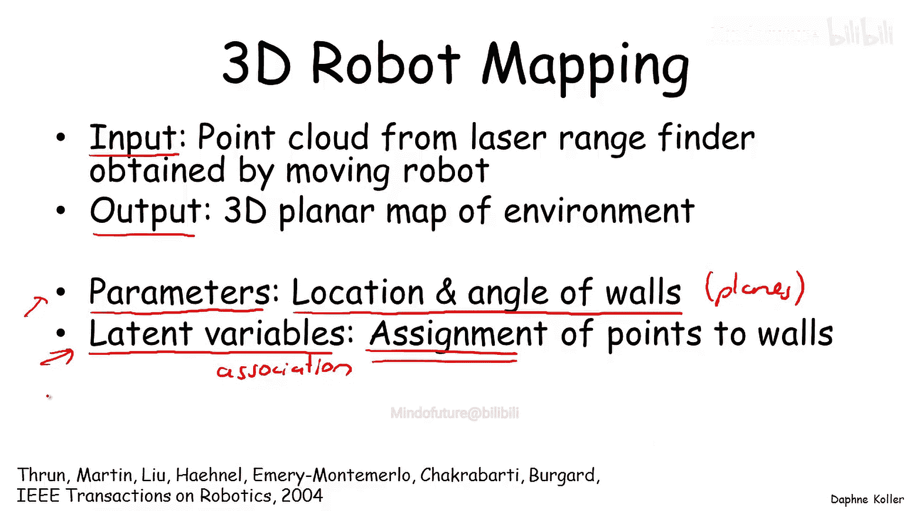
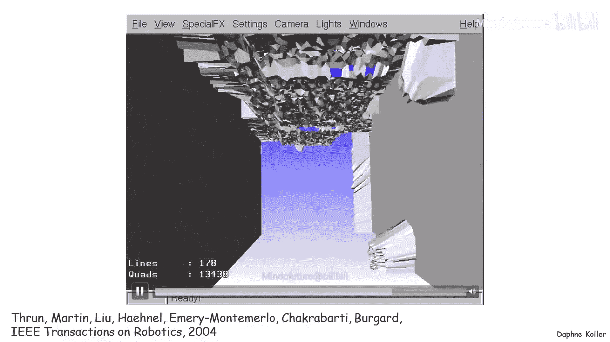
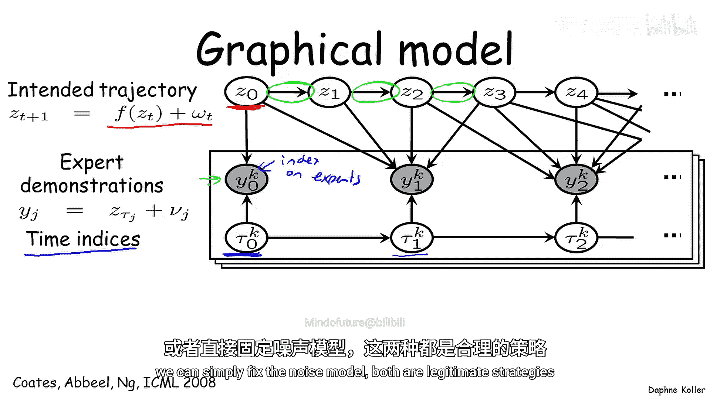
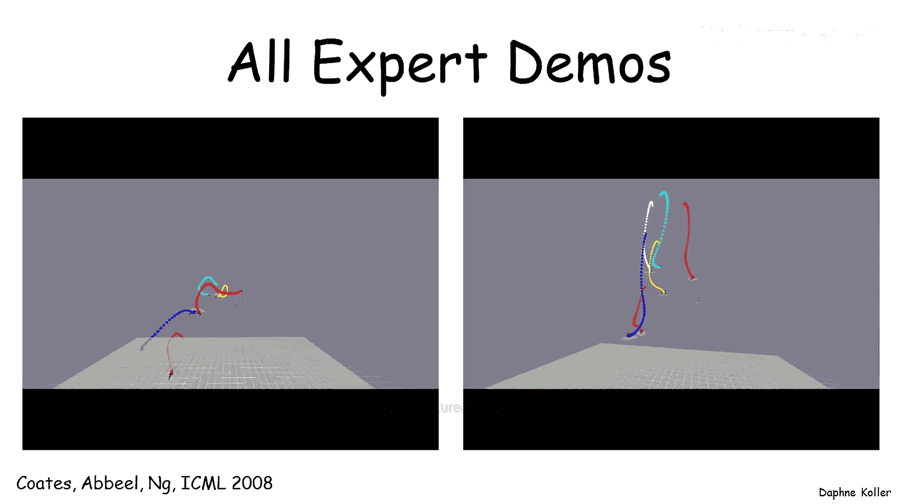
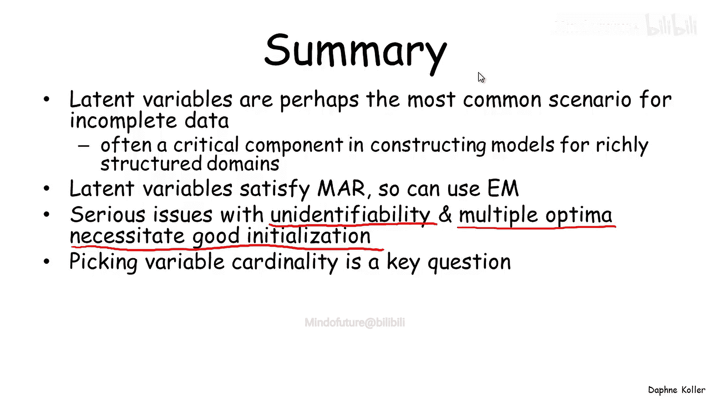

# 【斯坦福】概率图形模型3：学习 ｜ Probabilistic Graphical Models 3 Learning p27 P27_潜在变量_06_01_05 -BV1MH6LBREqD_p27-

Perhaps the most common use of the expectation maximization algorithm is to the problem of learning with latent variables。

 these are situations where there is a certain set of variables that we just never get to observe but they turn out to be important for capturing some important latent structure in the distribution of the data instances that we have so let's look at a number of these examples and talk about how EMM was applied in those settings。

So perhaps the simplest example is in the context of Bayesian clustering。

 where we have some kind of latent class variable and some set of observed features。

And we're trying to basically segment the instances that we have into categories where we assume that for each category there is a similar distribution over the observed features。

 and specifically in many of these applications that distribution takes the form of an Iive base model。

 that is that the features are independent once we're given the class。

So one example application of this is the segmenting。😊，A set of users。Into similarity groups。

And so one cute example of that is the following segmentation of users on the MSNDC website based on which of the stories on the MSNDC site the users chose to click。

 and this is due to Jack Breze and colleagues at Microsoft Research。

So here we see we're going to see four clusters， the first of these is a cluster that a human given name to because the machine doesn't give a name to the cluster just cause a cluster one turns out to be readers of commerce and technology stories so these are people for whom the highest probability clicks on stories were for example email delivery isn't exactly guaranteed or should you buy a DVD player so remember the stories are the features and their binary variables did you click or did you not click on that particular article and the cluster is the segmentation of the users into these different categories。

So this is category one。The second cluster are people who primarily clicked on sports stories。

 so the highest probability features in this for this user group were， for example。

 stories such as Cowboys are reborn in winover Eagles or something like that。

The third cluster are the people who went to the top page and basically clicked on the top promoted stories。

 this is  29% of the users and。One can date this by at least this article although this one seems pretty perennial and so we can so that's a third category The last one was the surprising one these are people who traversed all over the site so for the previous three categories there were actual pages that existed for sports for toppromod stories and for commerce and technology this last category are people who went all over the site to look for stories that you might call softer news and so this was an interesting discovery for the MSNBC website about its user population and suggested that the website might be better redesigned to capture this kind of structure and give these users a page where they can find these articles。

A very different application is to speech recognition which is one that we've talked about before in the context of speech recognition we've already discussed that the standard representation of choice is a hidden Markov model and in a hidden Markov model we have hidden variables and we have parameters。

 the parameters are the parameters of the HMM， the transition probabilities， for example。

 between one phone and the other or the acoustics or the probability over the acoustic signal that we observe for different pieces or states within a phone。

The latent variables are the segmentation of the initial acoustic signal into which state it belongs to that is which phome and which part of which phome。

 those are the hidden variables and that's an awful lot of hidden variables。

 because if we're just given an undifferentiated unsegmented signal。

 it's very difficult to assign a piece， a small slice of that segment of that speech into one phome versus the other。

So in order to train well a speech recognition HMM。

 the standard strategy is a bottom up bootstrapap training where one first trains the phone HMM separately for each phone using a phone database。

Now this too is done using EM because the breakdown within a phone into these little constituent pieces is not labeled。

 and so it still requires that we do EM to address the issue of latent variables。

 but at least it's now selfcon because you're only training a model for a single phone like。

With that model trained， we one can now take entire words and use the model initialized with the phone with the model trained on individual phones to now train the higher level model and one still retrains the phone HMM parameters in the context of this larger training regime where one now trains on entire words。

 but the fact that one seated the model with this much more correct initialization on the parameters allows the segmentation in the ESTEP to be performed moderately correctly and gives rise to a much better local optimum in the speech recognition problem。

Yet different application is that of 3D robot mapping。

 so this is an application that's due to thrown at all and here the input to the problem is a sequence of point clouds obtained by a laser range finder that were collected by a moving robot and the target output is a 3D map of the environment as a set of planes。

And you'll see the difference as to why you want the planar map when we look at the demo。Here。

 the parameters of the model are the location and the angles of the walls or the planes in the environment。

 So we have no idea a priori where their walls and how they're situated。

The latent variables are as an association。Variables。Which a sign points to walls。

And so the EML effectively in the E step， figures out which points go with which wall。

 and in the M step it figures out how to move the ball around to better fit the points that were assigned to it。

So what we see here is the raw data collected by the robot。

 the red box is the robot moving around in its environment。

The red beams that emanate from the robot are the directions that the laser took in order to collect the point cloud and what we see here is the point cloud that was collected by the robot as a traverse environment and even just looking at this image we can already see that there is a lot of noise in the laser range data and that this is going to give rise as we can see to a very noisy map of the environment。

If we now look at the model constructed by EM so now we're going to see the planar map constructed by the robot and this is done on the fly actually as the robot is moving。

 we can see that walls are constructed when there is enough data to support them and thats when enough points are assigned to a wall then that wall gets constructed in its pose and the environment gets determined by the EM algorithm and so we can see that this construct a much more plausible and realistic map of the environment than just looking at the rawpoint cloud data。

different application is also in the context of 3D laser range scans and you we pick those not because these are the most common applications of EM but because they give rise to some pretty cool movies so here is the problem of getting in this case 3D range scans of a person in different poses and the goal is to see whether by collecting a bunch of these poses。

 one can reconstruct a 3D skeleton of the person。So from front and front back。

So in this particular case， the first problem is actually to correspond points in the different scans to each other。

 and in this case that was done by a different algorithm that I'm not going to talk about now although it also used graphical models in fact it used a belief propagation algorithm。

But now let's talk about the clustering problem， that is the problem of assigning points in each of those scans to body parts。

So here we have the notion of a cluster， which in this case corresponds to a part and each part。

In a given in a given scan of the person has a transformation。

 so that's why we have a plate around each of the parts because we have an instant because for each of those parts。

 there is multiple instantis in the multiple scans that we have the same person in different poses。

Now， a landmark is a particular point on that。On that person in that part。

 and if we knew the part that is if we had the part assignment。

 which is a latent unobserved variable， that we could predict how the point that we see on this can would translate to the point on this can。

 because that would be effectively a deterministic or close to the deterministic function of the unobserved transformation of the part that is the fact that the arm say moved from this pose over here to this raised arm pose over here。

 so given the transformation and given that we know which part the point or landmark is assigned to。

 we can predict how the point transformed from its original position to its new position。

So this is a way of clustering points into parts and one can run EM on that and if one does that effectively one gets pretty much garbage because it turns out that there is enough muscle deformation to make the actual positions here fairly noisy and it's very difficult to get correct part assignments from that。

But if we now add an additional component into this model。Specifically contiguity of space。

We can now consider， say two points that are adjacent to each other and impose the soft constraints。

 not the heart constraint， but a soft constraint that a part assignment of two points that are adjacent。

 should be softly the same， it doesn't have to be exactly the same because otherwise， of course。

 everything would be assigned to the same part， but it's a soft constraint。

 which is actually an MRF constraint。In fact， it's even an MRF constraint which is associative or regular。

As we discussed before。And so this model now that actually does the clustering not of each point in isolation。

 but rather assigns points jointly to parts taking into consideration the geometry of the person's body is a considerably better gives rise to considerably better outputs。

 and what we see here is the M algorithm in action。And we can see the the。

Algorithm converges very nicely to a partition of the points in two。

Different parts and from this one can easily reconstruct the skeleton。

A final application that uses EM in get a different model is one that was used in this helicopter demo alignment here the input。

 this is work that was done at Stanford by Andrew Eing's group and here the input to the algorithm is basically different trajectories of the same aerobatic maneuver flown by different pilots so they were all trying to do the same thing。

 but each person has their own idiosyncratic way of doing this and so the exact sequence wasn't as we'll see exactly the same。

The goal of this was to produce an output which aligns the trajectories to each other。

And at the same time， learns a probabilistic model of what the target or template trajectory ought have been。

So how does this get represented as a graphical model here we have a latent trajectory which is the intended trajectory that the users were aiming for and the states and those are labeled disease and we have parameters that tell us how one would move from Z0 to Z1 and so on so those are the model parameters of this Markov model。

Although it's a hidden markov model， as we'll see。The expert demonstrations。

 that is what we saw in terms of what the expert did at each point in time。

 is a noisy observation of the intended trajectory。

But we don't actually know which point in the trajectory the expert observation comes from。

 and so we have this additional set of latent variables which are the time indices and they basically tell us that at time tau0 the demonstration which which of the true states in the intended trajectory the expert was added at this point in tau 1 tells us which point in the intended trajectory the expert was in time 1 and similarly for time2 and so on we're k is the expert demonstration so so k is the index on the expert。

So this problem can be solved using an expectation maximization algorithm where we have two sets of latent variables。

 the tas。And the Z。And one set of model parameters。Which are。The transition probabilities。

 although it's possible that we can also it's also possible to learn the model for the expert demonstrations。

 or we can simply fix the noise model both are legitimate strategies。

So let's see how this works let's first look at the original trajectories and we can see that initially they start out aligned。

 but after a while they start to diverge， so for example by the time we're right about here you can see that the different experts are very different places in the trajectory。

And so the question is， how can we address that limitation？And so if we look at the aligned model。

 which is what we see over here on the right。We can see that the algorithm manages to maintain alignment。

Fairly well。And that。Here， you can see。The D。Different trajectories are pretty much at exactly the same point in the sequence。

 and from that it's much easier now to learn the model and have the helicopter fly。

The new slide the correct trajectoryor。

So one important issue regarding latent variables is the number of values of the latent variables and this is something that has been implicit in many of the applications that I've mentioned in this module。

 so how many user clusters do we have or how many different pieces of a phone are there？

And so how do we pick that cordinality for the latent variable？

If we use a likelihood to evaluate a model with fewer values for the latent variable versus one with more。

 it's in the same way that likelihood always overfis。

 we will find that more values is always better because it's a strictly more expressive model and can therefore achieve a higher likelihood。

Now， one can circumvent that in the same way that we circumvented the likelihood overfitting phenomenon in the context of other structure learning algorithms。

 so we can use， for example， a score that penalizes complexity。Such as the BIC score。

As we mentioned back then the BIC score tends to underfi and so there has been a range of extensions to the Bayesian score for the context of incomplete data。

 these are always approximations because we can't actually do the integration required for the Bayesian score for incomplete data and so we have approximations to the Bayesian score that turn out to work much better in practice than BIC in many practical applications。

There's also other strategies that people have adopted。

 for example we can use metrics of cluster coherence to look at a cluster and sayoo it seems like this cluster is really incoherent。

 so maybe there's really two clusters in there so we should split it up or these two clusters are very similar to each other maybe we should merge them and there's various heuristic exploration algorithms that basically split clusters and add clusters in a way that hopefully converges to the right number of clusters。

And finally， of great popularity in the last few years is a range of methods that are based on Bayesian techniques。

these are methods， often the most commonly used class is called delate processes。

 which instead of picking a single cardinality for the latent variable。

 basically maintain a distribution。Over the cardinality。

And then instead of picking a single value for that cardinality average over the different cardinalities using authentic techniques such as Markov chain Monte Carlo。

 although there's also other approaches。But this turns out often the problem of picking latent variable cardinality is often one of the trickier issues that one has to deal with when learning with latent variables。

To summarize， latent variables are a really common scenario in the context of learning graphical models and one perhaps the most common setting for incomplete data。

😊，And it turns out that when we want to construct models for richly structured domains。

 the introduction of these latent variables can be critical in the success of the model。

We've already mentioned that latent variables satisfy the missing random assumptions。

 and so the expectation maximization algorithm is applicable in this case and is very commonly used for optimizing latent variable models。

However， it we've already discussed this previously as well。

 that when we're learning with latent variables， we have serious problems both with identifiability of the learn model as well as multiple optima that are often even symmetric reflections of each other。

 which is a facet of unidentifiability， but also ones that are not reflections are just symmetric permutations of each other。

 and those really necessitate a good initialization strategy。

And we mentioned that picking variable cardinality for the latent variables is a key question in these latent variable models and one to which a lot of work has been devoted。

 especially in the last few years。

