# 【斯坦福】概率图形模型3：学习 ｜ Probabilistic Graphical Models 3 Learning p28 P28_学习总结_07_01_01 -BV1MH6LBREqD_p28-

Over the past few lectures， we've discussed a range of different learning algorithms。

 We've discussed learning of directed and undirected models。

 We've discussed learning of parameters and learning of structure。

 We've discussed learning with complete and with incomplete datana。

What we're going to do now is we're going to take a step back and think about these different methods and how they fit together and equally importantly。

 how one might use one or more of these when encountering a practical problem， that is。

 what is the loop or the process by which we apply a learning algorithm to a learning problem？

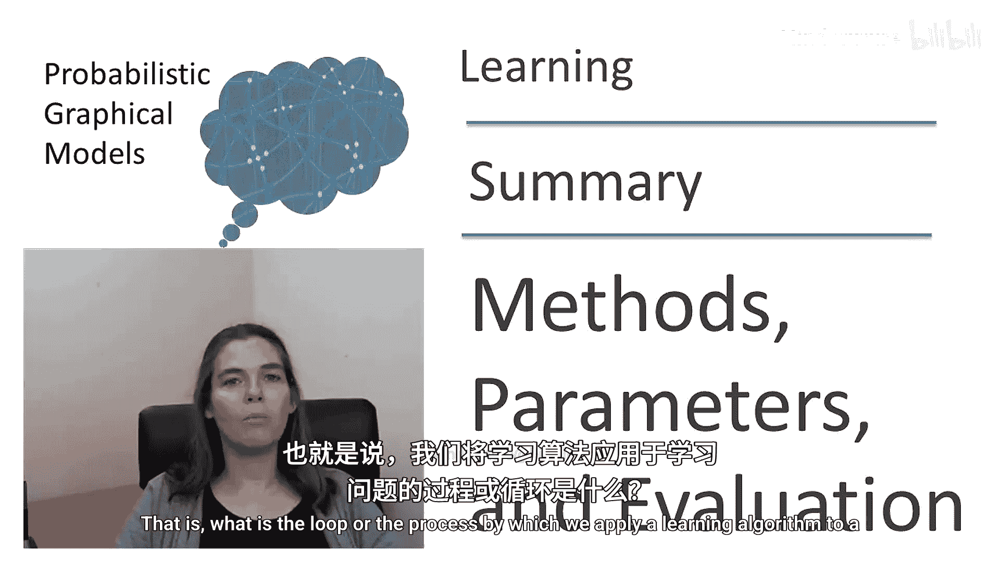

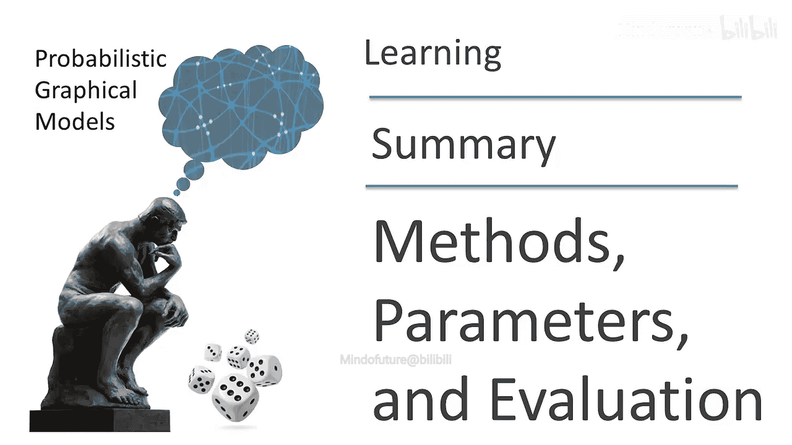

So first let's reconsider the learning problem from very high up。

 the learning problem can be viewed in terms of three different components。

 the first is the hypothesis space， the class of models that we're interested in considering。

The second is the objective function that we're trying to optimize when we're applying the learning algorithm。

And the third is the optimization itself that aims to optimize the objective function to give us a good model。

 and pretty much all of the learning algorithms that we've discussed can be viewed in terms of these three different components with just different combinations of objective function or optimization algorithms or hypothesis space。

So let's look at each of these components in turn。The hypothesis space is what we're searching for and there's really two different pieces that we can be searching for the first is the parameters of the algorithm and the second is the structure and in some cases we're searching for one in some we can search for the other and in many cases we're actually searching for both and this sets up a different depending on which choice we make it sets up a different learning problem some in some cases it's a continuous learning problem when we're searching for parameters。

 searching for structure it's usually discrete and when we're searching for both it's actually a hybrid search problem。

Then the second part of the hypothesis space is when we impose a certain set of constraints on what we're searching for。

And this can be done for multiple reasons we can constrain the hypothesis space for computational efficiency。

 a smaller space is often easier to search for and admit different algorithms that might be computationally more efficient。

The second is that we might restrict the search space to reduce the model capacity。

 that is the complexity of the models that we're considering。

 and that can reduce the risk of overfitting because we're searching over a smaller set of possibilities and so less likely to overfit random statistics in the training set。

And then a third form of constraint is when we have some kind of prior knowledge that we want to encode。

 and that allows us to guide the learning algorithm towards models that are more reasonable than in a totally unconstrained way。

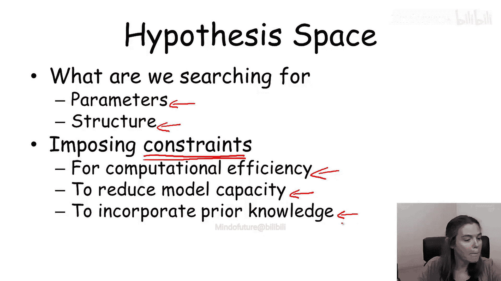

The second piece is the objective function。So perhaps the most commonly used objective function is that of a penalized likelihood。

So penalized likelihood has a log likelihood component which measures the likelihood of the log likelihood of both our graph structure and the parameters relative to the training set。

 but that has to be accompanied in most cases by a second term which is the regulargizer which serves to guide the model of the learning towards simpler models that are less likely to overfit the Danna。

 and that regularizer can include one or both of a parameter prior。

 which guides the parameters usually towards more smooth models， so for example。

 in the case of MRFs we had L2 or L1 as the regularizer and in the case of Baysnets。

We had some kind of deer sle prior in many cases， those are some examples that we've looked at。

 and both of these tend to smooth the parameters and avoid overfitting to the statistics of the training set。

And then the second form of regularization is a structure complexity penalty， which of course。

 is only relevant if we're also searching over structures。

 which aims to push us towards models that have fewer parameters or fewer edges again reducing overfinning。

An alternative paradigm， which we also discussed is what we call the Bayesian score。

The Bayesian score is a score that's used when we're really searching over graph structures alone and integrating out over parameters。

 so this is a case where a hypothesis space is really just the space of structures and the parameters are kind of implicit or integrated out。

And the Bayesian score， or which is the log of the probability of the graph given the dana is equal to the log of this guy。

 the probability of the data given the graph， which as a reminder is called the marginal likelihood。

And the log of the graph prior。Now， importantly， as just as a reminder。

 the graph prior is a regularizer， so log of P of G is a regularizer over graphs。

 but log of P of d given G， that is the log of the margin likelihood incorporates within it a regularization term as well as we've seen before and also serves to reduce the overfitting of the model。

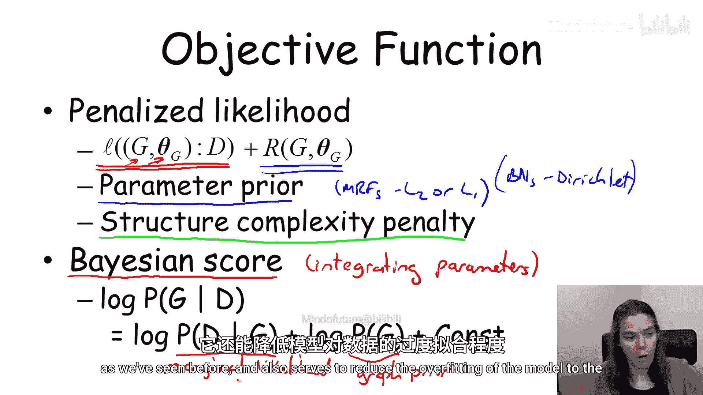

对不对的。The final component is the optimization algorithm。

 which of course depends both on the space that we're trying to optimize over as well as the objective that we're trying to optimize。

So if we're trying to optimize purely over the continuous space， then in some cases we're very lucky。

 we showed， for example， that for Bayesian networks with multinoial CPDs，We can actually optimize。

The likelihood in closeded form and find the unique optimum for the parameters。

 and this also happens when we have a penalized likelihood or even a full deer s distribution over the parameters。

In other cases， we're not so lucky and we need to somehow optimize the function when we can't have an algorithm that finds it in closed form。

 so in this case we use gradient ascent or some other kind of perhaps second order method that allows us to hill climb over the likelihood function and we saw that this happens。

 for example， both for MRF learning as well as for learning with missing Danna。

For both baysts and sers。And of course， gradient ascent in its naive form is a fairly slow method。

 but there are second order methods that build on top of gradient ascent， for example。

 some kind of conjuga gradient or LBFGS that uses similar computation。

 but that converges much faster。Finally， there is the expectation maximization algorithm。

 which is an algorithm that's specifically geared for learning likelihood， learning with missing Dma。

😊，So optimizing the log likelihood function in cases where the log likelihood is multimodal because of the case of missing data。

 and we talked about some of the tradeoffs of local Opima， for example， in this method。

If we're trying to do discrete optimization， trying to search over the parameter space， again。

 in some cases we can be lucky， so when we're trying to do optimization over tree structures we we saw that a very nice simple algorithm that's very computationally efficient that is finding a maximum weight spanning tree can allow us to find the optimal scoring tree in a very efficient。

 very efficiently polymer time。In other cases， the space is more complicated and we can do an optimization that's guaranteed to give us the optimal answer and in this case we typically end up doing some kind of local hill climbing where we。

And in this case， we typically end up doing some local hill climbing where we do things like add。

Delete or remove edges。And。And that gradually gets us to a better optimum。

 there are also algorithms that take larger steps in the space。And finally。

 an interesting combination is when we have to search over both the discrete and the continuous space together when we're trying to optimize over both parameters and structures and that ends up being in many cases quite complicated because when you're taking a space on the discrete side。

 you also have to optimize the parameters for that new structure before you can score that structure to figure out whether that was a good move to take so this tends to be computationally。

Expensive in many cases， and there's some tricks that one can do to reduce the cost on that。Now。

 every learning algorithm we've discussed has some set of hyperparameters that we need to set before we can run a learning algorithm。

So these are include for example， if we're doing， say a dechle prior over the parameters。

 it includes the equivalent sample size， and perhaps the prior itself more broadly。

 that's usually a hyperparameter that we need to set。If we're doing， say， CRF for MRF learning。

 we need to set the regularization strength for either the L1 or the L2 prior。

If we're doing expectation maximization， we need to figure out when to stop and we already talked about the fact that early stopping is a useful strategy because it reduces overfintting。

If we're doing structure learning， we need to figure out the strength of the structure penalty。

 how much do we want to penalize models that are more complex。If we're doing。

 say MRF or CRF learning， we have to figure out how many features we want to add and which of those are we should add initially。

And when we're doing learning with latent variables。

 then there's the decision of how many values a latent variable ought to take， so for example。

 when we're doing clustering， how many clusters should we consider？

Each of these is an important decision that we need to think about。

The question is where does this come from， do we just invent this from thin air or do where do we get the answers to this？

One bad answer that we shouldn't do is try and estimate these on the training set。

That is find the hyperparameters。That maximize the objective function on the training set because if we do that。

 that is effectively calling for a choice of these hyperparameters that are going to overfit to the statistics of the training set。

And so a common strategy， perhaps the one that's most commonly used。

 is to have a separate validation set on which these hyperparameters are set。

 which means that we train。On the training set。And then we evaluate on the validation set。

And we pick the hyperparameters。That give us the best evaluation on the validation set and not on the training set。

Now， if computational cost allows us， it's good to do this not in a single training set or in a single validation set。

 and at that point we usually end up doing something like cross validationation where we split up the training set into a training set in a validation set in several different ways and pick the hyperparameters that give us the best cross validationidation scores and then we use those hyperparameters to train on the entire training set。

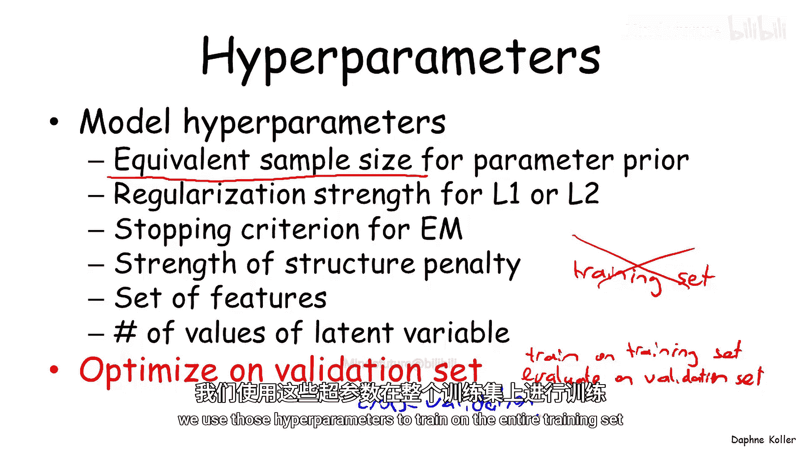

This， of course， gives R the question of what it is that we're actually evaluating。

 So what are some of the evaluation criteria that we might use to figure out whether a model is good or not。

So one obvious one is log likelihood on the test set。

 So if we're actually trying to to find a model that gives us good predictive performance on unseen datana。

 then log likelihood of the model on the test set is a good way of measuring。

But in many cases that's not the objective that we actually care about and so in that case we might often evaluate the learned model using a task specific objective。

 for example， segmentation accuracy if we're trying to do image segmentation or。

Or speech recognition accuracy word error rate。It's called WER would be another task specific objective on which we can evaluate a model。

And if you really want to get a high performing model。

 it's useful to think about optimizing the objectives that you actually care about in the context of the task。

Finally， when we're trying to do knowledge discovery。

 it's often useful to think about the extent to which the model that you learned matches with prior knowledge。

 so if you're doing clustering for example， if you have some notion of clusters that you think exist in your data。

 trying to see whether the clustering algorithm is more or less compatible with those is a good idea to do a sanity check on the model as well as well as for example。

 if you have some notion on edges that ought to exist in a network。

 trying to see a match with those is also a useful thing。

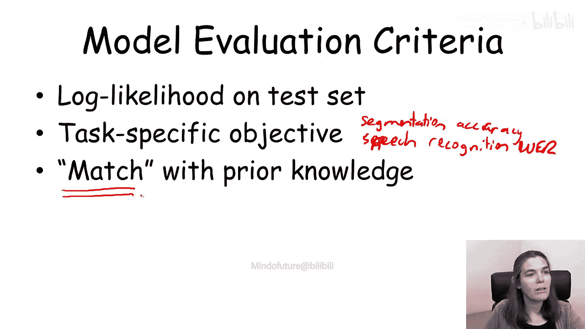

So now we've learned and now let's think about some。

Possible air modes that might occur and how we might diagnose them and how we might fix them。

So one error mode that occurs often is underfitting。

Underfitting means that the model is not sufficiently expressive to capture the patterns and data。

And this we can recognize when the training and the test performance are both low。

 and in that case it suggests that we just haven't put enough expressive power into the model and it can't even get good performance on the training set。

At that point we can have several different solutions。

 we can decrease the amount of regularization because maybe the regularization is driving us towards the regime where we can't fit the patterns in the training set。

We can reduce structure penalties。To allow more edges and more interactions to be learned。

And then a very important one is to add features into the model。

 often done by a very targeted error analysis in which we look at the errors that the model is making and say。

 wait a minute in in this kind of instance I would have expected to see this answer and I didn't。

 so how do we improve the model by adding features so as to give us better results for this set of instances。

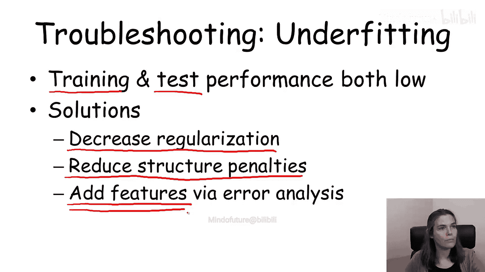

The complementary error mode is overfitting。So overfitting can be diagnosed in cases where the training performance is high。

 often ridiculously high， whereas the test performance is low。

 and that indicates that the model has fit patterns that are in the training data that are really statistical noise and don't generalize to other unseen instances。

And in this case， the solutions are complementary， you increase the regularization。

 you impose capacity constraints reducing by forcing the model to pick within a subclass and you reduce the set of features so as to eliminate or reduce the capacity of the model to overfit。

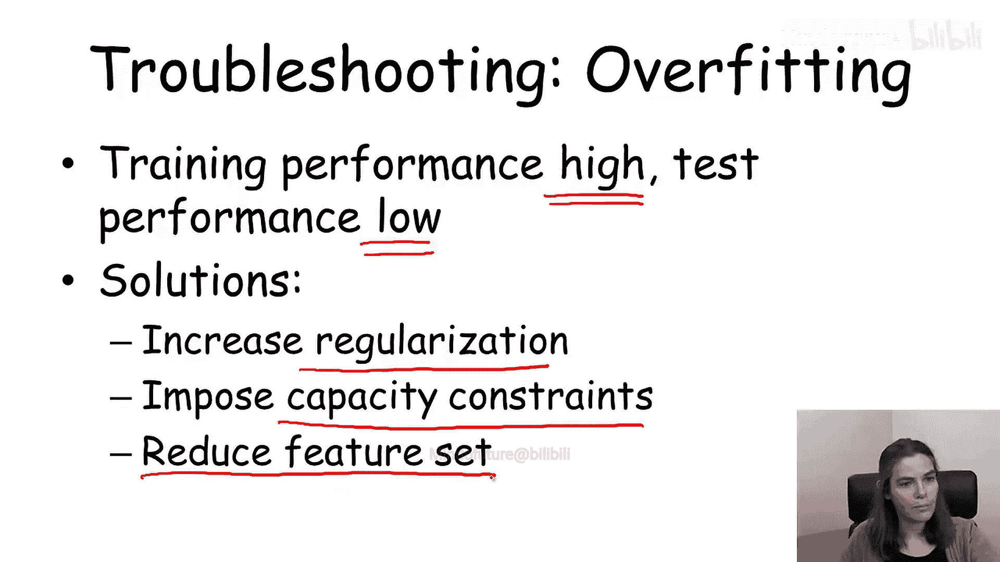

A different error mode happens when our optimization algorithm is not doing good job of optimizing the objective that we've laid out for。

So that happens when the optimization might not be converging to a good or the global optimum。

And people tend to associate this error mode in cases where the problem is multimodal。

 so we're converging to a poor local optimum， but in fact。

 this can happen depending on whether we carefully design our optimization algorithm it can happen even if the problem is a convex optimization problem。

 it can happen， for example， when we don't set our learning rate appropriately and we never actually converge to an optimum。

So a way to try and diagnose that is to compare models learned with different learning rates with different random initializations and basically see whether these models give rise to very different values of the objective function。

 and if they do， it suggests that we should be very careful about how we optimize and maybe try multiple random starting points or set the learning rate more carefully。

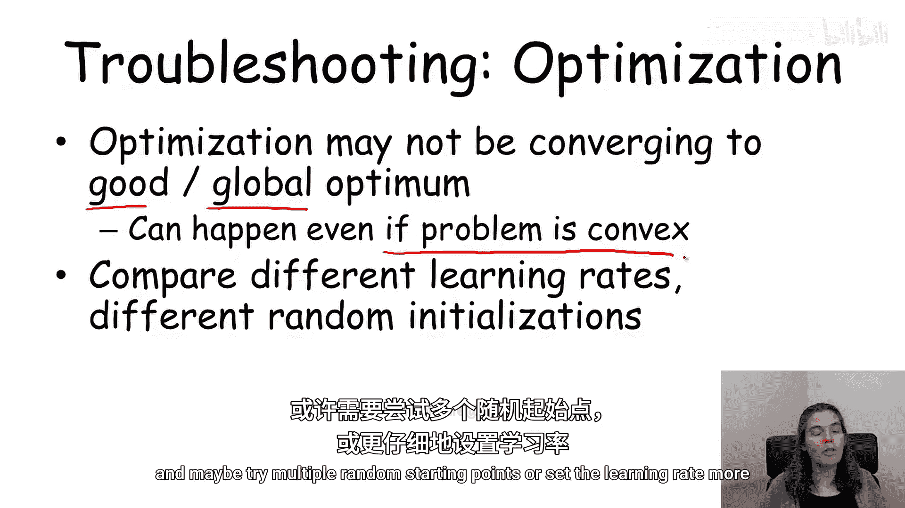

Now。This previous analysis called for comparison of the objective function。

That is the objective that we're trying to optimize。

A very different error mode happens when our objective function is not actually a good match for the performance metric that we're actually trying to optimize。

So for example， one important thing to check for is cases where we have two models say that we learned in some way。

 as we discussed on the previous slide， and the objective function for Model1 is significantly better than the objective function for Model2。

But the performance objective that we care about， say segmentation accuracy for Model 1 is considerably lower than the performance for Model 2。

 And this suggests a case where the where' optimizing the objective is not。

A good surrogate for optimizing the performance that we care about。

 and that happens quite often when we're using a regularized likelihood as an objective where regularized likelihood is not necessarily a good match for the performance that for the objective that we actually care about and an important mistake that people often make is to say well。

 let's try and change the optimization algorithm to give us better results in this case。

 That is a bad idea because you can't fix a bug and the objective function by breaking the optimization algorithm。

 The right thing to do is to redesign the objective function to match better the desired performance criterion as so as to get a better alignment between those two。

😊。

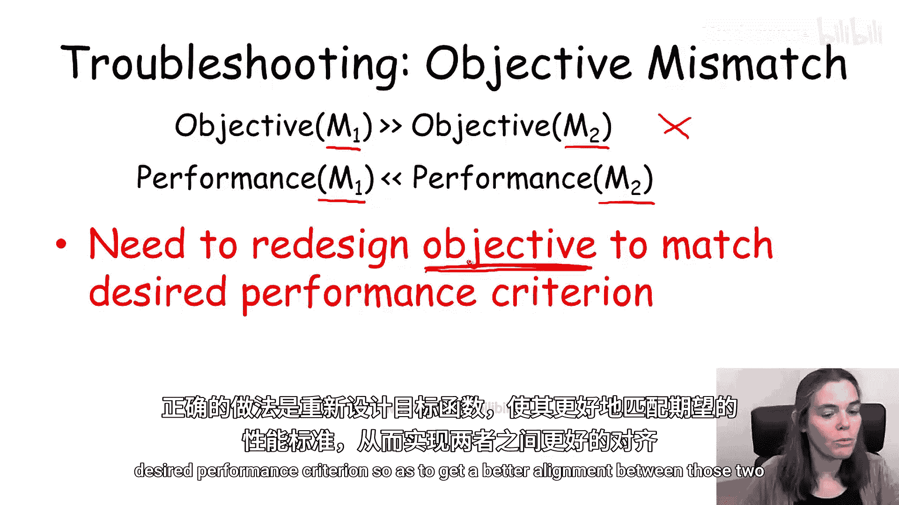

So to summarize， let's think about the typical learning loop that we use when trying to apply machine learning in practice。

First， we design the model template， which tells us， for example。

 the set of random variables that are involved and whether the model is directed or undirected and perhaps some notion of the kinds of features that we might include。

We then select the hyperparameters via cross validation on the training set。

We train on the training set with the chosen hyperparameters。

And then we evaluate performance on a held outset to see which of the error modes， if any。

 that we've discussed on the previous slides is actually occurring。

This gives rise to a process of error analysis， what kinds of errors are we seeing。

 and how do we redesign the model or the objective function or the optimization algorithm in order to address those problems。

That gives rise to a new model template and perhaps some other changes in this cycle then repeats。

When we're done and only when we're done， we can now report results on a separate test set。

 which is not the same。As the held outset， because we've effectively used that held outset to set a lot of model parameters and reporting results on that held outset would be misleadingly optimistic in regards to the performance of the learned model on real unseen data。

 because this held outset is not actually unseen data at this point。

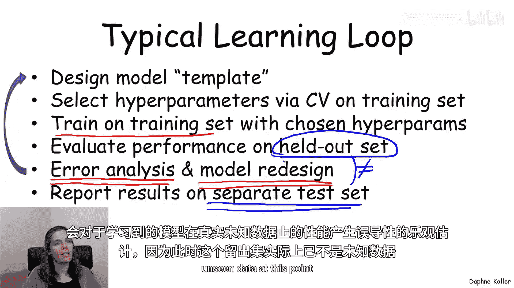