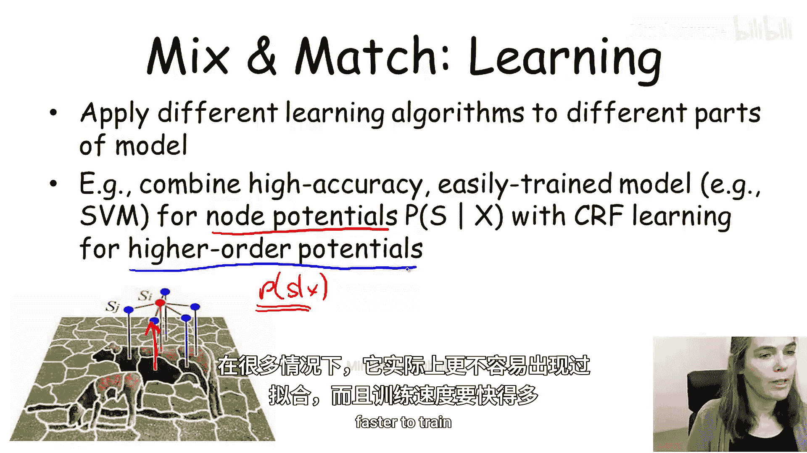
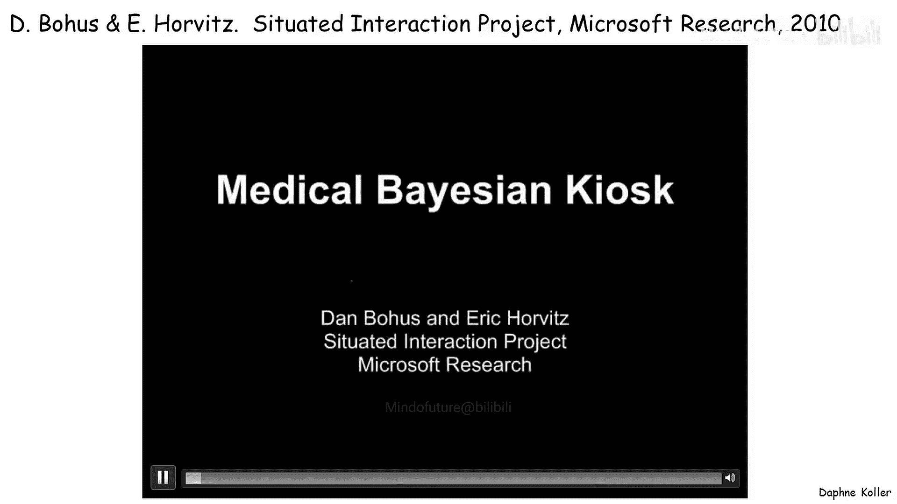
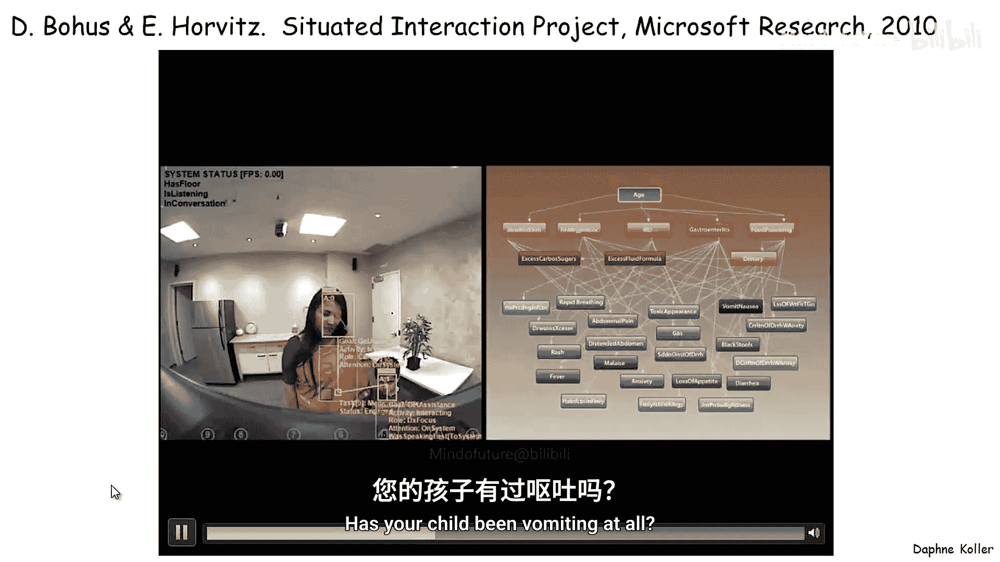
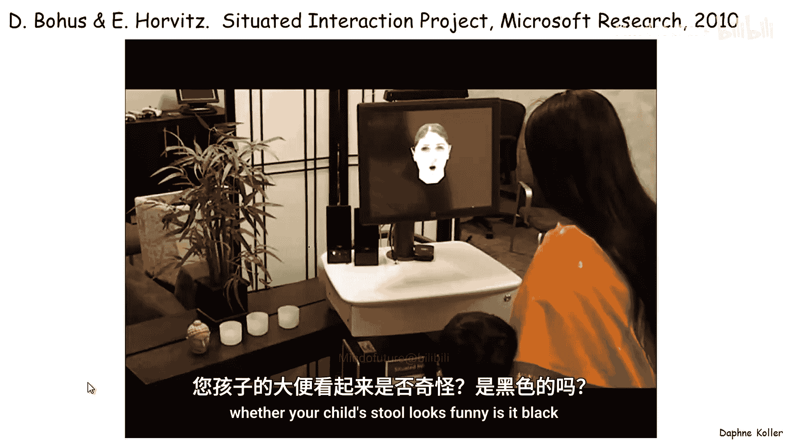
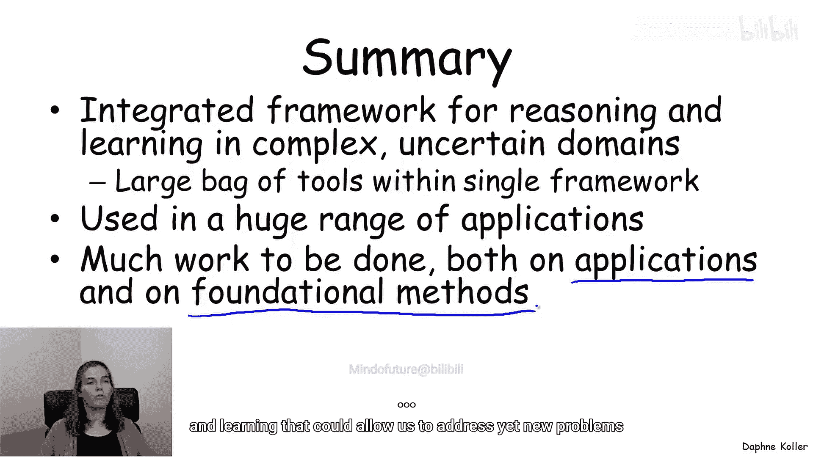

# 【斯坦福】概率图形模型3：学习 ｜ Probabilistic Graphical Models 3 Learning p29 P29_PGM课程总结_08_01_01 -BV1MH6LBREqD_p29-

We've spent the entire course talking about probabilistic graphical models。

 we talked about different variants of probabilistic graphical models on the representation side。

 different inference algorithms that can be used to answer various types of questions about probabilistic graphical models and algorithms that can be used to learn probabilistic graphical models from data。

Now let's take a step back and think about probabilistic graphical models and what they might do for us。

So first。Why probabil graphical models？So probabilistic graphical models are， in some sense。

 the synthesis or the marriage of foundational ideas from statistics and important techniques from computer science。

On the statistics side， we get sound probabilistic foundations that tell us about probability distributions and how they can be used to think about uncertainty and various manipulations on the probability distribution。

 such as conditioning and techniques such as value of information or decision making that can be used to build on top of probability distributions to make decisions。

From the computer science side， we get the idea of taking this probability distribution over a very high dimensionional space and using ideas such as graphs as a data structure for exploiting algorithms that allow us to manipulate these high dimensionsional objects very efficiently。

 and it is these ideas that we got from computer science that allowed us to take these sound probabilistic foundations and make them applicable to the kinds of complex real-worl problems that we're now facing in many scenarios。

😊，Now， a key component of the ability to take a high dimensional probability distribution and consider it as an object is the fact that we have now obtained a declarative representation of our knowledge about the world。

So that declarative representation， which is a model probabilistic graphical model。

 is a standalone unit that we can consider separately of any algorithm that we then use to manipulate it now that's important because it allows us to refine the model separately from refining the algorithm that that we're using so we can develop the model and consider whether it's the appropriate one for our application and then we can apply one or multiple different algorithms to try and answer questions regarding that model。

😊，It also allows us to separate out the model construction phase from the inference phase。

 and the model construction can involve one or both of elicitation from a domain expert or learning from Dana。

 and we talked extensively about learning methods and also to some extent about elicitation methods。

Now， when would we apply probabilistic graphical models？

So we would apply probabilistic graphical models when we have noisy data and uncertainty。

 that's pretty much true in any application， so that's pretty much a given。

They're also particularly useful when we have lots of prior knowledge that we want to embed into our model。

 it's often easier to do this in the context of probabilistic graphical models than in a variety of other approaches。

 for example， in many traditional machine learning settings。

 it's actually quite difficult to incorporate prior knowledge in as natural a way as one can do here。

Probilistic graphical models are particularly useful when we wish to reason about multiple interrelated variables。

 so if you're trying to predict just a single variable。

 probabilisticographical models might not be the most ideal solution and there might be a range of other methods that are equally or more competitive from say traditional machine learning。

 but when you're trying to reason about multiple variables simultaneously。

 then the ability to incorporate the interrelationships between them is often very powerful and hear probabilisticographical models can really shine。

Another useful place where probabilistic graphical models bring significant value is when we want to construct richly structured models that are constructed for modular building blocks。

 so when we're trying， for example， to do fall diagnosis or medical diagnosis。

 we often have these little building blocks of models that can recur across different models for different diagnostic problems and this architecture allows us to take these building blocks and construct very rich models from those very quickly by reusing components。

So we've talked about probabilistic graphical models in terms of a set of design choices。

 there's design choices on the representation side。On the inference algorithm that we choose to use。

And on the learning algorithm that we might adopt， should learning be required？

It turns out that these design choices， although the declarative representation allows us to separate them and consider each of them in isolation and develop each of them separately。

 they're not actually totally separate and it's important to consider the interactions between them。

So on the representation side， it's clear that which representation we choose affects the cost of both inference。

And learning， we talked about differences in the cost of inference for different types of graphical models。

 and also we showed that in the learning setting， there is very different learnability and complexity issues when you're learning。

 say directed or undirected models。The inference algorithm is also interrelated with everything else。

 so the inference algorithm， for example， is used as a subroutine in many of the learning algorithms that we showed。

 for example， in MRF or CRF learning even in the complete data case and in any setting when we're learning with incomplete data and so thinking about the complexity and properties of our inference algorithm is critical in designing good learning algorithms。

😊，And we also know that some inference algorithms are only usable in certain types of models。

 and so if we're aiming for a particular inference algorithm that affects our choice of representation。

And finally， the learning algorithm also imposes significant constraints on the modeling because our ability to well identify the correct patterns from the data impose significant constraints on the expressive power。

 for example， of our model。And only certain types of patterns might be identifiable given the amount of data that we have and the type of data that we have complete and incomplete。

 for example。So let's look at one example of some of these trade offs in the context of image segmentation。

So here， one of the first design decisions that we need to make is whether we're going to try and model this as a basesnet。

So there's a directed graphical model， and MRF。Or a CRF where we're trying to predict the segment labels or the super pixelel labels S subI given features。

X， so we're trying to do P of S given x rather than a joint distribution。

What are some of the trade offs that we might want to consider for this kind of decision？Well。

 one is the naturalness of the bottle。So initially just thinking about this。

It seems fairly clear that a directed model where we have directed edges from one superpixel to the other doesn't seem like a natural。

 particularly natural choice in this context， because which direction would we pick and what implications would this have if we went。

 for example， using directed edges from the what top left corner of the image to the。

Bottom right corner of the image。 it just doesn't seem to make sense。

 And so a more natural modeling paradigm here seems to be either the MRF or the CRF。

But that still leaves us the question of which of those should we use？And here， for example。

 one possible design criterion that we ought to consider is that we might want to use a very rich feature representation。

 that is that these features X should be richly structured and count different gradients and different gradients of texture and color across the image for example。

 different histograms these rich features are often highly correlated with each other and we know that correlated features are hard to model in the sense of capturing correctly their correlation structure and so in this case a CRF seems like it might be a better choice because it avoids the issue of how do we model the correlation between these the correlation structure between all these rich features and so it allows us to use rich features without falling into traps of incorrectly modeling the correlations which might diminish our performance。

Now， another related question is that we need to consider is the cost of inference in this kind of model。

 and that comes back and influences the modeling。So for example， for certain types of models。

 as we've discussed， for example， when the structure in the potentials in the MRF or the CRF is associative。

Or regular。Then we know that we can apply very efficient inference algorithms that utilize min cuts and other comminatorial graph algorithms that are much。

 much faster than applying， say， message passing schemes。So that's all very well。

 but then it imposes on us the constraint of。Making sure that our that our potentials， in fact。

 are associative。 And that does have implications about the ability of our model to correctly capture the structure and the distribution。

 So， for example， it's very easy to capture using associative potentials。

 the fact that we expect adjacent。Pixels to have the same class。They have the same label。

That's very easy to capture。Using this type of potentials， but not quite so easy to capture is。

 for example， the the constraint， not the constraint， but the tendency that cows。Are on top of grass。

As opposed to on top of water or on top of road or on top of sky。

That's a potential that goes between one class and the other。

 And it's very difficult to come up with with a。With an associate dysfunction that actually captures these kinds of patterns。

Another thing to consider is training cost when you think about this。So here， in fact。

MRFs for CRFs are more expensive than Bayesian networks now we might still in this case want to take the hit because of the benefits on the modeling side。

 but we've already seen in the case of complete data training a Bayessian network is considerably more computationally effective the training an MRF for a CRF。

 and so it's a place where we're taking pay we're taking a hit for a design decision that we made on the representational side。

And then， finally。If we have to learn with missing datana。

 that sets up yet another constraint that we want to think about and might not be obvious going in。

 So say that we have a scenario where the segment labels are not observed。

 that is we're trying to learn。To segment。In an unsupervised way。So from unsupervised data。Well。

 in this case， the S's。Are unobserved。 They're latent， which means that optimizing。

P of S given x doesn't even make sense because S is never observed。

 and so in this case we simply cannot learn a CRF。In this context because there is no the objective of optimizing the labels F。

 given the features just is completely undefined in the setting and so at this point we have to resign ourselves to learning using a different representational scheme and so this is another case where we see the intertwining between different choices that we make and different constraints that we have in that in this case learning with missing datana。

Interacts with the choice of representation in potentially unexpected ways。Now， what important。

Component， one important benefit of probabilistic graphical models and their modularity is that they allow us to mix and match different ideas within the modeling framework。

And the reason why that's important is because it gives us a much greater richness of options than by considering individual topics that we learned as a solution in and of itself。

 we can often combine those in interesting ways so to see one example of that let's go back to our image segmentation that we just talked about and think about models that actually mix directed and undirected edges。

😊，So here we might， for example， if we're trying to learn image segmentation from unsupervised data。

We might have undirected edges over the labels S as an MRF， just as we see in this diagram。

 which is the natural directionality or rather the lack of directionality that we discussed before。

But we have directed edges。From the Ss。To the features X。And this is a model that is half undirected。

 it's undirected at this level， and it's directed going from the s's to the X。 Now why is that good。

 it's good because first it gives us a meaningful optimization objective that is we're trying to optimize using our model parameters and our model structure。

 the ability to explain。The images that we've seen。Using。Using the segment characteristics。

Or the class label characteristics？But why is it so in that respect it's a generative model that by forcing us to in some sense。

 generate the observed data can allow us to learn something about the statistics or the patterns in the distribution。

But。By allowing by making this model directed as opposed to undirected。

 which we could have done by doing an MRF over the entire set。

 which would also have been a generative model， it actually greatly facilitates the learning because each of these potentials P of XI given SI can be learned separately without trying to optimize over the model as a whole and so is considerably more efficient so this is a case where mix and match is a better strategy than a unified model that is entirely directed or entirely undirected。

Another type of mix and match can occur on the inference side we learned about a variety of different inference algorithms and we might be tempted to just take a model and just throw it into a black box of one of those inference algorithms or another。

But it turns out to be much more beneficial in certain cases to consider applying different inference algorithms to different pieces of the model。

So for example， we might use something like belief propagation or Markovchein Monte Carlo on some subset of variables。

 but on certain sets of variables， we can do exact inference which gives rise to much more accurate results over those subsets and perhaps makes the convergence properties of our algorithm considerably better as well as the accuracy that we get。

So let's take an example， this is a bipartid MRF that we've seen before where we have a set of variables A on the one side and B on the other。

 and let's assume that there is fairly dense connectivity between the variables and maybe even full connectivity between the A's and the B's。

Now， let's think which algorithm we might want to use for this kind of a model。

If there is a very small set of A's or a very small set of B's， then we can use exact inference。

 but that's not usually the case， and so we might have to resort to approximate inference。

One possibility is to apply belief propagation， but if you look at this graph。

 you can see that it has a very large number of fairly tight loops。

And we know that tight loops are a problem for belief propagation。

 and so we might be worried about the quality of the convergence and the quality of the answers that we get。

Another approach is to use something like a markov chain Monte the Caros， such as Gib sampling。

But in this case， if we have a lot of A's and a lot of B's。

 then we're sampling over a large very high dimensional space and we know that sampling methods in high dimensional spaces have。

 again， limitations in terms of the rate of convergence and the quality of the answers。

So one possibility that we might consider here is a variant of Markov chain Monte Carlo。

 where we only sample， for example， only over the A'， say there's fewer A's and Bs。

 so we sample over the A's and then for each assignment over the A's so for each little assignment a1。

Of M up to a K of M， which is one of our particles we maintain。A distribution。Over the bees。

In closed form， so we're effectively doing exact inference over the B's and sampling only over the A's。

 which is going to considerably improve the rate of convergence as well as the statistical properties of our estimator and this is just one example that we can talk about other examples of occur in belief propagation that we can construct larger clusters where in each of which we run exact inference。

 there's many， many such examples where mixing different inference algorithms can be tremendously beneficial。

Mix and match on the learning side is equally useful。

 so again we could apply different learning algorithms to different parts of the model。😊。

So going back to our image segmentation example， and now we're assuming we're back in the case where we're doing learning from fully observed data。

 so we're going to consider a CRF， it's very commonly used to train a high quality easily trainable model such as a support vector machine or some kind of logistic regression for P of S given X。

And we can train that very efficiently， we can use sophisticated machine learning tricks like kernel methods or various other ideas to get really high accuracy node potentials。

And then fix those and use CRF learning for the higher order， say the pair wiser。

 even higher order potentials， and it turns out that when you do that it's actually less susceptible in many cases to overfitting and it's much。

 much faster to train。

So by putting together different pieces of functionality， different ideas。

 it turns out that we can build some very nice integrated applications and I just want to end this discussion with one example a cool application that puts together a whole range of different ideas into a single framework。

😊，So this is a。A work from Microsoft Research， which has a longstanding tradition in the use of probabilistic graphical models。

 And it puts together ideas from。From speech recognition。

 from diagnosis and from decision making under uncertainty。

 so let's watch the video and then talk about it briefly。

Hi， thanks for coming to the triage Giosk。 I am in touch with the best doctors in the world。

Are you here for your child or yourself for my child？So how can I help you？Yes， been having diarrhea。

Oh， no。Sorry to hear that。Hi there。What's your name？

And how old are you so five years old， right？Yeah， almost 6。Okay， six years old。Have you felt no？

Either。So what we can see here is the use of value of information to figure out which questions ought to be asked that are going to be the most useful for improving the quality of the diagnosis and the ability to make decisions in this Bayesian network that we see over here on the right。

I'm sorry。Has your child been vomiting at all no？

Okay。So let's see， has there been a fever？Sllight。Have you been feeling tired lately。Yes。Let's see。

How about abdominal pains？He not been complaining of all。

Has your companyney been hurting？Yes。Oh， I'm really sorry。I hope it will feel better as soon。

Another component here is the use of current model。

 the current scenario situation to guide the speech recognition system so as to get better quality of results from the speech recognition system。

 so instead of doing totally unguided speech recognition。

 one uses the current scenario as the system is understanding it to guide the priors on what the person is probably saying。

Okay。Do you happen to know if your child has been losing weight no？That's okay。

Have you noticed whether your child's stool looks funny， I it black or darker than usual？

It is darker than usual。Okay， let's see。Considering everything you've told me。

 I'd like to schedule an appointment with the doctor， just to be sure， however， not to worry。

 I'm not that concerned at this point。

So to summarize。Probabilistic graphical models provide us with an integrated。

 coherent framework for reasoning and learning in complex uncertain domains。

And people over the years have developed an enormous suite of tools that can be used for accomplishing different tasks within this framework。

 and we can put them together within the single unified framework to solve much harder problems than any single tool can do alone。

We've seen over the course of different examples in this course that this framework is used in a huge range of applications and there's many more in which this can be used。

 and so overall we can see that there's a lot of places where one can continue to work in this paradigm。

 both in utilizing it for applications that might be of interest in new ideas that come up and also on improving the foundational methods for representation。

 inference and learning that could allow us to address yet new problems。

