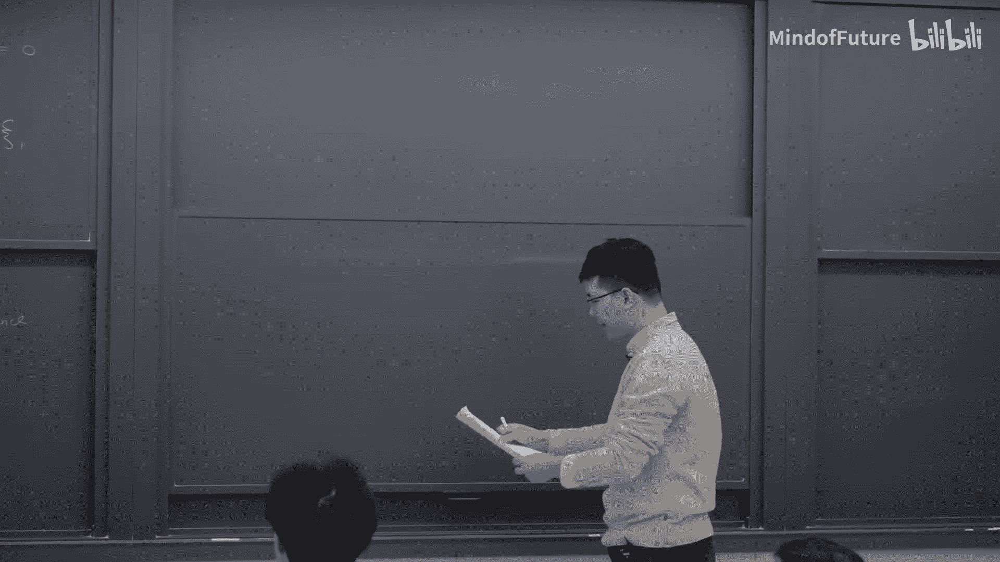
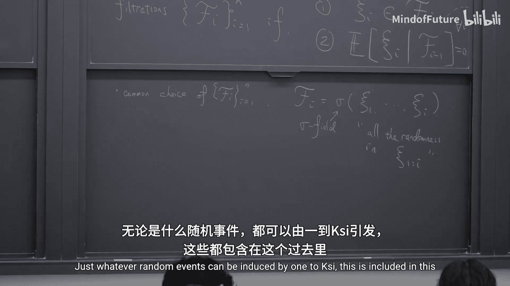
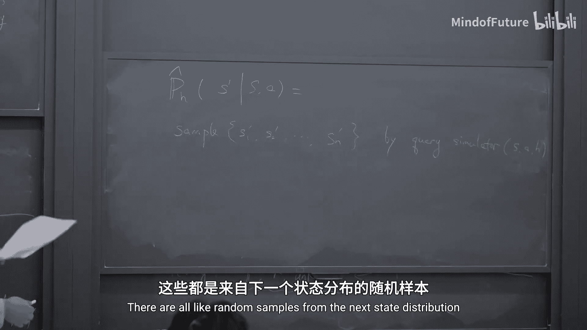

# 【普林斯顿】强化学习基础 ECE524（Foundations of Reinforcement Learning，2024） p05 P05 Martingale Concentration -BV1a2frYfEk4_p5-

🎼So at the very end of the last lecture， we kind of wrap up with the concentration and quality of independent random variables and we start talking about the rent concentration。

Of， of random variables with under weaker condition that is no longer just in that that that is no longer independent。

 but satisfyes so called like Martining go difference condition。 So just recap。

 we kind of informize this Martin go difference thing。Informal condition， we say this is。

Martin goal is we look at the summation of some random variables。

 let's say we look at K C I summation from I to N。 And so it's Martining goal because each KI。

It's no longer ID， I is what we have been working on like for the last lecture。

 but the Martining difference no longer require they are independent。

 it only require you to have some condition expectation of CasI condition on all the thing happened in the past。

Where we say a lot of things happened in the past， including like co say I-1， the till co1 okay。

So you can， you can informally understand this past as like all all the randoms happen in the past。

 And we're saying this is equal to 0。 In this case。

 we call this Caci I Martin go difference sequence。And in the last lecture。

 we kind of like already seized the example。Where we have a。There's probability matrix。

Becauseuse you too。Cause you won。And the minus1， the1， minus-1，0，1。0。50，0。5010。

And this is the conditional probability of a Cai 2 conditional Ca 1。

So in the last lecture we already verified， so in this case in this case first Ca2 is definitely not independent of Cai 1 because the table does not affect rise。

 but on the other hand， you have a Cai2 condition on Ca 1 equal to1 that is equal to 0。

And expectation of a Q C 2 condition on K C 1 equal to 0。 This is also equal to 0。

That certain minus1。This is also equal to 0。So this essentially says this Ca1， Ca C 2。

Are not independent。But are。Marting go difference， but it's a maring go difference sequence。

And finally， we says the mar difference would also exhibit the concentration phenomena because the summation of the difference。

 essentially the Martin goal would also has the concentration phenomena because if we just plot the summation CI。

Over time， like this is I equal to1， I equal to 2。And we can of sum them together。 Sorry。

 this I sum from I to N。 This is N。And we see the first step。

 we're doing some random work and second step， we're also doing some random work。

 And like eventually， it's something like。Like this。And the only difference here is for example。

 if I have another realization is。Its something like， I， like here。So this。

 those two are two different realization of the random work。

 and the marginal goal different sequence essentially says they are no longer independent。

 So for this trajectory and this trajectory， the this。Ca see T plus1。

 the distribution can be different。 For example， this distribution is like this， one half，12。

 and this distribution like like like this with probability 1 equal to 0。

 But the important thing is the conditional expectation that is a conditional all all things happens in the past and the the single step in the future has a。

 has an expectation that is equal to 0。 So in this case。

 you would also expect a lot of cancellation happens。 And eventually。

 the sum will grow like something like squared。O。So this is last time where we finished。

 we talk about this high level picture about what is this maring goal happening。I think today。

 we will be more formally talking about mathematically how we're gonna define everything。

 I think to understand intuition， really， you should understand is the major differences we are no longer independent。

 What we're seeing is we require weaker condition that is condition on the past。

 The one step future has a conditional expectation equal to 0。This is a key idea in the Martin go。

So today we'll mathematically define， like， this is like informal definition。

 We never talk about what is the past。 So today well be just be a little bit more rigorous on like how we define the maring go and what is this Martining concentration inality。

Okay。So this is a little bit like terminology， but you can just intuitively understand I will talk about intuitive understanding later。

So let's say we suppose F1 to Fn。Our fts。Fusitionians typically can be understand as a set of like random。

 random events。You can just think of as a collection of a lot of randomness。So that。

The filtration at I-1 time is a subset of filtration at I time。

 So you can think we here we kind required randomness to be strictly increase。So for now。

 you just understand like the sigma F is like all the randomness up to time I from from time step one to time step I so that you have this like inclusion condition。

For any eye。嗯。We say。This cassi。Sequence。Is a mar go different sequence？

With respect to filtration fi。Iphoneone 12 N。If the following two condition holds。That is one。C CI。

 these could be inside F。This is some conditional， we'll explain later what is the fu and what does this mean？

And the second thing is the expectation。Of K CI condition on the past where which we we doed as a futration F minus-1。

Is equal to zero for all I。So this is the formal mathematical definition。

 I think the everything else is like pretty straightforward。

 The only thing is a little bit opaque if you haven't like learned the formal。

For more like a graduate version of stoastic processes like， what is the definition of fution。

 I think for now， for this class， we don't really necessarily like you need a lot of rigorous understanding it。

 But I think you can just usually understand this fution as a collection of all the randomness in the past。

 So we will say the common choice of fution。Okay， so this is not necessarily always a choice。

 but we say common choice。 or in intuitive we understand this is F I will be chosen as a sigma field。

 So called sigma field of Ca C 1 to Ca C N。可是 I。So the sigma field， So mathematical definition。

 this is called sigma fields。But intuitive understanding。

 you can just say this kind like include all the randomness。Ining。C see，1，2， I。

Just whatever random events can be induced by Ca C 1 to Ca I。 This is included in this pass。

 So this is why I like this is。

This is like all the past。 Okay， so you can think this is just my mathematical definition of like。

 you condition on all the possible pasts。 That is the， the sigma field。

But I also want to comment if if you only choose this filtration to be like sigma field of K C1 to K C I。

 then there's really no need to like write this like filtration notation。

 And you can just basically just just say I conditional other the past thing。

 So sometimes in the later lecture。 like we might need to use some filtration slightly different。

 I think the comments here is like the filtration can actually。Can add more randomness。Two표 최。

So in a sense， we all we need is we satisfy like those， those two condition。

 So you can actually choose some other type of fu。 For example。

 you can also and alternative choice would be。If I have not only Ca C。

 but also like some Zeta random variable。 So I can also choose this fu I to be the sigma field of Ca C 1。

 Zeta 1， K C 2， Cta 2， Z Zeta 2， and about you， Ca C I。Zta。So in that case， I still satisfy， like。

 for example， the， the FI， the randomness like strictly increase for this filtration and also。

The random variable CaciI is like is in this futration FI， so this is also another valid choice。

So sometimes we can include some more randomness into this filtration。

 And if we can prove the maring go kind of condition holds different condition holds for this like different filtration。

 And then we also say this is like maring difference。

 The only difference is like the fuel filtration definition is slightly different。Essentially。

 like intuitive understanding， like what you include in the past not is not only like just Ca C1 to Ca C I minus-1。

 Sometimes you can also include some other random variable， other random events into the past。O。

So finally， we already defined what is so called Martining goal difference sequence。

And then we can define what is so called Martin， Martinold。Marti go sequence。So S。

 i from 12 n is a Martin goal sequence。Or line time， you just call it Martino。If and only if。

This S I is equal to some summation of Ca。CJ。J from one to I。And this could see。

Cay J is is a multiple different sequence。Okay， so essentially。

 what we're seeing is a summation of the maring difference is the Martin goal。

 So we called sum to be the Martin goal and the each individual sum called Martining difference sequence。

Okay， so this is like a mathematical formalism。 but the intuitive understanding is really this informal。

 It's just fuion is just the past。 And all we have is just condition on the past。

 The conditional expectation is 0。So given the definition now we。

 we kind of like were ready to state。The concentration in for Martin difference sequence。

It turns out。What are we gonna say here for Martining difference is basically identical to Hings and burnton in quality。

 The only difference is precondition。 We kind of relax relax precondition from requiring to all the random variable to be independent to now we only require all the random variable to satisfy the maring goal difference condition okay。

So the theorem now is called azuma hofting。My intuitive honor standing is like Hfting is originally for independent random variable and you can have azuma hofting。

 which is basically strengthening to like a Martiningo difference and later we also have the Azuma Briston。

 essentially the Bton version of Martiningo difference。So the theorem is。It's very simple。

 It's pretty similar to the half in in quality。 So we just suppose。This casi， i from 12 N。

Is a maring go different sequence？With respect to like fut， I fine。And remember the hoing。

 for the hing thing quoted， the most important preconditions like the random variable need to be bounded。

 So here we also essentially assume the same thing we say for and for all I， any I in。From one to n。

We have。그 see eye。Is supported。On an interval。With length R。Where's the probability want？

For most cases， we just understand this caciI is bounded， this is fine。

And then we have essentially the same concentration inequality。That the probability。

Of this summation， I from one to n。그씨 아이。grter equal度T。It's less or equal to。

Minus T square e to the minus t square over two times summation1 from summation I from one to N R I square。

Okay。So that's essentially the same thing。 We still have the bounded， like bounded random variable。

 still like our main precondition。 and the concentration is like a like the probability of some tail probability。

 that is。The summation。 And here we no longer subtract expectation because by assuming this maring or difference sequence。

 we essentially already assume like this expectation is equal to 0。

 So you should think this ca is something like something roughly like something X I minus E X I。

Something like that。 So， so we already subtract mean。

 So that's why like it's corresponding to the halfing in quality and remaining thing is basically same。

 We're saying the tail probability is smaller than something。That like exponentially smart。

 respect tea。And you can， you can do essentially the same operation。 We say we make this data and we。

 we can like solve the upper bounds for the sum。 Ca seeia， the Martin goal。

And we will not repeat that kind of part。So any question about the theorem statement？Yes。This isす。

The difference between this and often is that the two move from the top to the bottom。Is it no， no。

Oh，I think probably I may have made a mistake。 I think it should be exactly the same。

 So Hoffing has a tool on the top， right。Soir。Just want to make sure hopping has two on the top。

 Yeah， yeah， let's do。Thanks for pointing out the title。Okay。So if no question about the theorem。

 we will just briefly talk about how we're going to prove this。

 the most of the proof is like going to follow the same arguments for the hoing inequ quality。

So in order to do this proof， let's just， we need to essentially recall how we prove the original half inequality for independent random variable。

 We have three Lamma， and the final theorem is just proved by combination of simple combination of three Lamma。

 So the Lamma 1 is markov inequality。Which， of course， we don't need to。Moify it啊。So at that time。

 Lama 2。So just this is like a recall。The proof of independent proof for it。

For the original halfing scene quality。The second Lama we're seeing。

The summation of independent Gaussian。Has good concentration。And the third step。We're seeing。

Bmed that are random variables。Its sub boundaryed the random variable is subgoussion。

So those are three lammas we use to prove the original half in， and we can check first。

 the Markov inequ， of course， like we don't need to change anything。 so this is like down。

 we don't need to do any extra work。And then this abandoned random variable of subion。

 this is regarding。Regarding a single random variable。

So this Lama actually has nothing to do with whether it's independent or whether it's like a maringo difference。

 all it say is for a single bounded random variable。 it is subgussion。

 So this one we actually also does not need any modification。 we just directly use the same Lamma。

 So the only thing that's gonna to related to whether it's independent or it a maringo difference is the second Lamma where we see the sumation of independent subgussion has good concentration。

 and we essentially need to modify it the proof for the second Lamma。

 we need to strengthen the second Lamma to move from independent to like the Martining goal difference。

So this this is like what we will do here。说的牛了吗？Let's call themma two star。

It's a newlema we can improve with say a large。Could see I， I from one to N。

B Martin go different sequence。Where。For allland。In2。

We have the following precondition that is expectation。Of the E to the power of Lada Ksi。

So in a previous definition is just this like a moment generating function。

 we say it's bounded by some exponential。 and now the only difference is we essentially need to see this expectation is。

 again， the conditional expectation。 We condition on whatever happens in the past。

 that is a filtration of I minus-1。 we say this expectation is upper bounded。

By E to the Lada square Sigma I square over2。D。For。O t greater than 0， greater equal to 0。

We have that the probability。Of summation， I from one to n。可 see eye。Gter equal to T。

Is less or equal to e to the minus t squared。Over two sum， iPhone one to an。시그먼 아이스 square야。

So everything is the same as the last lama， the only difference is now we kind of adding the condition like change this or original unconditional expectation to now the conditional expectation because's no longer independent it's a Martin difference sequence。

Okay。So let's prove thislema， too。So we will essentially follow a lot of steps。

Like in the last lecture， we how how we proved themma too， The first step is。

So we kind like we first write out what we want to approve。Now this probability of sum Casi。

Gter equal度 T。The first step， we raise everything to the exponent。

 So we say this is equal to the probability of E to the landda。

Sation I from1 to N co C I greater equal to E lambda T。This used the fact， again。

 use the fact that lambda is greater than 0， greater equal to 0。 So。

 so basically E to the Lada T is like monotonic function respect to T。And again。

 we will use Markov inequality。 So we say this is less equal to into the。

Minus Lada T minus the expectation。Of into the land。Sation I from one to M K C I。

 This is using the markov in quality。So let's first recall what we use in the independent case。

Recall in the independent case。So in an independent case， we use a very important。Like in equality。

 that is for anything independent。 The expectation of the product of independent random variable is equal to the expectation。

 the product of expectation of each independent independent random variable。So we have E of X。

 Y equal to E X times E Y。So in this case， we can essentially make this。Make the second part。To be的。

To be the product。Of iPhone 1 to n。And expectation of E to the Lada Ki。Okay， essentially， we。

 we pull the sumation to put the product outside the expectation。 And then we use the independent。

 the property of independent random rule。 We can also pull the product outside the expectation。

 And then for each expectation， we can just directly use the subgution。

Condition and this finished approved for independent case。But for now， we can no longer do that。

 So we kind of realize formating difference。 It's key the key is， essentially， we can bound the。

This term now with the relaxed condition， with a weaker condition， weakerpy condition。

So how are we going to do that？嗯。TheActually， it's also not effort。 not， not not that difficult。

 So what we can do is we again look at the important quantity， which we need to bump here。

 That is expectation of E to the Lada summation iPhone 12 N， Ca C I。

So what we will do here is we will do the expectation in two steps。So we will first take expectation。

Over only the last randomness。So essentially， we will basically condition our F n minus-1。

Condition on the history up to n minus1 time。And then we essentially only take expectation over the very last randomness。

 and then we take an expectation over the history。So essentially you should understand like intuitively。

 this understanding is like this expectation is taking over Ca N。

 and this expectation is taking over Ca1 to M S1。 This is what this equation really means。

So the good thing is， if we look at the in like expectation inside。

 that is we condition on the past when we condition on the past。

 a lot of thing on the exponent become deterministic because we can't condition on the past so we can move that outside the expectation。

😊，So what we are saying is。This is expectation outside。And what we can do is we。

We move this E to the Lada sum iPhone from 1 to M-1， K C I。

Outside this conditional expectation and inside expectation。

 we only have expectation of E to the Lada。可是 n。FCond expectation of FI Man as well。

The reason is because record the inside expectation， we only take expectation of Cassan。

 So only Cassan is random。 Everything else is essentially fixed， given the given the history。

 So that's why we can move everything else fixed outside expectation。 So inside。

 we only take an expectation over Cassi。Cause you am。Okay。So you already realize why we do this。

 because now we can use this precondition for the very last step when we replace this I equal to n。

 So we say this is a less so equal to。Expectation。Of a。E to的。难得。Sation I from 1 to M，-1。可是呀。

And times。一图的。Lda Square。Sigma n squared。Over2。This is essentially just use a precondition。

If we call like Martiningo subgsion or something， like it's a bit informal。So by now。

 you will see how it goes because we start with this moment generating function。

 that is a summation from I to N。 Now we ends up with this moment generating function。

 but sumation from I to n-1。 The only actually thing we get is we times some scalar。 This is scalar。

 This is not even random。 This is some scalar。 So we can essentially repeat the whole process again and again。

 So we say this is also less so equal to the expectation of for example。

 we can move1 n-1 and outside。 So what we will end up with summation from I to n-2 because the I and times E to the lambda square sigma n-1 square over 2 and times E to the Lada square sigma n square over 2。

So eventually， we can repeat the entire process again and again。

 And we end up with a single scr that is E to the minus。Eto the Lada square。

And summation I from 1 to n。Sigma I square over2。So the final step is basically the same。

We can just say， we can like we start from the very beginning where we say probability of this summation greater equal to T is now less or equal to。

E to the minus Lada T。 And we plug in the results we have for this expectation。

 That is E to the Lada square。Svation I from 1 to N， sigma I square over two。And we again。

So for optimal Lada and to minimize the right hand side。 And again。

 this Lada is some quadratic formula on on on the exponent。

 So what we can do is we just pick the optimal Lada。Equal to T over。S Asian sigma I squared。

 This is exactly the same as the last time when we do the independence of Gaussian。

 and this becomes less or equal to。E to the。Minus T square over two summation I from  one to n sigma squared。

Oh。Yes， the two does end up in the bottom。So the two ends up in the bottom。 Yes。

 and this is like in the Lama。 So the in the in this like Lama about the subgussian2 is in the bottom。

 But in the original halfing bound2 is on the top because we still need the third step。

 that boundary random is a subgussian。 So you eventually。

 you need to choose like this sigma equal to R over2， something like that。Wai。

 so when we're doing Lama 3， we have to get out that conditional expectation instead of like the normal nonconditional expectations that change 3 at all。

 Yeah， so I think this is also a good question。 if you're not convinced。

 it's a good exercise to think about at home。 But basically basically the main idea is like in in this like azuma hoing inquiry。

 we're essentially we're assuming that no matter what is what is the past。

 the is like always bounded。 So that bounded random variable is also modified to be like basically condition on on whatever happening in the past。

 it's bounded。 And then it's just a single， as I said， its like single random random variable thing。

 So you can just repeat the same argument and you prove the thing thing is true。Okay。

So basically everything is the same。嗯。Except now we kind of we make the condition weaker and which we will actually leverage this weaker condition in the later when we do the reinforcement learning。

 because in the reinforcement learning setting， we don't have the luxury to。

 to make everything independent。 We actually will encounter a lot of cases that is like Martin goal。

And， finally。After introduced the Azuma Hfing， I will just quickly give the result for azuma Bernton。

 I will not no longer do the discussion because everything is the same as Bernstein。

 The only thing different is like the condition is slightly weaker。

So thatzuma brings them in quality。We are again， suppose。We have the Martin O different sequence。

We spread back to the ftration。That is F I， I from one to n。And we have the following two condition。

This is for simplicity， say this。Ca CI is always bounded by R。With probability1。And the variance。

 I think important part about the brainstein and quality is the variance of Casi conditional filtration I -1。

It's bounded by sigma I squared。Then we will have。That， again， the probability。Of summation。

 I from  one to n。可 CI greater or equal to T。It's less or equal to。E to the minus T squared。Over 2。

Sation i from 1 to n， sigma I squared。Plus 2 over 3。Rt。For any。Great and0。

This is essentially the same， same bound。 We have the。Smation of the variance and R。

 we no longer have the summation， but we have actual T here。And eventually。

 this will be the leading order term， and we can still do the discussion like this leading order term depends on summation of a variance。

 while the previous hoing depends on the summation of the bound。

 So this this will be slightly sharper。So this will be basically everything we want to talk about。

 any questions？No。This is， this is basically what we want to talk about for the concentration inequality。

 So we just want to wrap up and summarize what we have learned。 And if youll。

If you kind of feel you're not very sure about the proof， it's okay。

 I think in the later class we will never be able well never use the proof for concentration inquiry。

 All we need is we need to use the results。So we basically talk about four defining inequalities that is oftening in quality。

And the second one is， for instance， in quote。Third one is azuma hoping。

And the fourth one is Azuma Bernstein。So the hoing given for independent and random variable。

Independent。And plus， independent and bonded random variable。So the Princeton is for independent。

And bounded a random variable。But with sharpper variance condition。So in this case。

 when the shock variance is like much smaller than the bounds。

 So this will be sharper than the previous one。And finally。

 we just relax this independence condition。From Martin go here。And everything else is the same。

 like it's a hofting on Princeton， it's correspondingly， it's the same。Okay， so for now。

 I hope you now feel like very powerful。 You have been through like already the most difficult mathematical contents of the course。

 And now， like when we， when we do the statistical estimation， we can essentially just。

Cd is like concentration inequality and we already have like pretty sharp like guarantees。

 you will do this in homework and we will also see more in the lecture。

So before we go to the like talk about reinforcement again。

 I will also talk about another mathematical bound， like very simple bounds， which。

 which but we will also use a lot。 It's easy to see it here in isolation。 It's very easy to see it。

 It's called a union bound。So the simple union bond is as easy as the following that is let's。

 let's call it the proposition of one。So I'm sure you will learn this from every basic math like probability and statistical course we're seeing for any random events。

A and B。The random events are not like independent are not random variables， or just events。

So we say a probability of。A union B。Is that either a happens or B happens。

We notice this is less equal to。Pi。A plus B， P， A plus P， B。

So it's very intuitive the probability of either a happens or B happens is less equal to the probability of a happens plus probability of B happens。

In fact， we can see the right hand side is equal to the probability of。Either A or B happens。Plus。

 the probability of both A And B happens。Okay so this basic form is is very straightforward and I guess you will immediately see it from like a writing out equation。

 I will write out a slightly transformed form we will use a lot throughout the lecture I think it's easy to see it here chlor one。

So this is like the immediate query of this proposition。s for example， if we have a lot of events。

And we know the probability of each individual events is as happens with high probability。

 That is the probability of each individual event's AI is greater equal to 1 minus deta。For all I in。

Okay。And then we need to calculate the probability of。

So each individual event is happened with high probability and what I want to know what is the probability of all those high probability events happen simultaneously。

That is the union that that is the intersection of AI， iPhone1 to M。So what is this probability。

 Like all the hyper events happen simultaneously。 It turns out you can also prove this probability is greater equal to1 minus n delta。

So essentially you pay a n factor here and it's the number of events you're taking its intersection over。

And this， this qua is actually。A directly core of the select union bounds will immediately do some proof here。

So later on， we will essentially always like use concentration and query to prove for some events holds with high probability。

 and then we want to say all the concentration happens simultaneously and then we just essentially do intersection over all of them and we pay some inor there。

That's usually how we handle that。The master。So this queryary， why this is true。We essentially。

We first write out of what we want to bond。And one way to calculate this is we look at the complement of this set。

So the complement of the inter of this AI is actually equal to the probability of union。

After compliment。AI compliment。Okay。So， so the events of all AI happens simultaneously is is the complement of at least one of the AI bars happening。

So that is in order to do a lower bound for this， we only need to do an upper bound for this complement。

And we just look at the probability of the union。I from one to n。AI bar。

And now we can immediately apply the union bond。This is lesser equal to。The probability of a one bar。

Plus， a tool bar and the tail like probability of A N bar。

Which we know each AI bar is upper bounded by deelta， so this is upper bounded by n deelta。

And we finished the proof。Okay， any questions about the Constitution and quote Union Bo or whatever we have talked about so far and。

If not， we're going to move to the next。Part of we're gonna to talk about how we're gonna do the learning for like MDP reinforcement learning。

Okay。So。As we promised earlier， all the reason we can do this concentration in Q is because were not only interested in the planning of MDP。

 but we're also interested in the learning of MDP。So we will start with the easiest learning setting that is called a generatorative model。

Or a lot of literature also call it like a simulator setting。

So I still want to recall it's a bit time like last week， we kind like we always focus on this MDP。

Where we have a lot of elements， that is the set of states， set of action， reward， transition。

 and also the horizon。So in the last lecture， we're talking about the planning。That is we need to。

we need to know the environment that is the entire P and R unknown。

So today we will talk about the learning setting。This PR are not unknown。

So whenever we talk about a PR and unknown， we need to talk about how we're gonna collect the samples to learn those PR。

 Like what is the protocol of to to to collect。Coect data。

So the similarulator setting is one of the easier settings like how we specify the collector data。

 and later on we will talk about more challenging like online and offline setting。So for now。

 let's focus on the tableular set setting in the tableular setting， we means。

W means the this state and action are finite， the set of。Has finite carronality。

And in the second half of the the course， we will like generalize this tableular to like more generic。

 like a large stay space or you can have infinite number of states or something。 But for now。

 let's just focus on the simplest case that is we have finite number of states and a finite number of action。

So what is simulator， simulator you can in general， like be understand as a black box。

You have a simulator here？So similarly is a one specific way to collect data。

So the simulator essentially allows you to take some input。So you can ask simulator what is state。

 what is action， what is current step H。So this is the input of the simulator。

An output of the simulator is the S prime， which is the next state。

And this is like stochically randomly draw from the probability， transition probability of S。

At H step。And also， we will have the reward。R， this is like output。And this r will be just equal to。

RrH essay。You can essentially think you have a computer program called simulator。

 You can just query whatever the state action age。 It will not directly tell you what is the transition。

 what is a reward， but instead， it will give you a random sample of the next statess and the reward。

We will comment a little bit here， we will again assume this reward is deterministic。

That has no run randomness here。I think the reason。It's it's okay in a sense。

 like it's not it's like without loss of gene because because like in this case。

 we usually need to learn two things。 that is this aesthetic distribution where this is like multi multinooral distribution and the other thing we need to learn is a reward。

 and in fact， we only need to learn the mean of the reward。 that is expectation of reward。

 and we assume it just is okay because in general， learning and multinmal distribution。I's hotter。

Then learning the expectation of a scalar randomno variable。

So it turns out I think although we assume it's deistic， but if you make it random。

 like all the proof will be easily translated there with very little modification。

 so for simplicity we just assume reward is deistic and only the randomness is through the next states。

 the phase generation。So let's intuitively understand what is this power of simulator and what it tells us。

Let's look at an example。Of， of， of like。Maze。Okay， maze essentially。Is a。

It's a map where you have a lot of wars here and there。Or something。 and。

let's just randomly draw something like that， and we have a starting point here。

And we have an endpoint here。Let's call start。So in this problem， we can formula it as an MDP。

 where state。It's like the position。In the maze。And action。

Its essentially we have four possible actions， we can move upwards， downwards and move leftwards。

 rightwards， essentially we have four actions。So， the next state。

The output of the simulator order usually the next state is the position。After moved。So in this case。

 for example， you are moving towards the direction of war。 like， for example。

 you are moving on the right， like youre going right。 you're taking an action to go right。

 And in this case， you were stuck in this position because you cannot go right。

 But if you go down from this position and you can go down。

 So the next days will actually be a function of the action you' are taken and you're starting position and also whether you have a war like some environment there。

 So it's like some complicated transition probability。And the reward is essentially you get one。If。

 if you leave the。If we， if you reach the end。So we talk about the important thing here is like how we're going collect the data to learn this maze。

 like imagine you are an agent， you actually originally you don't really know the map of Maze so you cannot really know whether you can go right at this position or not。

 you're keeping the duck。So in this case， I think the simto setting。

Its essentially corresponds to the way of learning。Essentially。

 you can query any state action pair and you get a next state and reward。

 So essentially corresponds to。Asian is allowed。To teleport。To any location。

To learn a map in the neighborhood。In this case， like the in the maze problem。

 like the entire environment is essentially the map。

And the query of any state action pair can of correspond so you are allowed to like tele aport to anywhere。

So， this is。Somehow。Quite strong。 And you， for some application， for example， for some simple games。

 you can， you're actually able to do that。 But for a lot of complicated games or like for robotic tests。

 maybe you cannot do something like that。So this correspondent to later。

 we will talk about two settings， online setting and offline setting。And in the later online setting。

 you are no longer allowed to be teleport to any location。 You have to reset to the。

To the star location。So this is more challenging because you can no longer teleport to any location every time you want to reset。

 you have to go from the very beginning so in that case，Like if， if you're allowed to teleport。

 like scanning through the map is like pretty trivial。 You just query all the possible states。

 But in this online case， even reach some states is not very trivial。 Okay。

 you need to have some reasonable。Policy so that you can reach some location of the states。

And in the offline setting， you are given some data。Given some trajectories。

Collected by other agents。So in this way， it's also more difficult。 in a sense。

 like now you're in a similarulator case， you're allowed to teleport to any location。

 you want to learn whatever you can basically learn whatever you want to learn。

 But here youre kind of very limited to what other agents have have done so far。

 and you need to learn good policy from those limited data collected by other agents。

 So those are two more challenging settings。 we will talk later in this lecture。

 So so far we will focus on a simulator for now， because this is easier setting and we will always start from easier setting and do the result there first。

 and then we go to the more complicated scenario。So we just want to recall that the final goal of reinforcement learning。

I we want to find some policy。Let's say， pie hat。So， that。

I think a lot of times because now we have the statistical arrow。

 like we never able to find exactly the optimal policy。

 but we want to find something close to optimal policy。

 like we say epsilon optimal and epsilon optimal is measured in terms of a value。

 So we will look at the value of the initial states。 Let's consider again， the fixed initial states。

So basically， this is the optimal value we can achieve。

 that is the value achieved by the optimal policy。So in terms of epsilon optimality。

 we need to measure the value in terms of the comparison to the optimal value we cant achieve。

 So typical ways we say this subtract the value of the policy we find by the algorithm。

Is upper bounded by Epsilon。So in this case， were guarantee our， our value is like reasonably large。

 is at least the optimal value subtract by Eppsilon。

Can you repeat why we can't find optimum policy for？Learning。Oh。

 because we always have statistical  error there， right， We only observed a sample。

 and even with concentration inequality， we have some  error in estimating the true probability。

 We never able to learn what is true probability。 So you always suffer some statistical error。Okay。

And one of very important questions we will ask in this scenario is also called sample complexity。

So some companies essentially， we will ask like how many queries。We need。Qurry， essentially， we say。

Like one query is like we ask similar to one SH and a similar to give me one next states and one reward because we call it one query。

And we say how many queries we need to find its's not optimal policy。Okay。

So we're already talking about setting now。 Let's talk about our solutions。

 like if we are given like this similar setting， what would be the algorithm you're gonna develop to solve this。

 We say in the planning scenario， we give exactly the P and R。

 And then we can directly use the Belma opt equation。 And now the only thing difference。

 we no longer have access to the P。 So one naive strategy you might think of is I want to first use this sample to As P。

 And then I would just directly use the Belma opt equation。

 And that sounds like a pretty straightforward solution。

 And this is exactly what we gonna study next。So， we essentially gonna。

So the only thing unknown here is the transition probability。The reward is modestistic。

 so we don't really need to estimate it。So one way to estimate this transition probability of PSA。

I we can calculate the empirical frequency。That is， we will essentially。Sample a lot of。S 1 prime。

 S2 prime Q S N prime。 So well sample a lot of samples。Bai。Qury simulator。The same SH。

So we' basically keep repeating like query dis simulator the same step H and the same state action essay。

 and then we get a lot of the next stage samples。 They are all like random samples from the next stage。

Distribution， and we will estimate this transition probability to be the。

Basically， the empirical frequency， that is1 over n。Times the summation I from 1 to n indicator。

Of S I prime equal to S prime。So what is a probability I'm going to estimate I would just look at all those samples and I see。

Like basically， how many times I observed the next days is exactly equal to S prime。

 and I divided by n。 This is essentially my empirical frequency。

 And I use this as my estimate of transition probability。

So this gives a very straightforward algorithm we're going to actually analysis。That is again。

 we call it valuetu。But in a simulator setting。We're essentially just doing this two steps。 We。

 we first estimate the P， and then we use the wellman automatic equation。

So user need to specify what is the this n sample here， Like how many samples we need to。

We need to collect for each state action pair。And then the algorithm run the follows。

 That is for all state action H。 essentially， we do a sweep over all the state action pair and for every state。

 every step。We do the following that we will query。SH。And collect n samples。That is S1 prime。

Q S N prime。And I will directly do the estimation of the transition probability。

By this start equation， let's call this a star。All as prime in us。

And then we will just do the Belman optimal equation。Compute。

The only difference to the original be opt equation is now we no longer have access to the P。

 so we will use the P hat， our estimate to replace P in a Belman opt equation。V， H star Ha S。

Is equal to the max。Taking over action。Cure hat star， I say。

And the output is just the greedy policy respect to this Q hat。我确是。We output this high hatage。U。

It's equal to just the ag max。A over Q hat HSA。So essentially it has two steps。

 One is the US estimate transition matrix P。And the second is doing like a value tu。

 original value tu。 That is be my automatic equation on the estimated MP。

 which use the new transition， P hat or estimate and the reward。Essentially。

 the algorithm is following these two steps。O。This is also like what we will think yes。

Assuming that we know are for sure。Right， I think because we're gonna take a sweep over all the state action pair。

 and so you're are going observe reward at least once。 And because we assume music。

 So we can't like just know that reward。 So I didn't write it here。

 but you should just correct a reward。Okay。So one very important thing here。

 we want to still know like in terms of theory like we said about sample complexity。

 like we just say we're gonna collect n samples and do this estimate。

 But the question is how many samples we need to collect。

 So to guarantee we're gonna have the epsilon optimal policy and this is what we gonna address in the next lecture。

 we're gonna compute essentially provide some guarantees for the sample complexity of this very algorithm and we will actually see like roughly how many samples we need to learn to we we need to learn MDP like learn optimal policy accurately and how skill with number of states。

 number of action and horizon X。