# 【普林斯顿】强化学习基础 ECE524（Foundations of Reinforcement Learning，2024） p09 P09 Exploration in RL -BV1a2frYfEk4_p9-

In the last lecture we talk about exploration in mouseamp Benit。Specifically。

 we talk about two algorithms， one is epsilon greedy or epsilon first algorithm。

The other one is the upper confidence bound。We're seeing the epsilon greedy algorithm。

 which just naively like try random action at epsilon fraction of the time while upper confidence bound kind of combines both exploration exploitation by computing this upper confidence bound。

 which is mean plus some bonus and by looking at that we kind of we saying we have a better tradeout between exploration versus exploitation。

 So it turns out in the epsilon greedy， we get a regret。Which is。T2 the3 over 4。Something like that。

 and UCB will get screwed here with。And this is in the multiam banner setting。 And today。

 we' will talk about the。The reinforcement learning scenario。So in the reinforcement scenario。

 we kind like we noticed。The exploration is much challenging than than than like a multi bandit。

 specifically， we talk about we have this counter example， which which is a counter lock。

 where if we do random exploration or do epsilon greedy， we actually pay something like。A to the H。

 at least exponential in horizon to， to first identify what is the optimal R。And in this case。

 you can easily prove the regret would be something like a。

Either linear in T until like you get the the T is greater than a to the H， something like that。

A told， ome go。So this is like a really bad。 So in terms of in a multi bandage。

 the only problem of epsilon greed is just we get a slightly worse regret in terms of rate。

But in the multi， like in the reinforcement in area。

 we actually paint something exponential in horizon。 So this is like not tolerable。 So basically。

 this lecture will talk about how we're gonna use the better idea in exploration into to like to incorporate that to reinforcement the the idea is basically。

 we just incorporate。AUB into the reinforcement learning。 and we will get something like again。

 we will get square root T and pnomial in H。So this is the algorithm we will talk about。

 We will just by combining。Value tu， which is the algorithm we use for reinforcement learning with UCP。

So let's first talk about the algorithm。So the whole idea is basically very similar to the UCB algorithm in the multi benefit setting。

 instead of just looking at the mean， we we also add a bonus。 So here is similar。

 we can like we also do the bonus type of algorithm。 So the algorithm is called the UCB VI algorithm。

 It's upper confidence bound value algorithm。Which was introduced in Aadah。2 on17。

So the algorithm we first initialize with。With some am data set。Let's call this D data set。

 And let's say it's empty like because when we， when we begin the algorithm， we don't have any data。

 We haven't observed any trajectory， and we initialize。QH essay。

I think this is important because we always want to maintain the upper bounds to the optimal value function。

 so we just initialize it to be H。Because h as the upper bound is always an upper bound on the value。

Just recall our normalization conditions like we assume the reward each step is zero to1 so that like the maximum value you can achieve is capital H specifically it should be like capital H minus little h。

But for here， let's just say Ka which。For for all SH。We will also initialize V H plus1。

 capital H plus1 S。This thing is the value at h plus one step。

 We know there is no reward received after h plus one step， so this is always equal to 0。For any us。

So the main algorithm consists of following two parts。

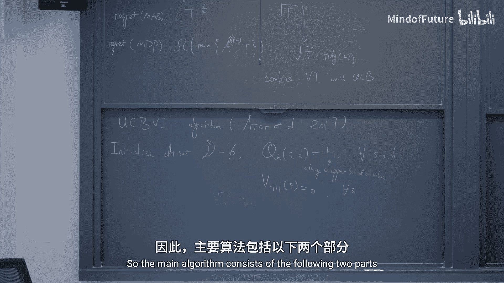

Again， the exploration setting， we need to say four episodes。K from 1，2。To capital K。

So in each episode， we we we're doing two major stuff。 The first step is actually， were doing the。

 we calculated in the UB of value， upper confidence bound of value at each each step。So。

 this is about。Compute。UB。Of values。The idea is basically just doing better plus bonus。

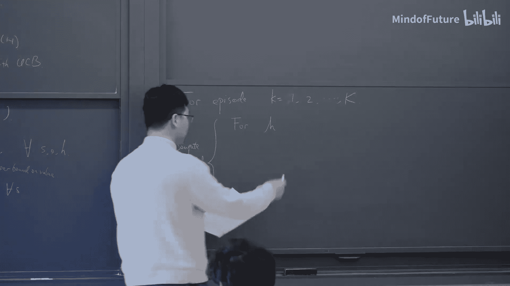

So we again doing when we do value tri， we start from the very last step to the first step。

We start from capital H to H minus1 and the ti1。So what we do is we first check if this state action pair。

If this S A H is already in this data set D。 So if， if in a data set we have。

 do we have ever observe an S A pair at H step。

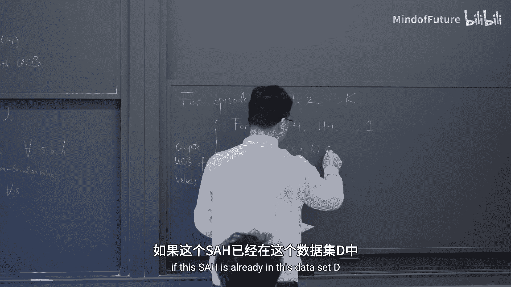

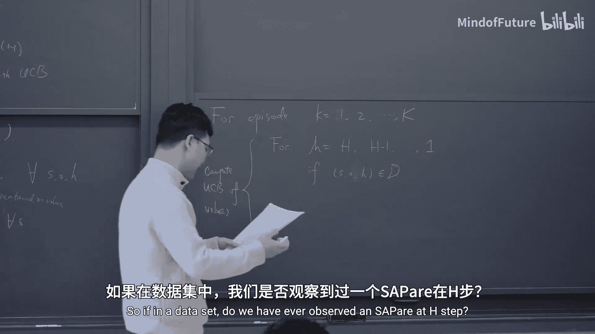

If so， we can compute。This empirical estimate， we again use the empirical average as my estimate。

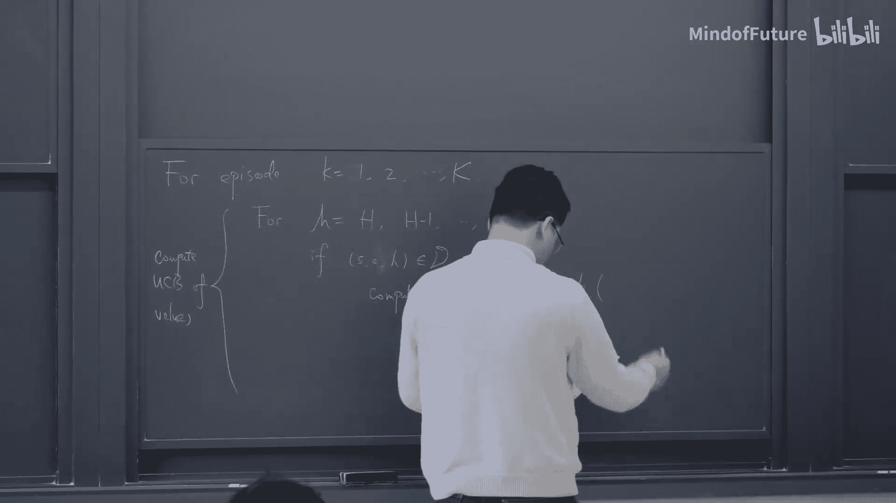

We use the ratio， like how many times we have observed S as prime pair in the data set。

Divided by how many times I have observed S A H at H stuff。 Those are counts。In dataset set。

So the only difference is like in the simulator setting or generatorrative model setting。

 we kind of we sweep over all the state action there so we can guarantee this is like some fixed number。

 NSA is fixed number now because we're doing exploration sometimes we might never be able to visit some state action so that one will be zero and we will treat it in some other way。

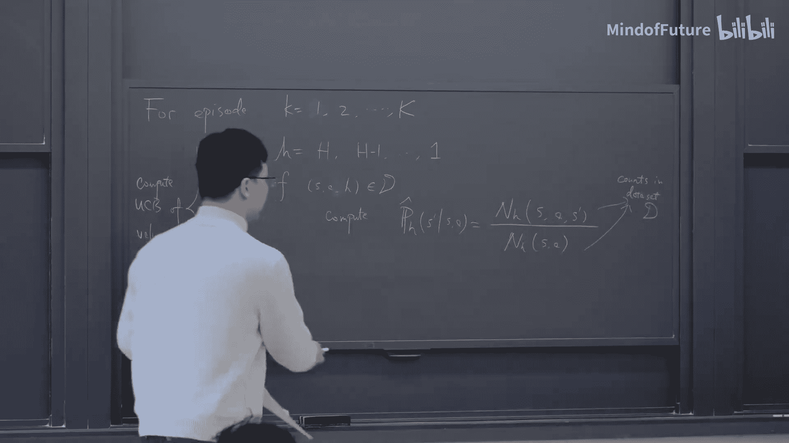

So as allow this is not zero， we can use the empirical average to estimate the transition。

And then all we do is we just do that。Valu update。Slightly modifiers。

Refers to some truncation so that we guarantee the value creation。

The value we got from ve will never be greater than H， which is our upper bounds。

 always an upper bound。And then we just use the Belllman update to do。

Bll up it and replace the transition P by P hat。And this is a standard value update。

 So our modifications， in addition to doing this， we also add a bonus。And the bonus will be only a。

As a function of N H SA， as how many times we have observed essay A at each step。

So basically this step is we just do value tu， but with this replaced by empirical estimatess and adding some bonus and also doing some trunc。

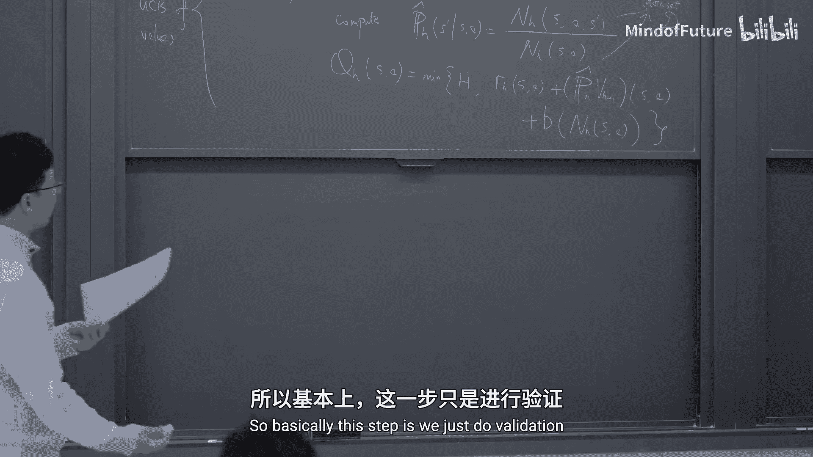

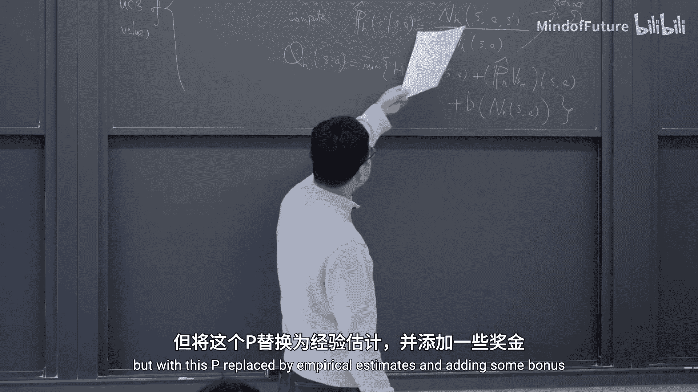

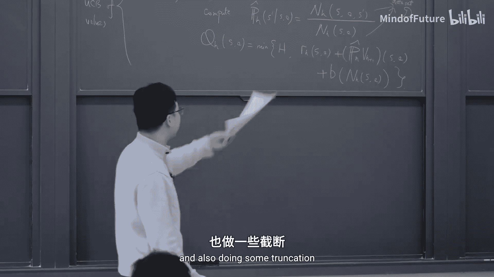

And in the case， if we haven't observed S A H in the data set， Basically， we won't do this step。

 And we will just the Q value will be remain as the initialized Q value， which is capital H。

 So it's still well defined。 Q value is well defined。 It's just is' not according to this update。

 but it's just H。

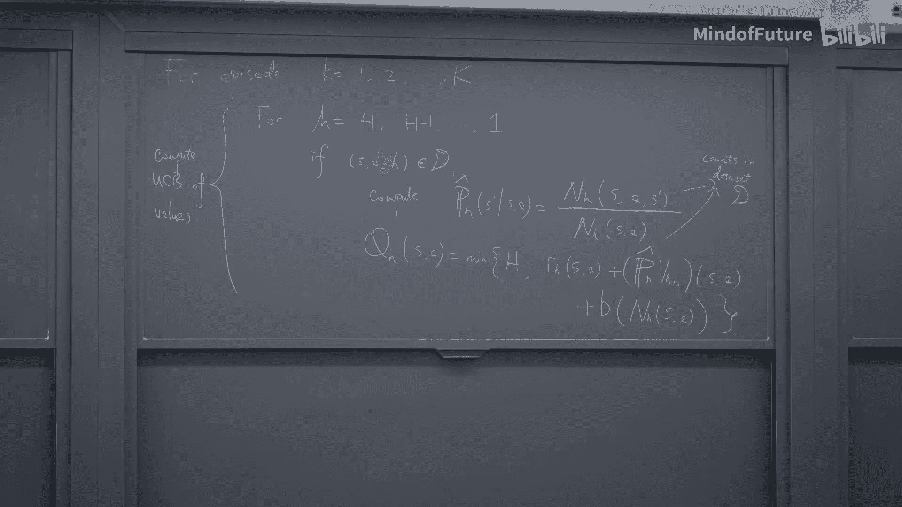

So the next step is。Sorry。Sure， Mr。This is thing for。O SA。So this is a Belma update for Q value。

 So next we will do Belma update for V value。

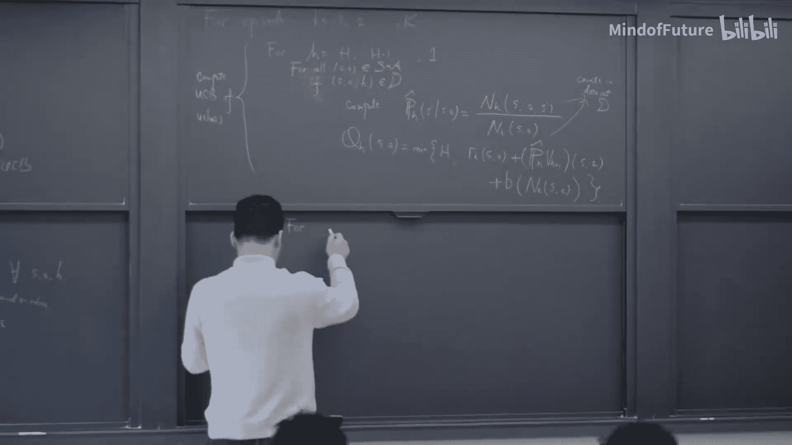

Which is essentially the same for O S S。We do this VHS。Equal to max。A inA。QHSA。So again。

 when for any essay has already been observed， we the Q value is defined in here。

 And if the essay has not been observed yet， the Q value will be the initialized Q value。

 So this V value is， again， also a well defined thing。So basically。

 this entire part is how we're gonna compute the UB of values。 The header value is very simple。

 It's just we replay。 we add a bonus to the Q value updates。Okay。

 and there are other variants for it。We're about a patient to say the queue is minute。

Why do we want to have this。Because sometimes like in the ver， we will see later。

 this bonus is something like a one over skirt then。And times。C times H square and log term。

Something like that。 So in in in some case， like when n is not。Not not very large。 like， for example。

 if we only observe one or two values， we may add a lot of bonus。And in that case。

 my Q value will be very large。And cumul very large goes down to the next step when we talk about like how we construct。

The is this bonus。 I think the main， main reason we construct this bonus is like we want this to be an upper bound。

 And if Q value in the intermediate Q value become very large。

 and then they will hurt the entire proof on how it becomes an upper bound， because essentially。

 we want to do some constitution。 So we will see the reason。Later。

 but mostly just so to make sure like this Q value is well controlled。 It's not like extremely large。

 and everything is well behaved in terms of concentration and statistical error。

I think this will not happen if we don't add this bonus like this。

 only this bonus can make this cube like extremely large。So that's why in the earlier step。

 in a simulator setting we don't do this truncation。Yeah。Okay。

So this is a part about we just compute UCB。But after we consume UB and the other step in the multi arm benefit is we will take greedy action regarding to to the like upper confidence bound we we compute in the multibe setting is basically we compute the upper confidence bound for each arm。

 and we just take the arm has highest upper confidence bound。 Here is essentially the same。

 We will just take greedy action regarding to this Q value。 We compute。So for H from one to H。

We will take action。AH。Is equal to a max。A inA。QH。SHA。

And we will observe the next data and next states。S H plus one。And reward arch。Yeah。

And then we just add this， this tuple to the data set。D is equal to the union with a new tuple。

That is， at each step， we observe S， H。B。And S H plus one。

So the second part is essentially execute greedy policy。

So you can think this is just like reinforcement MDP version of a UCB algorithm。

Instead of like adding bonus to the value of each arm， you adding bonus to the。

To like in the Belman update So that a computer upper bound of Q value。

 And then you just take a greedy policy regarding to this upper bound of Q value。Any questions again。

D is the data上 use this data this data。Okay。Yeah， I think， I think I swapped a little bit。

 You can think this is a。If you are rigorous if there exist any DHSA。

 and it can be anything indeed D。 that basically exists is I have ever observed an S A pair at each step in this dataset set。

So what is the D NH essay again？All， that's just like literally。

What D ofH at the end of that QH essay？唔玩咁食唔使。Sorry。喂 okay they。好开子。Oh this one， Yeah， this is a bow。

 our choice of bonus。Yeah， we'll talk about that。So basically。

 we already mentioned here our choice of bonus。The bonus is only a function of the count。

 Like how many times we observe this essay pair at H stuff。

And this choice will be equal to C some constant times square root of H square uda over an。

Where this Yo is just some log factor， like log SAT T。Overpe。

So we will actually show why this construction of bonus is valid and you will see like why this thing kind of happens。

So essentially， this bonus reflect our confidence of。Of like this value after seeing it at n times。

 So it somehow reflect a fluctuation。Of random variables。Bounded by edge。Because eventually。

 this is like something random， according to the value。So after we introduced the algorithm。

 we will now talk about。Like what kind of guarantees we can provide for this algorithm First。

 any question about the algorithm。Every wasn part is just more or less like a time time series version of the UCBL wisdom in the Malian Ben。

Okay。So because this is like an exploration setting， we will also talk about regret in MDP。

 And in the last lecture， we already says like once we get a regret。

 we can easily convert it to the sample complexity。So regret is even stronger noa。

 I think in a lot of reinforcement and setting we don't really care about regret。

 but you can think this is like a convenient way of getting sample chemistry as well。

So in terms of regret。In the MDP。We can also define a regard up to K round is equal to K。Times the。

Opttimal value。Subtracted the by the value we get at every episode。V1派 K。I what。

This is like the total value if we always play off to a policy。This is value。

Achchived by the learner。Okay， so it's the same definition。 The only difference is like replace the。

 the reward of each arm by the value of MP。

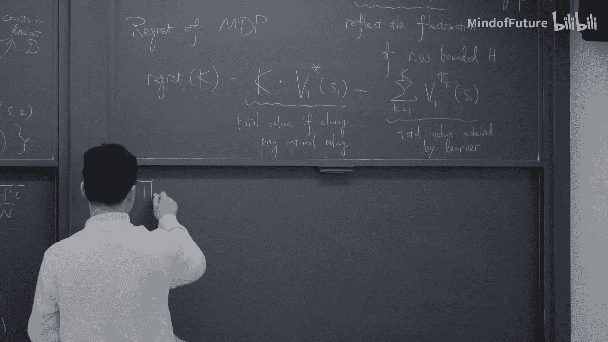

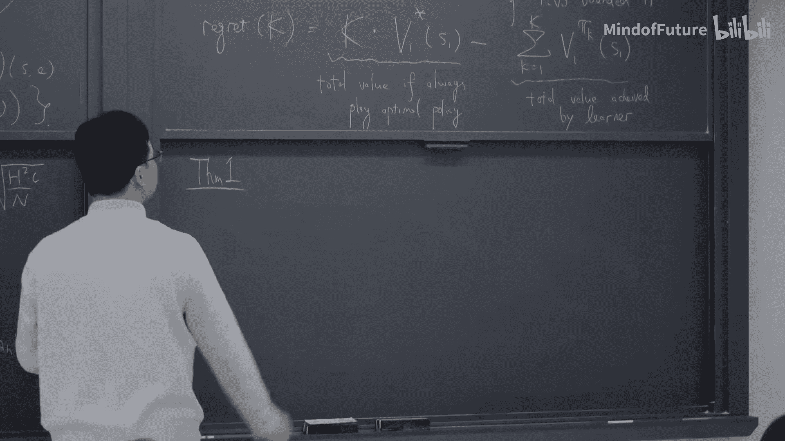

Okay。So the most important theorem we will say is actually， we can show which probability。

At least1 minus P。The regret。Of UCBVI algorithm。Is upper bounded by the following。That regret K。

It's upper bounded by。Some concern， see。Time是。The square root of。H。Cbe。SAT。有的。Plus。H cube， S square。

A。Yda Square。Where this T is equal to Kh。You can think you can also put H to the fourth。

 So regret up to K round is。Is this amount。 So sometimes people write in T because T is the total number of steps you observe。

 And in case the number of episodes you observe。I's see。Where this yoda is again。

 the the logar rhythmmic term。Usually， we don't care。 It's just SAT over。Basically。

 you can log everything。A log H SAT。I think we can also put a niche here。

 it doesn't really that matter。AndLet's so。Oh， we already have urge。Yeah。

 I think SAT T is fine because T is like K， H。 So T is already containing H inside。

So we cant like notice this is like the formal theorem。

 But basically if we want to know the like leading order term， this is like square root T term。

 and this is something independent of T。 We know regret will be something like the worst case regret will be grill like a linear in K。

 So the square root K is already something non non trivial。

 And this is like something constant independent of K。 So this is like the lower order term。

This is a leading order term because square root K。

 this is a low order term because it's independent of K。

So what we really have done is we can like achieve this， this guarantee。

 can like already say something like that。 We get square root T or square root K。

 But the most important thing is we don't pay anything like exponential in H。

 as in the random exploration or Epsilom greedy， where we basically only pay par number in H。

In the worst case。Like the order。Yes case like larger。So the question is the T term is order of K H。

 K T is just exactly equal to K H。I'm saying we care about what the regret is。So that's why。Yeah。

 this term matters。 This is the leading term because this is like squirl K term。

So now we'll talk a little bit more about like why this algorithm would work。

 Like we intuitively say this is just adding bonus similar to UCB， so actually。

Be a bit more concrete and improving in theorem1。So in order to do that。

 we will introduce slightly a bit more notation so that we don't confuse with the quantity。

I think the most important location is we'll add a superscript K。The reason is here。

 we kind like repeatedly like we update Q value based on the new data。

 and it kind like a little bit confusing if we just say some Q value。

 because at each different episode， the Q value is actually different。

 So we're just adding a superscript key to denote the quality。Computer at episode， K。Okay。

 for example， like we have a N HK。S A S prime。Okay， so essentially， in an algorithm。

 we have this NH essay。 But here， like to be very specific about which episode like the。

 the number is， is showing up in which episode we will like to add a sub superscript here。

 And this will be denoted as a number of。H S A S prime。嗯。Observed。Up to episode。And similarly。

 we will also use the P K。At H S prime S A theynoted the empirical transition matrix with computer at a case episodes。

And Q value。At case episode， we value I case episode。 essentially。

 we just you know the those notation。These are the values。Yeah。And finally， we will say this S。

HK A H K。I will say S 1 K， A 1 K。大大大TS capital HK A capital HK。

This is a trajectory collected at episode， K。By the way。

 I forgot to mention that theres one thing we need to be careful。 like in the value tu。

 it turns out in the episodic setting， we only do one path of value tu。

 But here in the exploration setting， we notice that once we at every episode。

 we are collecting one new trajectory。 and after cuttinging one new treasury。

 we do a full path of value tu。 This is essentially like we recomp。😊。

A valueu traditional path at every。Episode， so this can be like costty in the end。

 And we will talk about another algorithm killing later because of this。 This is require compute。

4 path of V I。At an average episodes。So this is like very costy。

Because at every episode we only observe one trajectory， however。

 we're kind of updating all the values。We're updatinging all the values because it can relate to like late like the value in a later step can be updated。

 So we can like we need to recomputer everything。 And this is like very cost。Yes。

 what's the world over。Comp。For four parts of V I，4 parts of V。Okay。So with this new notation。

 essentially the way we're going to prove theorem1 is very similar to the UCB in the multiium Ben。

 we essentially have two steps。One is we will show。That。K coach， I say。Is a opera bound。Of a。

C storage， I say。So this is by the name of UCB， essentially the way we construct we design this bonus。

 we want to ensure this is true。And the second step is we do the regret analysis。And by UCP。

 we were eventually able to show something like regret。Its smaller than summation of all the bonus。

And this is what we have been done for the UCB setting in the multiam Benit。

 like up to some constant。 and here we will do something after small terms。

So the second step is a little bit tedious for for this like a lot of computation in the like for the lectures。

 so we will leave the second step to the to lecture notes if you're interested。

 like you can look at a specific calculation about how to derive the regret bound， So in the class。

 we will mostly focus on the first step， like showcase why our construction justify this is an upper bound。

So we will do this in lecture。Do this today。And this will defer to。Lecture notes。So formally。

 for the first step， we need to prove dilemma。 essentially， this is。

We just make this statement more rigorous。This step more rigorous。

 we say with probability greater or equal to 1 minus P。We have。QHK。S A greater than Q star。Iay。And。V。

 HK。S。Greater than V， H star S。For any。S A H。Okay。In。Set of state， set of action。

And the horizon is up bounded by H， and。And this episode is a bounded by capital K。So basically。

 throughout at every step and throughout all episodes we will always maintain with high probability。

 this our compute Q value will always be an upper bounds of the value of the optimal parts。

Any questions about the statement before we proceed to the approve？

So essentially the proof a lot of times of reinforcement learning is。Is basically by induction。

 So here again， we will do the induction。We will do from capital H。To one。So， the base case。

B cases is for the H plus one step， because in the algorithm。

 we never update the value at H plus one step。 So this is not updated。

 So that means at every episode。My value at each plus one step will be always equal to the initial value we set。

Which is equal to 0 and equal to the optimal value。

So the base cases pretty straightforward straightforward it。Okay。So， now， we assume。

We have a VH plus1。Okay。As greater equal to the star， which plus one is。For O。

That is for all the later steps we already guarantee this a Vh plus 1k is already the upper bound of a V star。

So not， so now we want to do the inductions to prove for each step。

 we still have the value is also an upper bound。So we divide into two case。

The first case is if state action。HSA。Is not in decay K。

So that is this HSA pair has not been observed in the data set up to case time。So in this case。

 we haven't update。QH K， I think， because if we don't observe it and we basically a skipped update。

So it will still remain as an initial value， so this Q KHSA。Will be equal to theH。

 which is initial value。Which is clearly in the upper bound of。C star， H S A。And on the other hand。

 if we have observed this。And then we kind of divide it into two steps， divide it into two cases。

If we already know。H is less or equal to R H。I say。Plus， what do we have like。分手里的皮 hat。H S A he had。

VH plus酸K。S， A and plus bonus。嗯。In this case， because were doing the truncation。

 we kind like we know the Q value will be equal to H。

 because remember in our we're doing the minimum of the two。S equal to H。And it's， again。

 greater than kill storage I。So the only non trivial case is the otherwise。

 like this is actually smaller damage。So the last case we need to do a little bit calculation。

 this is basically the reason why we picked this specific choice of bonus。So， we look at the。Q K HSA。

Subtract by Qstar HSA。This we we can basically by the update equation。We immediately know this QK。

 by definition is equal to。PHK Pha hK。V H plus1 K， I say。And plus bonus。

And a subtracted by a second part， which was bibelman equation。P， H V， H plus one star。Iay。

So essentially， we just use， expand this use update equation， Exp this use Spel equation。

 and then we cancel out the reward。So we can rearrange the term a little bit。We say this is equal to。

皮ha奇HK。VH plus oneK。Subtracted by V H plus one star。I say。Plus， P hat。Cch。Subtracted by P，V。

 H plus one star。I say， and finally， I'm adding the bonus。A fee of。NHK。I see。Okay。

 so all I'm doing is we subtracted this Pha V star and add the Pha V star back。

 So I didn't do anything。 It's just we can' decompose a difference into two parts。

The most important reason we decompose those terms into two parts is。

We can basically in like conclude the first term is greater equal to 0 by induction。So by induction。

 we know this is equal to 0， a greater equal to 0。Because we know for any step in the future like H plus1。

 we already assume this is already an upper bound。So once this VK is an upper bound of V star and if you just apply some transition on something positive。

 this is， again a positive thing。 So this will be immediately greater equal 0， this is fine。

So in order to make this QK to be an anotherground， all we need to make sure is the second term。

We want to ensure the second term greater equal to 0。Yeah。

And now we become very familiar with this theme because。Essentially。

 what we want to do is we use a bonus term to cover。Some like a。stochastic term。

 which turns out this is like a summation of independent render maybe not not independent read， but。

 but like summation of Martinro terms and eventually。

We can say as long as we use we use some hoing down， too。ととです。So to more specifically。

We can say half things in quality。Guaranteees with probability here。At least1 minus P。For all。K。

 H S A。We have the following。 That is this。P， K， H hat。Subtract by P， H。V， H plus one star。I see。

So the， so this P V V star is the expectation。 Well。

 this P hat V star is the empirical average of K of of like N HK independent。 sorry。

 the like Martin go samples。 So we can see this is less equal to C。Times， Sir。H square Yoda。

 where H square is essentially the skating of， of V。 So we know this is like bounded by H。

C times square yoda of。N，HK。I say。So this is just by halfing in quality。

 essentially we have this many items summation together。We' taken average。

 and we know the convergence is like one over squared van。

 so this is why we put a one over squared vent here。And we specifically choose to so that we。

 we manage match the bonus。Essentially， we， we make the bonus to be。

Exactly equal to this or maybe greater than this by some constant factor。 And this is。Yes。I mean。

 so is this like a worm bill that uses it？バステ or。I think this is essentially the same thing we talk about in a UCB scenario like if you still remember in the UCB scenario。

 we also need to like in a multi band case， we also need to do this type of concentration we're saying this is essentially a halfing inquiry there with only difference that this NHK like the number of times you put that arm here is also the number of times you visit the S K is like random。

So that's why you kind like， you need to do a little bit more advanced techniques in。

 in addition to just the hoing。 you need to like do ama hoing。

 which which is is is the same same like。Similar argument to USA you。To handle the randomness。

In this account。N去KS。O。So this essentially justified our choice of bonus。

 and we can essentially just put a bonus here。And。And we say like this will with high probability cover。

 whatever the activity happens in this like concentration term。

 And so we can guarantee this is greater equal to 0。And definitely the proof。There was actually。

 one more step there。So the very last step is， very fast。So once we prove this QH K S。

Is greater or equal to Q star HSA。For O S S。We just say the V V value is also the same。

 This implies that V HK， S。Is equal to the max。Over a。Qu。HK，SA。

And this is greater or equal to we taking max。Over a lower bound， that is a pure star。I trust say。

Which is equal to V H star S。So essentially， we can use this to finish the induction and everything is done。

Okay， as we says， eventually the proof of theorem1 will be just some regret analysis。

Because we already prove the upper bounds。 And then we can essentially leverage this fact to show that regret K is less so equal to。

Smation of the bonus。Where specifically is something like pay from one。And H。Of this sub bonus。At NK。

N， H， K S，H， K。A H K， so we were only counting the bonus at the state action we visited at the case episode。

And plus some small terms。Some odd small concentration terms。So we'll leave this to lecture notes。

But I just want to emphasize like this is usually the way we prove the upper bound。

 like UCP algorithm， first we prove it's upper bound and then we say regret it's upper bounded by bonus。

So we can see from here， we cannot just like if we only care about the first part being upper bound。

 we can just make bonus to be extremely large。 Like， for example。

 I always pick Q value to be capital H。 And that's clearly an upper bound。

But the problem is eventually the regret is going to be bounded by some constant times of bonus。

 So in that kind of case， if we make the upper bound very loose， this bonus is also very loose。

 and this entire regret will suffer a lot。 So essentially the key point here is like we want to make this upper bound as sharp as possible。

 So in this case， we essentially use a concentration inality to to do the upper bounds。

And then eventually， we can do the regret。Based on this。あ九。QK， upper grounding。Q star。

 Why does that like， how does that relate to the boat。U bounding bonus。Sorry。Right。

So I'm saying for the Lamma 1， we can actually choose bonus to be very large。 So， for example。

 in here， all we need all we say is like as long as we choose bonus greater than this Hing concentration。

 We can actually guarantee this to be an upper bound， right， So basically。

 we can choose any bonus that's greater than。This， so that won't hurt the Lama 1。

 but that will hurt the second step where we prove the regret because regret ised by the bonus。

 So that's why we want the sharp sharpest bonus as we can。😔。

So another thing I want to talk about is a design of bonus function。So， it turns out。

This UB value UB via algorithm， the design of a bonus function actually matters because this bonus function actually not only affected analysis。

 but also affect algorithm， because in the algorithm， we explicitly need to add bonus to the value。

 And then we collect data according to the greedy policy compute by this like upper bound on the value。

 so。This design of bonus function actually affect the algorithm and the data we collect。

Or trajectory we collect。So this is why it goes back to the previous point。

 I said want we want to essentially use the sharpest bonus function we want。

 but on the other hand like it's still like a computable。

 it doesn't depend on some uncomputerable quantity。

So the way we introduce the lecture like this B N is equal to。Like H。Square Yoda， C over N。

 This is like what we previous did。 This is like， essentially designed by。

Halfing's concentration in quality。So as we learn from the Constitution inequality， we actually know。

 like this is Hoffin's concentrationequality is not the sharpest concentration inequality。

 A lot of times we can actually do brain inequality， and that's actually give a shopper bound。

 So it turns out you can also design a。Improable shopper bonus。背伤本的硬口里。

So presumably this is going to help so the only complication here is because Bling in Q actually depends on the variance where the variance like like which is different from hoing which essentially it's a bounded random variable we know it's bounded by h so we just directly put an edge here Well here we essentially need to estimate the variance。

Yeah。So this create a lot more， a little bit more like steps because we we essentially we don't we don't know the variance。

 So we need to estimate the variance and use the estimate the variance into our like a bonus design and analysis is a lot more involved。

 But eventually if we make everything work， you can actually improve。A square root of H factor。

In regret。So what I mean is like actually doing a sharper bonus。Indeed。

 going to help in terms of a regret。 So originally， we get some square root H to the H cube SAT。

 And now we get a square root H square SAT。Okay。So any question up to now？

So after we introduce the entire like use B VR algorithm， we want to revisit the。

The hard instance we talk about which， which， which。

 which kind of vehicle very difficult to exploration the combial log。

Like why UCB is able to solve this problem。If you still remember， Com Lock is a two state MDP。

Where essentially， there is only one specific action sequence。

That eventually going to reach the end state that S 0。Everything else is gonna leads to。

The absorbing state S1。And never goes back。So we say if we just do some random exploration。

This problem， actually。Its very difficult because the chance we sample precise action sequence that a one star。

 A2 star， a3 star T O A H star is like exponentially small。

 and it's extremely difficult to find this optimal policy by just doing some random exploration。

However， we can see by doing UB， it's actually。It's actually doing a lot better in a sense。

 like it eliminates incorrect action very fast。So we will essentially start with all the value。

To be like H or the Q value to be H。So after we observe some multiple trajectories， for example。

 at this step。If we observe some， a lot of other actions like in addition， which is different。A3。

We notice the secure value of other actions that is not a 3 will like decrease very fast。

 So it will go， goes to 0， like very， very fast。 So in that case。

 well eventually very fast eliminate the incorrect action。 We， we will like do this step by step。

 and eventually we will be able to find this optimal。😊，Value， like in some part of a time。So。

 actually， the。So essentially， whole idea is， again， we will do the dynamicyna programming type of。

Way to find the optimalim policy。OkaySo this also says the combinator lock thing is actually only hard for specific algorithm。

 like for random exploration， it's actually not very hard for well designed algorithm， for example。

 for VIUCB， we can actually guarantee this one will not suffer from some exponential age and this actually with panoral time。

 we can already find the optimal policy。Okay， so the reason why it decreases is because of when you triggers。

Incorrect path then that increases the sample of that。Right。Okay。

So this is about how we're going to combine the upper compete bound idea with value。

So remember in a simulator setting， we not only talk about value。

 we also talk a k learning algorithm， which is doing incremental updates。

And we also noticed in the VIUB setting， we noticed there is one very big computational problem。

 like in every episodes， we need to do a four path of value duration。

 although we only like observe one trajectory， but we need to do the entire path。

So essentially we will see actually we can we can do the Q learning with UCB as well。

 and this algorithm will actually fix that computational issue and be the truly online learning algorithm。

So the algorithm is as follows。And this is in our previous paper in 2020 in 2018。So again。

 we initialize all the Q values。To B H。AnNH essay。Equal to 0， that is the count。For allHSA。哦。

So we do the full loop。That is for episodes。Okay from one to cap O。We first to receive。First state。

 initial state S1。And then， for a step。H equal to one to capital H。

So we no longer decomp the entire thing into two， too big trunk like the VI or collecting data。

 So the benefit of Q learning is like we do incremental update。

 So every time we collect one new data， we would immediately do the update。

So we can like combine the take trajectory with with this value update。So well take action， A H。

It's equal to agon max。AOf， of the current value， we。We maintain。And observe the next states。

And we will set some tea。Is equal to count。Of S， H， A H。Which will be incremented by one。

 because we observe this S， H H now。So this NH S，H H is always the count。

 How many times we have observed this S， H H at H staff。

So the most important part is we do the secure value update。So there's a Q H S， S，H A H。

If you still remember， the Q value is Q learning output is equal to1 minus RF T fraction of the previous Q value。

🎼2 H， S， H， H。Plus， the r fat T fraction of the new value。Our fat fraction of the update。

 where update is equal to the reward。Plus， the value。

Of the next step taking on the states we observe in the current data。And plus a bonus， B。

 where B is only depends on this T。So again， we're just adding in this bonus。

Where we choose this bonus is equal to。See time， Sir。With slightly worse dependence on H， H Yoda。

 H cube Yoda over T。And then we just do the V value is equal to the max of Q value。

 but trumpated with H。That's it。So we see this there's no need to compute the。P hat。

 which is the in like the estimate of transition。 Well in in this entire key learning。

 we don't actually compute P P hat。 So this is typically considered as a model free algorithm。

And also， we only。Update。The value on trajectory we visited。

So instead of doing a four path of value tu， which should need to essentially recompute the value for all state action and H at every step here。

 we only update the value at the state and action we visited。

 So this is a lot faster in computation than than V IUB。And also， remember。

 we have this select memory。Memory advantage。Yeah。So again， key thing here is。We need to。

 we need to essentially put more。 remember in the killing。

 One very important thing is doing like this bias variance trade off。 So we need to put more weights。

On later updates。To like， reduce the variance。Which kind like。

 if you still remember in the similar setting， which is equivalent to like choosing。

Choosing this learning rate alpha T is something of other。HOT。

So we noted if it's chosen as one over t， this is exactly equal to like a uniform average。 Well。

 now I'm like putting it greater than one over t。 So that means I put more weights on the like later updates than than the previous updates。

So once we do this， everything like that， we will essentially be able to prove the next theorem。

With probability。G to equal to1 minus P。The regret of children U B。Is that most。

Unless's what you could with see。Times square root of H to the fourth。S a。T有的。Where Yoda is again。

 a lock term。And we also noticed this regard is one square root factor worse than。单UBVI。

This is due to the same reason like this is like incremental updates， similar in a simulator。

 in a generator model， like simulator setting， we also observe a slightly worse sample complexity because we essentially need to favor the later updates so that we we know we're not handling noise as good as like VIU B。

 which is like you basically remembering all the data and and use the smallest like variances。

Here's online updates and we're kind of scrolling away data。

 So we're less efficient in terms of sample companies than the use of BVI。

I think we're going to stop here today， so starting from next lecture we're going to summarize this exploration setting and then start talking about a little about yes questions。

You said there's less weight on。对然。weや。アティで。That' way don't like what's going out of。

So so alpha t is always need to be decreasing because you have more and more samples。 So。

 so even if you're doing uniform weight， you should expect alpha t to be decreasing because like if you have t data。

 every data only get a weight1 over t。 if you had like2 T data。

 every data should only have like weight1 over two T， that's the uniform。

 So I think I think in the last lecture the lecture before we can like we exist mentioned if this is a one over t。

 And by doing this one minus alpha t fraction of previous one and alpha t fraction of the new update。

 you get a precisely uniform average。And whatever you， you make it greater than1 over t。

 then it's like a favoring later one than the previous one。밖도 나온。Q点。Fster to compute in UCB B I。

 but also less simple。So， so the faster to compute in terms of a pertuation。

 It's per episode is much faster to compute。 But the last sample evolution means like is。

 it probably need slightly more episodes。So but overall， then keep what it keep using。Will not。

 because this is this is only like a square root H factor worth in terms of semi。

 So that means essentially you need H more factor like of episodes but per episode。

 you are only like computing one trajectory， like update one trajectory。 Well in the UCB V。

 You're essentially doing a four path of evaluation that you need to look at all states and all actions。

 So there essentially you have a S A factor more in terms of computation。

So there's a trade off there， and in the next lecture we'll actually talk about that tradeoff。

