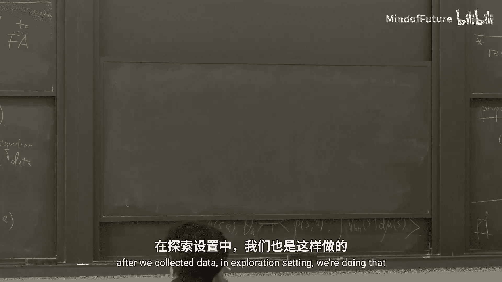

# 【普林斯顿】强化学习基础 ECE524（Foundations of Reinforcement Learning，2024） p13 P13 RL in Large State Space -BV1a2frYfEk4_p13-

Okay， I guess let's start a lecture today。

So for this semester， so far， we have been focusing mostly on the tabular setting。

 where we have finite a number of states and number of actions。 So in the next two weeks。

 we will advance to a new topic， which we deal with a large number of states and large number of actions。

So typically， like its large number of states。So we will deal with the new topic that is reinforcement learning in large state space。

Okay。So by large space， the methods we're going to do is called function approximation。

 So we'll introduce what are those things later。So in this week and the next week。

 we will basically dealing with this topic。 So we will divide it into three parts。 First， today。

 we will do some overview what are the challenges in this large day space and what are the basic methodology for function approximation。

And then we will deal with a simple case。 We will deal。 We will do the linear function approximation。

Because basically， everything will， like， as we do in theory。

 will start everything from the easier case where easier case essentially。

 we will approximate value policy by like linear functions。

 And after we study the linear function approximation， then we will talk about the general function。

 approximation essentially generalize how what we learned the principle under this linear function approximation to generalize version。

And this will be topic of the next week。Okay。So let's start with the overview， then。

So we will talk about what， what do we mean by reinforcement learning with a function approximation。

So let's just recall that we have been talking about tabular MP so far for this semester。

 And if you still remember one thing very important we discussed in this class is called sample complexity。

So the sample complexity for learning interpreter MDP。

Is something like the following that is a poly H， where H is the horizon of MP and S S this number of states。

 A is number of action over Epsilon square。This is number of samples。 We learned the tap MP。

 like either in generator model like simulator setting or in the online setting or in the offline setting where we pay the select con coefficients。

I think the most important thing is this is like linearing us。But as just we said。

 in a lot of practical scenarios， we want to deal with this large stay space and a lot of practical applications。

 this number of states is like really tremendous。😊。

Let's just first think of example were in five or three or five years ago。

 a very famous paper on reinforcement learning is basically they first knows how to use deep neuraler networks with with like reinforcement learning to solve a very simple like entire games。

 but with like50 different entire games。So in each atara games， the number of。States。

Its essentially corresponds to。Each different states。 Okay。

 so we can talk about what is the roughly number of states of in entire games。So basically。

 each different states。Corresponds to。Different pixel values。In the image。For those game。

 this is like a video game。 So， so it's each each different。

 like where we have like like around 200 different pixels in the in each image。

 and each each pixels has a also about like 200 different values。 So this gives a tremendous。😊。

Different possible numbers of states。 Basically， if we're paying something linear in S， we're。

 we're kind of screwed。 like no algorithm in practice can pay something linear in S。

So we cannot afford leaning states。Samples。But to be for basically any set all settings。たさんそれ。

Most algorithms， if， if you're doing like too terrible， like algorithm is like too bad。

 then then you won't do this Yeah， But in in this， in this class。

 we talk about value and some variant of value。 Also cu learning。

 they all have like this type of guarantees。 You're right。Okay。So first。

 we notice the number of states is like really， really large in those kind of applications。

 so you cannot really afford anything like linear in S number of examples。

Second thing you observe is。In practice。We may never。Visit the exact same state twice。

So the thing is likely the robotics。Where essentially。

 you can think the state is represented by some real value。

 like in the like in terms of positioning in terms of joint angles， something like that。

 And if it's a real value， it's very difficult to basically experience the same exactly same real value。

 like the twice okay。So in this kind of scenario， this is also related to our old strategy intular MP。

 basically in the similar setting。 We just try other states。 And in exploration setting。

 we're essentially doing similar stuff where we basically look at different states。

 If some states really visited。 We will just try to visit that states。

 But here it's kind of saying we it' just not possible to visit other states。

 So the same strategy will not work。ok。So this kind of all hints to in the like large day space scenario。

 which we need some new mechanism， which we haven't been talking so far in the tableular MDP。

 that is so called the generalization。So this is a new thing in the function approximation。

 By generalization。 we means we want to learn a generalization。

 There are a lot of different generalizations in in the learning scenario。

 like in terms of overfitting or that kind of generalization or out of this regeneration。

Generalization here， we specifically talking about generalization where we want to generalize from the observed states。

This is something we have seen so far in the in the data， or we have explored。

 We have played in our data。 But we want to generalize the stuff we learn from the observed states。

To unobserved states。Okay， so this is what we really want to。Dweis。And， of course。

 there's like no free lunch in terms of the， the， the way we can generate from observer states to unobserved states。

 Basically， we need to encode some similarity measure between those states。 Only if we。

 we assume like with some prior knowledge， we know states are similar。In some specific way。

 for example， we know like in playing entire games。

 if certain one or two pixel are change by some small values。

 those image should be very similar in that kind of scenario。

 basically we can encode some of our prior knowledge so that we can talk about what states are similar and we can do this generalization。

So the key here， key to this generalization is we need to encode。Seminarity structure。Between states。

Or monsters。So once we have some prior knowledge about similarity。

 we can generate from observed states to unobserved one。So this leads to basically the main approach。

 how we're gonna handle this large stay space。Scenarro。

So the approach is called a function approximation。So in a high level。

 a very simple way to encode such a similarity structure is basically parameterized。Like either。

 like either models， values or policies by specific， like class of functions。

So this is why this is called a function approximation， because we no longer。

We no longer like as a tableular setting， we， we essentially。

We essentially that remember the value for all the different states and remember the model for all different state action pairs。

 where here we no longer do that kind of table approach。

 We just parameterize everything by some function so that they have some。

They have some in imp constraints within those different states。 Okay。

 so several approach we already mentioned there。One thing we can do is we can。Prametized models。

In terms of we use neural networks to parameterize transition probability。

Which is P S prime given S A。 And in type setting， we essentially remember this entire transition probability as a table。

 But here were saying we have to parameterize by some neural network parameter see。

Those are the model parameters。There's our function prim。

We can also say we're going to learn a reward， which is also a function of a S。And Cta。

 where seeta is again， the function parameters。The second approach is we're going to approximate the value function。

Which actually in this class， we will talk a lot about this approach。

In terms of approximate value functions， we will approximate the Q value Qs。By some。Functions。

 neural networks with Premier Cta。And the third approach is we can also parameterize policies。

That is we will essentially parameterize this pi function。A given S by some parameter theta。

And some last approach where in practice， people also do this algorithm called actor critique。

Essentially， parameterize both value and policy。And the actual critic methods is essentially。

 we will fix the value。 and you learn a policy by this approximation。 And then you fix the policy。

 and then you learn learn the value by approximation。Essentially， you learn them alternatively。

So we know the key of function approximation， essentially， is we restrict。Moel。Value and policy。

To be。Certain specific。Parametric form。For example， we restrict the value to be linear function。

 restrict value to be parnomial。 restrict value to be like a two layer neural networks。

 something like that。 And by this restriction， we rarely encode this similarity structure within those。

State， okay， this restriction essentially， we， we kind of encode the similarmer structure。

 And after we do this restriction， we will learn the parameter see。So eventually。

 we no longer learn a table of value table of like policy。 We just learn this primary seat。

 And after we learn a function。 For example， after we learn a model。

 we can directly do planning and we got the optimal policy。 After we get the Q value。

 we can also directly implement the greedy policy， we also get the optimal policy and that policies connect the same thing。

Any questions so far about the select function approximation approach？If not。

 we will basically iterate a little bit about the challenge in this large day space scenario。

So we need to first understand what are those challenges。 And then later we。

 we kind of handle those challenges in theory。 like either。

 either say some challenges too difficult we， we like postpon we， we deal with we deal with it later。

 or we kind of we directly face those challenges。I think as I summarize summarize there are a bunch of challenges。

 I think the first challenge we already mentioned is we call it like sparsity。Sially basically。

 says do a lot of。States that are not observed。And in fact。

 for robotics or for like when you want to play at entire games， the。

 the number of states you visited is actually very， very small。 Most of states are not observed。

 So the sparsity essentially， is' equivalent to like the challenge of sparsity is essentially require our algorithm to handle this generalization。

 We want to generateize from observed states to unobserved states。

And function approximation by itself also introduce a new challenge that is called misspecation。

That is basically by dealing with function approximation。 that is we we say we approximate。

 for example， Q value by this neural networks with some parameter Theta。 But in reality。

 we also have an optimal Q value function。 Q star S A。

 This can also be defined for even like infinite number of states MP。So this optimal value。May not。

May not be able to， to be parameterized by it。C的。Or we can just fasci say the Q star。

This optimal value function may not in our function class。

This is like a function function value function class of F basically the function class contain all the function can be represented by this seat。

 Like， for example， too， all too layer neural networks or all linear function。

So in that kind of scenario， if the optimal value is not a linear function。

 but if we approximate the optimal value by linear function， then we kind of introduce this arrow。

 this so called misspecificationation。 and this will definitely hurt our performance。

And in the third， we also talk about in the online scenario。

 we also need to handle exploration versus exploitation on top of all the sparsity and specification。

And there are also more challenges。So in this class， we will basically handle those challenges。

 and specifically mystifications like very difficult to handle and require a lot of like a new advance。

Either require a lot of new advanced techniques， or there are a lot of like harness result。

 So for in the， in this two weeks。In this lecture。We were basically dealing with well use the approach of a value function approximation first。

Just because this is like also one of the most practical approach。

 which we just directed parameter by value。And we will dealing with this function approximation without misspecation。

So we will handle a simpler setting where to avoid some like a very difficult scenario。

So we will only handle the sparsity and exploration challenge。

So this is essentially the road map of what we will do in the。Next to or four lectures。

Value function approximation， and we handle with sparssity and exploration。O。

So this is essentially our overview。 Any questions so far。If no questions。

 we will directly jump into this topic。 We will start with a simpler setting。

 simpleimr setting where we will first talk about the linear function approximation。

Since we already mentioned， we will restrict our attention to this value function approximation。

 So in this sense， we're essentially saying we're going to approximate Q value by a linear function。

So more formally， what we are talking about is we assume we know a feature map。

We assume this is like given。The agent is knowing a feature map。This map is we denoted as a Poes。

So 5。 And this map is a map from a state action pair。To a dimensional vector。

So this is like a feature map， essentially encodes a state action by a d dimensional vector。

So we say Phi essay。Is the the dimensional feature。Of this state action pair， S pair。no。Yeah， think。

So in general， you may ask like， how we gonna know this feature。 So of course。

 like in a lot of practical scenario， this feature。

Like you either need to learn it or some engineer like hand hand hard code。

 like hard code design the feature。 For example， if you want to design some reinforce some learning for。

 for playing touches。 like you can look at the how many holes you have and what are the what are the next then what are like the index number of the next pieces。

 and in practice， the people realize if you just use like those hand code like hard coded features as a like like some linear feature and you learn some linear value on top of that and they receive like quite good performance。

 So for some simple scenarios， you can actually just hard code features and they will actually perform reasonably well。

So once we have this feature map， we can essentially do the following parameterization。

That we will essentially parameterize all the Q value。By a weight vector， W， this is a weight vector。

And this essentially is the primary seat we talking about earlier。

 This is parameter we need to learn， and we can essentially parameterize all the Q value by W transpose this Phi S A。

Since this feature map file， as we know in advance or some some other people already give give it to me。

 all we need to learn is this W。So， we know， in general。

If we simply approximate the Q value by this linear function， like in a general scenario。

 we know theres a misspecification。 So in general， like Q star。It needs not to be linear。

This will introduce a lot of misspecation。Which is turned out to be very challenging。

 So for quite a long time， we kind of struggle even in this like a simplest scenario where like linear function approximation。

 We don't really know like what kind of guarantees we can talk about。

 what kind of algorithm and what kind of positive result we can talk about for this kind of thing。

 And it turns out like when we have a misspecation。 It's always very easy to give the harness result。

 saying like something is very difficult to learn or something in worst case。

 like we don't have any algorithm able to learn this。So one thing as a first step to understand。

 like linear function approximation under what kind of scenario this approximation would work is give a like a strong。

 sufficient condition so that we can say like doing linear function approximation is reasonable。

 So in this kind of scenario， we will essentially as a first step。As we said in this class。

 our approach is we want to rule out the mystification。Essentially。

 what we're seeing is if a generic case is like too hard， let's understand the easier case first。

 Okay， we will understand well specify well specify sending first。

Well specify setting means under certain assumptions， we will actually make sure the Q value。

 Q star is actually linear。 Okay， Well specify setting in this kind of scenario is indeed。

 Q star is linear。So the question is， what kind of condition will actually guarantee us the Q star is linear？

So it turns out there's a set of simple conditions that will make sure the Q star is linear so that we can learn something reasonable。

The the setting we studied recently is called linear MDP。

So we'll introduce linear MDP and show why it will guarantee the Q start linear。Yes。questionし。Yeah。

 lean in the nonfi feature。If I could be a nonlinear map。 Yes， if I could be arbitrary things。

 So it can be。Some neural networks or something。 But， but basically here， we。

 we call linear because we don't handle the complexity of learning this feature。

 We basically assume this is a lot given already。YeahVery good question， thank you。By linear。

 we always mean like everything is so linear in this feature map。Okay。So formally。

 what do you mean by linear MP。Linear MP is， of course， a special case of MDP。

 So when we talk about MDP， we always have the following elements that is state set of states。

 set of action and reward function， transition， and also the horizon。

So here the S is the set of states。Only thing different from the temperature setting is can in this case。

 we， we even allow this as to have infinite carity。For simplicity。

 we just only handle the finite infinite number of states。 We still restrict our action to be finite。

So the key linear MDP。Is in the how we assume the reward and transition。

 how reward and transition will come from。So in the linear MDP。Essentially， by its name。

 we essentially just say that we require both reward and attention to be linear in the following sense that reward need to be parameterized by this C H。

Trandition。Fi essay。And this is the parameter。Essentially linear MP assumed reward by itself is a linear function of of this feature map Phi。

And also， the transition。Here we use write it in the measure theory language。

Is the transition of starting from S state action pair S to the next states。

Is the inner product of a de dimensional fi。5hi S。Time is a D dimensional measure。Mu。

The vector version of mu。大。So this is like a D dimensional measure。

We' will talk a little bit more about this notation。So by D dimensional measure。We just。

 we really just means each dimension is a probability。Measure。

Measure essentially some like a generalized language for， for probability。 for simplicity。

 you can just think of measure in terms of a。This dot。

 you can put any like measurable set because in general， like states can be continuous。 So。

 for example， if we have some set a。A is a subset。Of。Are possible。Next days。

Let's just say this A is a set of possible next days or like a a subset of possible next days。

Then this pH。A given SA。Just means condition on starting from S A。

 What is the probability of the next days lens in this subset， a。Of S prime in a。

If starting from S A。And by this condition， essentially it says this is equal to some file of S A。

And time， some common measure meal。This and times 8。O， so in this sense， this is a linear。

For it the same both。Reward and transition areen。We use this measure theory。Kind of notation。

 because we want to essentially unify the things of both discrete， discrete。

Discrete probability measure， also the like general。

 like continuous probability measure or like even some mix， like some part of some part is discrete。

 some part is continuous。 So we can always like use this same language like the。 But in。

 in principle， it just means that transition probability is also linear。Yes。我也经。The second one。

 So the， the true answer is actually， this is like assuming linear MP is the sufficient condition to say Q star is linear Qar is linear。

 but  Qar is linear。 You can also use some other ways to make sure。 Yeah。

 we just said this like simple case。As we said， this is like one of the sufficient connection we actually prove later。

 like this will。Allows this to be true。So after introduce this linear MP。

 this looks like a set of like abstract conditions。 So we will first like connect this new notion。

 linear MP to the existing one， the tableular setting。

 And we will also look at some new examples which we cannot covered by tableular setting。

So the first example is Tular M DP。So we will actually see that T MP is a special case of linear MP。

So， so in that case， we just need to specify in a table MP， what are the linear map。

 Phi and what are like why the reward and the transition satisfy this linear form。Okay。

So in the temperature MP， we know the states， the set of states。Its sorry， the number of states。

It's the carna ofs， like this cruteous。And number of action A is the set of。

The carronnide of action a set or finite， both finite。

So what we will do is we will set the dimensionality of the feature map equal to the number of states times the number of action。

This is the dimensionality we constructed for， for tableular MP。And the P S。

The linear map we constructed for the WMDP。Is just the the。

Like unit vector in each dimension and dimension is like encoded by S A。 Okay。

 so this S A kind of encode a coordinate because we have like S A dimensionality。 So。

 so each state action pair like indicates one of the coordinate in each in in one of the dimension。

So this is like indicator vector that essentially says only。S a coordinate。Is one。All other corns。R0。

So what remains is we just need to specify what are cedar and mules so that we can essentially cast tableular MP to be a special case of linear MP。

So what we will do is then。Se。Car H and meo H。So， that。Yi。SA。Transpose。See you that rich。

Is in R is equal to RHSA。This equation kind like says for what are the values of each coordinate of this seeta vector vector。

 Cta， again， is a vector in， in like S A dimension。 is's an S A dimension of the vector。

 This essentially says the one coordinate of the seeta is equal to blah， blah。

 So this fully determines seeta。Similarly。We also need to set the E transpose S A。Mo H dot。

This is equal to。P， H dot S。This also， again， this is like S dimensional measure。

 And by doing the projection onto this little essay coordinate。

 this essentially just says one dimensional， like one dimensional measure is just one measure。

 And this is like saying one dimension， one coordinate of this three dimensional measure is precisely equal to this measure。

 This also for determinants。没有。So by doing though， we have。Past。This taber MP。In the form。

Of linear MDP。And this directly implies that。Tabular MDP is a special case of linear。

So the first case is really straightforward， but also on in some sense， it's not very interesting。

 If the linear MP can only handle the tableular MP， then we don't need to develop the new thing。

 we can like we go back to the what we have been studied for the past。

Like weeks for the past four or five weeks。So we need to talk about some examples which can be potentially new examples beyond the tableular setting。

So we talk about the second example。We allow not only the temperature setting。

 but we allow some simplex feature space。In a simple X feature space setting， we。

 we essentially a lot more general。 We allow as long as this is a features space。

Feature space is essentially constructed as a set of all the possible feature map via S A。

For all possible essays。So it's a collection of all the possible feature maps for any corresponding like state action pair。

 As long as this feature space is a subset of D dimensional simplex。By the dimensionsal simplex。

 you probably know like the dimension simple essentially says all the coordinate need to be greater than one and also summation。

Ne to be。you to be equal口涂完O。な justし。So D dimensional vector or D dimensional simplex is the set of D dimensional vectors。

X， Y to X D。So that。X， I greater equal to 0。For any eye。唔啲。And summation Xine。

 I from one to D equal to one。This is D dimension syn。So if we have featureer space。

 that is a subset of the。Of， of the D simplex， on the other hand。If we have。

Each coordinate of this measure。Is a probability measure。This is the first condition。

 This is second condition。Probability measure essentially says it's not only just a measure。

 but if we you take the whole set， its， it's equal to one。So it's like a probability。So in this case。

 then you can check。RH， P。Are well defined。In a sense， given by this construction。

 if all the coordinate of this meal is a probability measure and we guarantee the feature map is in a simplex。

 we will guarantee this is actually a probability。 Okay， this is not something like crazy。

 giving you some some negative result。 So in a sense， this is like well defined。

And this essentially gives the other scenario where linear MP can make sense。So in this example。

 we allows。Allows infinite number of states。This is example doesn't really care about how many states you have。

 As long as you can， even if you have infinite number states。

 as long as you can map those data action into some like simpleimx feature space and you're ensured that reward and feature reward and transition are like linear functions of those。

Those things。 And then you're in a good shape。Okay。So any questions so far about this？

For that probability is simpleax。It's kind like a just。It's kind like， just。

You can think it's the one norm bore like， like whatever vector on this set is。

 like has a one norm equal to one。But but it also require all the coordinate to be positive。

Positive and positive。And turns out the one norm is like the important thing。Okay。So earlier。

 we kind of we we we mentioned we introduced this linear MP because we essentially want to find some specific sufficient condition。

So that we can ensure there is no misspecation。 We can ensure all the like Q stars are linear。

So it turns out we can even prove a stronger theorem。So we will say linear MDP。Actually， ins。

Not only the optimal value function， but all value function。

 That is the value function of any policy。All value functions。

In the sense of value functions of any policy。20年。So this is the proposition we're going to approve now。

Propositional。For linear and B， P。And for any policy part。Your exists。Vctor。WHI。

H from one to capital H。Essentially， we have one weight vector for each step。So， that。For any。S A H。

 Top。In this set of states， set of action。嗯。We have the following hos。Q pi H SA。It's equal to。5i S。

Inner product。With W H Pi。O， so this essentially says for any policy pi。

There exists a set of linear weights so that this Q value is linear。Because for any policy。

 the Q value is linear。 and of course， for the optimal policy， this is also linear。

And I think we note this is like very strong in the sense， we， we do say this is like for any policy。

We never say this is like linear policy or whatever。 So you can just throw in any arbitrary。

 weird policy that only like even if we have a linear map， we can do some policy that only like。

 for example， for this state。 this specific states is we're doing something completely different from。

All the neighborhood of the state or something like very arbitrary weird policies。 And this。

 this proposition still holds。So that's why the linear MP assumption， in some sense。

 is also a strong assumption。Okay。So we'll do a quick proof。

 and this proposition is actually not hard to prove at all。Basically， what we do is。

By induction and by bio equation。We don't even need to do induction。

 We just directly buy Belman equation。So by bound equation， we always know the Q value。Q pih S。

Still equal to。All right。Plus。P， H。V H plus  one pi。I say。So of course， Bel equation still holds for。

 for function approximation， Bell equations just generically holds。Okay。

So now we need to plug in what we have for reward and transition。So for reward。

 we know reward is a linear function of feature map Phi。

 So this is equal to inner product phi S times the h。And for the second part， essentially。

 we need to do integration over this。V， H plus 1。So it turns out the linear MP first assembled the next states。

 And then for the next states， we need to look at the value of V H plus one pi。

 So we can write out this， this P B of the next value is equal to， again， linear function P S A。

You can actually push the integration inside。 It becomes something like。Interral。Of V H plus 1。Pai。

As prior。Dimmu。That's prime。Okay。So we can simplify this form a little bit。

 That's just equal to a file essay in our product with C H。Plus。Interegral of the pi。Plus one。

S prime。D mu S prime。This essentially says I don't really care about what your value in the next step。

 It can be non nonlinear， can be arbitrary stuff。 And I think most cases non non nonlinear。

 This only says like Q value is linear， but V is not necessarily linear。So in this case。

 I don't care about what's your value in the next step。 I can basically。

 we know this entire thing is definitely a D dimensional vector。 Okay， We can say this is like a W。

 H。And this is definitely in a D dimensional vector。So， this immediately implies。Q pi is linear。

So basically it's it's quite quite expected because embel equation is just the reward。

 plus the transition to the next value。And we already assume both reward and a transition are linear。

 So， of course， the value is linear。So， of course， this is like the good part of linear MP。

 We essentially find a sufficient condition so that we make sure the optimal value is linear and we actually make it stronger。

 not only the optimal value is linear arbitrary value， like value of arbitrary policies are linear。

Of course， the， on the other side， the disadvantage of like making such a strong。

 sufficient condition is the the strong assumption always makes a lot of restrictions。

 So we will also note that linear MP is a strong assumption。 for example。

 it put a lot of restrictions on the feature space and something maybe we don't want。Okay。

So we'll talk a lot a little bit about the restrictions。Of linear MP。

We know linear M you can't like assume both reward and transition are linear。 And specifically。

 like transition are linear means a transition transition is like a probability。

 transition cannot be some arbitrary function。 So transitions linear put a lot of restrictions on the feature space that's possible and also like what are the what are those。

Measures， because you need to make sure those are the value transitions。

 Those are not just arbitrary functions。So we will do a second proposition。It says。For linear MDP。

For any。S A H。In the all possible state set。Action set。N H。We have the following。

That the featureer map P essay。Transpo。With this meal measure。Hat。If we take。

On the all possibles stay set O。被色斯莱克的。Entire stay set。

We essentially says this need to be equal to one， because this is a probability measure。

 If we can like， we say that what's the probability of the next states land in。All stay set is。

 of course， one， right， because next days has to be a land lazi this set。And also。

 we need to say this Phi S A。Transpose of mu H。This B。Let's say this set B。

Needs to be greater and equal to 0。For any。Measurable events。Subet of。S， S。

So the proof of this is like quite straightforward。This is like immediate， basically just immediate。

From the requirement。That the transition probability。If we say。

 what's the probability of transition to the whole set。That's just equal to one。

And the transition probability to any measurable set need to be known active。

Those are just two conditions。These are the basic conditions for probability。As we said。

 the most important construction is we say the transition is linear and the transition linear because transition is a probability。

 So this will put a lot of constraint。So first， the， the probability need to be。S equal to one。

And all probability need to be non active。 Those are two basic requirements for for probability。

And this just gives this condition， and this gives the second condition。So what does proposition say。

 like why it gives a very strong condition？We can like notice this。S is like the whole state set。

 So this is fixed。 And the measure on this whole set is also a fixed thing。

 So this is like a fixed vector。But here， this is like for any possible S A H。Sorry， we have H。

We should have a。Okay， no， no， we don't have fish。 So basically， this is kind of saying。

For any essay， this feature maps。In our product with some fixed vector equal to one。O。

 and this gives a hyperplane。 This is essentially equation for hyperplane。

 because this is a fixed vector。So it kind of says all this feature needs to land in this hyperplane。

This specific hyper planee that is inner product with some fixed vector is equal to one。

 The projection on the on some direction is equal to one。Okay。So this include。

 this conclude that is the feature space。Must be。In the hyperplane。For example。

 in the previous example， we say we have some simplex feature space。 Simx is， is a hyperplan。

So that's why that one is solid。 But this essentially says it requires feature map must be in a in a hyperprint。

So， for example， if you want the feature space to be L2 ball， for example。

 this is like a very simple choice。Sorry， you cannot do that。 The linear MP does not allow that。So。

 it cannot be。The future space。Cannot be， for instance。An L2 ball。This kind says linear MP is。

Is a basic model。To study linear function approximation。Linear function approximation。

 let's say linear。But it's also a strong model。Restrictive model in the sense。

 assumptions is very strong and put a lot of unwanted assumptions。 put a lot of unwanted structure。

 For example， I think in a lot of factors scenario。

 you can really like feels like the feature space L2 B is like very normal。

 But basically once you assume you have like transition linear。

 you cannot allow any like L2 ball or feature space just because it violates the linear transition assumption。

Okay。So， after understanding the。The basically， the advantage and disadvantage of linear MP advantage is basically it's。

 is' well specified。 So it makes everything simple。 All the Q values are linear。

 but the disadvantages like put a lot of unwanted assumptions。

And after we understand the pros and accounts of this simple model。

 we now we goes to the interesting part。 we talk about how were gonna learn this linear MP。 Okay。

 although we know this is like put a lot of strong assumption， but it's， it's always not hurt to。

 to like study the simple model first to understand like for the basic model。

 how were gonna learn the linear MP。So it turns out we will actually also do some algorithm similar to value duration。

 but here， because we are doing function approximation。

 we can no longer do the precise function value。 So we introduce a variant of function value called least squares value。

L SVI。So essentially， the whole idea of a least square value is to approximate a boundman equation using data。

Record that in a tableular setting。What we have is we do this Q hat。When we have like samples。

 instead of the。The， the， the real transition。 What we have is this R Q hat is equal to R H。

S A plus P hat， V hat。And this is like a。Imerial classmates。

By counting like how many times we will observe the next data as prime， given the specific S pair。

What。onlyI think in the even for the online setting， like even for the bonus scenario， we。

 were just adding a bonus， right， effectively， we are still doing this。 Like after we collected data。

 we， like in the exploration setting， we are doing that in offline setting， we are also like doing。

So I think the difficult part is in the linear setting。

We essentially prove if we have the true transition， this is a linear function。

 We can essentially approximate everything by linear precisely。

 But the problem is when we don't have the precise value function transition。

 we only have like estimate from the empirical transition。

 Then this is not necessarily like equal sign。 It's， it's only like approximate a linear function。

 It's not necessarily just exactly linear function。So in the land linear MP， basically， we want to。

We want to find the linear value function。Essentially， we change this equation to。

 to find the linear linear vector function to minimize the  error。So it turns out basically。

 we parameterize Q hat。H。To be。To be something like。WH。Hat transpose。5hi s a。

So how we gonna compute the W H headfin， This is essentially the parameter。

 So we will set this parameter。To be the argument。Of weights。Which summarize。

 which minimize the square loss of some， some， some summation from all the data， iPhone from 1 to N。

That we have W transpose。5hi S I AI。Subtract， I。Subtractor V， H plus  one hat。As I p。

If we have a lot of data of those peopleil。S I AI。哎。S like。Okay。So。You can think this in the。

 in the tablet setting。 if this is like just the。Like， like a basis vector。

 Then we're essentially minimizing the， the minimizer of W is essentially solving the Q value for the table。

 Okay， now， the only difference is because we're in a linear scenario。 so we。

We're not necessarily going to make this equal to zero so we can just minimize this square error。

Okay。So we will stop here for this lecture in the next lecture。

 we'll talk more about the property of this L S V I and under what kind of scenario we can give theoretical guarantees for it。

And also， the third homework will be released today。

