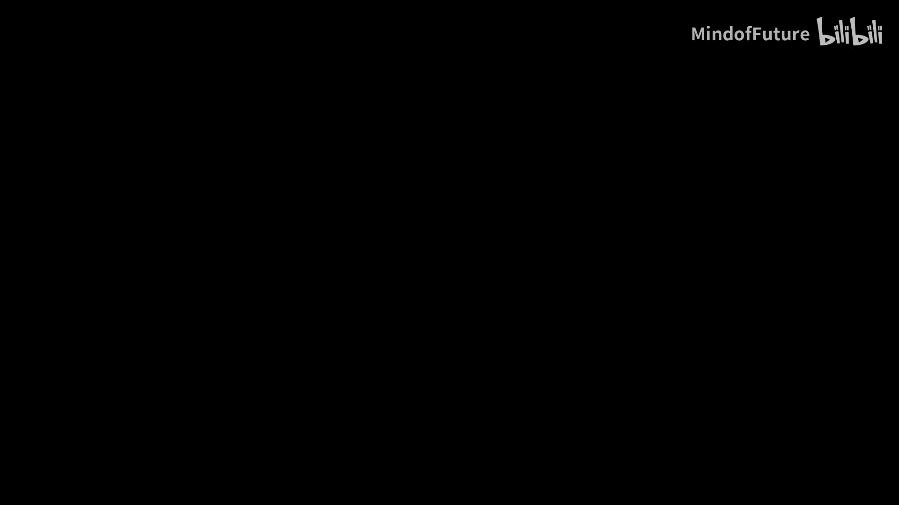
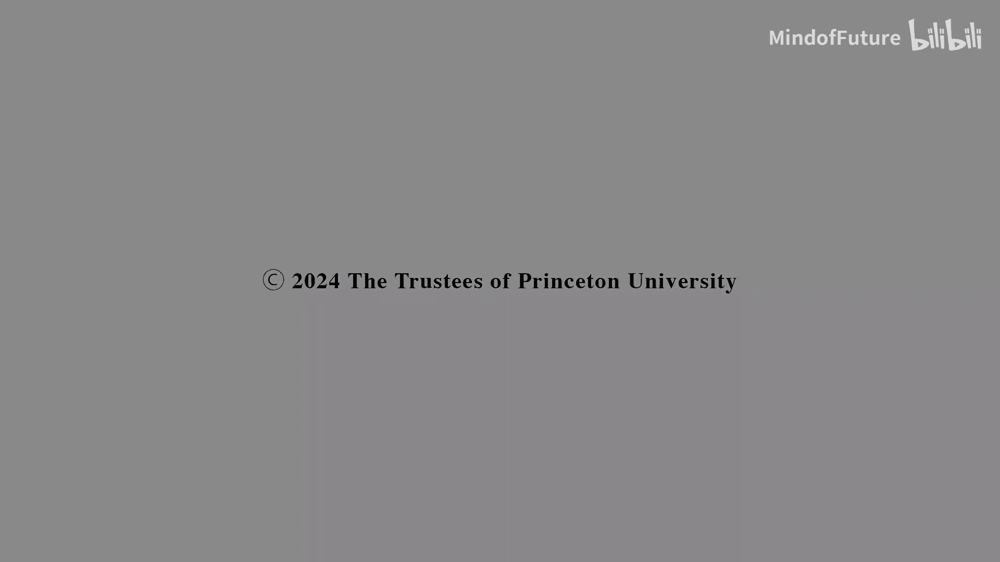

# 【普林斯顿】强化学习基础 ECE524（Foundations of Reinforcement Learning，2024） p14 P14 Least-Squares Value Iteration -BV1a2frYfEk4_p14-

So let's first recap a little bit of what we have been talking about in your last lecture。

 So since the last lecture， we have started talking about reinforcement learning with function approximation。

 So we start with as simple as a case on the linear function approximation。

So we say for the linear function approximation， the most important thing is we can make sure the value is is linear。

 So we， with resort to first a sufficient condition， which will guarantee the value is always linear。

 That is called linear MDP。 So in the linear MP is an MDP with with other like similar elements。

 We have a stay set， action set and transition， reward and horizon。

But the most important thing is in a linear MP， the reward is linear that for every step。

The reward of a state action pair essay is equal to the inner product of some known feature map， P S。

In our product with some unknown parameter cta H。And also， transition is also linear。

Where we see again， this is transition probability。Going to the next states。Given the。

Given going to the next set in general， like if， if it's continuous and the probability of reaching some set starting from S A is equal to again。

 some linear inner product or I S A inner product with the。measure没有。And also。

 in the very end of last lecture， we're talking about we want to do the， the。

 essentially the value tradition for， for this like linear function approximation。

 So the algorithm we talk about is so called least squares value tradition。

So because were doing function approximation right now。

 So instead of exactly solving the bema equation， now we're just solving the value， linear value。

 which minimize the square loss。So we say we will parameterize QH。As something like a Phi essay。

Email product with W， H。Where this WH。We will solve W， H as our。Of some problem。

Where this is like least square sum I from1 to n。 if we have n different data。嗯Wtranspose。Fai。S I AI。

Subtract I， subtract。V H plus one pet。S I prime。So that is。

 if we have collected a lot of data tupot that is in the form of S I， AI， R I， S I prime。

 This is like starting from the current state action pair。

 What is the reward we're gonna get and what is next data we're gonna transition to。

In the linear function pro scenario， we will instead of directly solving the be equation。 where。

 we find the， the linear value， which minimize this square loss。Okay。

 so today we'll talk more about the the property of this algorithm。So you can think in the。

This is like a generalization of the tabverse setting。So we will see this more。 so first。

 let's define this square loss as JW。That's first， solve for this least square。 So like。

 what is the answer for， for this least square。So in order to find a minimizer。

 we first make the gradient equal to 0。This basically we will take a derivative over this object function。

 And this implies sumation I from 1 to n。F哎。Let's call。This thing surprise to be。To make it simple。

So we have P， Phi transpose。W。Minus I。us V H plus1 hat。Sside prime。Lets thing equal to 0。

So this just implies。You can think this is。You can make this thing as a matrix on。栏가。

I didote landnda。Equal to summation I from 1，2 n，5，5 transports。We can directly solve this W H hat。

The solution of W is equal to Lada inverse。Times the summation。I from one to n。5i I。

RI plus VH plus one。Hats。S， I。I'm directly telling you the answer， but it's， it's very simple。

 It's like a standard solution for the least square。I just want to also comment a little bit。

That sometimes。When we want to do this Lada inverse。

 this kind like assume this matrix is already invertible because otherwise， the matrix。

 you cannot do this inverse。So we mention a little bit in practice。

If this matrix is no is not inver what we can do， we can basically adding in a little bit regularization。

If this La matrix is no longer invertible， what we can do is we can just modify this Lada to be summation。

Or we can do tuta， equal sum I from 1 to n， Phi，5 transse。

And plus a small land eye for some small lender。And they use this Lada tuor to replace Lada in this formula。

So this solution is equivalent， too。So the regularized minimization problem。

That minimize JW plus Lada W square。So originally JW is the least square is， is like the square loss。

 And if were adding a slightly like a little bit lada I here， this just becomes a regular problem。

And also， you can check in the last lecture。 we talk about theres a correlation like a tableular MDP Its a special case of of like linear MP。

 In the case， you can basically check if this P I is， can be only the basis vector that is E S A。

 okay， so， so basically you have S A dimension and it should coordinate is is corresponding to one essay。

 If you reduce to that kind of special scenario。 Then this least square value just becomes the standard value in the tableular setting。

So you can think this silly square of eeration like general a standard eeration in the linear setting。

 So it not only dealing with the basis vector， but also can interpolate as something like。

Some linear combination of a basis of that vector， and you still give some reasonable definition for that。

Yes， popularular MDVP in general is like linear the subset。

Tempature is is a linear is's a special case of linear MP by choosing special feature map。

We kind of like could talk about that， if。If we make this， this is like de dimensional thing。

If D is equal to， we can make D equal to s number of state times， number of action。 And if we choose。

Fi S in in the tablet case， like each state action pair correspond to like basically。

 you only have like a finite number of state final number number of action。

 and you can make that specific state action。 The fee feature map to be E S N。

 that is a basis vector in the S A coordinate as as as a， as a coordinate index。

 And then everything goes back to the tableular setting。 So table is a special case of linear。Okay。

So once we have， so now we have talking about the model that is linear MP。 Also the algorithm。

 which is like least square value。 The next thing we will do for this class is we will talk about the guarantees for。

 for the algorithm。So we will start with the simplest setting we。

 we have been considered for this class。 That is similar to a setting。Okay。

 so what we want to do is we want to establish something equivalent or like some counterpart of the simulator setting。

 for the table setting。 But， but now we， we're doing like linear function approximation。

So remember in a simulator setting， the basic strategy is。Basically， we will query。A possible。S， A H。

To the simulator， basically in the temperature setting。

 we kind of sweep over all state action and at every step。 And then we obtain reward。

And the next states。However， now were in this， like。Large space scenario。

 We want to do function approximation because we have like a extremely large number of states states。

 And last time we say most of states will not even be visited once。

 So we may even have like infinite number of states。 So in that kind of case。

 because we're in a large space space。It's definitely no longer feasible to query our essay。

So what are we going to do instead？Ideally， we want to still be able to query some set of essay。

 okay。And hopefully， the set of essay is kind of representative over the entire space。So。

 more formally。If we have。Some sort of a set of essay。Those are like a D different state action pair。

So that。5hi S I AI。Is equal to E I。Or， or， or close to it。

So we will later define what do you mean by close to it？Basically。

 the intuition is now we're in the linear space。 So we somehow need to get information for all different dimension。

 all different directions。 and there are D different directions。

 If we somehow have a set of S A like a set of S A pair， Theyre representative， in a sense。

 theyre feature map， expand the entire directions， span the entire feature space。Like in a sense。

 like is state action pair， the feature map is equivalent to one basis of that vector。

 So in that case， they are like a very representative over the d dimensional space。So in this case。

 like we're exploiting some like linear structure in it。And。Qury essay。IAI。Is similar。To cr。

Is the coordinateator of a Cai。So because we assume both reward and transition are like linear in in like in this as an inner product of some file h and with this feature map。

 So in that case， if we can just query some basis vector。

 then we just directly knows one dimension of a seeta H or something。

 And then we can like put them together and we can reconstruct what is reward。

 what is transition and so that we able to learn。So well be more formally about what do we mean by those things。

 So we will actually call such such set being representative， not necessarily EI， but can be close。

 We will later call coreet。Okay，So later， we'll give the formal definition of what do we mean by corest K。

 But， but I intuitively， you should understand this Cosat is something。Saying。

Those set of state action pairs are like a representative in D dimensional space。

 they are kind like pretty much orthogonal each other， so that。Like they， they。

 they form a relatively good basis。So refer firsts to if the algorithm。

 then we give the formal definition of this a core that thing so that we can establish establish the guarantees。

Algorithm is least square very traditional， with coreite。So we will do two part。

Then the first part is data collection for all steps。And all the state action pair。In the coreset。

 remember， in a table， in a tableular simulator setting。

 we just directly query all the data action pair。 Now we。

 because it's invisible to query all the data action pair。

 we only query the action pair in the coreset。So what are we gonna to do is we going to query。S AH。

And collect and samples。S 1 prime till S N prime。This part is similar to the simulator。

 partly we just directly query dis simulator and getting n samples of the next again。

 in for synchronity， we assume reward is known。And then we just put tubbo。This S A。S， I pray。

Into dataset set D。O，The collection part is right relatively straightforward。

 The only difference is now we no longer query all the action。 We just query the。

And the select curve。Corsset。And next step is the value tu part。

Better tradition is always starting from the very last step to the first step。

The only difference now is instead of directly doing the Belman equation。

 because now it's like a function approximation， we can not directly assign to be equal because we restrict our radar function to be a linear function。

 So in that case， we just。We essentially set the value function。

To be the linear function that minimize the beman residue。As we said earlier。S a。Prime and D。I see。

Subtract to RA。Subtract V address one。Hat。Okay。So this is like a B square。So we will set the Q value。

Just directly equal to the linear function specified by this weight W， H。And also。

 we will set the V value。Similar in the tableular setting， equal to the maximization over a。

TheQ about it。And this is good because in the last lecture。

 we can also assume although the state is infinite， action is still finite or you， you just。

 you can also be infinite， but you， you need to assume like you can maximize this action over action a efficiently。

Okay， so basically two part。 The second part is a least square ver。

 The only difference from the standard ver is you you replace the beman equation by this like a least square that that finding the linear function that minimize the beman residue instead of exactly assign it to be the Belman update。

And then you collect the data by looking at a corset。

So this is like very similar to the simulator with valuetuition。

 but with some additional new ingredient， like the core set and the least square valuetuition。

 So we need to understand why this algorithm is still gonna work in this new setting with linear function approximation。

So that's first more formally talking about what do we actually want for this cores set。

 Because we just intuitively say the core set should be something similar to basis。

 but this is like too vague。So by saying something is coreset。

We do mean courses that is a set of D state action pair。And specifically， we can also denote。

The feature map。Of this corset， of the stay pair in this corset to be Posi I。Specifically。

 we use for I to denote the feature map of S I AI。For this SI AI in this core set。

So we can essentially look at the feature map， this capital per。That is conation of the feature map。

Of all the late action pair in this corset。So this matrix essentially fully characterize。

 What are the feature maps of this corset。So particularly。

 the course had required the following property to hold。The first one， we require this pose。

To before rank。Essentially， we require this the feature map of of the stay action pair in this course had to span over D dimensional space。

 it doesn't left out any direction。And the second and important thing is。Were required for any essay。

Any feasible state action pair。We want this pers inverse。Times5hi， I say。This is a matrix。 Okay。

 this beside a matrix time is a vector。 So it ends up with a vector。

 So require this vector has a one norm upper bounded by L。

And we will actually see immediately how what kind of this condition implies。 This essentially says。

You can， you can efficiently use this set of core set like this peri 1 per side D to。

 to like represent。Any feature vector of the feature vector of any state action pair。

You can think this is more like a soft version of saying this Poes not only need to be for rank。

 but also kind of close to orthogonal so that they can。Represent things very well。 if。

 if you have like two vector extremely close to each other， then the representation， like using。

 using precise as basis like。Very bad in the sense that those coefficients can be very large。

So I want to talk about a few things。So Mark1。First， this is like。

 want to talk a little bit about existence。This is a bit abstract condition of like I say there exists some set of S AI。

 S I AI。 This is like the coreet and satisfy those two condition。

 You may wonder the first thing is whether this always exists。So the answer is actually， yes。

So given the set。This is essentially the set of all possible feature space。

All possible feature vector。That is supported。In D dimensional space。Then， there is an algorithm。

Finding such a core as。For some reasonable value of， if I remember correctly。

 there's some like log vectors。So we omit the construction here。

So the construction requires some like separation， de separation techniques and。

Probably gonna take and a half an hour to talk about it。 So we just omit here。

 But just first remarksmark is。It always exists。 And you can even have an algorithm able able to find a corset。

 if you have， if you know the set of all possible feature vectors。The second property。

 the second remark I want to say is like basically intuitively。

 why we require a second condition of the coreset。Is the property tool， of courseet。Implies that。

Any feature。Any feature in terms of a file essay for app arbitrary essay state action pair。Can be。

Represented。By linear combination。Of course， that。With small weights。Okay。So in a sense。

 if we have like arbitrary file essay， this is like the feature map for some arbitrary selection action pair。

So we say we want to represented it by the course by linear composition， of course， in a sense。

 we want to say we want to express this as summation iPhone 1 to D。Let's say WI plus， I。

P essentially， the basis given by the corst。 And this is like the linear coefficients。

So in the matrix expression， we can say this is equal to the pine matrix。Times W。 O， W is the vector。

Which each corner is W， W， I， W1 to W， D。So in this sense， if a persi matrix is a for rank。

 because we say ps is it's like span over D dimension。 So we can resolve for W。

W vector now becomes something f inverse。F S。Which is precisely precisely what we have here。

So the property two of the courses that directly implies。The one norm of W is upper bounded by L。Yes。

 any question？来个块。The essay is been larger you。スです。Surprising。嗯。It's not surprising。 For example， if。

If the feature is all in simplex。Like， you， you know。

 simpleax is like the probability simpleax like you you can generate slow d dimension。 then if。

 if the core set is like a basis， then that means the all feature vector can be represent as a linear combination and the the one by L is like very normal。

 So yeah， so this is like a regularization condition。 you can essentially assess。

You will actually give us some examples，This is like processor we're going do the simple feature space。

So we look at the example， which satises something like this。So in the last lecture。

 we talk about those theplex features space。That is auto feature vector fine S。

For essay in this set essay。Is a subset of。Let's say just equal to the D dimensional simple。

 D dimensional simple is like something X1 to X D。So that each X I is greater equal to 0。

 and summation X I is equal to 1。Is a probability simple。So in this case。

 we can look at the because this is like exactly the feature space。Then， were saying the。SIAI。

The set of S I AI D。D state action pair。So that they reached the basis vector。Eal to EI。This。

This set gives a course， is， is like a cores set。The reason is。

If we have the feature map of the core set， like it's just equal to EI basis vector。

Then we know this Posine matrix。Is identity a matrix。

So you first clearly satisfy the first connection that is for rank。And secondly。

This precise in verse。Fire S。If we can check this condition。We say this is the one norm。

 And because we know Posi is identity identity matrix。

 So we know posesi inverse is also identity matrix。 So we only need to look at the Phi Ss one norm。

And because all the featureer map applies in the simplex。

 So we know that any featureer norm in the simplex is equal to one。

So you can also say this is less or equal to one。 So you can say L is equal to just one。

So once we have talked about the algorithm and also the property of this like a corset thing。

 like our linear。Like linear surrogate for like the simulator thing。

 So now we can talk about the guarantees of such an algorithm。So theorem says， if we choose。

M greater than。Some count C times L squared。Hdge 4。Yta over Epsilon square。 is again。

 something like complexity。 Remember， this n is the number of samples we will query a simulator for specific specific the action pair in the。

 in the coreset。Okay， if we query this number for each estate action pair in a corset， where again。

 this Yoda is some log factor。 we have seen this a lot in this class。We do the log， H D。Over P。Then。

 with probability。Greatter equal to 1 minus P。The output pi hat。Of our SVI。

Which this pie hat we haven't defined the algorithm。 But basically， this。

 you can imagine this is like the greedy policy of Q hat。Is Eps optimal。

So it's a very similar ingredient。 We just say with sufficient numbers of of quaries。

 And then we say the policy output by our algorithm is absolutelyps optimal。

So one important thing we note is we're now in a functional approximation scenario。

 So we're in the large say space。 So as we said， in the very beginning。

 the the main motivation we want to do this new theory is now we no longer want to have any dependence on the number of state S and number of action A so that we can get beyond the table setting where we require both state action and finite。

 We not in this theorem， this is already achieve。 like there is no dependence on the number of state and number of action。

 We replace it by this dimensionality， this D。 okay。

 so essentially de characterize the complexity of of S A or whatever in this like linear function of approximation scenario。

So we can talk about the whole sample coming。We note that this is。

 this n is just the number of queries we will make for each quaset each state action pair in inside a quast。

 So we first need to times the number of steps。 This is like for a single step。

Then we need to times the number of number of state action pair within a corest。 in this case。

 we will always make a D， like corest always have like D state action pair。

So this is the total number of sample complexity。And this is equal to some constant times H to the fifths。

第。L square， Yoda。Over。Absilnal square。As we said， we have no。

 no longer have any state action pair dependence。 We have dimension。

 Now we instead of we have dimension dependence。 and we also have L coefficient dependence。

 This is like talking about how orthogonality this like coreset is， like how good this coreset is。

So the most important thing is independent offensive。This will be the first guarantee we see。

That beyond the tab setting， that later， like all auto guarantee we develop for the function approximation will be of this style。

 will no longer depend on。 I， what's the question。 like factor age worse than like the。だけしとか。It cost。

I， I don't remember。 I think probably it's similar。

 but also in the function linear function approximation， it can be a little worse， but。

But I think it's similar。I think in the similar setting， it should be the same thing， so。

So I think it should be to the fifth。As well， I think for the。For the homeworks。

 we do some Prince and some variances so we can like shape a bit H fixed dependency。Yeah。

 but I need to check it offline。 That's a very good question。Okay。So now after talking about theorem。

 that's。Let's do do the proof。So the overall proof is， again。

 very similar to the tabular setting with the simulator。 But again。

 we need to do auto adjustment for this core set and linear function approximation。So， we will。

Hopefully， highlight the interesting part。In is proof。

So the first thing we need to do is we need to write a little bit about like reform it a little bit。

 simplifyimpl a little bit about the Q value updates。So so far。

 we're saying it's like a least square valuetuition。 is's， it's doing least square。 So just recall。

 we're saying by doing least square valueition， W， H。Is Ar M。W。Smation S A S prime in the data set。

W transpose Phi S。Subtract IA。Subtractor the V H plus1 hat essay。That's prime。Square。And we know。

 this is。Lda inverse， because we already know this is like coreset。 So this is for rank。

 we don't need to add in any， at any regular。And we say this is like a La inverse summation。

 I from 1 to n。Faii。R，H S I AI。Plus V， H plus one hat。S I prime。Where we say this。Fi。

We use the notation file to denote Phi S I AI as a shortage。 And this La matrix is。

Equal to I from 1 to n。F I transports。This is what we have been talking about earlier in this lecture。

So what we want to do is we want to。 this is like a least square。

 but it seems a little bit different from the Bma equation。

 So we need to first connect this to the Bma equation。We can。

 we do this connection by looking at the Q value。QR testing。So by definition。

 Q value is the linear function， which we use this this weights。 So Q value is equal to fine S。

Tspose W H hat。So this is the Q value we use in the LVI。So we can， plug it back。This is Equto。fi。S，A。

Transpose。Lda inverse。Smeishin。I from one to n。Hi。RH SI A。And plus V H plus  one pair。S I。Okay。

So this is just plugging our solution for W， H。Still， it's a little bit complicated。

 It doesn't look like some Belman updates。 So we need to do further。Simplification。

 we plug in the definition of linear MP。By linear MP。

 we are saying this both reward and transition are linear。 So we just plug in the definition。

We first copied the first part。1，2， n。Faiaii。So the first part。

 we know the reward of SAI is equal to Phi I， which is a feature vector。Transpose the cedar edge。

 This is like the definition of the reward。Let's first split the robot outside。

And then we copy the second term。Transpose then inverse。Subation， iPhone 12 N。5i I V H plus one hat。

S I f。So the first term， we have a very good structure now。

 because we can now do this summation of Phi I， P I transpose。 We know this thing by itself。Is Lada。

 So this Lada and Lada inverse cancel out。 So it just becomes。Phi S A transpose。C the H。

 And we know later this is equal to like R， H S A。So this is a very good。

So now how we handle the second term。Second term， we write it in a slightly different form。

 We write it using the delta function。So this is like5。S A transpose， thenda inverse。Sation。

 I from1 to n。Fi I。So what we will do is we will add a direct deta function。Dta S， S I。That as prime。

 as I prime。And V。H plus one。Hch S prime， D S prime。

So this is a integration over the S prime and direct data function is essentially only if this direct data function。

 essentially， you have something like integral of deta， S prime。Of some as tda， as 0， let's say。

And F， S prime， the S prime。依括除。F S 0。 So you can think it's like a probability density function。

 which put probability density， like put put one probability into the specific value of S prime S Z S 0。

 and everything else is 0。 Okay， This is like a deta function。

And here we have like an different data function evaluated at the N states we sampled here。 Okay。

 which， iss just a mathematical reformation。So you can think this。

 it turns out you can make this as like a generic transition or something。

 So we still write in the form of P hat。H。V H plus one hat。SA。But just note this P hat。

 this empiricalialcra become something a little bit complicated。So， there's P hat。Is a measure？Of S。

That is defined equal to basically equal to this thing。 That is equal to this。I S。Transpo。

Lda inverse。Smation， I from one to n。Faiai。Delta。Dot S I prime。You can think of it as a。Some measure。

 which essentially assign。This value。We' just write it down。You can think this P hat is a measure。

Which assign probability mass or something。We say we have a quote well explain later。

 which assign probability mass that。5 S A。Transportse Lada inverse， Phi I。To the next states。

 as I prime。O， essentially， you can think this is like a summation of that kind of a discrete probability。

Well， the only different thing you cannot think is a proper probability because we see the probability mass。

 usually we require the all the coefficients for probability mass to be non active。

And this needs to be done， however， in general。This P S A transpose。

Then the inverse Phi I can be negative。So in that sense， P hat is not a proper probability。

So you can just think the form， if， if everything is positive。

 then it looks like some probability measure。 But， but it turns out it's not necessarily true because in general。

 like you can think this is a net negative。So it just looks like probability measure。But turns out。

 given this formalism， is we can already like do a lot of derivation on top of it。 Yes， questions。

Where is that Oh Because we can just move the sum outside。我就。2好。Right right， right， right。Okay。Yes，嗯。

I think it's not necessarily true。 It's not necessarily。Okay， so were。

 we have already done all the preparation work。 We now like have some connections to the classical bellman。

The equation。 we know the major difference。 Now our P hat is become something a bit ill defined。

 still have like， similar。Form as like empirical transition。

 but it's a bit out defined that it's not pro proper probability。 It's a probability。

It's just something similar to probability， but it's not probability。But still。

 we can still like use a lot of the previous derivation， A lot of previous derivation still works。

 It just， we just need to be a little bit more careful。So we directly use one of the previous lemma。

 we we connect similar to previous lemma， we proof。Again， for this simulator。

 the most important thing is。We， we need to look at this value difference。

This is the value of optimal S1。 And this is the value of L S V I computed。

We kind of decompose this value into the difference in terms of the transition。

And we say this is equal to summation h from1 to capital to H。P， H subjecttract。P chat。

V H plus one hat。S， H， H。Given S1。So if you still remember in a similar setting。

 we tableular similar setting。 we're talking about we can decompose the value difference of the same policy。

 but different MDP by， by the summation of the transition difference。

 This is essentially a similar lama。 But here is we kind directly jump one step。

 So it's not the same policy， but it's optimal policy for each different MDP。

 And we use less so equal to。So the important thing is we take expectation of a pi star。

 But here we need to do the V hat。Proof essentially， follows。So once we have this。

 we can basically focus on this arrow on this transition。So once we have this。

 we can look at the this error。P， H minus P， hat V， H plus1。We always need to keep in mind。

 this P HH is not a proper probability anymore。 So we need to be careful with it。First。

 we write our definition。This is equal to。5i S。Transpo。

The first thing is this is like standard transition probability。

 We know transition probability is inner product of Phi and some probability measure meal。

 So this is equal to the inner inner product of Phi and the integral of V H plus one as prime。

D meal aspir。The first thing， and then subtract the second thing。

 where the second thing is we define the， the P hat we hat here， and that is equal to。5 S。Transpose。

And the inverse。Smation I from 1 to n。Haiai。V H plus one hat S I。So what we can do here。

 we can add a Lada inverse to to make a so so that we can make difference between two terms so we can add a lada inverse here and times the lada here。

 because this is time equal to identity。 And we know the Lada is equal to sum I from1 to n find I5 a transpose。

So we just add this identity inside here， and this is equal to。5 SA。Transs， lambda inverse。Sation。

 I from 1 to n。你 right。That's always good。It is capital sorry。Faii。And we say5 air transse。

I'm intervaltro of。V H plus one hat S prime。没。As prime。And a subtract。This V hat H plus1。S， I prime。

Yes。is KaM the same as D？I think， yeah， we are connecting using the location。 This capital N is。

Equal to Andy。So we're in every step were， we're， we're， we're putting all the。

 all the coreries from different coreset together。 So you have N D data in this case。So for each。

 each state action pair in in the corst， you have a end data。 And now you have。

 D dis action pair in in a corst。Okay。And we note this， when we put dust steam together。

 this is actually equal to the probability。Of as prime。Given S A。Given S I AI。F。

Putting those two together。And by doing integral over S prime。

 this is like taking expectation over S prime。So we know this is actually equal to Phi S A transpose。

Thenda inverse。Sation， I from1 to n。Fii。We have the expectation。Over V H plus  one hat。As pray。

Give an essay。S I AI。Subtract one， single sample out of it。So we're going back to some form。

 which we have one random variable。Subtract by expectation or or the other way around， so， so。

And we have a summation of such kind of fluctuation。 So you can think of。Ideally， at some point。

 we're going to use the concentration air quality to， to fix this problem。So， we note that we have a。

N equal to little N D。 we can already set samples。First staff。Which。This。

 we can further decompose this N D samples to be like n samples。Profeure in a corset。

Times we have like D features in the corset。So this kind of tells us that this Lada matrix。

Which is equal to iPhone 1 to n。Fhi，5 transpose。Its also equal to。Because we all。

 we only query the corset and we query each corset n times each feature in the corset n times。

 So we have n copy。Of we query corst enzymehe。 So this J from one to D。

 and we query each feature vector。Pide J， Po J transportse。

We ex exclusively use the p J to be the features in the quat。

And we can also say this is just equal to the matrix form。

A representation that n times pers and Posi transpose。By similar manner。

 we can also further decompose this summation over all the data we collected for this step to be。

 to be the summation over number of features in the coreset and also the number of。like。

 like basically， different samples。Okay。So plug it in， we know this。PH。Subtract to P， hat。

VH plus1 hat SA。Its equal to Phi S A transs。And pai。不晒。Transpose inverse。We just replace this。

This Lada by this Posite pite transpose。And most importantly， the later part， that is times。Sation。

 J from12 D。Psidej。And expectation。Of V H plus  one hat。As prime。Given Po J。

 because Poi J denoted the data action pair subtracted by one over n。Sation。L from one to n。V。

 H plus one hat。S， L prime。So what we're saying is because we know Phi I just I copy and copy of of the features in the coreset。

 So we just directly explicitly write it out as a sum over D。

 And then we kind of cancel out the n factor here。 And so the M becomes inside。Goes to inside。

It just reformism by knowing this phi is just precise， but with1 different copies of it。

So the very good thing now is this is like the expectation subtracted by。

Some like empirical average over。Like， essentially。

 they are all starting from the same state action pair as pre J， the encoded by the linear vector。

 And then you're getting a lot of samples of next states。

So this is essentially the standard concentration。 And we can say by hoing， we call this epsilon J。

And we say by halfing in quality。We have this epsilon J。

 the norm of epsilon J to be upper bounded by some constants times horizon times Yoda over n。

So we're almost done。 We just。Putting everything together。 And we say this is equal to Phi S A。

Transpose， we still copy the Po Po in transpose inverse。And the later part， once we have。

 we denote this concentration part as epsilon J， we can also write it as a matrix form。

 which is like a pses Epsilon vector where epsilon vector。

 each coordinate of epsilon vector is Epsilon one to epsilon D。And we know Poses is for rank。

 So perses can be directly invertible。 And so this， there is some part of inverse。

 this Pos inverse cancel is this pers。 And what we get eventually is become something like。

Pi inverse。Fa。Transpo。Epsilon。And finally， by holders in quality。

We can see the inner product of two vector is upper bounded by one norm of one vector and infinite norm of the other vector。

Typically， we do two norm， two norm， but we can also do P norm  Q norm as long as one plus P1 over P plus1 over  Q is equal to one。

And we know this by the definition of core set are provided by L。

 and this is by the concentration inequality we already given here。

So this is less so equal to C times L times H times yoda。Square of yoda over at。

So this implies that V1 star。S 1， subtract the V hat S1， the which we originally start with。

 We know we can decompose it as a summation of the transition difference。Expectation of high star。

And summation H from one to capital to H。P， H， subtract the P， hat。V H plus  one hat。S， H， H。

Givenive S1。We already know each term is up bounded by this。 So we only have a sum H left。

 So we know this is less or equal to C times one further H factor times everything here。

 So times L times h square。And square root of yota over n。Finally， recall that our choice of n。

That is greater than some constants times L squared H to the fourth Yoda over epsilon square。

By choosing an equal to this， we can guarantee this is a less equal to Epsilon over 2。

And similar to simulator setting this is like one half of it。 And the other half is mostly the same。

 So with the details， basically similarly。You can also prove。That V， H V1 hat。S 1。

 subjecttract V1 pie hat。S1。This is。Again， you can decompose this a difference in the transition and then do the same argument。

 essentially the same argument。 And you can also say this is less equal to C times L H square squared Yoda over n。

 and which is again， absent over 2。And this finished the proof。

SoJust being what's the actual final difference for？The one。Yeah。

 were looking at the difference of V1 star。S 1， subtracted V1 high pie hat S 1。

 This is what we wanted to prove it a optimal。 So each， each part is apsnal over 2。

 So when you sum them together， it just a。Just sure， this only applies for。

This only applies for linear MDP。What part I do？I think it's also。

Especially like when we do the decomposition like this。If you still remember in the previous lecture。

 we cant say there is some symmetric decomposition。 We， instead of like having pi star here。

 we can also， like this is like P pi star。 We can also do P hat， pie hat P hat， P had pi star。

 and we have a V V here。But that is no longer feasible because Pi hat is no longer a transition。

 So so now we only only do  one，1，1 property decom。

So whenever we need to use something summation to one， and its a probability。

 we need to be very careful。 And unfortunately， in this proof， we don't， we don't use that。

And he said like the other one。YouYou can， you can， You can， Yeah， you can possibly a factor。

Although like in the linear part， the brainton is a lot。Is a bit more difficult。 I think this one。

 you can， you can still do。 Yeah， but later， like when we do the。Optimism stuff。

 The Princeton is is a lot， a lot more involved。I think that basically finish what we。

 I want to talk about for， for the simulator setting。 I think today， there are some。

Some calculations。 But， but basically， I want， I hope you can like。

 have some taste of some sort of like a function approximation and how to make it work like。

Basically， you can see the connection between this and table setting。 And later。

 part of our function approximation， we will talk more about the algorithm。

 formalism and guarantees and less about the。Proof just because it's quite involved。

I still hope you can like， guess some spirit from this like linear kind of proof。 Yeah。

 they down is kind of more complicated。 So starting from the next week。

 we will talk we will first finish the linear part by talking about like。In online setting。

 how we do the optimism and also whether we can like relax the linear MP assumption we said that in last lecture like very strong assumption Its very restrictive。

 only apply to like table MP and certain like simple kind of feature has some restrictions。

 how we gonna generalize that by using some new idea instead of a standard optimism。

 But we kind change it to like the global optimism。

 And then we can generalize those idea to the general function approximation scenario beyond linear setting。

It's your next thing。

