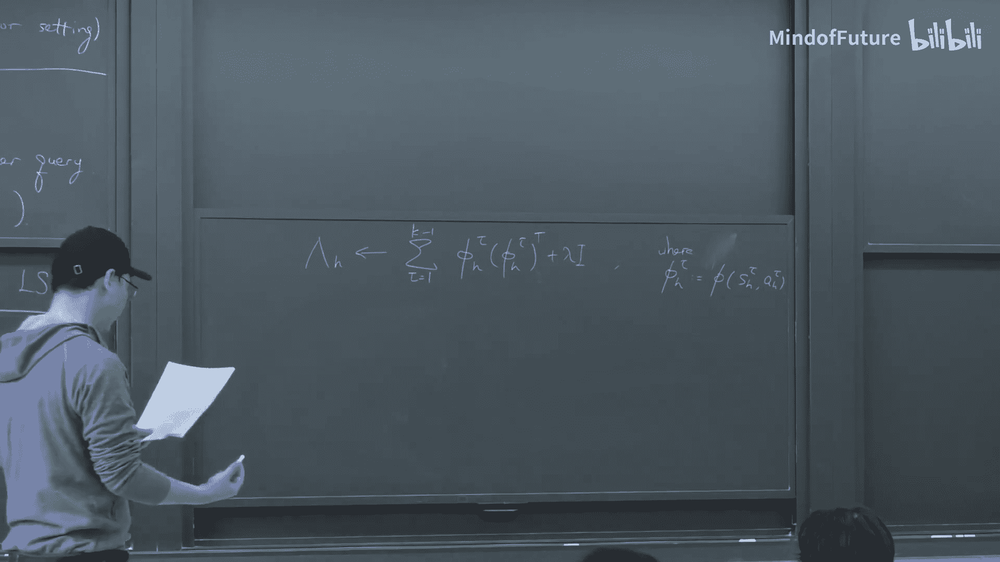

# 【普林斯顿】强化学习基础 ECE524（Foundations of Reinforcement Learning，2024） p15 P15 Exploration in Large State Space -BV1a2frYfEk4_p15-

So let's start the lecture today。 in the last lecture。

 we talk about specificallyre talking about reinforcement with function approximation。

 and we focus on a simple case called linear function approximation。

And we spend some quite some time talking about the basic model that is the linear MP and also specifically focusing on one algorithm called least square value S V I。

Which essentially just modified value tu， which is the algorithm。

 essentially the rule of thumb we used for temperature setting。

 but modified for the linear function approximation by by essentially replace the Belma updates by solving a least square problem。

And we particularly spend a lot of time like working on the guarantees。

 algorithm and also guarantees for LVI under the setting of the coreset。So it's essentially。

 you can think it an analog of the simulator setting in our like tabular MP。

 where it in a tabular setting， in a simulator setting。

 we essentially query all state action pair uniformly while essentially sweep over all state action pair while here in the linear function approximation。

 although we have infinite states。 But we just sweep over all the state action pair in the core set。

Uniformly， and we use that algorithm。Essentially， this is like a similar to generator model。

 simulator setting。And we know in the tabular M DP scenario， after simulator。

 we will talk about more advanced setting， like online setting and also offline setting。 So today。

 we will spend some time， a little bit time talking about。

How are we gonna extend this to the exploration setting or online setting。

So in the exploration setting， similar to the motivation in the tabular setting。

 that is we no longer able to just query specific state and action pair。

 We have to start from the initial states， okay。So in that case， the。

 the strategy that we're gonna sweep over all the possible of action pair in the course that no。

 no longer available。We can no longer。Qury states。That is I。e。 We can no longer query。Coursesets。

So this is like a more practical scenario。 So in this case。How are we gonna。

Work on this like online reinforcement learning。Problem。

So if you still remember in a tableular setting。The whole idea with dealing with this online reinforcement learning is we incorporate our optimism。

So here we will try to。Do the same strategy That is incorporate。Optimism。Or UCB。Into LSVI。

So this gives the following algorithm。Essentially， how we gonna modify our S VI with up confidence bound。

So the algorithm is called the L S VI UB。So for episodes。K equal to1，2， to capital K。

Good the following。That we will receive。Initial state。S 1 k。That is the initial state。

 the state had the first step in case's episode。And then for each episode， we do the following。

For step。H。From capital H。That too little to one。If you'll still remember。

 like doing value tu with U B， we essentially first doing value tu pre episodess。

 And then we used the greedy policy to collect the data。 So here we will also do the similar thing。

 We will first do value tu。 But the only difference is now we do least square value。So for each step。

 we're gonna do the following that we're gonna let。There's a La H。

Be essentially the gra matrix we talk about in the least square solution。

Sumation tau from 1 to K K-1。反 H他。5 H T inverse。Plus， Lada， I。Where。This is5 H。It's defined to be。

Defined to be phi。S， H tower， Ah town。Is the feature map of the state action pair we visited at step H at Toss episode。

And this Lada I is essentially the regularization we talk about because we're in an exploration setting。

 We're no longer guarantee this is for rank。 So we're adding a small regularization to make sure the matrix is for rank。

Okay。And then we essentially just solve for the least square solution， which if you still remember。

 the solution of least squareve is this gra matrix take inverse。And then， summation。To from one to。

Okay，-1。Fi。H tao。And R。Ach， S， H towel， A H town。Plus。Max。诶。Q。H plus one。

S H plus one ta and a next step。This is precisely the solution of the least square value。That is。

 we have this square matrix inverse。 and then the remaining。

 if you still remember the like how we derived the least square。

 this is like how we calculate the weights。 So nothing fancy so far。

So the most important thing now is how we're gonna assign a Q value。

 Because if we directly use this weight vector times the feature vector we have the phi。

 then this is like solution of least square。 But now we're seeing we need to add a U B。

 We need to add an upper confidence bound。 So， so in the Q value updates， we do the following。

That is Q value。Will be assigned again， to be the minimum over。H， that is truncation。 If。

 if the value is greater than H， we will tru it to H。And then。W， H transpose phi。

So this is a standard linear function solving by least squareve。

 So the major difference is we will add a bonus。So the bonus is in the following form。That is beta。

 some constant scalar beta。Times。A quadratic form， which is a phi fis vector。Transpose。

Lda H in verse。Transpose5。Okay， so this is like the most important thing。This is the bonus we have。

So the new Q value will be some linear function with a weight vector solved using the least squareveeration formula。

And plus a quadratic form as a bonus。 Okay， so quadratic form has some scalr。

 and we have the Phi transportse phi。 So this is quadratic form on phi。

 And only important thing is we have this grand matrix Lada inverse。

We will talk about why we choose this specific bonus later。

So this more or less finished the first part of the algorithm。

 essentially how we're gonna do the v based on the previous data。

 Then the next step is a very straightforward。So the remaining thing is for step。H from one。

To capital H。We do the following that。We will take。Ason。A H。Okay。

We take action at step H and case episode to be the greedy。Action。Of the Q value。

 we computed earlier。And then we observe the next states。Qu。So the overall algorithm has two part。

 The first part is。Essentially， this part， which is L S V I。With bonus。And the second part is this。

this is like an execute greedy policy。Okay。So the overall algorithm is relatively very straightforward。

 As I said， the only major difference is like you add a bonus here。

And the bonus is specific form for the linear function process。

 And the remaining is following the generic like prototype or like a。

 the generic framework of like value with U B。Any questions for this algorithm？ Yes。Yeah。

 the P map is is known is， is a fee feature map that is known。If for linear function progression。

 we always assume we know the map，In general， its， it's a writer like when you do D。

 a lot of times you， you also need to learn the feature map。

 that will make things a lot more complicated。Okay。

So now the question is why we choose this specific type of bonus， okay。

So why we use this Phi transpose Lada inverse。Phi as bonus。

The reason is pretty specific to like a linear function approximation， like this is a linear thing。

So you can interpret this as roughly something like。1 over a square would have。M p。

Just remember in a tableular setting， what we have for the bonus setting， bonus functions one over n。

 N is like the number of times we observed that specific state action pair。

 So in the linear function approximation， you can think this is a roughly one over squared of n where n is the number of times effective samples。

You see in five direction。Okay，By effective samples。

 we mean like because this is like linear approximation。 So you should not just say like when I。

 only when I observe the direction that exactly equal to phi。

 I will count as I observed it previously。 like because this is linear。

 So anything close to this phi direction， you can count as like 0。9 samples in phi direction or 0。

8 factor like samples in this p direction。 So this is about effective numbers。

Effective numbers of samples。In this five direction。

 And this effective number is counted by this matrix inverse。

 And it will say specifically more like why this reduced to the。Like， like， why does a file inverse。

 this specific form， like square root makes sense。So I think understand more concretely。

 we should first consider the special case of Tular M DP。Where in the tableular MP。

 we know the feature space。This capital 5。Essentially。

 all the possible linear feature vector we have is just E I。

Is just the basis of vector where I is from one to D。And in this case， H I。Corresponds。

To an essay A pair。So in this case， this Lada matrix。

Its essentially just a summation of all the previous feature vector we have seen。

 That is a summation of P J，5 J transpose。And then we can group all the feature vectors that are corresponding to the I spaces together。

 And so it's a summation， I from1 to D。Times how many times we have observed。

This E I in the all the pass data times E I， E I transpose。This is how many times。

We have observed EI。So in that case， when we look at the bonus function。

 bonus function is always in form of we have five lambda inverse P。 So that is， for example。

5 is some E J。Because the feature vector is always just the basis vector。

 and E J Lada transpose Lada inverse E J。And we because we know this Lada is of this form。

 So we know Lada inverse。Is of the form that is sum I from one to D。1 over an I。EIEI transpo。Okay。

And this bonus functions exactly equal to one over NJ。Which corresponds to the。

Essentially correspond to the confidence that like burns and bounds we。

 we have for the tableular setting。So this is like a very special case， because in a tableular case。

 all the feature vector are togonal so that。Essentially。

 only the exact same basis factor will increase your account and anything else is because it's exactly orthogonal to you。

 So they won't increase your factor of now number， but in general。In general。

 beyond linear setting beyond type setting。This P I fisure vector may not be orthogonal。

So any previous observation。So， that。This phi I transports phi is not equal to 0。

 So as long as this phi is not a fgonal Phi will increase。The effective number。Of5。

By a number in 0 to1。So this is more less intuitive understanding of why we're gonna use this type of bonus function。

 and the more rigorous mathematical reason， like stem from the linear bandit scenario I think as we as we said in this class for a lot of times。

 bandit is like a simpler case for for MDP without any states and a transition。

 So always serve as a toy case or a simpler case to consider。

 And it turns out there is a model called like linear bandits。 and linear bandits。

 they also say the UB algorithm。 And this is like specifically design。

 you can use for linear bandits。 So you can think this bonus is like what we borrowed again from thisit。

Literature and plug it into like reinforcement learning and make it still work。

So we directly is talk about the guarantees for such an algorithm。For any linear MP， again。

 we restrict ourselves to the model of linear MP。Which is still a bit restrictive that require both reward and a transition to be linear。

Then we say with probability。Greatter equal to1 minus P。The regret。Offer our S VI， UCB。

Is the following。That we have regret， okay。Less or equal to C times square root of D cube。HQ。Qi。

Yota Square。Were， again， this yoda。Let's log D T over repeat。

And this is the result stated in terms of the regret。

 And you can still use the similar thing earlier。 we talked about。

 We can convert any regret to some complexity by online to batch conversion so you can convert this as well to some sample complexity using that theorem。

So I would just make two quickly remarksmark。So the function approximation setting will be slightly different from temperature setting where we care a lot about the rates。

 where function approximation setting， we， we will talk more about what is the setup and what is the type of guarantees we can get。

 And we leave the rates that those detail rates， too。

To like some lecture notes or like more specific papers。So I think high level。

 the most important thing we observed the improvement of this L V I UB versus the previous the core that thing is now we no longer。

Assum。Given the corset， or any。Or we can query corset。Given or access to。

We here we use optimism to explore。So this improvement is quite significant。

 that is we no longer require access to a simulator。 And also。

 we don't even care about whether we exist some core set or not。 We can directly give this。

 And in fact， the result， if you remember in the LVI with coreet。

 we still need need to depend on some one norm of the core sets that L factor。

 Well here this completely independent of this L factor。

So that is I don't really care about whether you have good corrst or not。

I can't always make this guarantee。The second important thing we already emphasize in the course。

 I think we no longer。No longer have S A dependence。This is always important in。

In like function approximation。We have replaced I D。By dimensionality in the linear setting。我我た吧。

whyhy， why is the last one， right。Replace them by D。Dmen dimensionality。

 you actually think dimensionality plays a role as an essay because like， in a tablet setting。

 when you reduce the tablet， essentially， the D is equal to S。But in general。

 we can think D is like more， more general。 It's not necessarily， I say even for infinite as。

 you can， it can have some fixed D or small D。So。The proof is a lot more involved is you can imagine it's like a basically combination of。

Upper confidence bounds and the least square evaluation and some exploration。

 like regression analysis。 So we will leave it to the paper， to the previous paper。It's in appable。

Provably efficient。Reinforcement learning。Was a linear function approximation paper。嗯。

I me and few other collaborators into the 19。Any questions so far about this LCVR UB thing for optimism。

If not， if， if not， well go to the next topic。 that is well again talk about the linear function approximation。

 But we want to talk about beyond linear MP。Okay， so this goes back to a question we raised earlier。

 Were saying linear MP is quite a strong assumption that we have assumed both linear transition and linear reward。

 But for a lot of times， in practice， like when we do D。

 we only care about we can approximate the value function by， by linear function Yes， please。

You also do like。LI would like pessimism for offline settings。I think so。

 People also do that kind of variation in the paper， yeah。Yeah， let me check。

 I think that that's has been done。Okay。So the question is whether we can relax assumption if。

 if in the end， all we care is like we approximate value function by some linear function。

 Like we don't really care about whether I MDP is linear。

 Hopefully we can deal with some like more generic MP as long as we just do value equal to linear function。

 and we can still make it work。So people have been thought about this question for a while。

 and I would think the， there's the one type of result I would like to introduce。

 which I really feel like they're more， they're quite elegant。 And it， is this。

 it's this a slightly more general class。 let's call it temporary called like linear completes class。

I think I like this class because the algorithm solution eventually we introduce is like pretty generic。

 And we will say can generateize to the generic fun general function approximation。 It's。

 it's very elegant。So let's talk about what is this like more general condition is。So remember。

 when when， whenever we talk about the linear function approximation， we。

 we really talk about the linear function， linear value function class in in this， in this class。

So it's specified as F。Is the function class。That is consider all the linear function in the form of a Phi transpo W。

For all W in R。Okay，W is a vector in R。So this is essentially all the possible value vectors。

 the value functions we consider。So the assumption of this linear company class is。

We basically make two assumptions。The first one is reizability。Realability， in terms of。Okay。

 remember now we are beyond linear MP。 So we no longer assume whether we no longer assume we have a linear transition or reward。

 But we need to have replace this linear MP with some more abstract assumption。 Hopefully， it can。

 we can cover more applications。 So the first one is the realability， which is quite weak。

 which is just assume the optimal Q value。 Q star， is enough。That is saying we。

 we don't really know whether underlying MP is linear transition or or nonlinear transition。

 We don't care。 all we care is the optimal value is linear。And a second assumption we have。

It's called essentially the completes。 That's why we call this setting。 It's like linear completes。

So what we say is this T star。 T star is the Belman Op operator。F。Is inside F。O。

 so what does this notation mean。So remember this T star is a Bellllman operator。

Is the Belman Op operator。So for any function of a essay， that is a Q value function。We say the。

T you star F。To start essentially map a function to a new function in the S。

And we say this is equal to RSA。Plus。Max a。Transition。And this。F， S prime， A prime。

It's just the Baelman update。So it maps a function of a essay to a new function in S。

So what this completeness means。For any linear value function。

 if you apply the Belman operator as defined here。 Belman operator as it defined here。

 it remains to be a linear function。 So it remains in this class of linear function。So that that。

 in that sense， iss like Comp。 That is by applying the Belma operator。

 a linear function will remain to be a linear function。This is like the whole assumption of。

 of this linear companies。We'll， first check。Very simple at that linear MP。

Is a subset of this linear companies。So the most important thing is we will make sure that Belma。

 after applying a Belma operator， a linear function will be mapped to a linear function。

 This is relatively straightforward in the linear MP。Because in the linear MP， both reward is linear。

 and also the transition is linear。 So this part will guarantees。'mSorry， I think。

This is a max inside。Max a prime。 Okay， this is be operator。 So because the transition is linear。

 So this basically says whatever this is， I don't care。 As long as I'm applying a transition。

 It becomes linear and this is linear。 So it remains in the。Linear， so it's easy to check。

Easy to check that both a condition， both both conditions in assumption hold。

First assumption is also quite straightforward。 And I think first assumption is actually a bit redundant。

 If， if you kind like already says the function very function in the last step is。Is 0。

 And you also see0 is in this F。 Then this companies will basically guarantee realizability。

 in some sense， because optimal value function is this T star。

 But you can basically show the same same thing there as well。

I think first connection is actually even simpler for linear MP， because in the linear MP。

 we we basically already shows the Q value for any policy is a linear。So the Qs star is， of course。

 a linear function。thats per。So。Of course， whenever we introduce some new condition。

 we would like to at least see one example that is beyond the original linear MP。

 but still in the linear completeness。So there's another example。

 which is very important in the control literature， which actually following this more general class。

 but not， not in this original class。So that's called the LQR。

This is call like a linear quadratic regulator。This is like one of the very basic model in the control literature。

 because。In the control， I think people also do like linear control。

 And this is essentially the very basic model for linear dynamics。

So we will motivate this important model by。Unlike like， a real application。

Let's look at the application。Which， for example， we want to。

Control the height of some robotic helicopter。So in that kind of case。

 if let's just recall what we learned from the physics in high school。

If when we want to control the height of velocity for simplicity。

 we no longer care about some spin or some rotation。 So we just look at height height。

 So in that case， let H T and B T。Deote。The height and the velocity are time T。So， we。Essentially。

 we need to add， we need to calculate like how much force we need to add to the。

 to the helicopter to either like raise the height or like reduce the height。So in that case。

 whether we want to control the force， which is essentially equivalent to we also want to control the acceleration。

Because by Newton， second law。Like force so directly related to acceleration when mass is fixed。

So according to the Newtons second law， we can essentially write the dynamics as the following。

But this crit has a version。We can write the following dynamics。That is。

The height at T plus one time， and also the velocity at T plus one time。Is roughly equal to。Wen。

And tell， Ta is essentially the time interval。And0，1。At times， H TV T。So up to first order。

 the calculation is the high tide T plus one time is the high T time。Plus。

 some small interval ta the time interval times the velocity。 Okay， this is like the。

 the change in height。 And also， the velocity up to first order is just the original velocity。

And then we need to add a second order correction term。Which was a one half。To square。

And how time is the acceleration， which was8 minus G。And the goal of such a problem。

Is to find the best policy。Essentially， the policy is we can control the acceleration。

Condition on a state where state here is just a high ten of velocity。

And so that we will find such a policy。 we can maintain。The height， the height。

So we want to maintain a helicopter at the height H star。As best as we can。

And we want to do that with the least amount of power。So this is like a very natural objective。

 And say we want to just maintain it at high H。 and we want to use as less。

 like least amount of power as possible。 We don't want to like make it isolate a lot。

 like wasting a lot of power。So in terms of mathematics。

 you can essentially formalize this as minimizing some objectives。

So we just want to minimize sum Asia。 T。 T is the time。That H T。inus H star square。 O。

 this is the first objective。 We want to maintain the height of helicopter as close to H star as possible。

And then we want to use the least amount of power as possible that is we can essentially adding some coefficients times 80 square。

So you square kind of corresponding to。The energy we use for， for helicopter。

 So this is essentially the objective。 we can。Consider for this control problem。

So this application motivates a generic class of a control problem or MDP called L QR。

Which essentially， you can think is an abstraction of this type of application。So for general LQR。

You can， you can essentially abstract what we have here as a。You can think consider abstract version。

Where for this problem， state。Becomes something like。X T equal to H T V T。

 And let's just have some dummy one here。 This is essentially all the states we have for this L QR problem。

 And we also have action。In this case， basically， we can choose the acceleration or choose the force。

 which we use the U T to denote action， which in this case， action is just 8 T。

So LQR is in general the type of following problem。That。Sorry。

LQR is a generic type of problem like this。 it's an MDP。Again， we have a state action。

 All we need to specify the set of state， set of action， transition， reward and horizon。

 Let's say horizon here is T。So the stay set here。For General is arty。

So it's a vector in some D dimension。 So which is similar in the helicopter。

 This is like three dimensional thing。 where here in general， we can do D dimensional thing。

An action set。Its， again， also the dimensional thing。

 let's say the prime so that dimensionality can be different。So we have both data set and action set。

 as a vector set。So the important thing now is we need to specify what is a transition。As we said。

 the L QR is essentially one of the simplest control model。 So it assumes a linear transition。

 Linear transition means we will assume X T plus1。Is the state。

 It's a new state in a T plus one time。 iss equal to。A times X T。A is a matrix， okay。In D by地。Plus。

 B times U。B is， again， a matrix in D by D prime。And plus some noise， W T。

So this is a linear dynamics。 and this is generic L QR in this type of form。

 And we can see this applications in general， falling to the L QR。

 because if we make this as X T plus  one， this is X T。 and this is U T。

 And this is clearly following the linear dynamics。 Okay。

 linear in terms of this data and this action。And finally， we also talk about the reward。

So in the LQR model， we always assume the instantaneous reward。Which is， again。

 defined as a function of state and action。Is a quadratic function of both data and reward。So。

 this is a Q。X transpose Q X。Plus， you transse。 are you。So this is the， essentially。

 this is the cost。Within the bracket is a cost。 So negative cost is the reward。

 We will use the MP language。 So it's called a reward。So we can think in the helicopter case。

 we want to minimize this。 So we want to minimize some cost in the net negative of reward。

 And we see the cost as exactly the quadratic form。Of the。The， the state， which is H。

 H T part of the state and also the action。 So this， again， following the L QR model。Yes。

It's like H and H stars， they're not so tired。Oh， and also， we kind of include one here。

 The reason we include one here is because we can we can make make it a quadratic in terms of H T and one。

YeahI think the same thing here when we have the G here， G is also a linear term。So。

 so that's why we kind of augment the states by additional。Some do， So to include the。Contly。

 otherwise， like you also， you're right， you also have like linear term and zero smaller term。

 But here for simplicity， let's just say everything's screw。

An important thing here is we need to assume both Q and0 are a PD， PSD matrix。So basically。

 now we have four parameters。We have A B。In the dynamics。And the Q R in this reward。So。

 this four matrix。Specify。The transition and reward with the first two A B specified the transition。

 the later two Q R specified the reward。And those four matrix thus specify the L QR。So hopefully。

 you're clear with what is the L QR model。 This is like the abstract L QR model。

 which has this linear transition this linear transition in this。

 in this definition is like different from the linear transition in the linear MP。

 but it's this form of linear transition。 and also the project reward。

And this helicopter stuff is one example which show why we can like around this quadratic real world。

 why this linear transition makes sense。So once we have understand what is L QR now we have。

 we have the following claim that。L QR。Satisfiies。Linear M D sorry， the linear company。

But it's not a linear MP。It's a very good practice to check the definition by like by plugging those like con those those directly conditions and check whether those those those definition or those assumptions are true。

 So we'll leave this to homework 3。Yes。So like given I guess the probability transition。你 only。

Anpartis。SoSo Chris again or like with the transitions like probably。

I was just thinking about how Lake Beleld。And like the expectation of the next state is basically。

Yeah， yeah。For some linear function， yes。But I believe the value function for L QR is actually not linear function。

 Its actually a quadratic function。呃。Ohm sorry。I think I also want to say a little bit more。

 So it turns out you can。It is's essentially a little bit ha hint。

So by linear complete means we need to essentially augment a little bit the feature space。

 So in general， L Q， R value in L Q R。iss a quadratic。In both X and U。

 So this seems like it's irrelevant to like a linear companies or linear MP。 But basically。

 what we can do is we can do some augmentation that we can do the linear feature map。

 This is what we want for the linear feature map equal to something like vectorized version of X。

 X transpose vectorized version of U U transpose and also vectorized version of X U trans U X transpose。

And x and U and one。So if we make this as new thing as a。Feature。

Then anything quadraticing X and U is linear in P。Just because you essentially。

Expanded out as vector thing。You're gonna understand what I'm saying。 So in that sense。

 like basically， any matrix x。X transpose M X， you can write it as a。Trace。Of M times X， X transpose。

 the trace of M times X X transpose essentially just a vectorized version of M。 essentially。

 we we can like put the entire matrix M as a vector。

 We can like may make this D by D matrix as a D square dimensional vector inner product with vector version of X。

 X trans。So that's why it's in this sense， this thing， although cr in x。

 but it's linear in X X transpose。So when we talk about IO cures。

 linear complete or linear Mps we talk about in this feature vector。

 and we will talk more about this in the homework。Okay。

So now after we introduced the new generic class in this class。

 what we always do is like we introduce the class of problem and the next thing is we need to design a new algorithm to solve this class of problem and then provide guarantees。

So that's why we the next step is， we're gonna talk about what kind of algorithm can solve this。

 And unfortunately， the original R S V I with the UB algorithm no longer able to handle this linear company scenario。

 I think the reason is do a lot of specific like this function。

 like bonus adding in this specific bonus function。Where we will talk later， like。

 what's the major difference from this new algorithm。

 So the whole idea of the new algorithm that able to deal with the more generic class comes with some trade off is called a global optimism。

You use the global optimism。By saying this is global optimism。

 we're essentially refer the previous way of adding bonus as something like local optimism。

So we will see more clearly what is global optimism。

 What is the local optimism when we write out the algorithm。 But for now。

 let's just say the whole new ideas， this is a global optimism thing and the entire algorithm is evolving on that。

 And this actually comes with some tradeoff。 Its is not always game。

 There is like something loose in this thing。So the new algorithm is called Elena algorithm。

It's introduced in the following paper。With a title。Learning。Near optimal。Policies。With。

Low in here in Gumara。But it's the not at all。In 2020。

So I set the paper here because we we won't be able to talk about the proof。

 And if you're interested in check out how it works。 and feel free to like refer to this paper。

So the algorithm looks like follows for episode。K from one to capital。Do the following。

And we will receive the initial states。Again。S one k。We constructed the following confidence set。

So the confidence set is the set of seeta parameters。Okay。

So we have a one confidence set at case it at at pre episodes。 Okay。

 so this is essentially the confidence set we construct as case at a case episode。

So confidence set is a set of weight vectors for values。 C1 bar，2 seat h bar。

So you can think essentially Cta 1 is the weight vector for， essentially the if we， we。

 if we still use like the linear value function。 So that means for value at each steps。

 we just need a weight vector。 So C1 bar is a weight vector for the， for the Q value at first step。

 and H bar is the value vector for， for setta value at。At age step。

So those are weight of vectors at each step。So you can think this is a competent set of the。

 this is weight parameter。 you can also think this is a competent set as a value function。 Okay。

 because C that directly determines the value function。 if。

 if we just directly choose the linear function。And the weight of vector。

It's essentially a set of weight， which satisfy a couple of constraints。

The constraints is relatively very simple。 It says I only consider all the value function。

 all all the weights。So that it's not very far from my。Lee Square asmates。

In terms of this Lada H norm。So we'll talk about this。Laterer。

So here we need to introduce a bit about what is this norm and what is this。The see the hat。

 So basically， the notation here is。Let's say for any vector。

 this Phi Lada norm square means we have the Phi。Transpo land5。This is how we define it。So this。

 basically， we have this vector and transpose with this matrix Lada H and times this vector。

And by Lada H。We do mean the gram matrix we talked a lot about earlier。It is Cal12。K-1， this 5 h。

5 h transpose， Fta， phta transpose。Again， all the feature， all the previous feature vector。

Some together and plus some Lada I， which is small regular。 So this is the same gram matrix。

And this see the see the hat thing is just a least square solution， which is， again。

 this p inverse and summation how from 1 to k -1。tao。And orange town。Plus。Max a。

See that H plus one bar。Transpo。Fai。S， H plus  one。To。So， this is the。L SV I solution。Yuing。

See the H plus one bar。As value in the next state， in the next step。O。So after seeing this。

 we now see this con， this confidence that is not as simple as we originally thought， because。

This car hat cannot be computed independently for a different step。

 This see the hat actually depends on the choice of a c H plus one bar， which is again。

 a parameter here。 So this contrain constraint， you can not just decompose this constraint to into a constraint of H steps。

 Theyre not decomposable。 They kind of like some nest constraint。

That that that that will apply to all of them。 So this one basically is a constraint for both c bar H and also c bar of H plus 1。

 This is a function of c bar H plus one。So every constraint is essentially a vector。

We vector for the neighboring steps that depends on c H bar and c H plus one bar。 So essentially。

 were seeing this confidence that is a set of weight vectors that satisfies all the constraints。

So this is like na constraints。So once you understand this confidence sets。

 the remaining thing is like very straightforward。So all the remaining thing is we compute。

We do optimistic planning。That is， we compute the optimistic value function。

See the one bar to see the H bar。Toby to Arga Max。Of the car1 bar to cedar each bar。In this。Max a。

5 S 1 k。诶。Sit one。So you can think this part。It's essentially my value at first step。

 looking at S1 K。If we parameterize byceta。So this essentially says I just find find a set parameter in my confidence set so that I can maximize the value function。

Of the first initial state。And then we just remain。 and then we just do execution。 It's again。

 greedy execution。So this is like， you can think this is hot part is like a value。 And then we do。

We do execution。To capital H。Do the following。That we will take action。Ata HK。

Which we give it as a arc max。Ai。Of5 S， HK。诶。Transpose， cedar H bar。Yes。Question so。

The confidence that， like all the different values are like。Right。

Two bowls of these weight vectors that like。Are you getting those from some data or like just like kind Yes。

 youre getting some from from data because those are the previous。

Data right this Lada H and C H hat actually depends on the previous data。

 This depends on like the all the weight vector all the feature vector you have observed previously。

 This tau is again the same the same thing R V， essentially the previous feature vector you have observe。

 And this is also the feature vector observe rewarder observe and the next data you observe。Yeah。

 so the， so the whole estimation， this least square estimation depends on both data and cab barge plus one。

So theta K like the actual。It's not just like a lot of constraints。 H， H different constraints。

 lot constraints but like they still real space but not。Not， yeah it' it's a real。

 But you can think in general， it's like at least like in a linear setting。

 it should be some like subset of the space。So the whole idea is， again。

 just instead of using data to directly compute the upper bound on the value function。

 like in the L V I UB here， we kind do a little bit implicit。

 We can say after we collect all the data， we use data to construct some confidence set by this confidence that we're。

 we're more less certain the optimal value kills Car star will be inside this confidence set。😊，And。

And we kind of constructed this confidence set in this specific manner as a nest constraints so that we will see later it' it's very important。

 It's very sharp。 And another whole idea， like why we talk about a global optimism versus a low optimism is。

Here， we explicitly compute the value function that that Cta1 to c H， which only maximize the V1。

 V Y is the value at the initial step at S 1 K。So we never say we're gonna optimize over any middle value value or anything。

 Remember in the like in a type setting or in the least squareve。

 we can essentially guarantee for every states our value functions like upper bound here。

 We no longer require that。 We only require in the very beginning。This is upper bound。

 This is like optimistic value。 We want to find a max。 We don't care about anything in the middle。

In the middle， we don't want it to be like optimal or anything。

So this is why it's called global optimism。 So we will talk a little bit more about what do we specifically mean by those。

 Like what is a major mechanism difference。So in a global optimism。

 the most important things we only guarantee is。Upper bound in total rewards。Which， in a sense。

 we don't guarantee the V1 bar。We find here。Is an upper bound on the V1 star。Specificallyspecially。

 initial states。While in the low opt， we essentially guarantee upper bounds。For。All steps。All states。

Which essentially says， for any states。And N H。We need to guarantee this V， H。Whatever VH bar。

 let's see。Which bar S is greater than V star H S。Okay。

So we note this is true for both V I UD in the tableular setting and also the least square value is also in that setting。

 Remember， we can like we adding in bonus in every step so that we can guarantee the value function is。

Is it like upper bombs。So in general， this pose a lot of this is like pose a strong constraint。

This is a。Comparatively， a lot weaker contrain。And remember how the optimism were。Optimism。

 essentially， we have， we need to have two parts。So optimism， typically， when we talk about optimism。

 we're talking about bonus or we're talking about adding some additional thing to the original value。

So we want to optimism bonus to be large。Okay， so we want two things。 One is a bonus is large。

So that we guaranteed upper bound。The second thing， we also want the bonus to be small so that were。

 we， we， we understand that whatever the bonus we are adding is actually negligible so that the regret is small。

If we're adding too much bonus， we're essentially paying this bonus in my regret and that were gonna hurt the regret。

So those are conflicting goals in order to ensure the upper bounds， we want the bonus to be large。

 And in order to ensure the regret is small， we want the bonus to be small。So essentially。

 you can think the local aism put a lot of constraint in this upperbound part。

So that whatever the bonus you are adding， eventually。

 you can like blow up the constrain set to be so large， you can no longer make the regret small。

On the other hand， well we do the global optimism。 We put a lot less constraint。

 We don't put that any con。 We only require the first value to be large， to be the upper bound。

So in that sense， we can allow much smaller bonus and reflected in mathematics is we construct a very tight confidence set。

 confidence that is written in that way so that we can make sure the regret is small。So。

 the global optimism。We can have small bonus and a small regret。

So this is essentially the benefit of why we want to remove some unnecessary constraints when we do the optimism。

 That's why we reduce， we can move from low opt to global optism。

 just because we want to make the regret to be small。

 And it turns out for this like a linear complaint case scenario。

 This low opt regret is so large so that it doesn't even make sense It's something exponential in age。

 Well the global optism will give you something pernomial in age。And finally。

 I just want to accommodate the one single thing is this Gbox does not come with a free lunch， okay。

The global autism has one drawback that is， is computational inefficient。

You can more or less observe from this confidence set。 This is like nested constraint。

 So this confidence set has no clean way to represent it other than like basically written all the function。

 And there's a like very complicated optimization within in that。

 And now you want to just optimize with this like where the shape of confidence set。

 So the competition is very intensive。 It'll require you like search over the entire function space to get this very sharp bonus。

Well， for the local optimism， it's actually computational efficiency。Like L S VI， UB is efficient。

Algorithm。Okay。So。guess we will。 it's about time。 We will briefly talk about the guarantees for this Eena in the next lecture。

 and then we move to the general function approximation。

