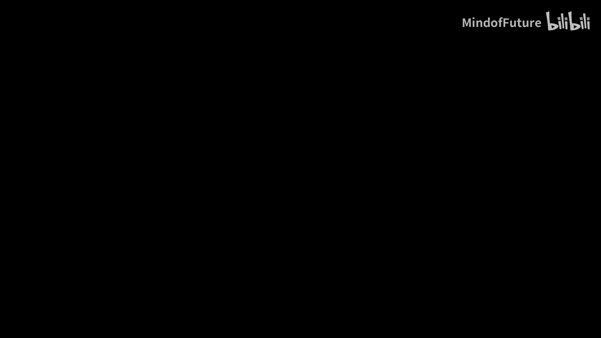
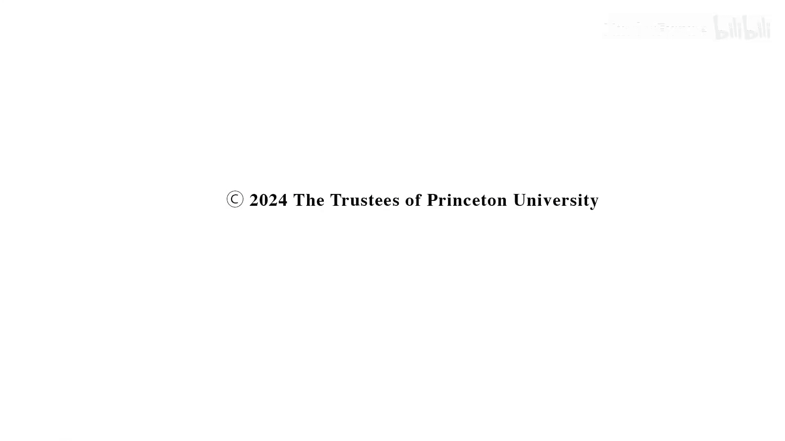

# 【普林斯顿】强化学习基础 ECE524（Foundations of Reinforcement Learning，2024） p19 P19 Two-Player Zero-Sum Games -BV1a2frYfEk4_p19-

Okay， let's start a lecture today。 So today we'll continue talking about multi agentian reinforcement learning。

So in the last lecture， we talk about the formulation called a Markov game。

And then we talk about how we're gonna solve this game by using the。Belman automatically please。

The B Op equation is essentially very similar to the MDP version with just the maximization replaced by the mini Max。

And this is like a multi agent， like two agent version。So。

 so this is basically the formulation and the planning。 Today。

 we will continue talking about the learning algorithms。Okay。

So although we can like we start from the reinforcement learning approach。

 we talk about the Belmon opt equation first。 and then we say like we can do planning based on Belmon opt equation。

 It turns out for multiian reinforcement learning， a lot of the early algorithm was not designed based on this like Belmon opt equation。

 It was designed by from another principle。 So we will talk about the。

 the previous approach first first。Prob actuallytro not a classical approach， but。But let's say。

 best response based approach。Okay。So for this style approach of algorithm。

 the key observation is the following。That given a fixed opponent。Computering best response。

We call it BR for shot for this lecture， is actually somehow a single agent problem。

We'll put a quote on a single agent because later， we will see actually。

 this single agent is slightly different from the single agent reinforcement learning we have been talking about。

So basically， as we said， the major difficulty of multi agent reinforcement learning is like we cannot treat opponent as a fixed environment。

 Well， for this best， best response approach is kind of saying when I fix my opponent。

 then my opponent， I can treat it as a， as a part of the environment。 So basically， then we。

 if we just compute the best response of the opponent， it becomes a single agent problem。

So for this type of approach， we have a two components， essentially。So， the first one is。Nash。

 finding algorithm。For normal form。With best response， ouracle。

That is we were essentially one part is we just have algorithms， which for normal form game。

 that is a mark game without any states and transition。

 As as this algorithm can is kind of only access to a best response。

 that this algorithm design is basically reduced to computing a sequence of batch batch response。

 We will see what kind of algorithm of this class。Later， but as announce we have this algorithm。

 then we can essentially just using this best response。

 And we know for like the re multi reinforcement， the best response。

One hereuristic is that we can just use a single engine reinforced learning algorithm。

Use single agent reinforcement algorithm to compute the best response。This has a lot of algorithm。

 like。Like a VI， Q learning。PPO D Q and a lot of things。So if we're using this generic recipe。

 that means the second part we， we can like we have already talked about this for the。

 for the most of this semester。 So we only need to focus on the first part about the na finding algorithm for normal form game that that cause best response Oracle。

 We only need to focus on designing algorithm for this part so that we can fix solve this best like multi Asianian problem。

 So this is actually has been the recipe for like solving starcraft or a lot like a lot of like the games before。

And we will talk about what is specific algorithm。 And later。

 we'll talk about the drawbacks of this style of algorithms。Okay。

So we will first talk about the best response based。Our wisdoms。放康冇风景。Okay。

So since is normal form game It does not have states and transition。

 And so the algorithm is usually very easy to specify。

 So the first algorithm we look at is called cell play algorithm。It's a very simple heuristic。For。

 for anyone。Who like， think about this problem， He might try。To see whether this algorithm is good。

 So the algorithm look like follows for k equal to1 for iteration capital K。We say pi 1， K plus  one。

Is equal to best response。Of P2k。派2 k。Pluss one。Is equal to the best response。Of Taiwan1 K， K plus 1。

So those are the strategies， pies like the mixed strategy。

Haian is a mixed strategy of the first player， and the Pi2 is a mixed strategy of the second player。

So basically， this is saying whatever if I have a。P 1 K and pi 2 k is the the strategy of both player at a case iteration。

 What I will do is I will use the second players case iteration strategy to compute the best response for the first player。

 And then for the first player， then I use the first player strategy to compute best response。

 and we get the second player strategy。This is essentially I just have two player。

 one compute choose the best response of the other and the other compute best response of the first。

 like we itated doing this。Yes是。系啊。好了声。Of。The ice player。At the case of iteration。

So what we can see about this algorithm。It turns out we can simply just try it on rock paper scissor。

So what will happen is， for example， if we initialize with the second player to be a rock。

Then the first player will change to be a paper， and then the second player will change to be scissor。

 and then the first player will change to be a rock。 and second player will change to be paper。

 So we kind like we， we end up within a loop。 we never able to converge to national equilibrium。

So basically this is like a very bad algorithm。 You。

 we should not try this algorithm because it isn't even guarantee to converge naturally。

 It can like stuck in some cycle。So after seeing this， you mind wondering， okay。

 what if this is like saying I just look at the iterator。 What I， what if I can't like average。

Average means like because I stuck in the cycle with like a rock paper scissor， rock paper scissor。

 If I do average， then somehow I ends up with one0。

 one third one0 probability on playing all the actions。So it turns out that average。Helps。

In this specific game， rock paper scissor。But it won't help in general。This is also very easy to see。

 For example， I can just slightly tune the reward for， for rock paper scissor。

 when rock paper scissor means like I。If rock paper wins rock， we got a reward one。

 Caesar wins paper。 We gotta we got reward one。 but I can slightly tune it so that I'm saying like when paper wins rock。

 I got reward 1。5 when Caesor wins paper and we got a reward2 or something。 In that case。

 the national equilibrium will no longer be uniform distribution over action will be slightly favored over Caessor。

 because when Casar wins， it has like a higher utility than paper wins。 but in that case。

 if we just do this best response plus a will still end up with 1 third1 third1 probability。

 So this is this is not helpful in general。 So in general。

 this cell play algorithm is not a good algorithm for doing。Best response。

So how should we fix this algorithm？If this algorithm， like a naive algorithm， is no longer working。

So it turns out there is a very famous algorithm that proposed as a variant of this algorithm called a fictitious play。

So this algorithm is proposed by Brown，1949。So the algorithm is similar to cell play。

 but it differs in slight details。Again， we have some iteration for k equal to 1。OkayK。

So we will do the similar updates。 Pi 1 K plus 1 is equal to the best response。

So the only difference is the best response is no longer the best response of the immediate policy of the current policy of the opponent。

 But it's actually the average policy of average of all the previous policy of the opponent。

 So this is like a best response of one over K。Times。排 to one。Ppe嗯。有排出。That is。

 I look at the average， look at the policy of my opponent across different episodes。

 and I do an average essentially， I look at the average policy of my opponent。

 and I find the best response for that。 That is how we do the fixious play。 And by symmetry。

 we can also do the same thing for the other player。1 over K plus1。太网弯。To拍 one K plus one。Okay。

 again， this notation pi K is the policy of ice player at a K situation。

So only difference is I'm no longer finding the best response of the current policy。

 but I look at the best response of the average of the previous policy。This is like computing。

The best response policy。To the average policy。Of opponent。

This makes a lot more sense in rock paper scissor。 We can imagine like when we do this averaging thing。

 And eventually， this a will converge to the national equilibrium。So， we can actually approve。

This actually has theoretical guarantees。This is by Robinson，1951。Basically。

 it says the policy of play。Converge to national equilibrium。So this is actually a very。

 very famous results back in like 951。It's kind also surprising to a lot of people。

 because this is saying just such a simple dynamics eventually will guarantees you that will converge to the aly room。

So this is also the reason， even till nowadays， there is still a lot of algorithm just leverage the fictitious play algorithm to compute a national equilibrium。

But as we said， this is like the theoretical course。

 So we're not very happy with just stop at the this asymptotic convergence。

 This is eventually we will con natural equilibrium。 But we across this class。

 we will talk a lot about how fast we kind of converge to a natural equilibrium and how many samples。

 In this case， its really about how fast。😊，Okay。So how fast。If it's use infinite amount of time。

 like K need to be like a。Super large。 that won't be useful， right。

So it turns out when we talk about how fast it's actually very tricky。 Even till nowadays。

 I don't think it's like a fully solved problem。So what we will know is actually。

 the answer is not very good。 so probably it's not facet at all。So what we know is first。

 we can inspect a proof。Of Robinson。951， the original paper that proves this will eventually converse。

So， the convergence actually requires。Something like。1 or epsilon。To the power of omega a。

 where a is number of actions。In the game， in normal form game。To find Epsilon Nsh。

Where Eppsilnal Nash， we kind of we already talk about in an last class。

 so by Epsilnal approximation to a national equilibrium we measure by duality gap。

So this is actually saying if we just use the original proof。

This is like terrible because for any reasonable number of action， like， for example，2030， this。

 this will be already like huge。 and this， this congence is like super slow。

So there is some further research later that trying to this improve this complexity。

 they kind believe maybe it's the artifact of analysis。

 maybe the algorithms actually conversionverge a lot faster。

So there is a very famous conjecture by Caring。In 9059。That this rate。Can be。Improve。To。

Order of a1 over Epsilon squared。Basically， it says probably this exponential in a is just some artifact and。

In reality， this algorithm won't even need the action number。

 like exponential in a number of actions to converge。

So this is a conjecture and like backing like 60 years ago。

 But then this just conjecture keep opening for， for very， very long time。

 and nobody is able to solve this conjecture。And theres some partial answer to it， by in210。

14 bioscallacus。And pen。The papers can like， say claim， it can refute。The conjecture。

 basically saying this conjecture is not true。But the paper kind of assumes we have some adversarial tiebreaking。

That is whenever there is a tie， actually。They're able to do some adversarial way that even inconsistent way。

 like， for example， whenever there's a tie， this time I can choose that action。

 And next time I can choose this action in some adversarial fashion。

 which is not very common in practice。 But basically， if we have this very weird I once weird。

 but like a very strong adversarial tie breaking， then basically theyre。

 they can construct some current example to， to say。

To prove you actually require something exponential in a， this is unavoidable。Okay。So basically。

 this is about the vio tie breaking for the。If we have some consistent tie breaking that every time we。

 for example， we we do tie breaking in some like a dictionary order or some like fixed order。

 then it's actually unclear whether what is the rate。This is still an open problem right now。

And in practice， if you run this algorithm for like Ted has a bit of this fictitious algorithm。

Maybe it won't be like exponential in A， but there are some like higher order parameter in A is kind like。

It's always observed in empirical。 So it seems like this algorithm is indeed， not very fast。

So the next question is how are we going to make this algorithm？

Faster if this algorithm is actually not that good。So there is a large class of algorithm。

 which we just talk about one representative one that is called double overac。So the whole idea is。

For example， when we have a。A lot of my opponent have a lot of policy that pi 1，1， pi2，1，2 pi 2 k。

And I also have a lot of policy that pi 1，1 to pi 1 K。I can essentially compute。

 compute the relative performance。Between them。So， for example。

 we can't say this is a value or like the utility of playing。Pi1 I I policy against pi 2 I。

So we call such matrix M K。That is a utility matrix。For if we can use the。

Play like previous policy of one player against player， policy of the other player。

 And we look at how what， what is performance。 This is like K by K matrix。

So double all is kind of like the algorithm look like this for k equal to one。To kept O。

I think the part of generalization is we see like infectious play。 This is like average。

This is a uniform average。 And we think this is not very natural。

 And we want to have a smarter way of compute and this weight。

So what we will do is we will essentially select some P and Q。Bok。By some specific way， okay。

And then。What we do is a pi 1 K plus1。It's equal to best response。Of summation， iPhone from 12 K。PI。

Hai。Haicicuaii。And pi 2 K plus 1 is equal to the best response。Of summation， iPhone from 12 K。

QI排 onei。Okay， so this is just slightly general。The fact should play so that we are no longer just one over K ways。

 We're using some other ways。 P I and Q， I， where P I and Q is computed in some more complex fashion。

So there's one way to compute this。P and Q vector。 that is called double oracle。

 Doub oracle can specify the specific way of computing and so to choose this P and Q to be the national equilibrium of M K。

So MK is a K by K matrix。 When you compute a national equilibrium。

 it's actually a mixed strategy for the first player， a mixed strategy for other player。

 So it's kind of like a probability。For P5 for Q。So this is one specific strategy called double orac code。

 But in general， like。They also proposed the algorithm called a PL。Which color policy space。Response。

 or recall。The name sounds a bit counter intuitive。 but if you look at the algorithm， basically。

 therere just the， the generalization of a double hour code。

 but using some other ways to compute the meta strategy， P Q。所以参出来。

We call PQ M strategy because PQ is actually a probability over the existing strategy so far。

So it turns out you， if you look at the paper of alphapha star， they essentially just。

like for Star craft too， they essentially just leverage some strategy of like in the class of P R。

 They design some like league training。 But it's more you have the， like this。

Mattrix and design some score based on this matrix to computer manner strategy。 and in a high level。

 is performing these kind of updates。So what we can say about the this double oracle algorithm。

 for example。So the proposition essentially says the double oracle algorithm。Fsna K。

Of a normal form game。With A actions。In order， a traditions。So in the first class。

 this like proposition looks a lot better than the picture should play 1 because picture should play says it'll require something like exponential in a。

 Well， here is just a linear in a。But turns out this proposition is actually pretty straightforward。

 It's actually nothing。Much， okay。 So the whole reason is。

You can more or proof that for double oracle。In every tour。Like first。

 we can prove the pie I K is always a single action。

This is basically because for for normal home game。

 you can always use a pure strategy to achieve the best response。

 Best response can be always achieved， in a single action。And then。

You can essentially also prove at every tour。The algorithm。We'll add a new accent。Or stop。Okay。

So basically， if， if the， if the best response you compute is not the， is not a new action。

 That means this matrix will not be updated。 so the whatever the policy you， you。

 you have here is actually the same。 What what you have is just exactly the same action with additional role。

 So in that case， when you compute national， everything will the same。

 So the algorithm essentially stop will not do any update in meaningful update。

 So only if when you compute the best response。 This is some new action。

 you will add a new action to this matrix and you essentially expand this matrix。

And then if we kind of always add a new action， didn't stop。 And then。MA。Will become。

A full game matrix。In8eration。this is just because the normal home game only have a actions。

 If we kinda keep adding a new action， then after a tour。 So we the M A matrix。

 this becomes M K matrix becomes the original matrix。So that is when K is equal to a。

 it is just the original matrix。So， that's why it's also。Not very surprising。Essentially。

 a lot of heavy work has been done in the double oracle。So basically。

 we have been talking about several algorithms that cell play。 we don't。 know it doesn't work。

 And fixes play。 It's a bit slow。 So that's why basically in practice。

 what you should do is this double oracle or PL algorithm。

 which you compute this matrix and you compute some new metastr and do this best response base。

Alrithm。So now we talk about once we know the algorithms for normal form game。

 we talk about when we combine this normal form game algorithm to single reinforcement algorithm。

 what might be the problem。For so remarkablemark it。

We're saying the converted algorithm is actually very straightforward。 All we。

 all we can modify for this double， for example， or P L algorithm is we replace this best response。

 instead of finding the best response for normal form game。

 would we replace it as using a single agent a single agent reinforcement algorithm for。

 for solving this best response。 For example， I will use P， PO。

 and the fixed opponent to be like this kind of policy。

 and I find the best response to be my current policy。😊。

So there are several caves when doing this approach。The first is by doing so。

 we're essentially converting a Markov game to be a normal form game。We're saying the high level。

 this is like a normal form gaming so that we can apply the double oracle or P S L。

 and the low level is like single agent reinforcement learning。

So when we talk about the complexity for the normal form game。

 we always one very important thing is the number of action。

Number of action for the normal form game。 So when we come convert the the markov game into a normal form game。

 the number of action actually becomes。The number of policies。A mark of game。So as we all know。

 for Markov Game or MP， one thing very complicated is this number of policy is like huge。So easily。

 if you just do some， first， it's if， if you compute the like a randomized policy infinite。

 but you can also do some discretization or epsilon covering argument。

 and roughly numbers like a one over epsilon。To the H S A， where H is horizon in the Markov games。

 the S number of states。 A is number of action in Markov game。

So this is why this conversion is actually not very efficient。 So that means whatever you pay for O。

 A or for exponential in a， you actually pay a by replacing a by this quantity。

 This is already exponential。 So if you could just play in the worst case would be double exponential。

 And the double oracle in the worst case would also be exponential。

 So this is why this first thing is not very efficient。The second。Is a。Finding a best response。

Offfer a mixed strategy。Sorry， a mixture of policy。Is not。Easy。

 is's actually not an easy single aisle problem。Standard in L， what I mean is like by the MP。

So what I mean there is we kind of claim earlier that when we have a Markov game。And plus， opponent。

Is fixed。Fix opponent playing。Some market policy pi1 or pi2。

 let's say pi two is only depends on the current states。Something like that。 Okay， so in this case。

 this becomes。And MDDP。嗯。The player wises perspective。This is still true。 This has no problem。

 But the problem part is when we do double oracle or P L or even fictitious play。

 we're not finding the response of a single macro policy。

 We're finding a best response of a mixture of policy。That is。

 we are considering actually the problem of a markov game。Plus。Fix opponents。欢迎。A mixture。Of a。排出。

K到S。So each individual policy is only depends on the current states， but there are multiple policies。

 and we're playing a mixture of them。So it turns out you you can essentially see a mixture of a Mark policy is actually not a mark of policy that you cannot just represent this mixture by a single policy only depends on the current states。

So this turned out。Is no longer。AMDP。In the player one's perspective。

So this is the reason in reality， if you want to say the principled way of designing algorithm。

 you should not just use a single reinforceable learning algorithm to find the best response because those algorithm like we said V learning of Val。

 cure learning and also like， for example， PO。 they are originally designed only for MP。 Well。

 this is like a beyond MP。 and whatever algorithm were using there is。

 if we use MP algorithm directly here It's only a heuristic。 It's not principle。

 It's not guarantee to find the best response。Okay。So all those two kind of concludes that。

Those line of algorithms。That are designed based on the five box approach。Of a single agent now。Plus。

 glass response， oracle。Actually， does not。Fly utilize。The detailed structure of Marov games。This。

 I think this tour are essentially the reason， although those are algorithms which kind of people tried a lot in practice because it's something simple to think about。

 But on the other hand， in theory， in principle， you cannot actually prove any efficient guarantees for this line of algorithm so far。

 like the best response plus in algorithm is just because all those problems we have mentioned before。

So we kind of conclude the most important thing is in order to get principle algorithm for Markov game is we need to essentially better utilize the detailed structure of Microsoftov game。

So how are we gonna do that。So we actually use our old approach。 We have been dealing with MP so far。

 and our approach has been based on the dynamicyna of programming to solve this。

 And now were dealing with smart games。 So we will also develop our reinforcement approach or dynamicyna approach。

 dynamic programming approach for solving this class of model。So this is aisle or。

Pmer programming approach。So we again talking about several settings in the MP。

 we talk about generative settings， exploration settings。

 So we look at the generative settings first。Essentially， this is a simulator setting。

 And we look at the taber。Ps for Mark of getting first。So remember， when we have the generator model。

 what we can do is we can uniformly。S铺。SAB。That is we。

 because we have a simulator that taking the states and action of a different player， and we。Gets。

Reward and S prime。 And we can use this。To estimate。The empirical transition matrix， he hat。

She had a transition。To S prime from S A B。Once we have the empiricalial transition。

 we can essentially run the value。Well， here it's a multiplayer game。

 So what we run is called national reies。But N valueeration is essentially the same as a。

It an original electrotrition， with just very little modification。So just remember。

 when we do the value， essentially， were just running a Belman opt equation with the transition replaced by this empirical estimate。

 So what are we gonna do here is again， when run run natural value is by doing this Belmon opt equation。

 That is we have the update。 Q， H S A B is equal to R H。S，AB。Plus， we use a。

Empirical transition to do V H plus one。S， A P。So this stuff is basically the same， and we will do。

For H from the last step to first stop。So the only different steps is the V value updates。

Where originally， were just maxization my maximization over a Q because that's a single vision problem and a single agent just want to maximize the value。

 Well， now it's a multiplayer game。 So we， one player just want to maximize the other player just want to minimize。

 So instead of just maxization， we will do a mini in this case。😊，So we're maximization over muh。

And the minimum over new age。Sation， A B。没有 which。诶。Yes。Q， HSAPB。And new H B S。

This is essentially the same as the last time we do the Belmon opt equation。

 We replace the max by mini max， and we， we always do the randomized policy。

And you can also think this is basically just a computer， Nsh value。For the。Matrix normal form game。

 which index by the current states。So kind of like this Q， for this Q value for if we fix the states。

 this Q value kind of denotes a normal form game with utility Q A B for like a first player play action。

 A， second player play action B。 And this is just computing na value for this。

Ce value at a state as us。So this is essentially the algorithm for Nsh value。

 and we can essentially do。Similar analysis。To VI。In generator model。To， to show sample complexity。

Of N yeah。I think it's a very good practice to use leverage to use existing knowledge。

 especially to recap what has happened in the value on the generator model。

 we learned before and how to adapt it to the， to like this game scenario。

So this is basically what happens for the generator model。

We'll talk a little bit more for the exploration setting because that's slightly different。

So in the exploration setting。Where we again， we will， I think the whole idea。

 So we have a national value and classical ways we just combine national。

 N value with optimism optimism。So this gives the algorithm that's called the。Optimistic。Nash VI。

I' also buy some paper in my groove。In 2020。So remember， the value， Op value compose two parts。

 The first part is we compute the Q value， and then second part is like executing a policy。

 So we'll do a similar thing here。He you put the one to capital O。And for H。Equ to capital H to one。

For all。State action。Pair。We compute the optimistic Q value。That is a pure upper bar。Is equal to R H。

S AB。Plus。Expectation。P at。Pch。V H plus one。Upper bar。SAB。Plus， some bonus。

So the tricky part is we have the optimism because in the singlegen setting。

 we only care about the maximization maximizing the reward。But here， because we have two player。

 one player trying to maximize。 the other player is trying to minimize。

 It turns out having just upper bound is not sufficient。 So we also need to have a lower bound。

 which a lower bound will serve as optimism for the minimum， for the minimum player。

So what we will do is again， we will have another。Optimism， which is optimism for the M player。

Thatll kill lower bar。It serve as a lower bound。We will do the same update that RH S A B。他是。P hat。

W plus one bar。S AB。subtract be。So the only difference is that we subtract the bonus here we add the bonus。

So this step is relatively straightforward。 We just have a Q value。

 And the tricky part now becomes the V value part。So write a naive algorithm first。

So what we will have here is we instead。So instead of having a one Q value。

 we can compute a national equilibrium。 Now we have a both Q upper bar and  Q lower bar。

 We have two Q value。 that serve as an upper bounds and lower bound。

 So this become a lot trickier because the national equilibrium now is no longer a single game。

 It kind of seems like we have a two utility matrix。

So one naive idea is what we can do is we can we can compute this。By Mu address。Neoh。

To be the Nsh equilibrium。Of Q upper bar H。Price。This is a Q lower by HS。Just remember。

 this is no longer the standard na equivalent。 This is no longer the zero sum game。

 This is a nichesh of a general sum game。Because essentially。

 we're no longer seeing the utility of the first player as the second player。

 So we'll just use Q upper bars the utility for the first， for the max player。

And this is a utility for the mean player。So now they those two player actually are the loss of the main player。

 So actually， the two player has a different utility and loss。 They no longer sum to one。

 This like general sum。 And general sum， we will still able to find a na。

 but we will talk about the caveat of this problem later。 But in short， this。

 this subrout can no longer be computed efficiently。 This is actually a PD problem P problem。

 So we will talk later how to fix it。 But the simple algorithm is first。

 we compute the nash equilibrium of a general sum game。General sum in a sense。

 the first player uses a utility to upper bar and a second player used a utility Q lower bar。

And then。We compute the upper bounds on the V value。By just the。第三学了。Doing summation of a。AD。Mwi。

Q opera bar。And a new。Be given us。Essentially， integrate this Q upper bound by mu and new。

 and similarly， for the lower bound is also the same。Are you given us。K lower bar SAP。

你ll be given us。So we just compute the natural equilibrium V policy and when we connect directly。

Do an expectation over Q upper bar and Q lower bar And just gives the V value。

And then all we need to do is we will execute。Policy。Man钮。Coect sample。Colaect of one trajecties。

And then， update。The transition P hat。This is the same part as a standard ofveism。

So we can like see the。This part is basically， we just have the upper bound and the lower bound with one adding a bonus and one subtract the bonus。

And because we have a two Q value， now we need to compute naturally equivalent and we have a general sum game。

And once we have the natural equilibrium， we just use this as a policy for Q value。

 and we do everything。So it turns out by doing this vanilla algorithm。

 theres one very important problem。That is。Computing。Nash equilibrium。For general， some game。

Basically， anything beyond zero sum game for zero sum game。

 national equilibrium is still fast computed， but for general sum game。Is。So called a P， P A D hard。

PPD complete。You think this is a complexity in the computational complexity theory。

 but it essentially says， it something。Rather difficult to solve。 And there are like a very。

 a lot of come complexity hierarchy。 But one thing we are very sure about this PD complete is so far。

 we don't know any pernomial algorithm that is able to solve any problem in this P AD complete class。

So， basically。No polynomal algorithm so far。In the worst case。Discon is bad， because。

Although like we say in the function approximation。

 a lot of algorithm we design statistical efficient。

 but in an earlier lecture for every algorithm we developed for the tableular setting。

 everything is computationally efficient。 Like we can solve it very fast。

 But here seems like for Microsoftov game， even for the tableular， like for tableular case。

 we somehow ran into some computational。😊，Difficult issue。

So it turns out this is actually not the problem is hard。

 It's actually this algorithm is not well designed。

 We can actually better design this algorithm to better solve the problem so that we can solve it in polynomial time。

So the trick is that we can replace。The Nsh finding part。By another subroutine called C CE。

So we replace this part。So called C， C，E。I first， write out the algorithm Im done explaining what it is。

So the algorithm will now becomes just simply， we will find a policy。

That is actually not necessarily a product。 So when we write this new and new that assumes like the sample of action A and sample of action B is kind of like independent。

 So this is like product product policy。 But now we might have some correlated policy。

 That is the sampling of A and B may no longer be independent。

So we will compute this pi to be the CE。Of Q upper bound and Q lower bound。And then。

We will do the updates， the upper bar。It's just a summation of A And B。Tai。A B given S。Q opera bar。

 H S A B。And similarly， we have a lower bound， also the same。

So this didn't say much because we kind like this C is still a black box。

 So we need to talk more about what is this CE subro。So C， CE， in general。

 we can look at this subroutine essentially takes two matrix。

1 matrix Q upper bar the for fix S and the other matrix Q lower bar for fix S。So， for example。

 if we compute the C Q upper bar and Q lower bar， it returns。

So calledled coarse correlated equilibrium。Which is a joint distribution。Pai。

In this simplex of a cross B。That is in the joint action space， A And B。

 And this is like joint distribution over， over this joint action space。

 So this kind of not is very different from a national equilibrium。

 which is a product policy that the distribution of A and distribution B are are like independent。

 Well， here， they allow some correlation that essentially allow some collaboration between them。

So by its name， you can see this is like some sort of equilibrium。But so。

What is the definition of such equilibrium。 So it basically says when we find CC E Q upper bar and lower bar。

 the pi policy pioneers who satisfy the following equation。And it expectation。

If A B both sample from pi。Q upper bar A B。 That is if both player like act according to the policy pi。

 I can cross to equilibrium。This will be greater or equal to。Max。A a star。Expectation。Of a B。

Sample from pi。Q opera bar。A starby。This is basic。The， the joint， the utility the first player get。

 if they both of them perform according policy pi is actually greater than if my opponent still play according to pi。

 but I can switch to something uncorrelated to this。 Okay， I no longer core collaborate with them。

 and I just fix some fix action a。😊，And I won't get anything。 Okay， so this。

 this means I don't have any incentive to change some fix action。Similarly， we also have the。

The other part， that is。Less so equal to the minimum。Of P star。Expectation。ofAB向后方拍。K lower bar A B。

Please start。So the intuitive band like an interpretation of C， C E is like。An agent。

Won't gain anything。 Like if we already reach the CE， then an agent won't gain anything。By。

Betweentraying the。Like the shared protocol， essentially， we're saying we will。

 we will sample from some coordinate policy。 But now， if I betrayed， I will just do some fix a star。

 I can no longer see how my opponent is sample from policy pie。 and so。I betray， and then the other。

Asgents no longer collaborate。O coordinate。But no longer collaborate in a sense， like originally。

 if we need to sample some joint action from pi， essentially， we have like a shared coin toes。

 we toast the coin and everybody both player will be able to see the coin to。

 and then we sample from according to this distribution。 And now when I betray。

 I no longer able to see the coin toes。 So my opponent is just according to some hidden like doing some random strategy。

 according some hidden coin tos。 I can no longer see the coin to。

 So I won't be able to gain anything。And there's a stronger version。 if I able to see the coin ho。

 that's called。Quality equilibrium instead of course quality without， without the course more。

 modify。 But here is O。 We just can talk about the CE。

So we'll talk about the brief reason why we can replace the Nsh finding by C， CE。 First。

 we note for general sum。We know C， CE is basically just having some linear constraints。 So C。

 CE is actually can computed by linear programming。

We know for linear programming there are a lot of efficient solve， so this is a polynomial。Well。

 nash's P D hard。 We kind of already mentioned that。Compflicte。The other thing。

 there are several properties regarding internationalash and C， CE。We can actually show that。First。

 national equilibrium。Equli is a subset of C， C，E。So you can essentially see the national actually satisfy a stronger condition than N CC。

E。 So whatever is national equivalent is always CCE。 But on the other hand， if some policy CCE。

 its not guaranteed to be national equilibrium。So then if it's just super sad。

 then that means it's a funny Nsh maybe， a finding CC may be very different from funny Nsh。

 So what we will have next property is very critical in this case。 That is。

 if I find some policy of CC， CE。Of Q and Q， That is a CE of zero sum game。

So both utility are the same。Then let's， and in general， this is like correlated policy。

 But we can let new and new。To B的。The marginal。Distribution of pi。So that is for zero sum game。

 I find a coordinate equilibrium。 And then I just computed a marginalized distribution for the first player and second player。

 You can actually prove that。Mu and new is a Nsh for Q。So this only holds for the zero sum games。

And this is essential reason why we can actually replace the nash by CC E here。

 because we know this is upper bound。 and this is a lower bound。 Intuly。

 you can think when we have enough samples， it's Q upper bar and lower bound will eventually kind like become very similar and become one value。

 Or even if it's not that one value， It's like a very close。 So in that case。

 we can essentially leverage this property so that we guarantee whatever the policy we find by marginalization is kind of close to nash equilibrium。

So we're running out of time。 We will talk about the formal guarantees of this optimistic national value in the next lecture。

