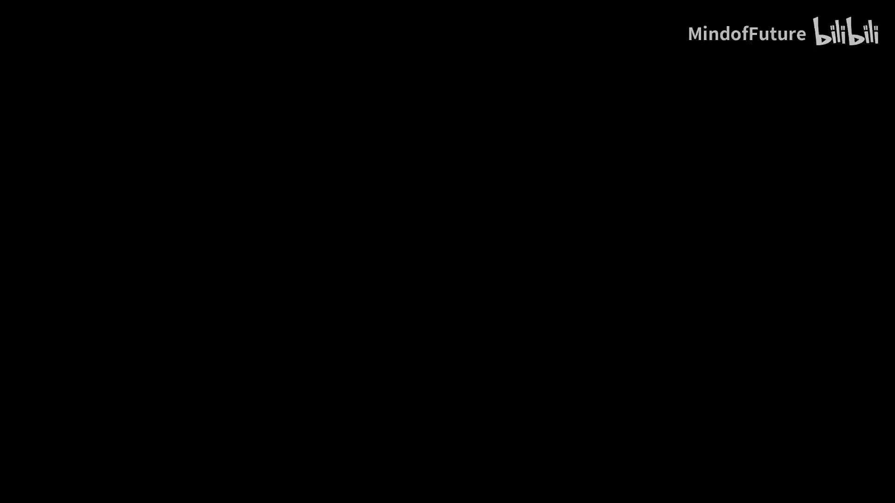
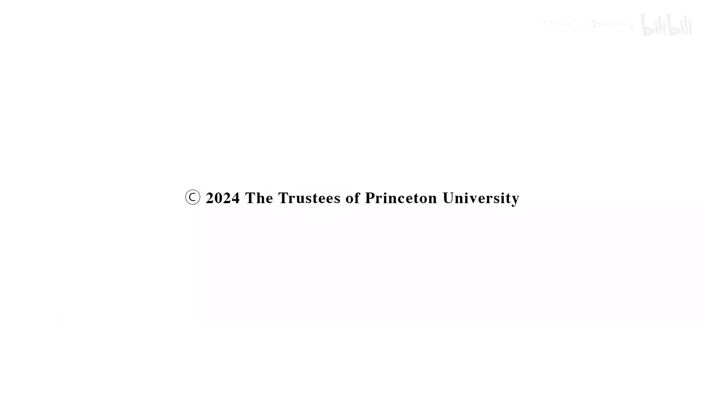

# 【普林斯顿】强化学习基础 ECE524（Foundations of Reinforcement Learning，2024） p20 P20 Multiplayer General-Sum Games -BV1a2frYfEk4_p20-

Let's start lecture today。So in the last lecture， we have been talking about。

Several approaches for solving。Mark of games。 we talk about the first approach。

 that is we combine the classical normal form based。嗯。Best sorry， normal form。

 best response based algorithm。Plus， single and reinforcement learning。

Although the connector algorithm is quite intuitive。

 but there isn't like any strong theoretical guarantees or principle manner we can improve for this class of algorithm。

 actually， there are some like。Indications where this algorithm。

 this type of algorithm may not be very efficient in solving Mark games。

 Then we resort to the second approach where we talk about the reinforcement learning based approach。

we're essentially just directly doing Val thatm programming， we do the N value tu。

So we talk about our。Like previous methods we have in several different settings that is in the generative model。

And in the end of last very last lecture， we talk about the。Exploration scenario。

 So we talk about the。optimistic of national re。This is like an online setting。

And we end with like explaining what is optimistic Nsh algorithm。

 which essentially is doing Nash algorithm with slightly modification that we need both upper bounds and lower bounds。

 And when we have upper bounds and lower bounds， we are now doing the general sum games。

 So we need to compute the CCE instead of a Nsh because thesh national equilibrium of CC is a PD hard to compute。

 So it's not computational efficient。So we just left waste。

 the only thing that we haven't talked about the guarantee is for this nationaltor algorithm。

 So this is。Well we will provide it today。So the guarantee is says， like with high probability。

Optimistic。Nash federation。Findines。And epsilon， approximate。Nashash equilibrium。

 Just remember the epsilon approximate natural equilibrium is defined in terms of duality gap。

In the following number of episodes。In O Tiilda， episodes is like how many games you need to play。

 That is H cube against some paraorial dependence on the horizon and state dependence S。

 this is table setting times A and B over Epson square。Episodes。Okay。

And I think the most important thing that makes this different from the single guarantee is。

This is the number of action of the max player。And this is the number of actionsions of the meme player。

So you can think， although we can like we need to use a new mechanism to design algorithm。

 But in the end， in terms of sample capacity， how many samples we need to find optimal。

Policy where here the optimal policy is national equilibrium。

 It turns out we just replace the number of action of the single agent scenario by the product of the action。

 which is like the total number of action combination of the two player。I think the most important。

Thing about the theorem is in because like in the previous case。

 like in the first class of algorithm we where we combine best response。 based algorithm。

 we're seeing engaging and reinforcement， we're saying like it's likely we cannot get any like efficient guarantee because。

The the policy like Part space is huge。 and those BR based best response based algorithm are not very efficient。

 And the most important thing here is once we resort to this like reinforcement learning based algorithm。

 we can actually conclude that。Optimistic。Nation weather tourism。Is able to find。

Ifpson approximate national equilibrium。In polynomial times， and samples。Okay。So this part is the。

Important thing now we do have a polynomial time and a sample algorithms。

And the other thing you might wonder is this seems like if you look at the sumcom this seems like pretty straightforward。

 as as we said， we just replaced the single agent number of actions by like the total number of action combinations by the two player。

But in the game， we might have like a more structure， like we want to find natural equilibrium。

 So natural question is whether this kind of thermoity is optimal。

So it turns out at that time it was unclear because the basic inform theoretical lower bound week one can proof is actually something lower。

So the information theoretical lower bounds。One can prove is something like this。

Something like欧omega。To the H cube S。Max A。Over Epilon Square。

So this is like something more interesting happened in the game that we actually don't need to pay the in the lower bound。

 at least we actually don't need to pay the product of the action。In this complexity。

 we only need to pay the max number of action of both player。So this leads to。Actually。

 some unique challenges in the multi reinforcement learning we have。We want to talk about。

So so far it seems like we just directly borrow what we have for single engine reinforcement learning while replacing the maximization by essentially just replacing the maximization by finding natural equilibrium and solving a mini mini max。

 and other than that we didn't do too much， like CCE is a little bit trick but other than that we didn't do too much。

Okay。So。Now， the first unique challenges we have that。Basically。

 does not appear in a single reinforcement learning。 It's so called the curse of multi agentsents。

So basically， we can already see some clue in this like two players，0 sum。G。Setting。So， the typical。

The sample complexity。Skills with。Something like the product of number of actions。 This is already。

 we already show it for the two player scenario in the multiple multiplayer scenario。

 you can essentially extend this kind of algorithm to the multiplayer mark game。

 We' will talk more later。 But basically you can imagine the if we just continue using this class of algorithm director using that number programming combined with like Nash solve。

 We will end up with some complexity that is omega to the product of iPhone 1 to M AI。

 where M is the number of player。Essentially， the product of number of action for each player。

 And this is roughly something omega to the A to the M。If we have M player。

This is like the number of players。So the bad thing about this is this is you can clearly see this growth exponentially in。

In the number of players。The reason for this is。AndRemember。

 for when we're doing this kind of national value tourism， we kind of have a joint Q value。

And the size of jointq value。Whenever we want to estimatemate something like that， it's like Q， S A1。

 dot dot dot till your AM。So if in our chapter setting， essentially。

 we need to remember all the values for different action combinations。

 So basically the size of such a Q table is。Omega S times product of AI。So essentially。

 whenever we want to estimate such Q value， joint Q value。

 we can like we need to pay something exponential in M。So the question is。

 can we actually goes beyond this type of algorithm and can we achieve some poium some complexity。

Okay so this is the first challenge， essentially also related to this complexity。

 whether we can improve from AB to max AB， or can we improve from like A to the power of n to something polynnomial in M。

Okay。And the second unique challenge in this scenario is called the design of decentralized algorithm。

Also， just recall that。In like可。VIUB or Nash Ra tourism。

We need to kind of maintain a centralized server。To compute。The joint Q value， O。

 something like a Q upper bar。S A 1， A2。Kill lower bar SAP。Similarly。

 when we like extend this Nsh registration to multiplayer， like this is like still。

 whenever we're doing this like joint Q value thing。

 it's still a centralized algorithm in terms of everyone need to communicate and eventually compute some joint Q value。

A lot of times， we actually favor some decentralized algorithm。

 So decentralized algorithm is somehow very different from this style。

 like a centralized server and compute something jointly。

 and decentralized algorithm is something much favored in practice is something like this。Ideally。

 a decentralized algorithm means like each agent。We'll just run。Runs her own algorithm。Independently。

Using her own observation。As if in the single agent setting。

So why we're interested in such kind of a decentralized algorithm。There are a couple of reasons。

First this kind of algorithm is definitely easier to implement。In a sense。

 we just need to design a single agent and algorithm and for each player。

 like how for each agent how to learn。 And then we just cop it for multiple different agents。

 So it's very easily to scale up to。Multiple different agents we don't even need to write some new code。

Second thing， this is also more versatile。If we have such a kind of algorithm means this algorithm like working in some strong sense in the sense。

 like it basically doesn't really care about what are the players doing， so it will be agnostic。

To the action of outer agents。Finally， it just has less communication。

Because theres no centralized agents just run their own algorithm。

 so we don't really require a lot of communication， so actually theres no communication。

 so this is just a reason a lot faster and if you ask game theorists why we care about this decentral algorithm。

 they would even argue like this is just like real life like if you're a reinforcement learning agents like you learn how to behave well in this world。

 you are essentially doing that kind of decentralized algorithm because you make your own decision and based on your own observation and basically this is like what you're doing。

So once we talk about this two challenge， I guess immediately we can ask。

The main question is multiage reinforcement learning。 that is like a very unique。

 very different from single agent reinforcement learning is can we。Design。Decentralized。

Multi agentian reinforcement learning algorithm。Thatrics。The curse of multi agencyency。

So we want to basically。Sove two challenges simultaneously。This will be the main question。

We're going to deal with in this lecture。Okay。So before we talk about how we're gonna solve this problem。

 we first I want to talk a little bit more about the formalism because now we're talking about like this multiplayer because of multiplayer and decentralized algorithm it's very natural to consider the general sum like multiplayer general sum game that is like beyond two playerer zero sum scenario。

 so I just want to briefly like talk about the formulation of general sum game Markov game。

 which is very similar to the two player scenario。So just be quick about all things。

 So a general sum markov game。Is again， we have a bunch of things that is we have a set of states and now because we no longer just have like two players。

 so we have a bunch of action sets where supposed we have M agents。

Where AI is the action set for Ipha， so we have M different action sets。And transition。

 we just have a single transition reward。 We have M different reward。

 Remember now it's no longer zero sum game， So each different each players utility can be different。

N H。Okay， so I think those are pretty straightforward and the transition。

Its specified as the P S H plus1。 Give a message。 And sometimes I will just use the A H and with vector notation。

 where this is like a joint action。Where the a vector H means。We have action of the first player。

 action of second player， and also we have action of M's player。

 so we just have action of all the player combined together and we denototeed as this a vector notation。

And similarly for this reward or utility。We also general as RIH， S，H。H and it this vector。

 So basically， the utility is going to depend on the current state and action of all players。

But the utility is different for different players。 So this specified reward or utility。

For the ice player。Any questions and H is this horizon access number the set of states。

So we can also define， also define the， the mark of policy。For the ice。

Its just defined as a collection of。Pi Ih。I from sorry， H from one to capital。So again。

 it's a policy one policy at each step where pi Ih。Here's a map。From only states。

 so local states and matters to a distribution over the action set of his own action。

So over the distribution， over the actions in the AI， that is action set for the ice player。

Similarly， we can also talk about value。 So those are just very similar stuff。And VIh。Over pi。

 but here pi is the joint policy。Is the again， expected accumative reward going received by the ice player？

It follow the policy pie。So via iPad。I's equal to the expectation of all the future reward for ice player。

Similarly， you can also define a Q value in this way。I是 this is V one来说。

So after we talk about the policy and values， we can talk a little bit about the objectives。Remember。

 in the game setting， we talk about the equilibrium is something we want to find。So for multiplayer。

General sound Markov game can also define a match equilibrium。Natural equilibrium is again。

 defined as a product policy。海s。Its equal to something like a pi1 star， pi 2 star。我道Q派Mster。That is。

 each player will choose a policy。 will choose a distribution of action。 and those。

 those distribution are kind of independent。 They are not correlated。

 So this is called product policy。 And we say this is a national equilibrium。There's no player。

Has incentive。To deviate。From her current policy。In which sense in the mass。

 we can say we have a value for the ice player。If we look at the pi I。Cross。Pi minus I star。

For any pie。This is essentially my opponent， all my opponents still playing this na equilibrium while I'm divviating from my policy。

 So I'm guarantee I won't gain anything。 That is my value。

 by deviating my current policy will actually smaller or equal to。

If I just stick with the na equilibrium。Sorry， this is like the value of ice player at the first first stage。

 This is you can also see， just put stay one here。行吧。So we kind of know that even in a special case。

Of normal form game we talk about in the last lecture。

We know that finding Nsh equilibrium in the general sum game is actually PPAD hard。

This as we said in the last lecture， like there is no polynomial algorithm that is able to find such a national equilibrium for general sum game。

 so a lot of times we used some surrogate type of equilibrium。

 we kind of already mentioned the concepts in the last lecture that is we will use the CCE correlated equilibrium or course correlated equilibrium。

So there's some surroates。Youre like correlated equilibrium。In short。

 we call it a CE and there is another kind called a coarse correlated equilibrium。Xixi。

So what is the correlated equilibrium or what is so called correlated policy？

So we kind of look at the difference between product policy and a correlated policy。

 So for the product policy。Or like what what a national equilibrium requires。

 It's kind of like we first have a bunch of a policy that pi1 is a mapped from S2 distribution of a1。

 And， we have a pi M。That is a map from state to distribution。O AM。So when we do this map。

 there are a lot of randomness in choosing A1 and AM。

 So when we do when we call product policy that we directly put pi that is equal to pi1 product with pi 2 product with pi M。

We're saying， essentially we， we make those。Randomness， independent。

That is how you're going to flip the coin and choosing the A1 in this probability and how you're going to flip a coin and choose the AMM mean this probability is independent。

 This is called product policy。Well， coordinate policy can be something slightly different。

Which was very useful in the。generalene sum game， because it's not necessarily just competitive。

 It can be like cooperative。 So that's why in general it might be helpful to share the randomness。

 So coordinate policy in general is just a single map that maps from us。

To the probability distribution。Over all the joint action space。

So it can have a very complex distribution that for example。

 I always I can' like use one half for example， if for a1 and need to all the action settings like have two action 0 or1 so this correlatedd policy can deploy some policy that with one half probability I will choose action 1111 and with one half probability I will choose action 0。

0，0，0，00 This is a correlatedd policy Well in a product policy you can never do that because parallel policy each player they need to like choose a benoulli so you won't be able to have like a one half one half ass all1 or0。

As we mentioned in general sum game， it might be beneficial to sometimes consider this correlated policy because the general sum can also have like a cooperative part and a lot of times the correlated policy makes sense。

So while natural equilibrium is equilibrium only developed for the product policy。

 so we can also have some correlated equilibrium defined for the correlated policy。So first is CE。

 and the other one is CE。So C is the correlated policy。Where no player can gain。By deviating。

From her own strategy。If she can still。Observe。Her simple action。From the correlated policy。

And we will talk a little bit more about what does this mean？Okay， and the C is basically。

The same kind definition。 And the only thing is he can no longer。Observe， okay。

 so this can change to cannot。So let's just pass a little bit of what does this mean？So first。

 when we talk about equilibrium， it's very similar to a Nsh equilibrium where everything is about like if other players stick with the current strategy and I deviate from my current strategy。

 I won't gain anything。So the only thing a bit trickier about correlated policy is there are two types of。

Like a two type of condition， like when we deviate from my policy。 One is like a C E。 when I。

 because this coded policy， like it need to be implemented in the following way that every time there might be a centralized player or whatever God。

 like first roll dice and roll dice to something。 And then the God will tell every player。

 like what kind of action to play。 This is like sampled action。 Jo sample action。

 So there are two type of thing。 One is。If you deviate from， from like， if you betray other player。

 if you deviate from your current policy， you can no longer observe the dis from， from， from the god。

 So you just completely dark。 I no longer know what kind of randomness has been sampled。

 This is called CC E。 And on the other hand， if I betrayed。 and God still give me the， the dies。

 Like I still know what other players going to play according to this randomness。

 This is called correlated equilibrium。 Okay， so they are two types of correlated equilibrium。

I don't want to go formally about the mathematical definitions。 If you're interested。

 you can free to look at the related literature or game game theory。

 like tutorial course about like how to formally define those to equilibrium。

 It's not necessarily used in this lecture。 But I just want to talk about the intuitive concepts and what's the relation between those concepts。

 So as we mentioned last time， Nash equilibrium is a subset of C C E。 It turns out for those three。

 Nash is the smallest set。 And Nash is guaranteed to be C E。 And C is guaranteed to be C E。Okay。

And interestingly， the smallest society is PPD hard。Well， everything else is imp。

I's in polynomial class。 Okay， you can basically solve by linear programming。For那么风格。Okay。

So this is like a brief brief about formulation of like a multiplayer Markov game。

 So let's go back to our question where we want to design。Decentralized algorithm。That。

Bricks the curse of multi agencyency。So now we talk about design of decentralized algorithm。

 The first thing we might think of is why not just everyone like run a single agent algorithm。I come。

How about。Every player。Like for example， we can run Val or run cure learning， for example。

 like I say， we do independent cur learning。Yeah。Remember this Q learning is different from like value tradition where we look at the Q value of joint policy because this is a joint action。

 this is like decentralized algorithm， so each player just runs their own algorithm。

 so you just treat as if like although other players are like changing。

 they just treat as an environment and just run the Q learning that was only Q value that as a states and his own action。

And this type of algorithm， as we mentioned earlier in this class。

 that one of the most important difference between single and multi agentent is opponents are not stationary。

 Okay， opponents are like changing adaptive。So this kind of algorithm like a treat opponents as a stationary。

Wwhich is definitely incorrect this is something you should not do because opponents are not stationary environment。

 theyre like adaptive opponents， so so far like up to now theres not any guarantees about proving this type of algorithm could actually converse to any meaningful objectives and I think it's very likely you can easily construct some common example which says this type of algorithm actually would not work。

So what kind of algorithm？Would achieve such kind of decentralized algorithm and also break the curse of multi agencyency。

Or you may think this kind of objective may even seem like very difficult to achieve。

So it turns out in terms of game theory， like we said， we always start from a normal form game。

 so in the normal form game there is some answer to such kind of algorithm。

 so such kind of problem so we should start from there。

So the whole idea in a normal form game to a design this decentralized algorithm that will break the pressure multi agency is instead of treating opponents as a stationary environment。

 I'm gonna design something for adversarial opponents。 Okay。

 so this is this big idea is called like no regret algorithm， which is a very popular。

In this like a nonform game or in game theory literature。 So the answer is basically just design。

 so called no regret algorithm wisdom。By no regret algorithm， we actually means。

We will basically achieve sublineial regret。We already mentioned in our online。

 online reinforced marine setting like a linear regret is like trivial regret。

 Subline regret is something like nontri。 But the most important thing about this No algorithm is not is not only just achieving subline regret。

 but it's achieving sub linear regret against adversarial opponents。So this is the key part。

 So basically， you， we are saying like earlier， if we just treat opponent as a stationary。

 this is like two week， that won't be enough。 And now。

 if I just make an opponent stronger enough so that I can my algorithm even works for。

Any opponents or even the adversar opponent that like adversarly like play against me。

 I can still work。 and then。This algorithm would guarantee you to find something useful。

So we'll see what kind of algorithm would achieve this type of。Guarante。

 like no regret algorithm guarantee。So it turns out there are a lot of algorithm that can achieve this can be called like no regret or chief subline regret。

 So I would just introduce one of the。A very like famous one it' called EXP3 for multi bandit。

The reason we do it for multi on Benit with Ben feedback is because in normal form game， remember。

 the normal form game is specified by a game matrix。

So if we can like look at one player's perspective and treating other player as adversarial。

 then in that sense， from one players perspective， we're just playing like multi arm bandit。 Okay。

 we're just choosing arm。 The only thing is the the reward is also gonna be affected by other players。

 So the reward is kind of like adversarial。 It's no longer stochastic。

So the EXP3 algorithms works as follows。That in each round tea。We will assess some probability。

That's mut TI。Just equal to some weights。Normalize by summation。So essentially for each action。

 we will have a weight。And this weight normalized weight denoted the。Distribution， mut tea。

So every time I would just in every round， I whenever I play I kind of like I play the multi arm banded problem。

I will draw the accent。AT。Randomly， according to the distribution RRT。他就是如是mty。

And then we will observe。The estimated loss。Which is we use LT hat。

To estimate the loss where LT hat for action I is equal to LTI。

The true loss we observe if and divided by the probability， we play it。And。Times the indicator。

That I is equal to 8。Okay that is if the action I is the action we play at round t。

 we we just use the observed loss divided by the probability to play that action。

 otherwise I will just always use zero to estimate my loss。

So the reason we do such an an is because it can easily verify that the expectation。Of the lost ass。

Of this， this is can be look at viewed as a vector， and this is ice coordinate。

 So the whole vector in the expectation is equal to the original loss。

So this is like onbias estimator， unbied sastic estimator of the loss vector。And finally。

 after we observed this estimated， we just set。New weights。WT plus one哎。It's equal to WT。嗯WTJ。

Times exponential to the minus Eta， some learning rate and L T hat。For all。

So the key update is essentially just this so-called multicative weight update。

 So every time this weight is related to the probability。

 how much probability I'm gonna play the action J。 So if the loss is large， I'm gonna decrease。

 shrink this weight a lot。 If the loss is small， I won't shrink this loss much。

 and this is basically the whole intuition about this algorithm。

Essentially I can think this algorithm just every time I receive some loss。

 I'm gonna to penalize this action and how much weights I' gonna going to penalize。

 it depends on how much loss I observe。 So eventually if this arm has a very little loss and eventually I won't like shrink this weight by too much if some arm has a lot of loss and then I will shrink that arm by a lot and eventually my distribution over arm will be more this focus on those arms that has a very little loss。

Okay。So we can think this is like a soft version of trying to be greedy with respect to the history。

 so very greedy with respect is just looking at the history and which one Im performed the best。

 I'm just taking that on， but this is essentially saying I'm going do some exponential weighting instead of like just looking at which why I'm doing the best。

So it turns out this simple algorithm is able to achieve the no regret guarantee。

So the guarantee looks like the following that we will save for。Arbitrary loss。Like L one，它的大。OT。

We have something like this。That's a summation T from one。To capital T。M t， LT。

Subtracted by the minimum。F a。InA。Sation T from one to capital T。A LT。

Less equal to higher an army of。Hey。Times T2的 minus阿尔法。So whenever we have such a kind of guarantee。

 we say this algorithm is like no red algorithm。If some algorithm is like that。

 then we say algorithm is not about algorithm。As we mentioned earlier。

 the important thing is the regret is sublinear。 This is like t to the1 minus alpha and this is regret because mu T is the distribution essentially taken by by the algorithm the algorithm choose to play according to mu T at T rounds。

 So this is essentially the expected utility that's gonna expected loss that's gonna received by by the algorithm and this is a minimum loss like essentially the best loss you can achieve by playing a fixed action and if you look backwards that is in hindsight。

 We're saying like this is always like the regret type of guarantee we look at those two difference that is if what if I just always play some best action in hindsight and how much regret are gonna suffer in total and we're saying this need to be subline。

So basically， we say EXP3。Is no regret algorithmm， is he no regret。

Because you can essentially prove EXP3 satisfyes such kind of guarantee and with rhi equal to12。

And one other very important thing about this noreta is icon we say this actually holds for any adversly chosen loss sequence。

So this kind of is very important in the multiian scenario because this loss factor， as we said。

 if we can when we look at the normal form game， when other player are playing some policies。

 then look at the one player perspective it's kind of as if it's doing multiarm bandit。

 but the only thing is this reward is not generating from some stochastic distribution it's actually generating from some adversarial possiblydversarial stuff because other player plays some。

Like you don't know what other player is playing。 So this kind of guarantee is very important。

 because the loss can be affected by other player。 but this guarantee says whatever other player is doing。

 I don't care。 I can always achieve this subline guarantee， sublinear regret guarantee。

 So this is why this is like so important。 And it turns out when we combine such a no regret algorithm。

 we can easily find a C or Nash。So the following claim basically can be easily shown by this definition。

So if everyone， if every player。Is a。Randnie and Ne gra up algorithm。

They don't need even need to coordinate on what kind of neurograd algorithm you learn。

 we say EXP3 is one of neuralgrad algorithm， but each player can just run different neuralgrad algorithm or they can run neuralgrad algorithm with different learning rates with different stars or something。

 as long as it notes no regretd algorithm， the following claim is true。

Like in a two pair zero sum game。We know the。Expectation。If we sample this tea。Uniformally。

I think we just say。We look at the average policy。1 over T summation T from one to T。

And this meal town， one。And one over t。Sation come from one to T。没有套。True。Basically。

 this is the action distribution by the first player and actually Tao's iteration， our Tas rounds。

 and if we're just doing an average over the first player's distribution and then we look at the average of the distribution action distribution of the second player。

 we can prove this will converge to na。Basically， by just manipulating this like no break guarantee。

And like plugging this is as opponent the strategy， and then eventually we're able to prove。

This is kind of guarantee。And this is for two pair zero something。So just know。

 this is already very different from like where we if we run single Q learning。

 we don't achieve anything while here if we run neural grid algorithm we can already find natural equilibrium。

And similarly， in the general sum。Gs。We can do the following that we will look at the average。Policy。

Here is slightly different。 We should not just look at the like independently sum of each player's policy。

 but we will look at the join sum of each player's policy。That is at。Every step。

 each pair's policy is independent。So mu tau 1， cross mu tau 2。So at every ittuition。

 each player's policy is independent， but when we do the condition product of them。

 do as a part of policy， and then we do an average over such kind of policy。

And because this summation， this average， actually will introduce some correlation。Okay， so each sum。

 each sum is is independent policy。 But when we do this mixture of this independent policy is no longer independent。

 It's no longer product policy， It's become a correlated policy。

 So it can prove such a policy actually converts to C， C E。And the most important thing。

 because each for each player， they're just running like a no grid algorithm。

 And this a is the is the number of action of the player。Of the player itself。

Because it treats all other player within the loss。 So this a is no longer the joint action。

 It's just the action of the player by itself。 So in this sense。

 each player doesn't really care about how many action other player has。

 And you can prove the sample complexity only skill with。Something very good。It's only， actually。好跳的。

Max I， AI。So if every player has the same number of action， then they just scale with a。

 there is no dependence even with like the number of players。

And this type algorithmm up to some logarithmic factor。So basically in the normal form game。

 if we after looking at all those kind of thing， we know the answer is very simple。

 we just do not regret algorithm， as long as we can design some algorithm can beat adversarial opponents。

 then everyone just ran this kind of algorithm and then we will guarantee to find a match in two player zero sound。

 and to guarantee to come with CCE in the general sum games。So finally。

 after we did so many preparation work。Like to solve this type of problem。 And we， we can。

 we will extend from like normal form to Markov games。 So we will ask questions like， can we just。

Ryan over right algorithm。For a Markov game。So basically， based on the same philosophy。

 if there are some nerve algorithms， we can directly just run it and we solve the entire problem。

So it turns out unfortunately the story is more complicated than this and unfortunately the answer to this question is actually no so by no regard algorithm to this problem。

 we do mean like something like if we can have some max PI。And some。T from one to F to T。

 And this is like a markov game。派 I。Cross。快7 minus-3。And subtracted by summation。

K from one to capital T。The one排气。Smaller than some quality。polylynomial times T2的 M阿尔法。

For thevers several opponents。Basically， any player can choose。

The policy for other player choosing the pressure of the opponents。

So such kind of guarantee is basically saying。If， if my opponent is vicero。

 he just chooses whatever the the player for the other policy for the other player。

 and this is the the total expected utility I'm gonna receive。

 total expected reward I'm going to receive。 And this is like basically the best utility I can receive in hindsight。

 if I'm always playing some fixed mark policy。And I want to achieve some sublinear regret。

 and turns out this is actually unfortunately not possible。The reason this， again。

 comes out with this like a temporal correlation。Like a normal film game is just one step game。

 So there's not， not much like a transition and state， state say transition。

 So basically everything can be done in that way。 But here， because this is like a Markov game。

 This is again， like a reinforcement in everything that can go through It's because we have this horizon H。

 And it turns out if we want to have some no regret guarantees for Markov game。

 You can no longer pay this polynomial。 Like you have to pay something exponential in age。In the。

 in this kind of regret guarantee。 So that's why like if we just want to have some paraormial dependence on everything else。

This is not possible for Microsoftcraft game。Okay。So till now you might think， okay。

 this seems like a very bad， does that mean like if for Marub games。

 we can no longer design some decentralized algorithm or precursor multi- agencyency？

So the answer is actually for that task， we can。We can， can indeed design some algorithm。So， the。

So basically， the key observation here is the no regret algorithm。If we design no algorithm。

 we can imp finding Nash or CCE。That is， once we have this kind of algorithm。

 we can solve this problem。But this does not mean this task is hard。

This car is also hard this does not say because the reverse is not true like once we find we have some algorithm find national equilibrium of CCE。

 we may not necessarily able to design。 so you can think this is actually a harder task So finding no regret algorithm because we want to beat against a opponent this is like a very difficult task while finding Nash or CCE is slightly easier than the no regret algorithm So it turns out a form markov game。

This is something you cannot do， but this is something you can do。

So the key idea here is instead of like directly designing some no regret algorithm。

 we will bring no regret algorithm， this idea like combined with the animal programming to design some new type of algorithm that is able to like break a curse of multi agencyency and。

And like have a decentralized algorithm。So this is the next algorithm we introduce。

It's called a V learning algorithm。So you can see from the name。

 it's kind of very similar to the cur knee algorithm in a single agent reinforcement and learning。

 but we will see what's the major difference there。

So the algorithm pseudocode looks like the follows at a 4K equal to 1 to pe k。

We again first receive some initial states as one。For stuff。H equal to1 to capital H。

We do the following。Go always take action。H， according to some policy。Patch， we will compute later。

And observe reward。RH。And the next states。S H plus one。

So the first step is very straightforward is just we take action and receive some samples。

And we add count。this NH is a number of times observe S。

We set the count plus one because we now newly observe a new state message。

And then the key steps is the following two steps。The first one is we update the V value。

Of the current states， we observe。That's we will。Very similar to the Q value， where Q learning。

 we Q learning doing the incremental updates。 here。

 were also doing the incremental updates doing1 minus alpha。

T and alpha T is likely the learning rates， VH， SH。Plus， alpha T。Arch。Plus， V H plus one。S。

 H plus one。And plus on beta T， where beta T is the bonus。

So this step is very similar to the Q learning steps。

 where the only difference is instead of updating the Q value， I'm only updating the V value。

But there is a reason why we usually do Q learning instead of a V learning like in a single region reinforcement scenario。

 because if we only have the V value， we don't have the policy。

 if we have a Q value we can know like we just do some greedy policy regarding to the Q value that taking the maximization of action for each states then that kind of generate a policy we can run。

 but if we only have the V value we don't have any policy like from the value， so that's not enough。

 so that's why we have a second step。That we will leverage the no regret guarantee。

So what we will do is and we will。In addition to just having V value。

 we'll calculate the policy we're going to take for this S H states。And the policy。

It's going to be updated。By running an adversarial bandit algorithm。So because for Markov Game。

 if we look at each state， for each state at every step。

 you can think it is like a banded problem and then for banded problem every time we for updates we only need to feeding what kind of action it takes。

 this is AH it takes and what kind of loss or reward it receives， so it is something like this。

It's RH plus Vh plus 1。I search plus one。So basically， this step is the key step here。

 and we say for every。State。Maintain。An independent。Ofce abandoneded her wisdom。

Nowice every state will arise its own sense of like an EXP3 algorithm， for example。

 and when we update certain states and we will only activate the adversar abandoned algorithm of that states by putting the RA and getting this utility or like the loss。

 update the adversar abandon algorithm。Because this is essentiallyized algorithm。

 so we learning is also a single agent reinforcement algorithm。

 so we can think this also would work for single agent。So we just quickly talk about the difference。

 So in terms of Q learning。We can't like we maintain a Q value。And policy is like the。Gedy。

 respect to kill。Well， for V learning， the major difference is now we no longer maintain a value a Q value。

 we can we only maintain a V value， so we are slightly weaker。

 we can no longer take the greedy action。 So what we will do instead is we will do adversarial bandit or like no regret algorithm。

This is a statewide no regret algorithm， it's not like overall mark of game， no regret。

 but a statewide no regret algorithm。states。To compute the policy。Okay。

So we just have a little bit finished in the next lecture we'll talk about the guarantee for the V learning and we'll wrap up the multiageian reinforcement learning part and we finally have one more lecture this week and the next lecture we will compensate for a lot of sickness and cancellation we'll probably have one more lecture and for the remaining two lectures we will talk about the partially observable reinforcement learning。

Yeah， thank you。

