# 【普渡大学】深度学习中的优化 ｜ Optimization For Deep Learning ｜ Purdue University p01 P01_课程简介 -BV1tvzKBcEom_p1-

🎼，🎼Yeah。Hi everyone， welcome to Opimization for deep Learning。Or。

Up for deal for short where in this course the goal that we are pursuing is to leverage optimization。

 theory and algorithms to understand deep learning。

 notably we want to understand how we can be deploying models to learn from data。

 why deploy models are successful in doing what they are designed to do。

And how can we provide formal guarantees underper as well as any other criterion that we may have in mind？

So in this lecture， we're going to provide a introduction to the course and essentially motivate the course。

As you can see in the title we have two main keywords here。

 we have optimization and we have deep learning so what I'm going to do I'm going to first talk a bit about optimization and a little bit about deep learning and see how we can merge these together to achieve the goals that I mentioned not to be understanding deep learning and I want to essentially motivate the Teth that optimization is a very useful and handy tool when it comes to understanding deep models and designing deep models。

All right， so introduction to the course。

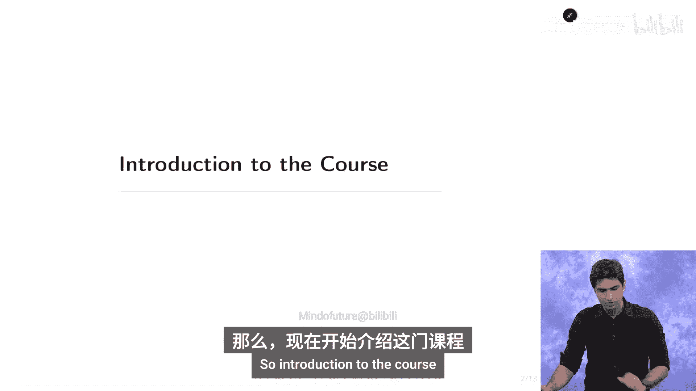

So as I mentioned， the first keyword that we have is optimization and by that I mean mathematical optimization。

What's the goal of optimization， So the idea at a high level is that we want to select or identify。

The best element。You's say from a set of alternative。

With respect to a criteria okay many times in optimization。

 the goal is to minimize some cost or loss function okay and an example of this is in machine learning。

 which is our main motivation in this course， where we want to。

 let's say minimize certain loss function to ensure our model provides the best fit to to the data。

Okay。嗯。Alternatively， you can talk about maximization and these are equivalent in some sense。

 that means that if I give you a cost function I can define it's negative to be some reward function or utility function right so in a lot of application we are interested to in maximizing some reward function or some utility function Okay so the problem that we're going to have instead of minimizing F。

We're going to maximize you。 So an example of this is when we have， let's say。

 an application of reinforcement learning there our goal is to design an agent that can perform a certain task Okay。

 another example is portfolio optimization right so for given set of stocks or resources we want to select the ones that result in the highest profit okay。

Now here F， as I mentioned is our loss function or cost function， U is our utility function。

 W is essentially our decision variable that we are optimizing over okay。

And x here is essentially our set of alternative。So this condition or constraint that says w must belong to x means that the solution that we're going to find is going should satisfy certain constraints in order to be feasible。

 Okay， I would say that for most of the。Topics we're going to talk about in this course。

 We have problems where the problem， the mathematical optimization problem is an unconstrained problem。

 meaning that X is essentially。Just。😡，The whole。Euclidean space R。All right。

 so this is the goal of optimization and we are concerned with modeling algorithms。😊，An assessment。

 and all of these are pertinent to machine learning， therefore to our course。

So when I say modeling that means that I describe a problem to you and in order to find a solution to that problem。

 the first thing you need to do is to model it as an optimization problem that could be solved efficiently so that is I would an art by itself。

Another thing that we are concerned with in optimization is design of algorithms when I give you a mathematical optimization problem like this。

What are the best algorithms？In order to solve this problem， and by best。

 we typically mean algorithms that are the most efficient。And finally。

 assessment so one thing that optimization can do is to provide formal guarantees on the quality of the solution right so I can for instance。

 say that which properties the the cost function F for instance should have in order for a certain class of algorithms。

In order to such a certain class of algorithms can provide a good solution efficiently so all of these of our importance in optimization and I would say for the most part we're going to talk about algorithms right so that means that what are algorithms。

 what are some algorithms that we can design and leverage to train the models right so what can we say about the the quality of the solutions we find using these algorithm so that's the topic of assessment。

Okay， so that's a brief introduction to optimization and the goal of optimization now let's move on to our next keywords deep learninging okay so what is deeping。

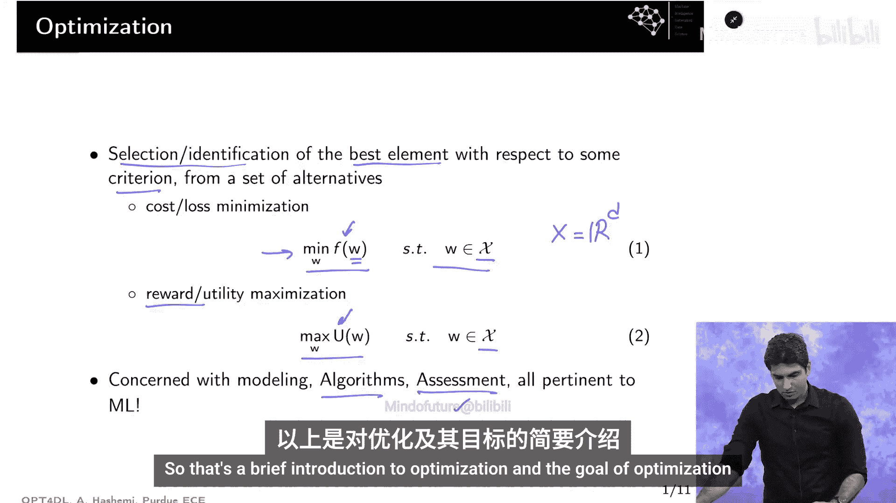

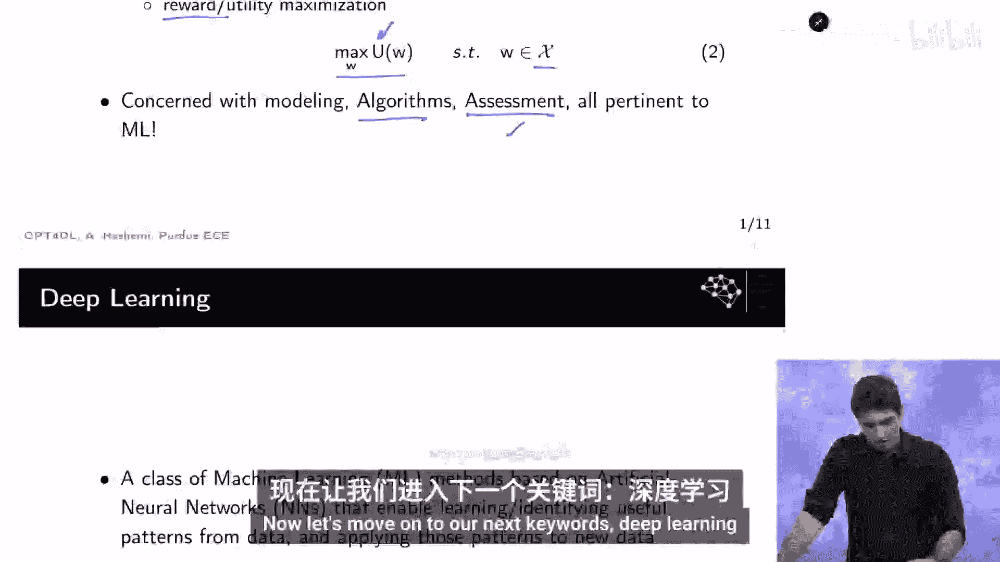

And to define the playing， I'm going to provide two。

Definitions that are one of them is basically I would say a universally accepted definition that I have here another one is by one of the prominent researchers in the field of deep learning that we're going to see so the first definition says that deep learning is a class of machine learning methods right so this is another keyword that we're going to define in the next next lecture。

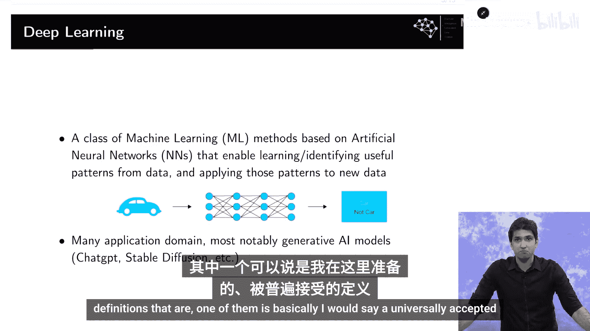

For the timing， you can imagine that machine learning means learning a model from data or designing a model from data okay。

So deep learning a ks of machine learning methods based on artificial neural networks or ANNs。

And what are these。 So these are basically。Models that are designed based on biological neural networks that have neurons。

 neurons receiving signals， processinging those signals and passing them along to the next neurons。

So based on this concept， we can design a class of models that we refer to them as artificial neural networks that is of the essential importance in deep learning。

So deep learning class machine learning methods based on artificial neural networks that enable learning or identify useful patterns from data。

And upload those patterns to neoda。This simple image sort of shows the procedure。

So let's say we want to design a model that can classify whether a specific image is an image of a car or something else。

Okay， so what we' do， we gather a large collection of。Images that are car and not car。Okay。

 so that's the first step， we define a certain artificial neural networks following a specific architecture。

 and this is something that we're going to talk a little bit in the course as we move on。

We're going to design training algorithms。And feed this training data。To the model， to。

Tune the parameters of the model。Okay。And once the training is done。

 we have learned potentially some useful patterns such that our model is now able to distinguish between images that our car versus images that are not car。

 Now， ideally， what we are hoping for is to not only perform well on the collection of images that we've used。

To train the model。But also perform extremely well on the images。

Or the data that the model has not seen。During the training phase， okay。

 so that corresponds to applying the patterns we've learned from the data to new data。

Data that we haven't seen okay。And D has been extremely successful。

 it has found many successing many application domains and most recently and most not we have seen successive stories in the domain of generative AI for instance we have chatbots that you may have interacted with such as chatGPT。

 cloud， etc， so these are things that you can give them a certain prompt center command。

 and the model is going to respond to or generate some response to your query， okay。

We also have models that are extremely successful in terms of generating。Let's say images right。

 so such as stable diffusion， right， so you give me a command and ask you to， for instance。

 generate the image of a specific cat breed or dog breed and the model is extremely successful in doing that。

 and there are a lot of other you can applications that the degree models have have been really successful at。

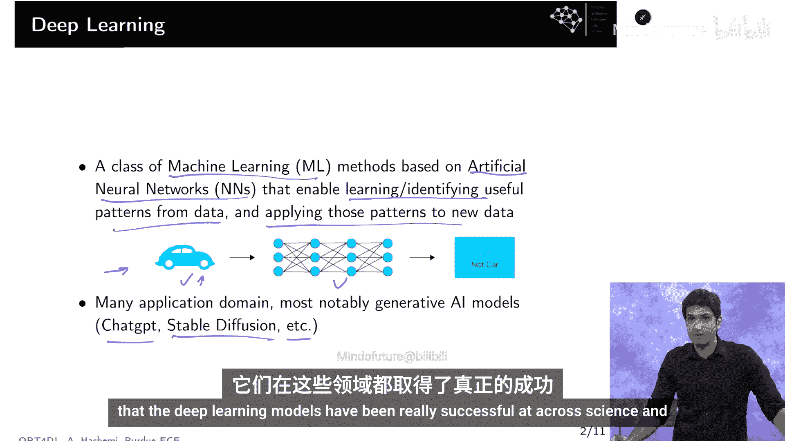

Across science and engineering。

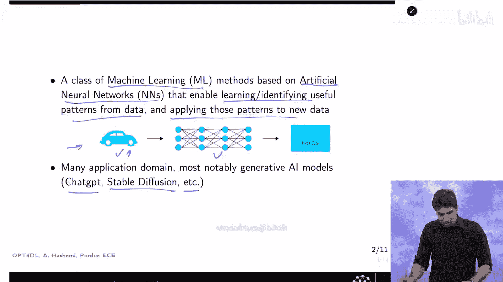

All right。Now I'm going to talk about sort of， if you will。

 related but a slightly different or technical definition of deep learning。

And as I mentioned provided by one of the pioneers in in the in the field。 Okay。

 so let's see what this definition says。 So， so deep learning or D L is basically constructing networks of over parameterized modules。

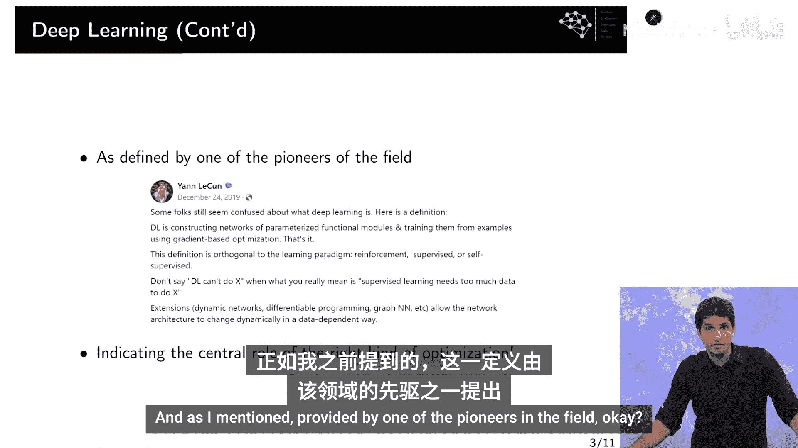

Okay， so this you can think of as designing a very， very large scale。Artific neural network。

And training them from examples， so this means that you this large over parametermease model that youve defined。

 you want to fit it to the training data now heres the interesting part and that I'm going to leverage as motivation for this code。

Using gradient based optimization。 Okay， so so therefore。

 the choice of the training algorithm is also essential when defining deep range。 Okay。

 so and this shows the crucial rule of optimization。

 or if you will the right kind of optimization in making sure deep models work and also in in。

Trying to understand why and how these modelss work？

And I would say the keyword here is the right kind of optimization， right。

 so gradient based optimization， that's why in this course we're going to pay a lot of attention and focus on certain classical of optimization algorithms that leverage this gradient information。

All right。Now， why optimization for deep learning？I would say there are at least two main reasons。

The first season is。That was somehow reflected by the definition we saw in the producer slide。

 The first reason is that the learning in。Deep learning and machine learning bores on to optimization problems。

 Okay， so that means that if I want to train my model。

 I'm going to have to solve an optimization problem。Okay。

 so if I want to understand why my model is is able to fit the data。

 why my model is able to generalize tocing data， we have to understand these fundamental optimization problems and naturally。

Optimization theory has a lot to say about that。The second reason is that there are a lot of mysteries in getting deploy models work and this applies not only if you want to train a model from scratch。

But also， if you have access to some model that you want to fine tune to your specific needs Okay。

 so there are a lot of mysteries and challenges involved in this process。No。Given that。嗯。

Training the model or fine tune the model involves solving optimization problems。

The right kind of optimization may lead to developing an understanding of these mysteries。

 and hopefully helping。In domesticifying。

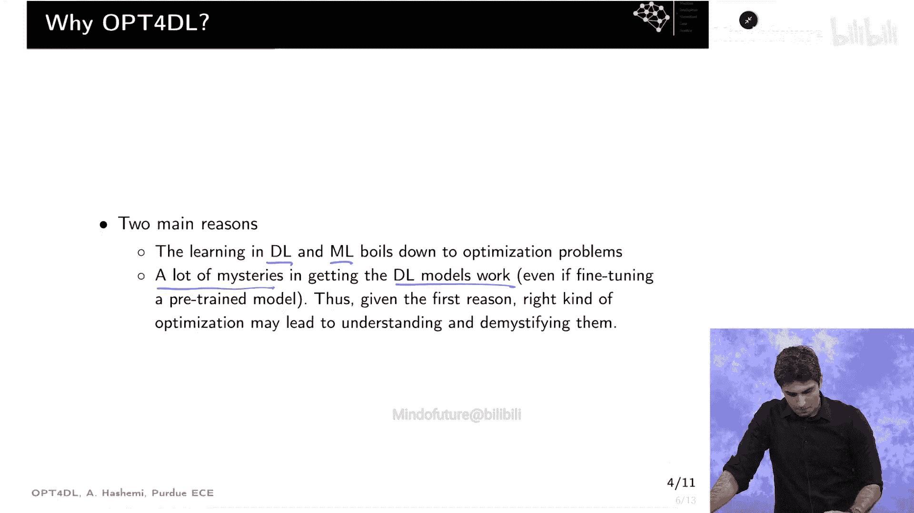

Okay now I'm going to talk a little bit about these two reasons。

 first of all the intimate connection of learning and optimization okay so I mentioned that when we talked about training a model essentially fitting the model to a training data。

 we have to solve an optimization problem okay。

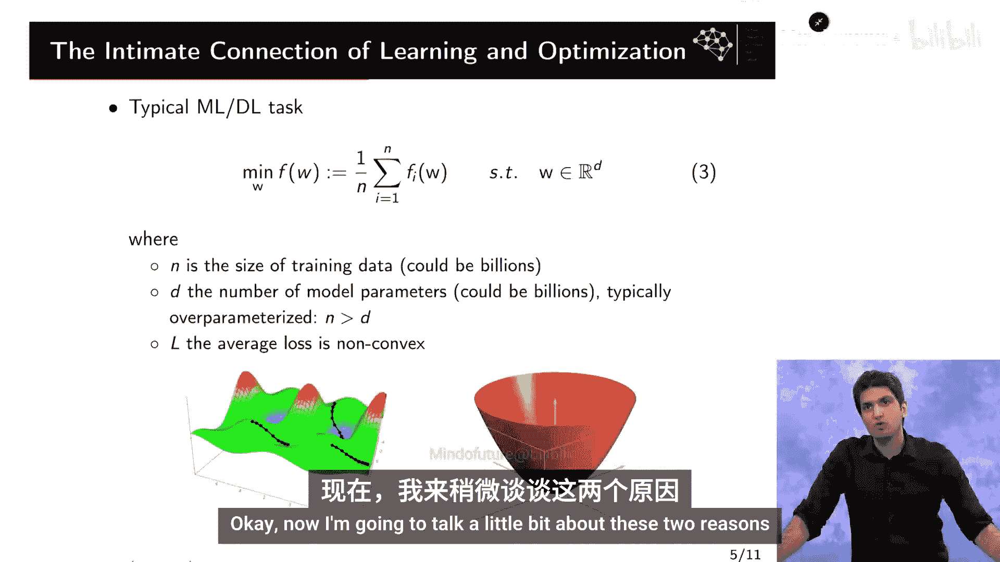

Now， a little bit more mathematically， this optimization problem is going to look like something like this。

😊，We still want to minimize a loss function here。 I den that by F。

But the last function is not an arbitrary。😊，It takes a many time in a specific form。In particular。

 in many times， the loss function can be thought of as being the average of some other functions。

Here in this case is1 over n solve i of these Fs？Now， what are these Fs。

 F I is essentially going to determine。How the model。W。Is going to。Fit。Data， I。Okay。So in particular。

 I have a data set of， let's say。N samples。 let's say I have X I， Y， I。X and Y， N。

 and this is something we're going to talk about in our next lectures a little bit more deeply。

So for instance， Xi could be thought of as a collection of pixels。

 Yi could be thought of as a label that says whether this image is an image of a car or not。Okay。

 and if oil captures how a model。W or how a specific neural network with parameters as W can fit。呃。

The， the I the I S sample。Okay， so this is a specific structure that I can imagine for a lot of learning tasks in optimization in machine learning and deep learning。

Okay， so n， as I say， is the size of the training data。

And the challenge here is that n is not a small number。

It typically in lot of cases is orders of millions or even billions。

 so we have billions of data data points2 feet。D。Is the number of parameters Okay。

 so this is the number of tuular parameters that are that we have or the number of parameters that we have to again optimize in order to find the best model。

Again， the challenge is that。The model size could also be very， very large。

 even up to or the billions。And in fact， the models are over parametermetized。

 as we saw in the in the definition of the learning。 And that means that。So I have a typo here。

 That means that D is larger than N。 Okay， so we have more parameters。Than data points。

 or in other words， we have more unknowns than knowns。

That means that there may be multiple solutions or multiple optimal models。Okay。

And I reserve release。😊，These complexities， the last function that we have to deal with is noncoms。

 okay。We're going to talk about convexity and nonconvexity in the next lectures。

 but for the timing you should think of a convex function as a function that is very。

 very nice and easy to optimize something like the one that we have on this side so this is convex as you can see the function is curved very nicely upverse and there is only one solution here。

Unique solution。On the other hand， the function that we have to deal with。😊。

In machinery and deep learning， then we want to， again， fit a specific model to data。

 or noncoms means that the landscape is full of hills and valleys， right。

 And there may be a lot of solutions。 So we are not guaranteed。

To find the best solution right so and in fact， in many cases。

 it matters where you initialize your algorithms because in a lot of cases we have local algorithms right So for instance。

 in this figure， if I start the same way algorithm here， this is a solution that I'm going to find。

If I start my algorithm here。I'm going to find another solution right and these solutions are not the same。

 one could be better than the others。And to understand which one is better or how we can find the best solution。

 we have to notice that we are solving an optimization problem。

 therefore we may want to leverage insights from the field of optimization server。

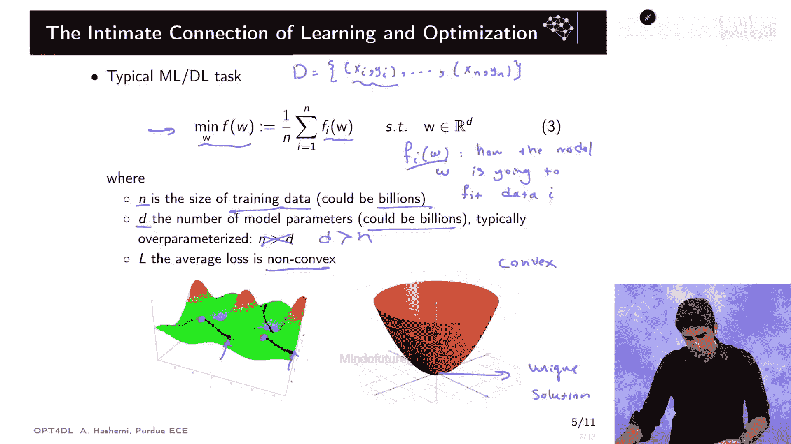

All right， so that's a little bit about the connection between learning and optimization， right。

 and essentially one of our motivation。😊。

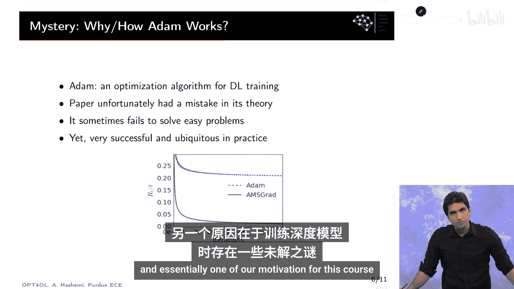

For discourse， another one is on the existence of certain mysteries。Then training deploy models。

And I'm mentioning a couple here， but there are a lot more mysteries and there are a lot of things we still don't know about the models。

Okay， so the firstness series。😊，Voy slashhow Adam workss。What is Adam， you may have heard Adam。

 and that's nothing but an optimization algorithms that is used extensively when training deploy models okay？

And it has a lot， it has received a lot of attention and it is I would say， very。

 very successful many times when training。Sophisticated deep models。Unfortunately。

 when the paper came out almost 10 years ago。Later on。

 people noticed that there was some mistakes in the theoretical guarantees that they would provide。

And in fact， sometimes certain variations of this algorithm may even fail。To solve easy problems。

 such as Coms problem。 So here whatm here is what is meant to show the failure of Adamom for a simple problem。

Essentially， you should be able to find a very good solution。But given that Adam has some problems。

 there is a gap， okay？So a mystery is that Vo Adam works or how Adam is able to work very successfully when training complicated film models。

 but it may fail for some simple problems。

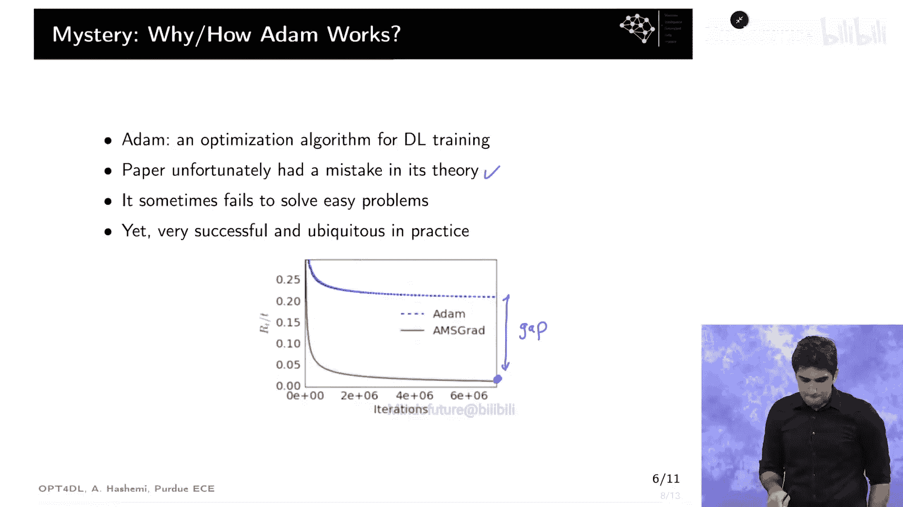

And again， to understand this mystery， we should hopefully leverage ideas and insights from optimization theory。

 because at its core， Adam is an optimization algorithm。

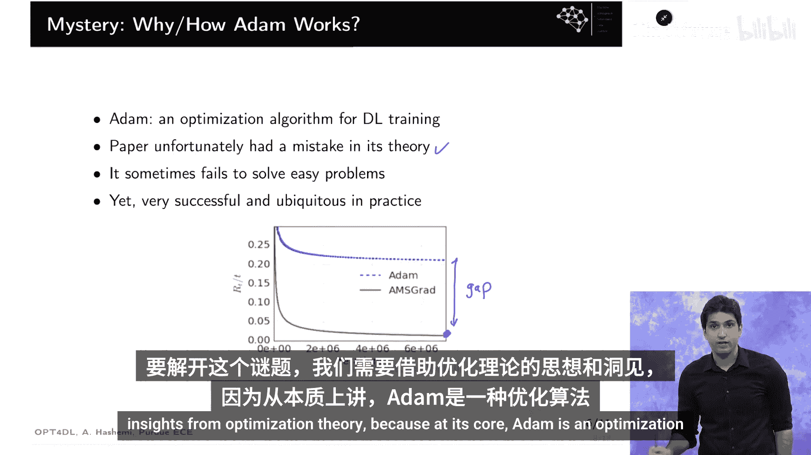

All right， the second mystery is about the central role of overpowerization Okay so as I mentioned。

Almost all of the degree models that we currently have and are leveraging in various applications are over parameters。

 meaning that they have more parameters than data points。

And this is a little bit contradictory to the traditional wisdom that we have from machine learning theory because traditional machine learning seems to require D the total number of learner parameters。

To be less than n。 Okay， the number of data points。 And the idea here is that if these is large。

 the model becomes too powerful and may overfit。The data。

So that means that we are not going to be able to learn useful patterns from the training data and leverage it later on to new data。

 We're going to fit the train data very well。But the patterns are not applicable。Broady。Good。

Despite this in practice， as I mentioned， D is typically much， much larger than n？

And the observation that we have is that not only this condition or this regime is going to help us to train the models better。

 meaning that fit the training data better， but also。In this regime。

 the models tend to even generalize better。Mean that they can apply the pattern that they learn from the data to newda and still be successful。

 okay。So。Therefore， the mystery is that from all of these available solutions。

 remember that when D is larger than n， that means that we have more unknown than knowns。

 so there are multiple solutions and from all of these magically the dip model finds the one that is doing great okay。

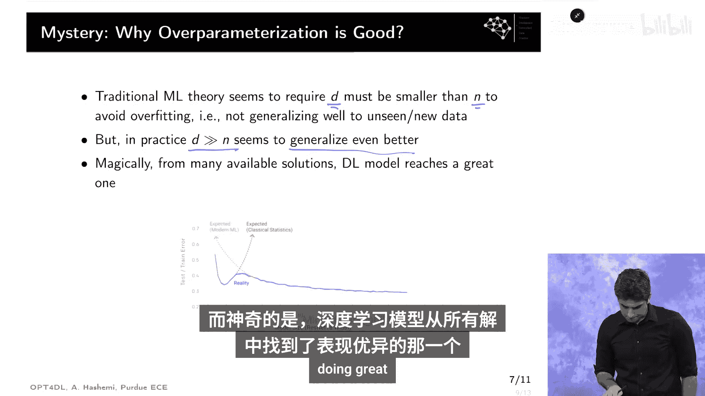

And this is sort of a figure that。嗯。Depics this phenomena。

 and we're going to get back to it later on in the course。

 So here we can see what we expect from the traditional machine learning model。 essentiallyly。

 that says that when we talk about the training error as I increase the model size， the training。

Eor is going to。嗯。Decrease until the point。Such that after I increase the module size。

The test error has to go up due to overfitting。But this is not the phenomenon that we are observing in practice。

 What you're seeing in reality is that。As I start to increase the size of the model。

 the tests are always going to go down。Then it's going to go up。But there is a certain point。

After which。As the model becomes more over Pmeized， in fact， the test error。

Is going to start going down again。Such that。For a very， very large model。I can actually get。

A better。Performance， so this is the performance gap between an underpomeized model and a very。

 very large overpomeized model。So in fact， overpowerization， despite the conventional wisdom。

 seems to be helpful。

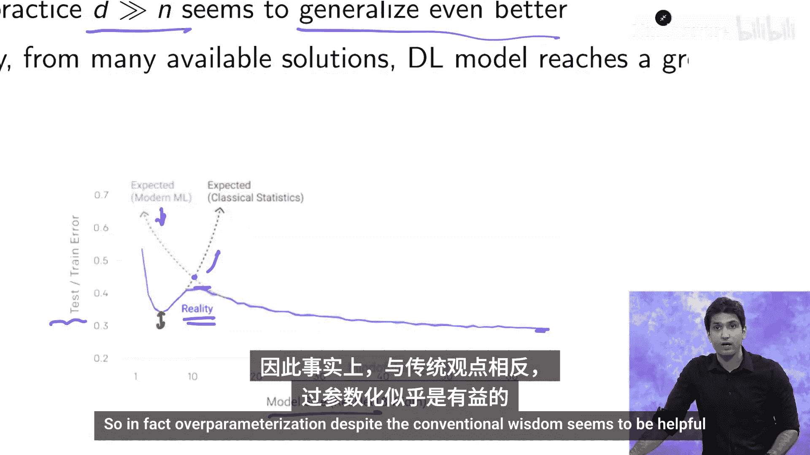

Okay， now this is a mystery that we want to develop an understanding for， and again。

 given the connection between learning and optimization。

 we should expect optimization to be able to help us with that。

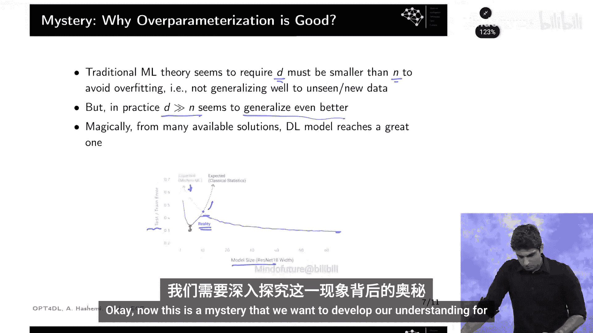

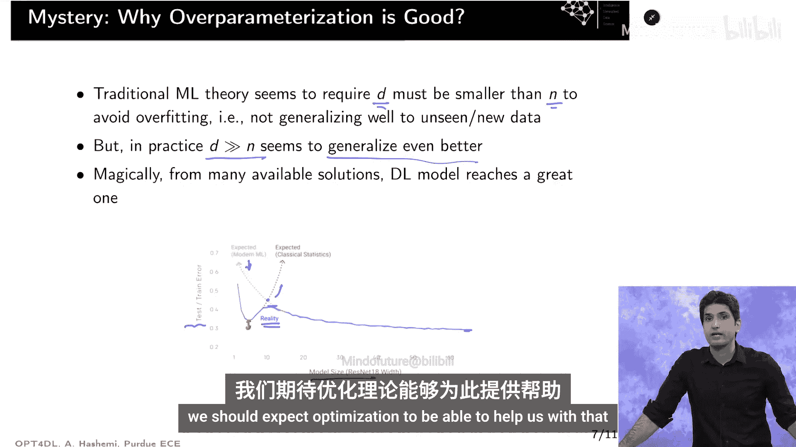

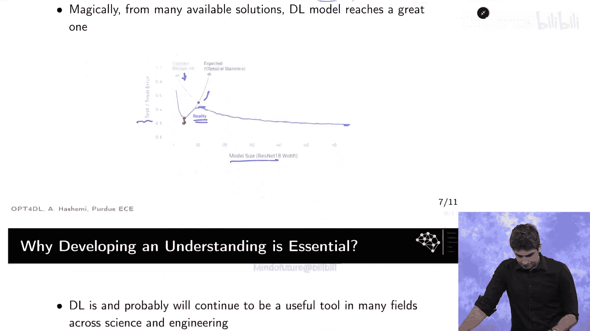

All right。Now， another question that I want to answer is why developing an understanding is essential。

啊。And my answer is that deeping is and probably will continue to be a useful tool in many field across science and engineering。

So therefore， this is a tool that we're going to apply。

And it's good to have a good understanding of this tool， okay。

And it's not just that we have developed models that can be deployed universally。

 we always have to deal with more than one task， more than one data set right so we have all these new tasks that could benefit from deploying we can always expect to have new dataset sets that we have to crack。

RightSo therefore you have to develop an understanding that for a new task or for a new data set。

 should we expect a deploy model， a specific discipline model to work and why。But beyond this。

 deep turning is actually very， very costly and the carox is reliant on expensive hardware and high energy consumption。

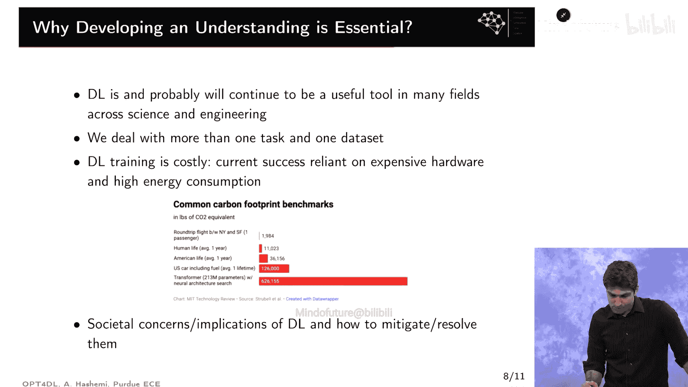

So here is sort of a figure trying to show that what's the carbon footprint of training a certain dip model。

 for instance， here we have a specific architecture transformer and as you can see is carbon footprint is significantly large and in fact it's significantly larger than the carbon footprint associated with life of a human being。

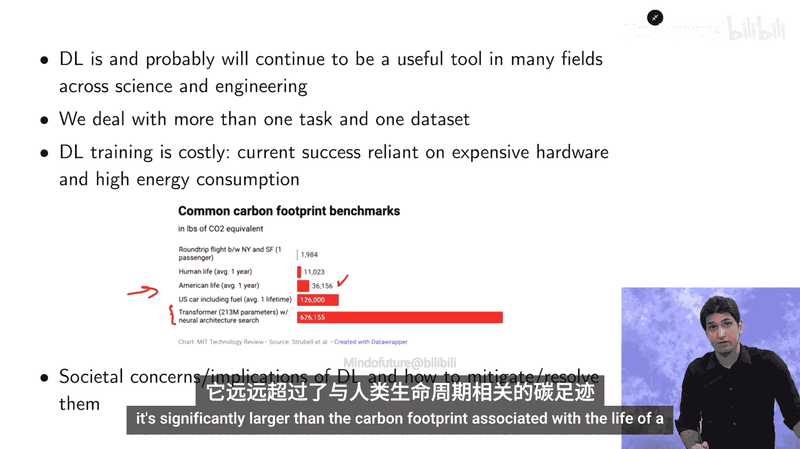

Given that this training is very costly。Then we should try to find more efficient or eco friendly。

 if you will， approaches to train these models right and given that training is again。

 essentially sort an optimization problem， optimization。Is going to be a handy tool。To。

 to perform this， okay。And finally， there are societal concerns。😊。

And implications of deeping and it is important to study this and develop approaches to mitigate them and resolve them。

And to do that naturally， we have to have a certain level of understanding of deploying models and practices。

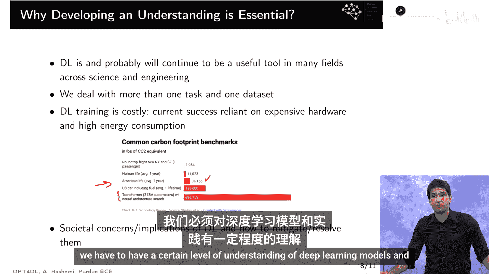

All right。

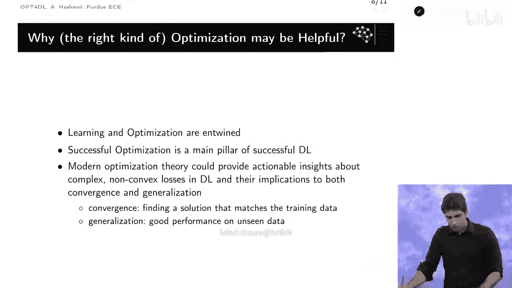

Now that we we talked about the connection between optimization and deep learning。

 and we talked about。The importance of developing understanding of why and how the models work。

Another question is why the right kind of optimization may be helpful。

 and I talked about this extensively that optimization and learning are entwined。

 there is an intimate connection between them。Optimization is one of the main pillars of successful deep learning。

 its not the only one but is certainly of essential importance。

And as we talked about in the previous slice， modern optimization theory can provide actionable insights about complex noncom Los landless cave that we deal with in deep learning。

And their implications to both convergence and by that I mean， how well I can fit the training data。

And generalization， how I can apply the patterns that I learned during the training to ancing data。

Okay。All right。Now， what are our main goals in this course？

So one of our goals is to learn about learning techniques， training algorithms。

 optimization algorithms。And potentially， the knowledge that we gain in this course could be leveraged to develop new algorithms。

Or understand or develop the knowledge that we currently don't have about the existing algorithms。

We are also going to discuss optimization for differing theory， methods and heuristics， right。

That means again， analyzing turning algorithms。Understanding。

Algorithms that are based on mathematical principles and also trying to learn about certain heuristics that are arguably essential。

When training a deploy model and trying to understand them， right？

We want to op why questions Okay so why specific method is able to let's say。

 work in certain scenarios， why it's not able to work in other scenarios。

 we want to discuss what we already know。And what are some things that we need to know， okay？

And how we can approach these questions。Later on in the course。

 we're going to talk about how we can leverage these tools and these methodologies for resource efficient。

disciplinary training。And finally， our hope is to discuss some pertinent。

 practical and societal concerns。And see how we can integrate them with our optimization。

 our base optimization methods。😊，That that we use when training the models。

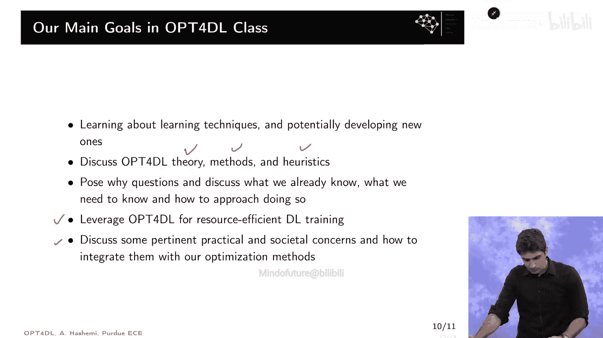

All right。Now I want to talk a little bit about myself， so I'm Al Faaz Hashimi。

 I'm an assistant professor at the Elmore Family School of EC at Purdue University and I've been here since fall 2021。

My research goal is actually intimately connected to optimization。

 I hope to contribute to the advance of the field of larger scale optimization that's essentially a kind of optimization that wheels with problems of very larger scale could be again mainly motivated by。

😊，Problems that we deal with in machine learning and deep learning。And my goal is to。

Provide actionable insights from this perspective。To innovate multiple domains between machine learning and AI。

 So， for instance， robustness。嗯。Developing equitable algorithm， etc。And recently。

 my research group has focused on applications to fedderative learning or collaborative learning。

 applications of deep learning to medical image analysis， next generation of manufacturing。

 and also cyberphysical systems。

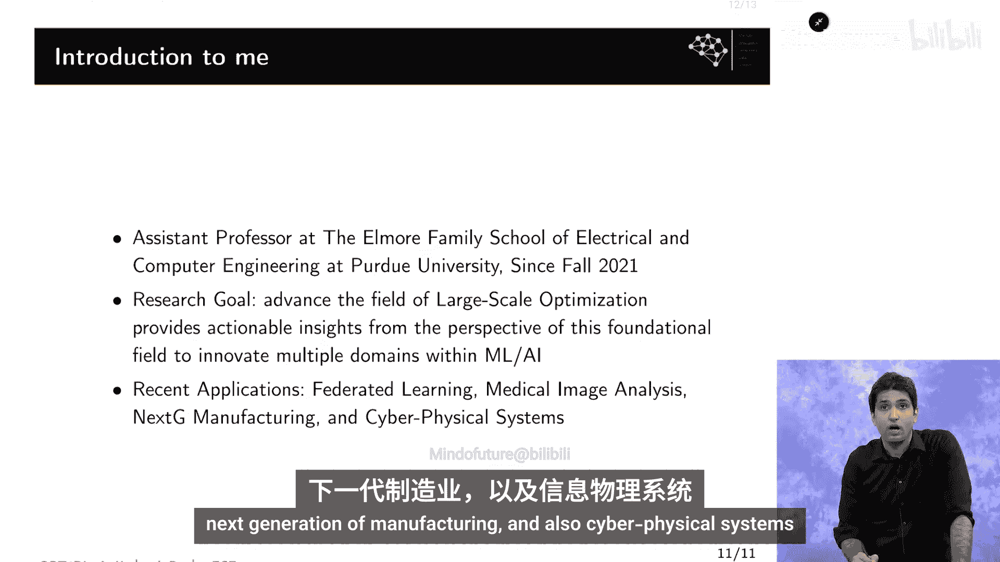

Right， with that next lecture， we're going to talk a little bit more about。Optimization。

 basically we're going to provide a very short course and introduction to optimization。

As well as machine learning。And we're going to。Progress to to other topics in the next lectures。

Thank you。