# 【普渡大学】深度学习中的优化 ｜ Optimization For Deep Learning ｜ Purdue University p02 P02_优化基础 -BV1tvzKBcEom_p2-

🎼，🎼Yeah。Welcome back to optimization for Deep learning。So in this lecture。

 we're going to talk a little bit about some optimization basics that we need in this course。

So the first concept that I want to talk about is the concept of stationing points。

So let's consider an optimization problem where I want to minimize a loss function。

So here where my decision variable is w and we assume that there is no constraints。

Meaning that W is just。A vector in R T。 So the size of W is D。 Okay。

 and we want to solve this problem。 So what does it mean to solve it right。

 So essentially we want to find an optimize solution that achieves the lowest function value。 Okay。

 in many cases， this could be a very， very ambitious goal。

 Certainly in problems in determining and machine learning because of how complex our function is。

So therefore， it is useful to first define。Oh。A more broad definition。

That potential is easier to achieve。And that's the concept of a stationary solution， okay？

So we say W star is a stationary point or more accurately a first order than a stationary point。

If the gradient of the function。Or essentially derivative if you are more comfortable with it。At w 0。

 sorry。 A W star is 0。 So that means that this condition must be satisfied。

 The gradient of F F at W star has to be 0。Okay。Then we call La install a first order assert point。

 We call it first order because we are talking about the condition that has to be satisfied。

For the gradient right， So and gradient is essentially a first order information。

Something about the first or the derivative of a function。Okay。U。

Now you can talk about solutions that that are higher quality or lower quality because the stationary point doesn't provide。

Any information about this solution is a good solution or a bad solution， if it's optimal or not。

 okay。For instance， let me draw a function here。Very simple function。Okay。

Here you should think of gradient being zero as。The tangent。Line to the function with the slope 0。

 okay， so。All of these points are， essentially。A stationary。Solutions， okay， so let's call them W1。

W 2， W 3， W 4， all of these solutions satisfy your first orientation stationary， okay。

But they're not all the same。Intuitively， some are better than daughters。 in particular。

 if I want to minimize a function。W1 and W3 are not good solutions。Because locally。

 they are actually maximizing the function。Okay。On the other hand。

 W 4 and W 2 are better in the sense that at least locally。They are minimizing the function。And。

Between W2 and W4， obviously as we can see here， W2 is a better solution because it achieves a lower function value right so therefore stationity is a condition that is a necessary condition for optimality。

 but it is not going to be sufficient in general。Therefore。

We may need other conditions to be satisfied if you are looking for higher quality solutions。

And in a lot of cases， we need more information， so because we are pursuing a more ambitious goal。

One piece of information that is useful for us to determine at this。

 whether a low year solution is is a good solution or not。Is second order information。

 the information provided by the second order derivative or the Haitian of a function。G。

In particular， if I am able to calculate the hes of the function at W star。😊。

If the Hasian is positive， definite。Then W store is a local minimum。On the other hand。

 if the Haitsian is negative， definite W star is a local maximum。

 So for this example that I drew here。You can imagine that the Hasian at W1。 And so this noise here。

 The Hasian at W1 is。Less than 0。 And I have a local maximum。On our hand， thehiian。W 2。

Is positive definite。So the curvature is upwardward here versus the curvature here is downward。

So therefore W2 is a local minimum， so therefore W2 is a better solution than W1 okay。

Now this condition sometimes could be referred to as second order satity。

 meaning that you have a solution that is a first order sessionary point。

 meaning that the gradient is zero， also it is at that solution the Haitian is positive definition meaning that the character is sort of car off part and this is something we're going to talk a little bit more deeply as we progress in the course。

 but for the first few lectures I would say this is not of essential importance for us。All right。

 and this is a point that I mentioned that is important to note that the stationary point。

 even a local minimum， is not necessarily an optimal solution， and we illustrated this。

This fact in this simple function。For instance， W4 is a stationary point。 the gradient that is 0。

 It's also a local minimum。 The Hasian is positive。But it's not a good wall solution。 In fact。

 W2 is is regular world solution，Now， sometimes。We have functions。

That are very complicated like this。 So therefore， in the。

 we may not be able to even characterize very efficiently。 whether a solution is。

 is a global minimum or not。But in。Other cases， we have functions。

That actually are very easy to tell whether a specific point is their global solution or not， okay。

And these are convex functions that I'm going to talk a little bit about them here。

And the main reason is that I want to distinguish these type of functions from the functions that we typically deal with。

In deep learning， which are non convex okay and that's why to understand deep learning。

 we actually have to develop an understanding of non convex or mother optimization theory as opposed to traditional approaches and thorems that are mostly concerned with understanding convex loss functions。

Okay， so let's talk about first， the convexity of sets。

 and then we're going to talk about the convexity of functions。Okay， so what are comic sets？

Let's consider a set X， and we call that convex。If for all points， X I。That belong to x。A。

The convex combination of the points also belong to x。What is Comx combination。

 it means that I define a set of weights， W I's。That are non negative。And a sum to one。Den。

The convex combination of Xs is essentially this weighted combination that I have here。

 So this is the convex。Combination。So a set is convex。 if and only， if the， the。

 the convex combination， arbitrary conx combination of the points that belonging to the set also belongs to that set。

 Let me try to illustrate this with simple examples， for instance。Let's consider a set like this。

 Okay， so any two points that you give me。Okay， x1， x2 for in instance。The mid point。

Or the line segment between the two point always reside inside the set。So therefore。

 this is an example of a convex set。And sometimes I write CVX as a shorthand notation for conves。

Complexity。So let's compare this set。With this example。Gy。Here。If you consider these two points。

The line segment。Again， belongs to the set。But that's not the whole story。

If I consider these two points。Part of the long segments。Ress all sort the set。Therefore。

 this is an example of non conves。Seit。Good。All right。Now let's talk about convicx functions， okay。

And I will say that again my definitions here are not very sometimes very precise。

 I'll just try to convey the main concepts that we need in this course but let's talk about convex functions so a function is convex and for the timing please ignore what I've written here in orange and I'm going to discuss it in a minute。

So a function is convex if for all Xs。呃。The F of。Convex combination is less than or equal to the convex combination of the function values。

 okay。So the way to illustrate this is as follows again， so imagine that I have a function like this。

So， this is F。So this says that if I consider any two points。Lets column X1 and x2。呃。啲。

Value of the function at the midpoint。 So let's say this is the midpoint。

And this is the value of the function at the mid coin。Okay。

 and so these are the value of the function at F X1 and x2。So。

The value of the function at the midpoint is lower than the average of the function values。 Okay， so。

 so here the average function value is essentially something like like this。

 So here is F of X fund plus F of X 2。Divided by2。 So that's what this is that there is always。

This gap or some gap between the value of the function and the midpoint。

And the average of the function values。 Okay， so these equations are essentially a way to generalize this idea to more than more than two points。

 okay。Now we can have functions that are even nicer。

 so we haven't talked about Vo conx functions or noise right but we going talk about that。

 but we can have functions that are even more conves if you will。T then this， right。

 and then for we call them a strong dex function。Which requires us to alter this definition。

By replacing。This inequality， with a strict。Inequality。

 So this essentially says that if I consider two points。

 F of x1 plus x2 divided by 2 is strictly less than the average of function values。Gi。And in fact。

 the example that I'm showing here is an example of a strongly complexx function where there is always this。

No zero gap between these two the values。All right。

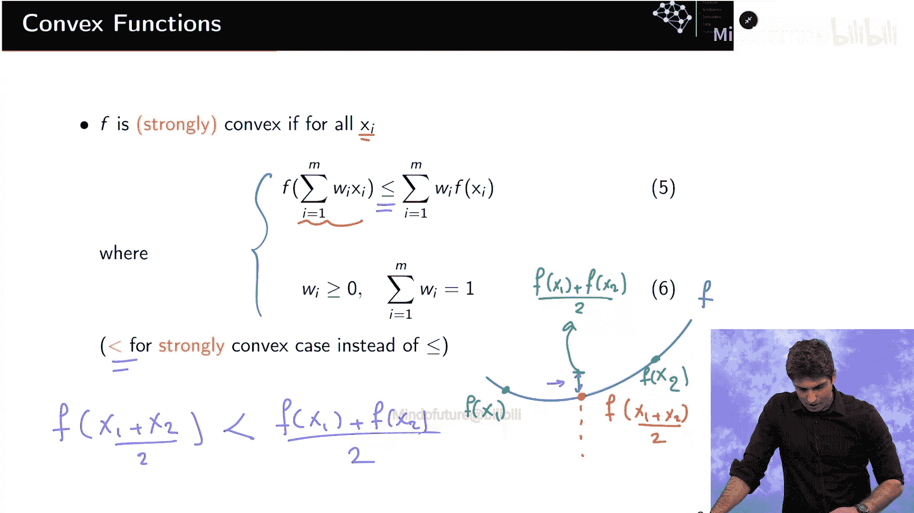

So convex functions can be characterized using multiple equivalent definitions and sometimes one definition is more useful in terms of。

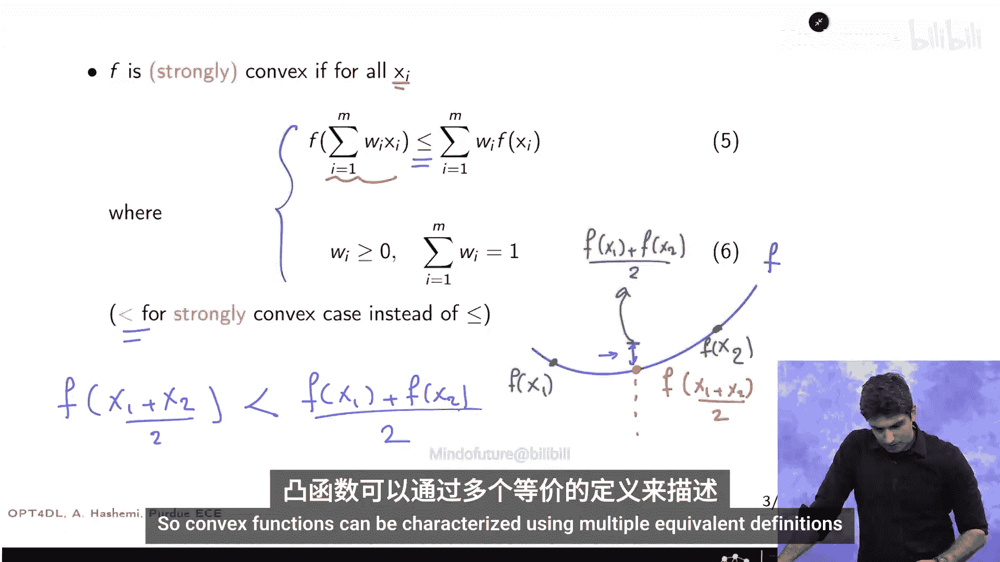

Let's say the theoretical analysis of optimization algorithms in terms of assessing the quality of the solution。

 etcter。So therefore let's also talk about those two equivalent。

 two other equivalent definitions of strong Comx functions and also Comx functions。Now。

 the second equivalent definition says that a function is convex。If。

The function value at Y is larger than equal to。This linear。A linear function。Okay。

 now let's try to illustrate what this means。Again， let's consider our function。F。

And let's consider a point X。 So this is point X。What this is saying is that if I。Consider。

A tangent line。At this point。And this tangent line is essentially nothing but。

F x plus the inner product between the gradient of egg。F at x。And y minus6。

So this is basically the formula for this tangent line at x as a function of y。

So this definition says that function is convex， such if the function always liess above。

The tangzent zone， okay？And the function is astronomic convex where there is a negligible。

 a non negligible gap or non zero gap between the tangent line。And the function value， okay。

 and the gap can be mathematically described by adding this term to the definition of economics function。

Where mu is called the strong。Convexity。Pometer。And essentially mu determines the extent of the functioning a string comics。

Okay so in2 we want mu to be as large as possible because that would mean that the function is nicer in some sense。

 there is a larger gap between the function and its tangent。Now。

 one thing I want to mention here is that。This definition is typically easier to work with than the first one we saw in the previous slide。

But this also requires that your function is differentiable， whereas the previous one didn't。

 it only involved function values。嗯。And for this reason the first definition is sometimes referred to as a zero order definition of convex function。

 this is called the first order definition of a convex function。

 because the first one only has requirement on the function values。

 this has requirements involving the gradient as well。

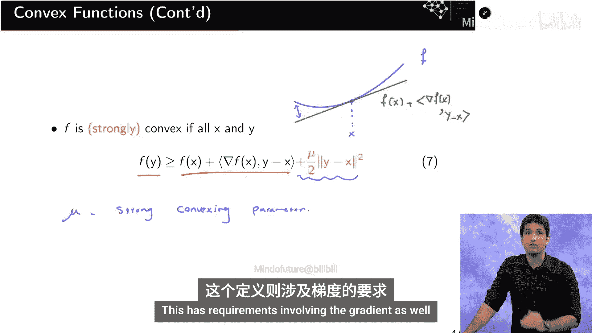

Now， in a similar range， then we can talk about。

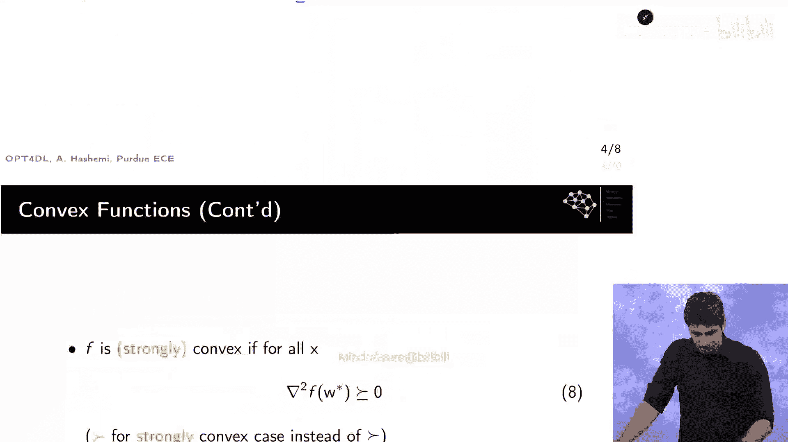

Second order definitions of a convex function， so in particular if I have a function which is twice differentiable。

 it is convex。If， for for all。So this has to be if for all。X。The Hasian is positive semi defite。

Let's try to illustrate what this means。So this means that basically the function is caring off so this is an example of a Comx function。

Whereas if I had a function that was， let's say concave。So this is cotton caveve。As we can see。

 the character is car down bars。So positive defense of the Haittian is essentially saying something about the care of the function。

And similar to the previous definitions， a strong con function。Is one， where。Dehiian。

Is not only positiveite positive definitioninite， but it's actually a positive definite。 So in some。

 we are replacing this inequality with the strict inequality as well。Al right。

 so we spent a little bit talking about convex functions and the reason for that is that convex functions are very。

 very nice in some sense。That is to say that。If I have some local information about the quality of the solution。

That local information provides certain global information。More specifically。

If we have a stationary point， WS star， which again can be identified locally if you just know the gradient of the function at that point。

Then if the function is additionally convex。This solution is going to be a global minimum。

A condition that requires global information about about the function and the proof is actually very。

 very simple to see For instance， let's consider the first order definition of a complexx function Now this applies for any y and W of star I assume that WS star is a solution which is a first order solution。

 meaning that the gradient is 0。 So if you replace the gradient to be 0。

 what we are going to get is that f of y is less than equal to f of w of star。For all y。

 So for any other solution， Y the value that I get is going to be larger than the value that I get from this access point okay。

So thats why your Comx functions are very， very nice that from local information。

Essentially information about whether a solution is station your point or not。

 we can provide a global assessment about the quality of the solution。

 we can say certainly that the solution is actually a global solution。In other words。

 for conx function， first orientationality is not only a necessary condition。

But it's actually also a sufficient condition for optimal。No。Tcom functions are actually even nicer。

In the sense that。嗯。They're going to have a unique minimizer whereas for Comx function。

 the solutions may actually be infinite the solutions that could be infinite。

 Let me try to illustrate this， right， So an example of a strongly Comx function is a quadratic function。

 Let's call it f of x is equal to x is square。

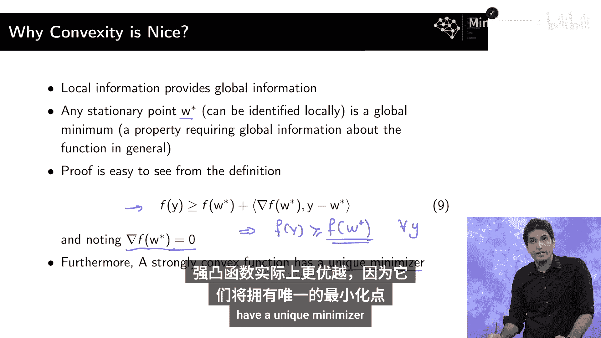

Now， this is my unique。Glowable solution。Whereas I can give you。A function， which is。Comvex。

 something like this。Os， sorry。Something like this。Where。

All of these points are actually global solutions。 So we have not only one。

 but an infinite number of solutions， despite the function being Comx。 So therefore。

 strongly Comx functions are actually also nicer than Comx function。

 Not only we can guarantee optimality of a solution by just looking at this local information。

 the gradient value， but we can also say with certainty that that solution is。

 is the unique minimizer。

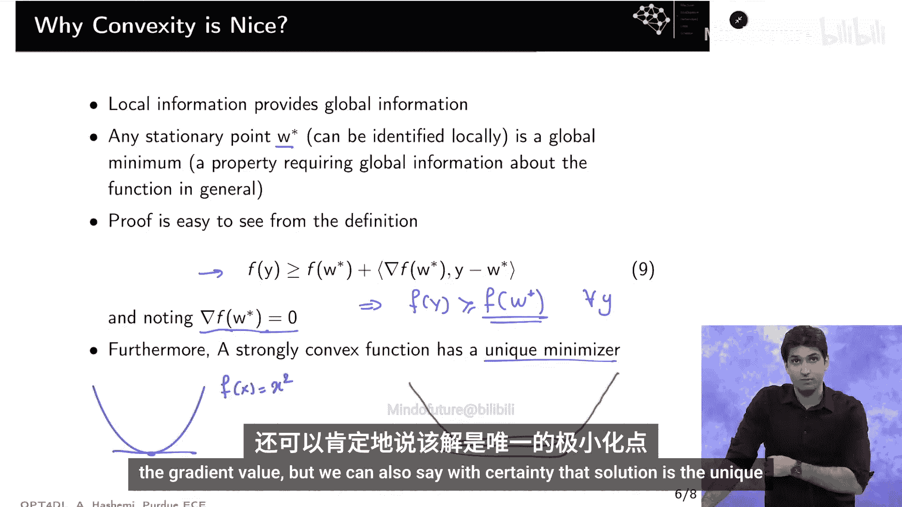

Alright， but unfortunately， con is not something that we typically see。

When we talk about optimization problems when training deep learning models， okay。

 and there reason I talk about complexities again， to distinguish it from the loss functions that we typically deal with when analyzing non deep learning training problems。

 Therefore， there is a need to go beyond the typical study of。

Convex functions and the performance of algorithms for convex problems。

In order to understand why the tiny algorithms that we have work well。On optimizing different models。

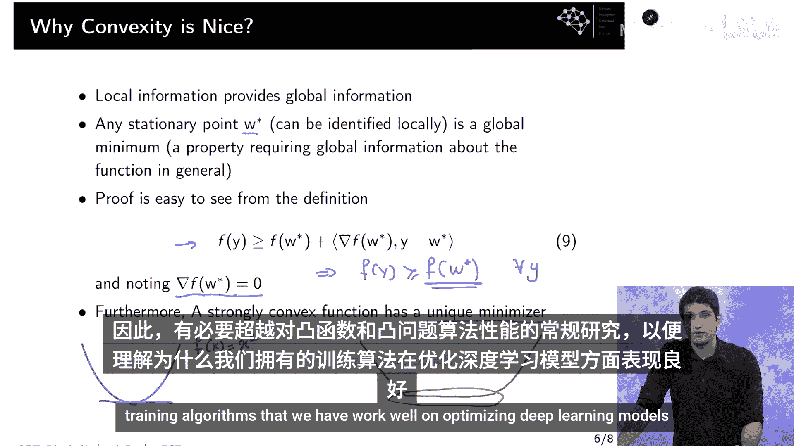

Okay。The next thing I want to talk about is notions of convergence right so when I say an algorithm is good。

 what does that mean Okay so in many cases in this course we are interested in establishing the following that certain error function。

Or。A convergence criterion。Is less than epsilon。 So you have a target accuracy epsilon in mind。

 And you want to say that I want to find a solution， W Tla。

Such that according to a specific convergence notion， error。The solution is。

An epsilon approximate solution， meaning that this criterion is very， very small。Good。Now。

 the methodss achieving these goals are typically iterative。 So what does that mean。

 It means that they're going to make。Progress， gradual progress。To find in this W tilder。So。

For instance， one of the parameters is the total number of iterations that you have to run an algorithm right So you start somewhere somewhere。

 you run an algorithm once， find hopefully a better solution。

 you run the algorithm for another iteration。 Hopefully you keep improving upon the quality of these solution and so on and so forth。

 And you repeat your process for， let's say， Ts。 And then at the end。

 you're going to output wt law to be your approximate solution。

 and we're going to see numerous examples of these iterative methods in dis course。Okay。Now。

 typically。Better accuracy， meaning lower epsilon。Requires。

You to run your algorithm for longer for more iterations。Okay。Now。

 one of the goals in optimization and also in optimization for deep learning is to establish convergence rates。

 meaning to provide a relation between。T and epsilon。According to different convergence cr okay？

Now there is a terminology here。When talking about conversiongence rates。

So you can have subline rates and let's say linear rates。 So these two are of more importance。

To us in this course。 So submarar rates means that the relation between T and epsilon as follows。

 right， So T， the number of iteration that you have to run your algorithm is at most epsilon to some power minus a for some a。

For some a strictly positive A， for instance， you can say that T is sort of proportional to one over epsidon。

Okay， or you can say tea is proportional to1 or epsilon a square。

 These are all examples of sublinear rates。On the other hand， you can have linear rates where。

You have a much better。Dependence on Epsilon， okay。So why is it a much dependent。

 much better dependence， For instance， imagine that epsilon is。Or your target appacy is1 over 100？

Then this guy or this rate。Employees that you have to run your algorithm for。T equal to 100。

Iterations。Whereas the linear rate says that you have to run your algorithm for， something like。

Log off。1 hundredundred， okay。Which is significantly smaller。 Okay， So therefore。

 we desire algorithms that have linear or we prefer algorithms that enjoy linear compared sub linear array。

Unfortunately， that's not typically the case when when it comes to。

Optimization problems that we deal with when training to models。Alright。

 so this is an example of linear versus sub nonlinearar rates。

 let's also talk a little bit about some examples of these convergence crions or the error functions that we deal with in this course。

The first example is essentially has something to do with approximate first order。

All I care about is to find a solution W， tla， where the Gian norm is at most epsilon。And again。

 this just says that your solution is going to be approximately first order solution。

 could be local minimum， could be global minimum， could be even local maximum。

 but hopefully our algorithms are such that we can avoid bad solution such as local maximum if you are minimizing a function and this curition we say is of utility when you are talking about general functions。

 functions that are not necessary convex okay so therefore the most you can say about the performance of a specific algorithm is whether they can find a first order solution or not。

Another katinian is when you require a low soym gap。

 meaning that you want to find a solution W such that the value of the function at that point minus the optimal value is at most epsilon。

And typically this FS star， the optimal value is equal to 0。

In learning problems that we deal with in machine learning and deep learning right so essentially the best that could happen is that you can fit the training data perfectly。

 so the last value is in the base case equal to 0。And this obviously is pertinent when your function is convex or it is non convex。

 but has certain structures so that you can leverage those structures to establish this。

More ambitious conversionence property。And finally， you can talk about point voice error。

Where you want to say that let's consider an optimal solution W star。

 I want to see how close my solution W to is to this specific solution W star now in general the number of global solutions is not one so we may have an infinite number of them。

 so I would say therefore this condition is more pertinent when you are talking about a strong de convex functions where it is guaranteed that you have a unique minimizer or you are focusing on a specific regions in the lost landscape。

Such that you can assume there is only a single solution and you want to see how the solution written by your algorithm or how far the solution written by your algorithm is。

To that a specific solution。So we've got to deal with some of these notions in this course。

 but I would say for the most part， because we are talking about noncom functions。

 this is the convergence sattonum that we're going to pay a lot more attention to。

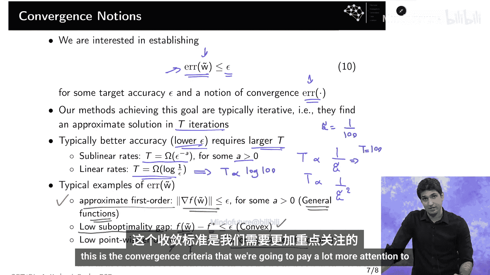

Alright。

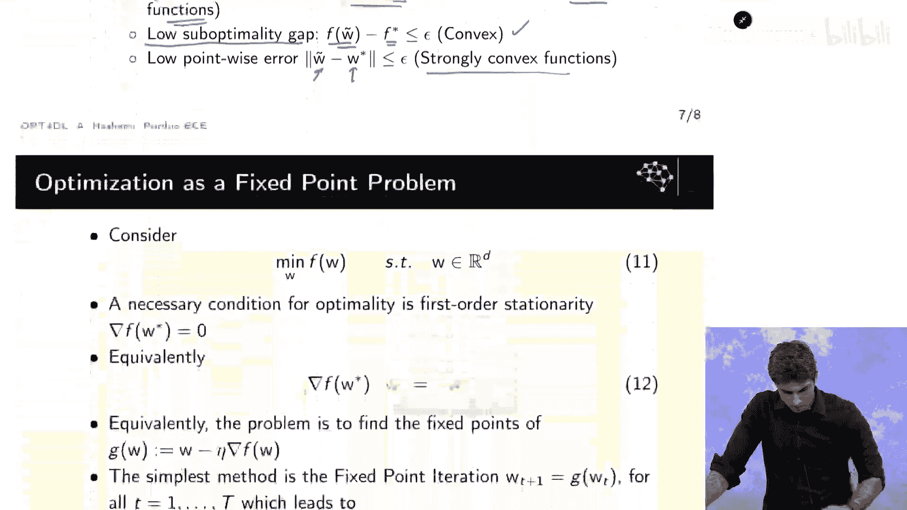

Now， let's talk about optimization as as fixed point problems that you may have seen in your。

In your previous studies。Okay， and the reason I'm talking about is is that this is a nice way to talk about one basic algorithm that underlines almost all of the。

Training algorithms that we use and leverage when training deploy models。 and that's gradient the。

So let's consider our optimization problem again， so we are minimizing some loss function F。嗯。

For the decision variable， which is d dimensional and there is no other constraints。Now。

 as we talked about。A necessary condition for optimalalmity is fierce or assertity。Meaning that。

If WO is an optimal solution。It must be the case that the gradient of the function A Wor is 0。Now。

 you can do something strange here。 Let's say that I multiply this by some。Consant Eta， where Eta is。

 let's say， strictly positive。 And then I subtract， let's say。W your star from both sides。

It is easy to see that these two conditions are equivalent， right？Now。

 one good thing about E 12 compared to E 11 is that now we can think of the task of finding an aary point。

As the task of finding the fixed points of another function G， which takes this form， right， So。

 so essentially our the goal is find。WS star， such that。W star is equal to F of W star。

 and this is called the fixed point calculation problem。

The simplest method for this is called fixed point it。

 where you iteratively apply your function to find a fixed point。 you start at some w1。

 you feed it to the function G。And then that gives you W2， the next solution。

 and you keep doing this process over and over again until hopefully you converge to a solution。Now。

4 is a specific function that we defined here。This fixed method leads to this update。 W2 plus1 is。

Or the next solution is the solution that you currently have minus Eta。

 so this is a constant we here times the gradient of the function。

 and this method is called gradient descent with a step size or layering rate Eta。And as I mentioned。

 this serves as a foundation of almost all of the deep learning methods。

 some of which we're going to talk about and study in this course。

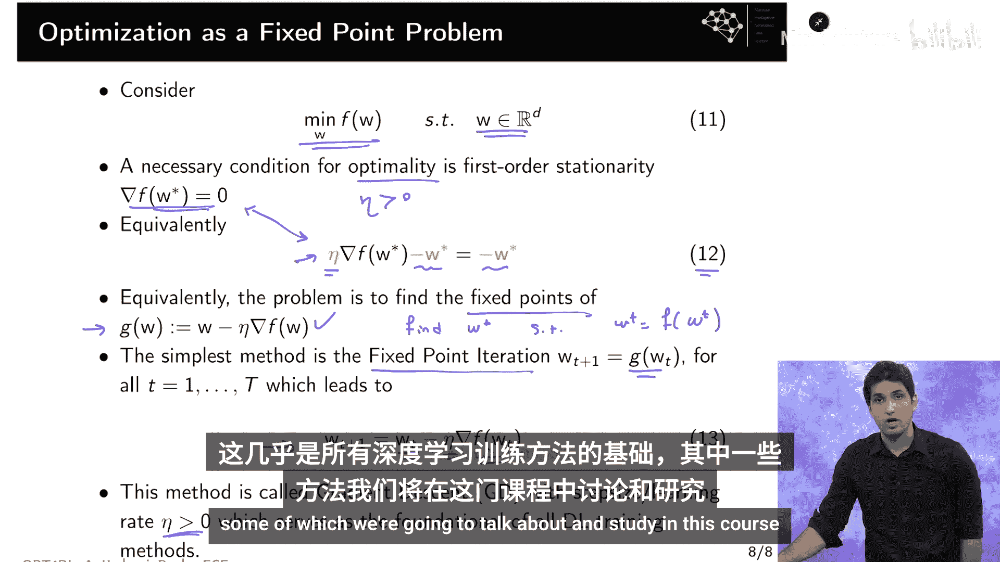

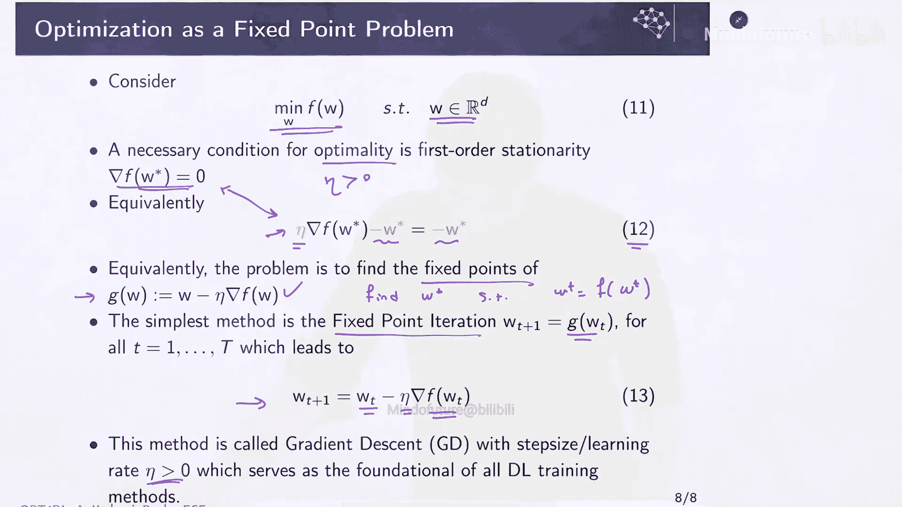

So in the next lectures， we're going to talk about some basics of machine learning。And then。

 we're going to talk。About carry and descent， a a little bit more deeply。Thank you。

