# 【普渡大学】深度学习中的优化 ｜ Optimization For Deep Learning ｜ Purdue University p06 P06_凸性条件下的梯度下降性能1 -BV1tvzKBcEom_p6-

🎼，🎼Yeah。Welcome back。So we talked about some basics of machine learning and optimization。

 basic concepts that we need to to develop the more advanced topics in this course。 Now， today。

 we're going to talk about。One of the simplest optimization algorithms。 And that's gradient descent。

And we're going to try analyze how your and performs。On convicts problems， okay。

So although we don't deal with convexity in discourse too much。

 there are still some lessonsers that we can learn and leverage when we talk about training algorithms that build upon optimization tools such as gradient Incent later on dis course and apply them to nonconvex problems。

Now， what gradient in descent。 And in fact， we talked about this a little bit in the basic of optimization lecture notes。

呃。So， let's consider。An optimization problem。Where we aim to minimize some cost function。F， okay。

 and for us。This is basically the loss over the data or the average loss over the data。Okay。

We talked about a simple method based on fixed point calculation， and that was gradient and descent。

 Okay， so the method was。An et algorithm。And that means that you need to start somewhere and then apply a specific update update rule iteratively。

To gradually refine your solution。So what's the procedure？You initialize at some solution， W1。

You have some learning rate et all。Learning radio steps size et。

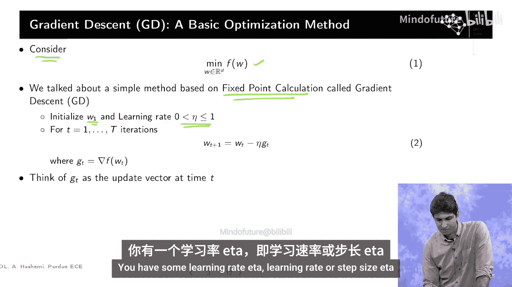

That we're going to talk about this。 But at a high level。

 this controls how much progress you are making。In this situation。

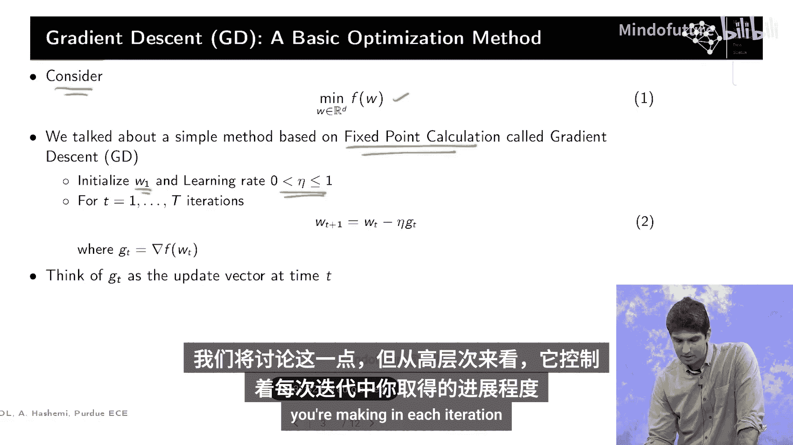

So， given these two inputs。We're going to apply the following simple update for capital T number of iterations。

 What is our update。

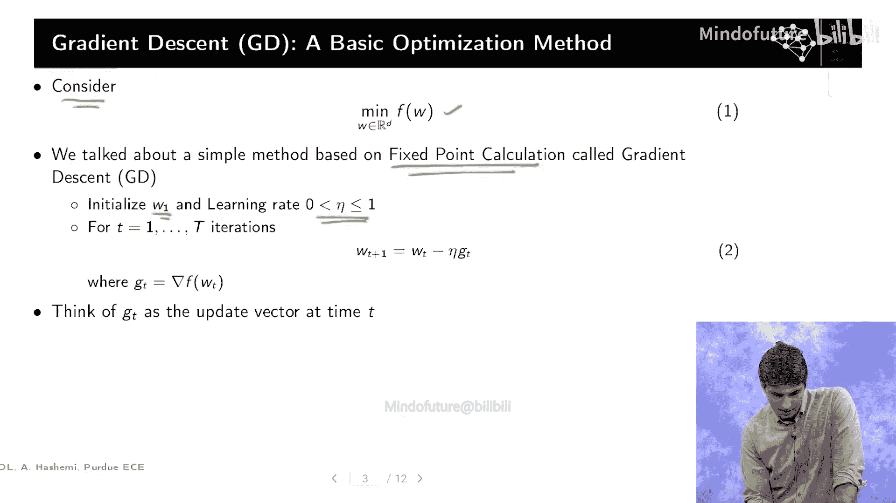

To find the next solution。We look at the current solution and we saw crack from it。

Eta or learning rate times G。G sub the， and G is called the update vector。And for gradient descent。

 the object vectoror is nothing but the direction of the gradient。

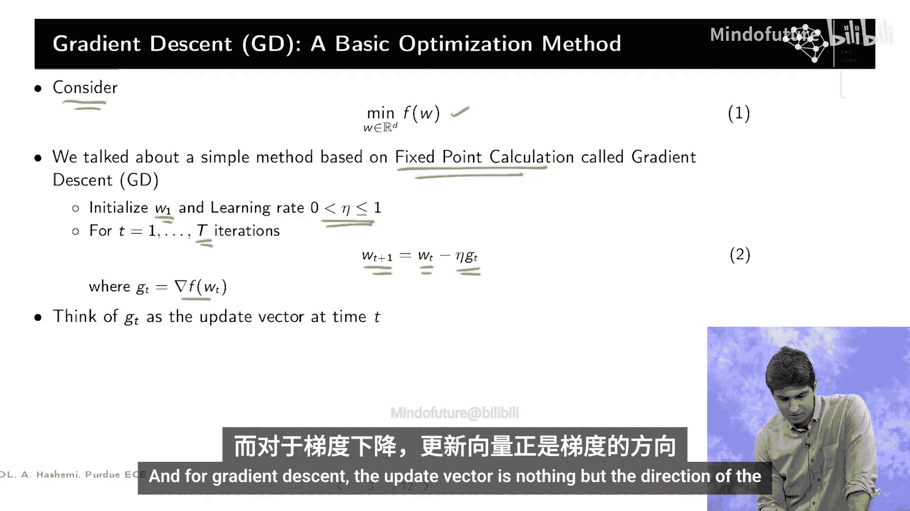

Okay。

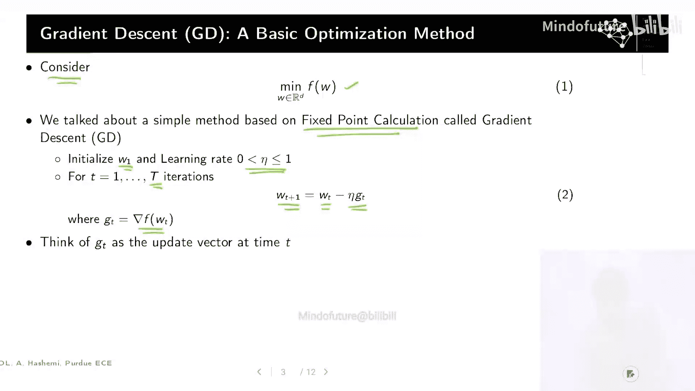

Now， what this is is the following that imagine that I have some loss function like this where the optimal solution is here。

Let's call the W star。And I am starting at some W1， okay。But this is that you're going to。Gradually。

 move。Towards。The optimal solution。 So in particular， after one update。

 after applying this update advance， you're going to find W 2。

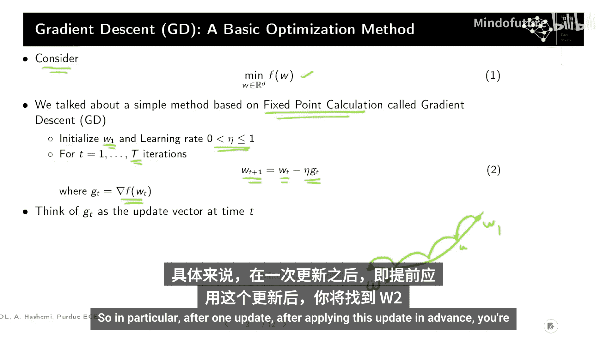

Then you're going to doconfine W 3。You're going to find W 4。 And in this example。

 you're going to find the optimal solution at the the future situation。Okay。

 now these steps that Im making。嗯。Determine how fast I'm going to conversege to the optimal solution。

 Okay， and this depends on two things。It depends， obviously on my update vector， the gradient。

 but also it it depends on the on the step size that I'm using or the learning rate that I'm using。

When senseify。Increase my step size。I might be able to converge。Passter the optimal solution， okay。

嗰啲灰。Reduce myself size。I may converge to the optimal solution L with slower。 Okay。

 so the rate that we should I'm converging depends on this step size。 Okay， so based on this figure。

 you may think that hey， it's better to use the largest step size possible。

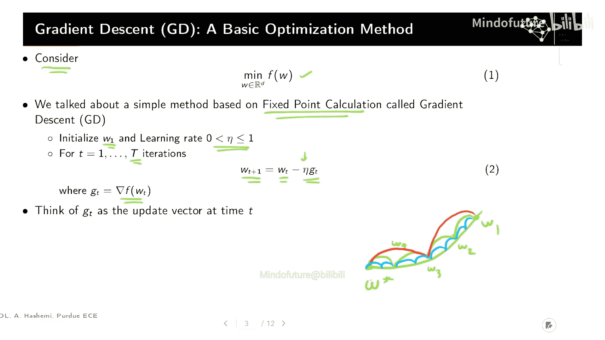

But that's not typically the case， right， for instance。

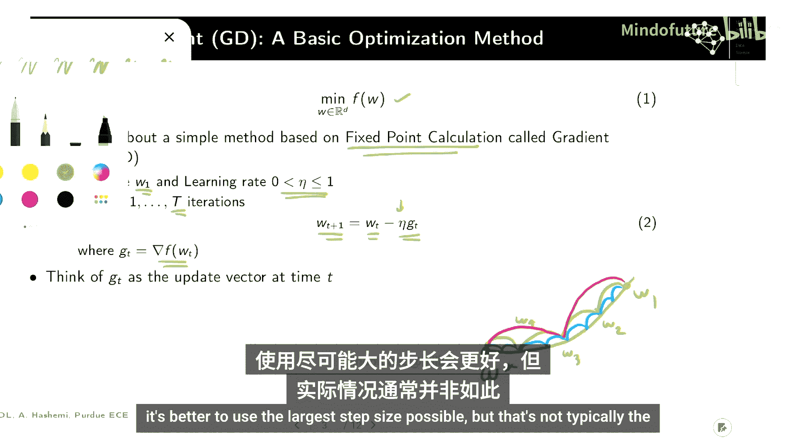

Imagine that my loss function actually is something like this。 Okay， now。

 if I use a very larger step size。I may actually diverge， so I may actually move。

Away from my optimal solution here。And then I may actually continue to go further and further away。

So this leads to diversions。 Therefore， the choice of these step size is very。

 very essential when we want to apply gradient in descent。And also。

 the more advanced training algorithms。That we're going to talk about in thiscourse。

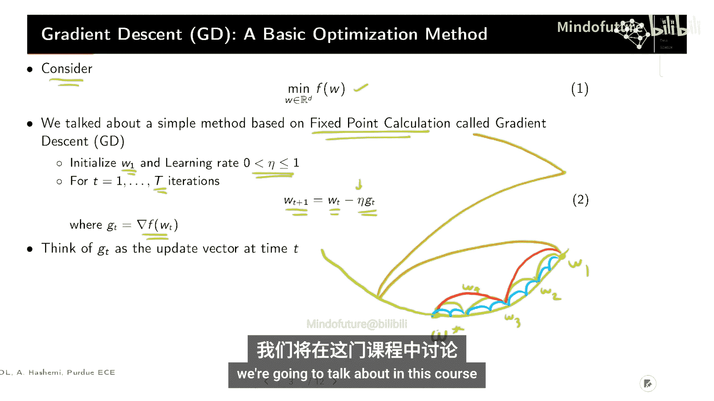

Good。Right， so what's the intuition， Y the gradient， okay。

And the intuition is that by using this update we what we are doing。

 we are following the direction of decrease。

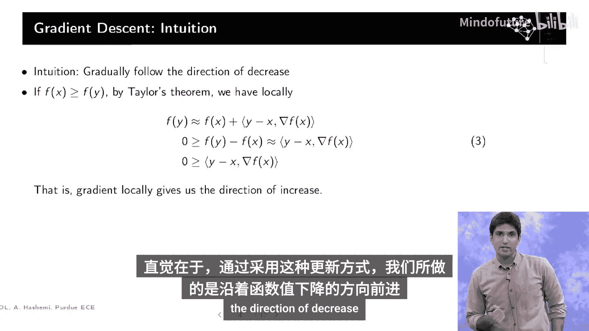

The direction at which the function is decreasing in its value。

And you may have seen in your other courses that gradient gives us the direction of increase。

 Therefore， if my goal is to minimize the function。

 I should move in the opposite direction of the of the gradient。 And to。

 to talk about this a little bit more formally， we can we can we can leverage the Taylor theorem。

 Okay， the Tayloror theor basically them in in this basic form。

 It says that you can locally approximate the function with a linear line。Okay， so if I have。

 let's say a function like this。At one point， I can locally approximate。

 This is basically the return。 Okay， now， consider the following case that I have two points。

 X and y。Such that the value ofvo is actually。Listen the value of x， okay。So， let's say this is。

This shows the direction that the function This shows the， the function value。

 So this is basically F of x。This is a forvoy。Okay， and on this axis， I have。X。Andvo。收。This vector。

Is basically。In the direction。That my function value is decreasing。Okay。

 now what we're gonna show is that by using theter theory。

 we can show that the gradient is actually negatively correlated with this direction。

 So this is basically y Y the x。嗯。The direction at which the function value is increasing。 Okay。

 so let's see this。 So Tayloror theory says that I can approximate F of Y around x。

With the linear line。 So it is approximately f of x plus the inner product between y minus x and the gradient at x。

 Okay， now we can do some rearranging。To get at the difference between Fy and Fx。

 which is byter selling roughly this inner product。Is less than equal to 0。

 And the reason for that is that I assume the function value at y is lower than the function value at x。

 Okay， so what this says， therefore， is that the inner product between y minus x and the gradient is negative。

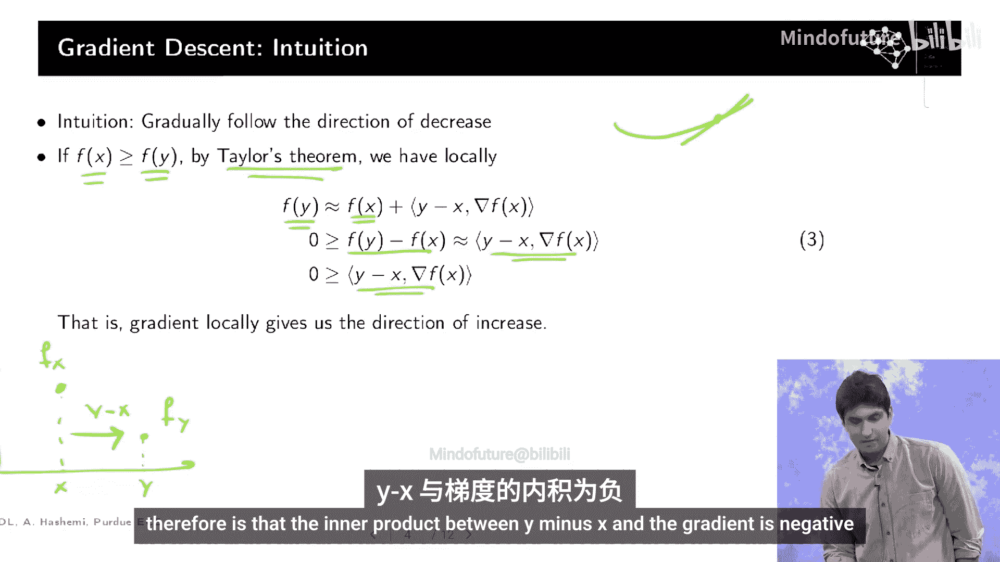

So that means that the guard must be。

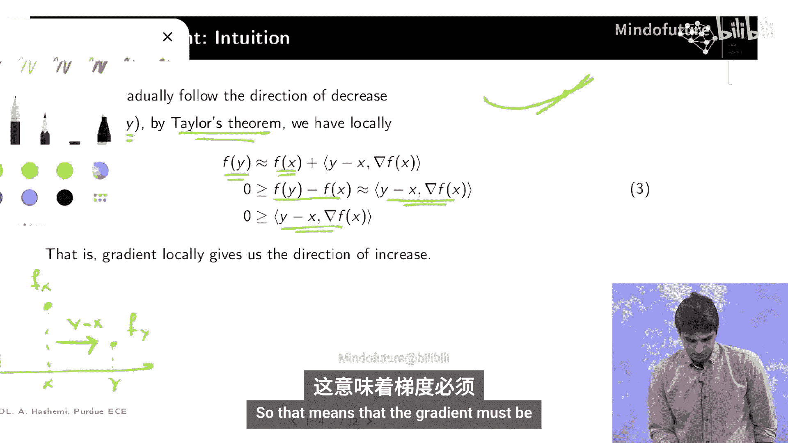

In the direction of increasing the function locally。 So if this is y minus x。

The gradientian is actually in the other direction。

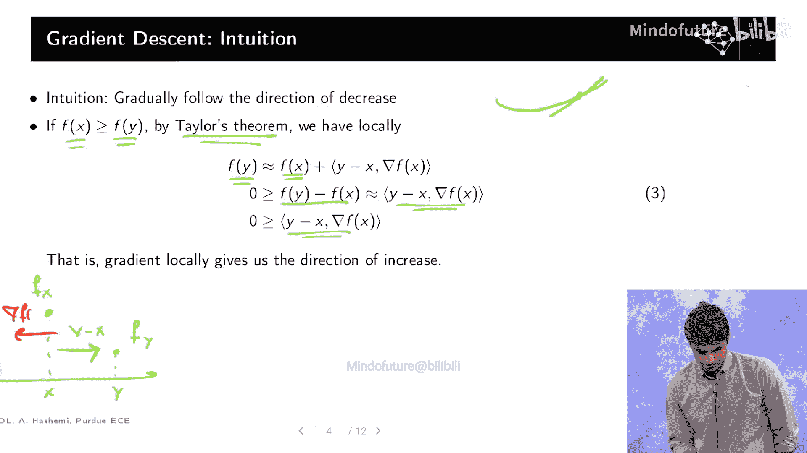

Okay， so。嗯。Given that we are leveraging the securityian disscent method。 So a local problem。

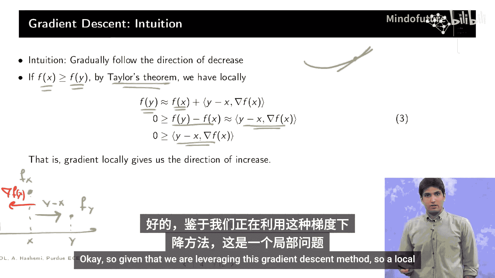

That locally tries to refine the solution。In order to minimize the function。

 we should locally move into the opposite direction of the gradient because gradient gives us the direction of increasing the function。

Alright， so hopefully this gives you an intuition why in descent I is is a， is a good thing to do。

 Okay， but keep in mind that this only gives you the direction of decrease locally。 Okay。

 for instance， I can have。A problem like this。Okay， where the true minimizer is here。

But here I have another minimizer。 Let's call it W bar。Now， if I were to start here。

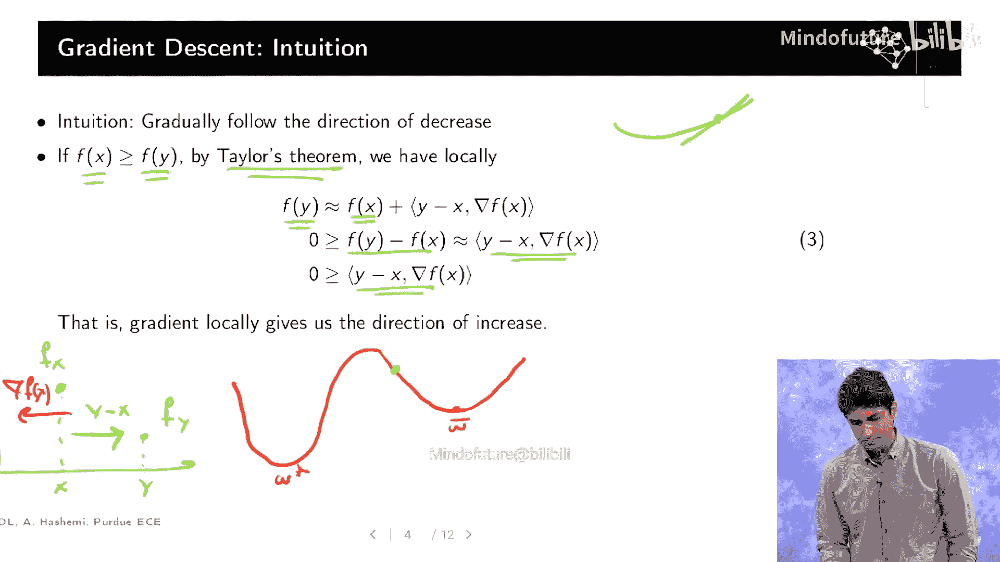

Using gradient and de。I'm going to identify。The direction that reduces the function value locally to be actually in this direction。

 So by running gradient in descent， I'm gonna to find this suboptimal solution。 Okay。

 and that in many cases， is unavoidable because we are rely on some local information， so。It it's。

 sometimes too much。To ask from Garrison to optimize a highly nonlinear noncomx function。

 such as the word I'm showing here globally。

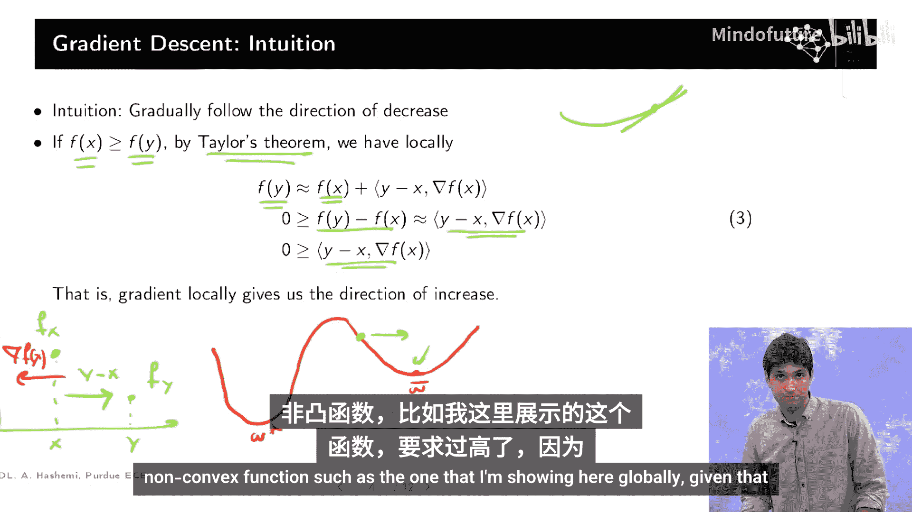

Given that it's only a local method。All right。

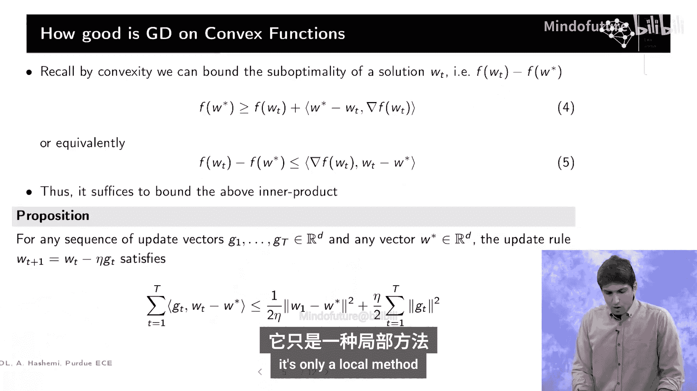

So one national question is how good is getting a desent， right？

 and we want this matter to be good because this is。The base method。

Or this unders the more advanced training algorithms。

That we are leveraging today to optimize deploying problems。

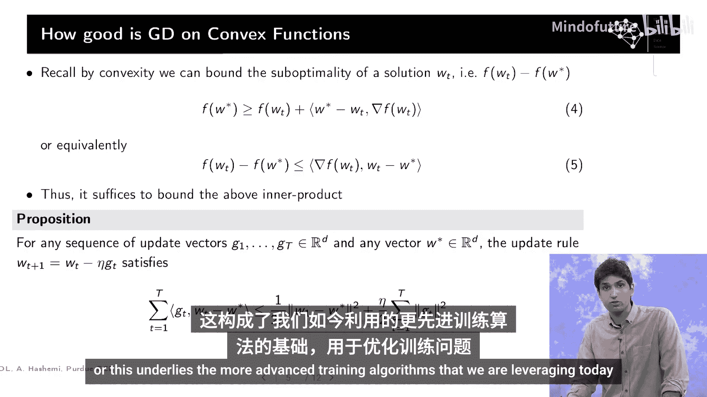

And， to assess how good Gary understandee is， we're going to first check his performance on convex functions。

 so。Recaed by convexity， we can basically get。A bond on the suboptiity of a solution。 Okay。

 so this is what I call by suboptiity。Of solution。

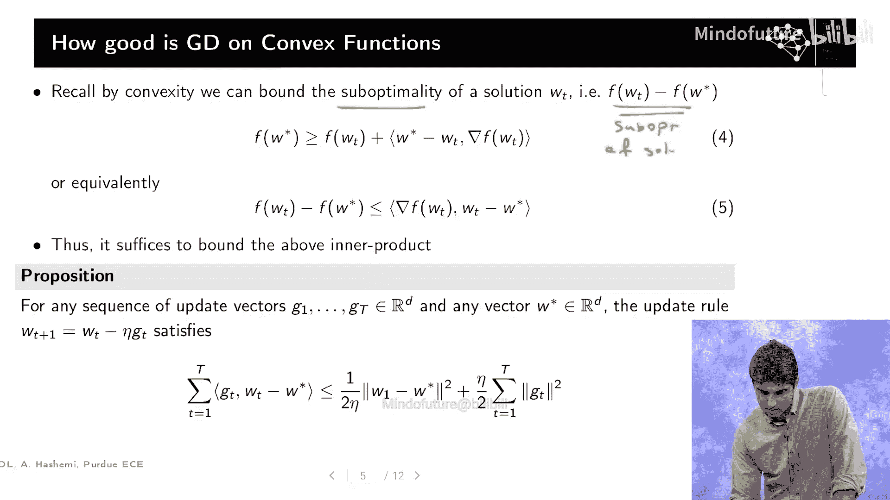

W T， okay， so how can we do this Again， one of the definition of conve that we saw last night。

Says that basically economics function lies above its linear tangent line。 So something like this。

 So this was basically our one of the definitional complexityity that we introduced last time。

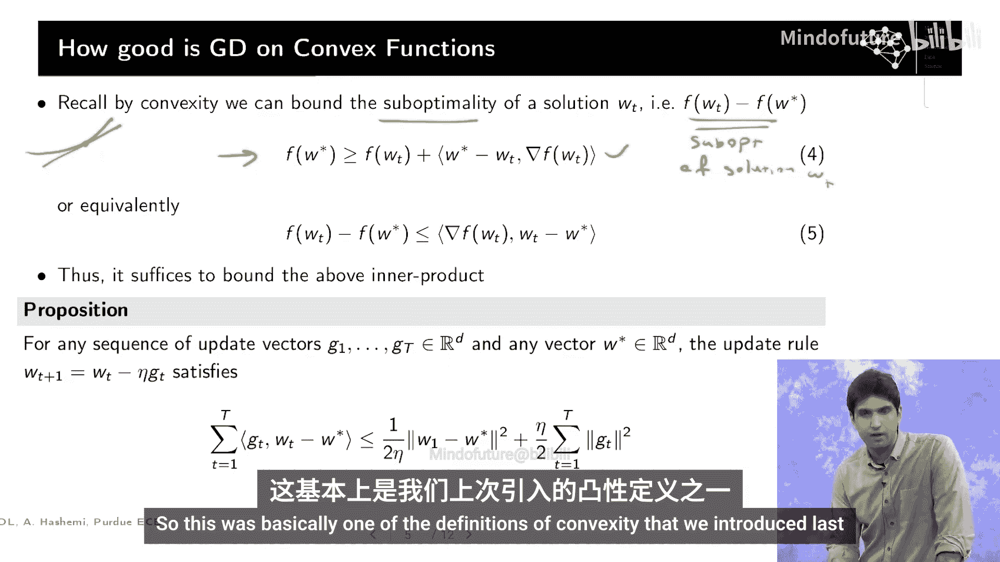

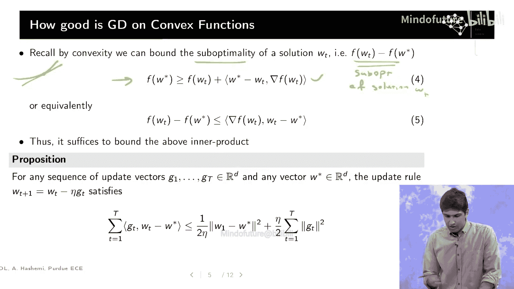

By some rearranging， we can get this equation。 Again。

 this says that the suboptiality of a solution W star W T。Is bonded by this inner product。都。

If I can find a good upper band on this inner product， right。

That will give me a good bond on the suboptiality of the solution W T as well。

 And that will be our strategy。 Our strategy will be to to upper bond this inner product。

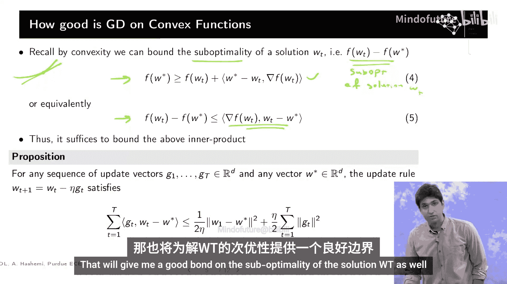

And then leverage that to find a bond on the on the of the solution that we we learn or we find by leveraging gradientian descent。

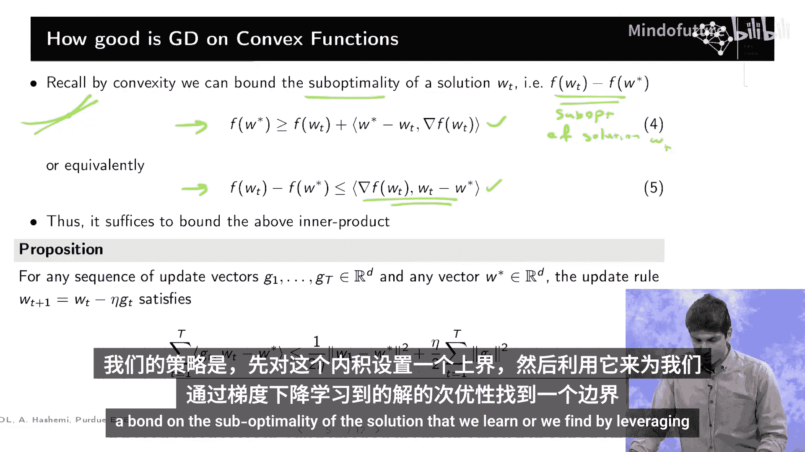

Okay。To do that we have the following proposition， okay。That says for any sequence of update vectors。

D1 through G capital T。And any vector W star。If you use this update rule。To generate our solutions。

 our et threat， if you will， W 1， W 2， W C， etc cetro up to W， capital T。We have the following。呃。

Experion。That the accumulation。Of these inner products is bonded by two terms。The first term。

Depends on。How far you are。From W store。At initialization。And the second term。

Basically talks about how big。Those update vectors are that you are leveraging in order to update your。

Your solution。ok。There are two important remarks that I want to point out here。

The first one is that the provision， this expression holds for any update vectors。

 G1 through G capital T。 So it doesn't have to be the gradient。

 It can be any object vectors you want， right。Oh。So。In some sense。

 this proposition is is providing a result that is much more general。Dan Ger。

The second reward is similar。The proposition applies to any vector WS star。

 So it doesn't say that WSR。呃。Has to be an optimal solution。 It can be any arbitrary solution， right。

 so it can even be， let's say， a local maxr。 Okay， so this just says that by following this update rule。

 using update vector G13 G capital T。The accumulation of these innerport， right， right。

 So is's one by these two terms， one that depends on how far you are from the WS star， again。

 whether that an optimal solution or not， doesn't matter。 And the second term says that。

How large the out vectors are。 and obviously， it also depends on E。Okay。

Because this is basically the learning rate that varies。

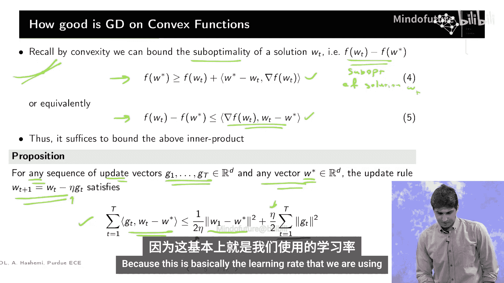

All right。So。Let's talk about the proof of the proposition because it's extremely simple。

 it just relies on expansion of a quaquadratic form okay。So in particular， what we do。

 we're going to consider the evolution of this error term， if you will， how far W T is from WS star。

Where we measure the distance。 Let's say，'s using some norm， Euclidean distance， Okay， square。

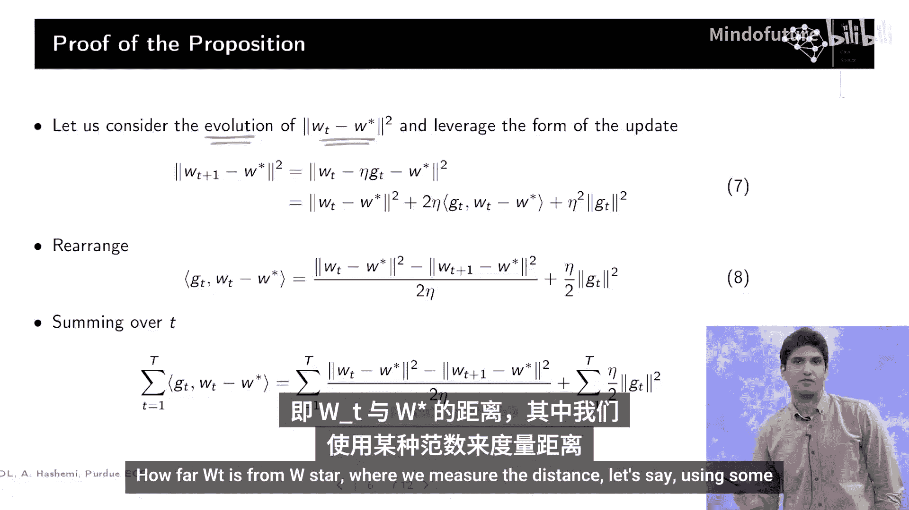

都。To do that， to assert this evolution， we're going to leverage the form of our update vector， okay。

So what is the form of the object vector is this。Simple rule， okay。So let's see。

 what's the error at T plus1。As a function of the error at time T。

 that's basically what I mean by considering the evolution of the error time。

So this is WT+1 using our update rule here。I can and the quarterly expansion。

 I can equivalentvalize it in this form， okay？Then what we do， we do some rearranging。

 I'm going be the the inner product on the left hand side。

 and then the rest of the terms on the right hand side。Then we're going to go sum over time。

So the accumulation of this inner product is bounded by these two terms。 Okay。

 so this one is basically exactly the same term that we had in the statement of the proposition。

 The first name， however， is a little bit more different。

But we notice that this is an example of a telescoping song。

If I bring out this the fact of1 over to Eta。I basically have， let's say， some term。 If you。

 if you will a at time T minus a at time T plus1， okay。

So this is basically if you expand the sum becomes a1 minus a2。Plus， a2 minus。A 3， et cetera。

 So all of these intermediate terms are gonna get canceled。Except the first one minus the last one。

 And this is a。T plus1。Good。So after noticing this telescoping sum and getting rid of these all of these intermediate terms。

 this term is going to become one over two eta。

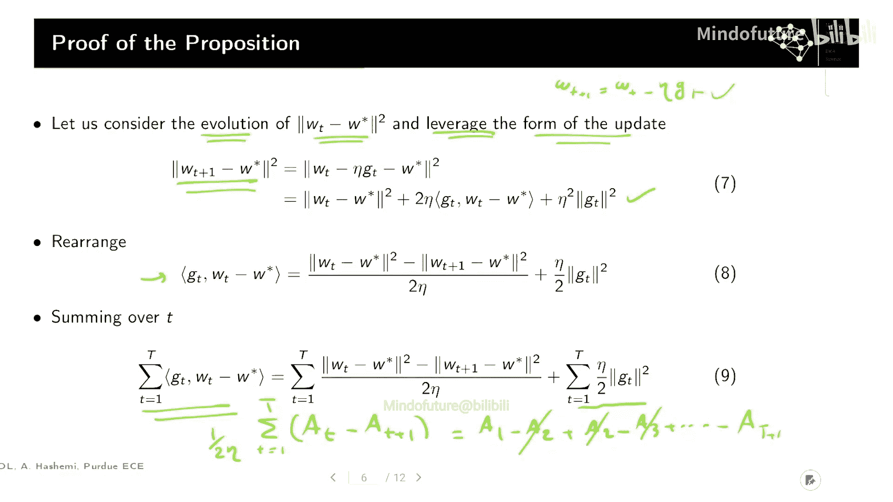

W 1 minus W star。 That's the first term， minus。

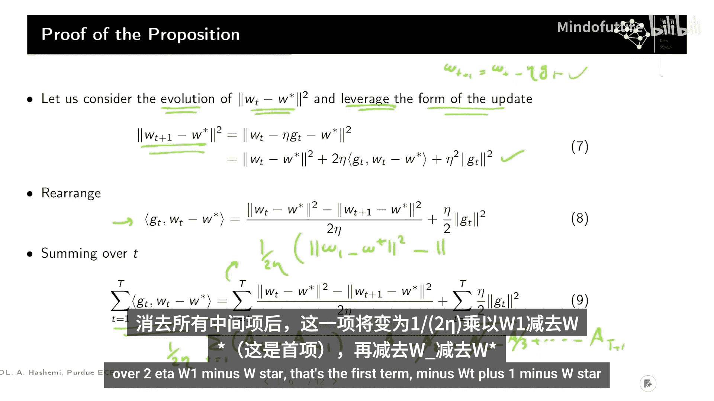

W， T plus 1 minus WS star。Alright， so youre almost done。The last thing to notice is that。This is。

And no negative term。So we can drop it。And by dropping that。

 we basically have proved the proposition。

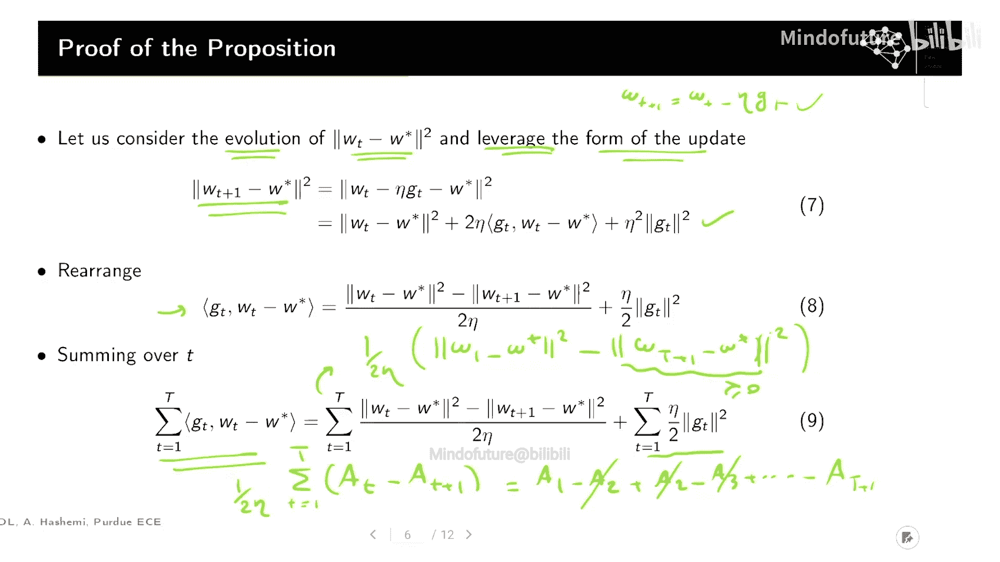

All right。No。How is this related to gradientian descent。

 so we're going to leverage this powerful proposition， if you will。

 to analyze the performance of the gradientian descent algorithm and complexx problems。

So in gradient De or update vectors， GT are basically the gradient。Okay， so this is the rule ofism。

No。Using the proposition， we found an upper one on the accumulation of those inner products。

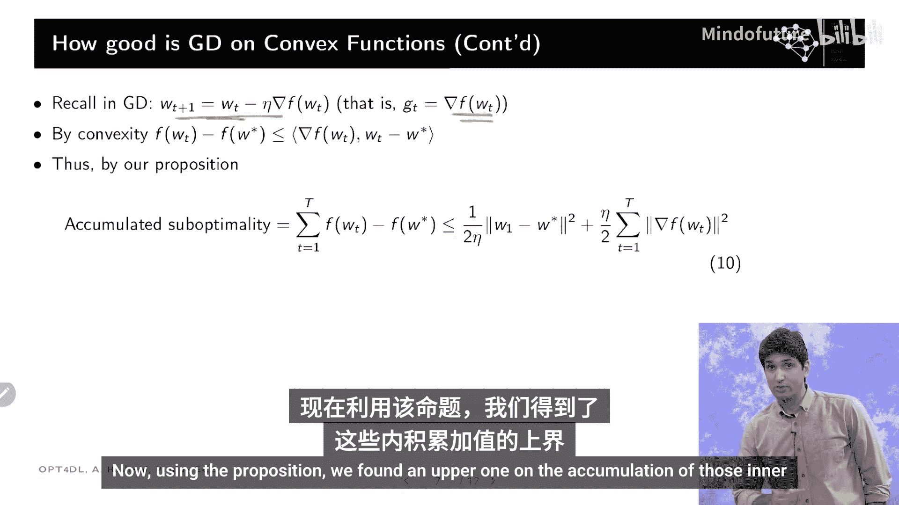

Basically， the accumulation of these inner products。And by convexity。As we talked about before。

 this provides a bond under the subnuality of the solution WT。Thus， by using a proposition。

 what we have shown is that the accumulated subopimality。Is bonded by。Two terms。One term。

That depends on the。Initialization。So， this is the。If you， if you will the error。At initialization。

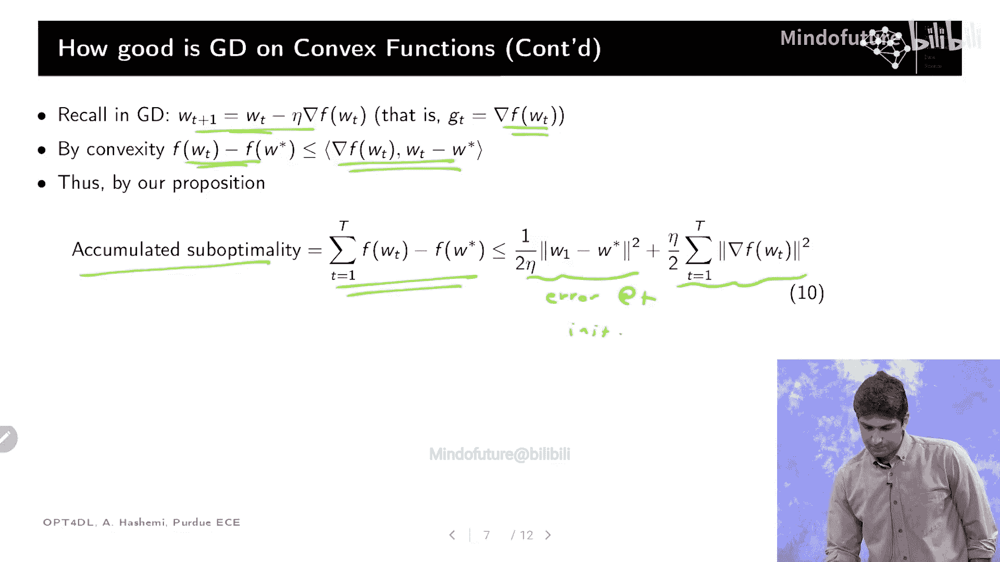

And this term， that depends on basically how large the gradients。

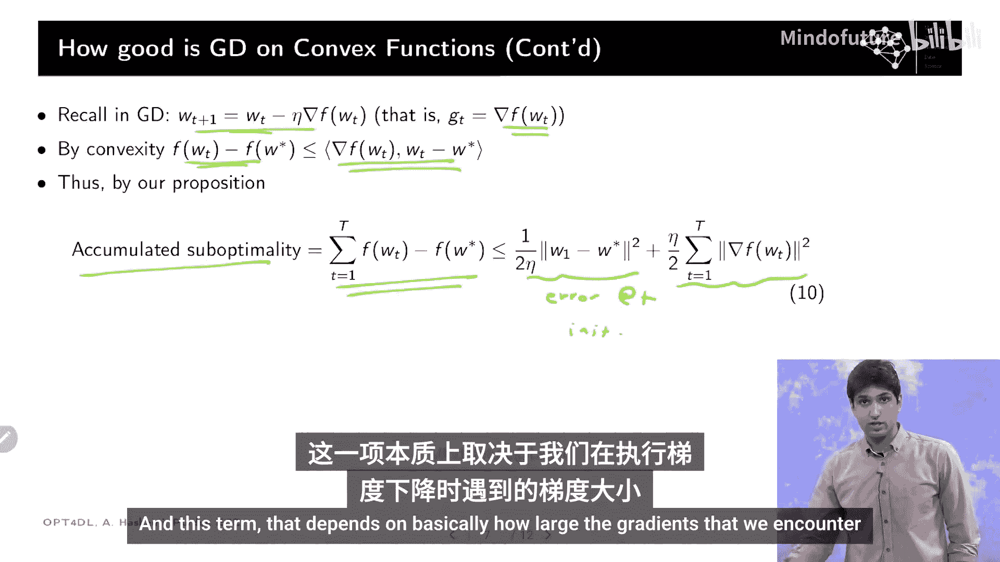

That we encounter while running the gaining descent R， okay。收呃。

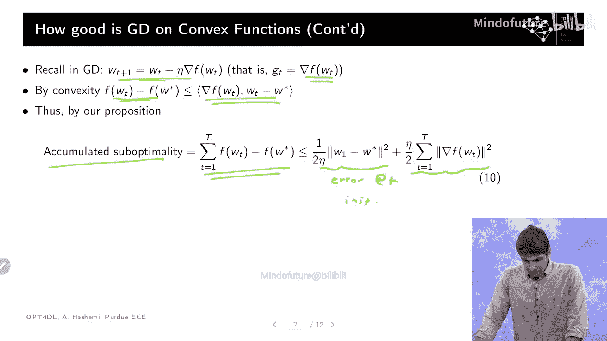

What we desire to happen is that this accumulation of suboptiity grows very gracely。😊。

As we keep running。Gadian descent， okay。And this could happen and or may not happen， okay。

This depends。Especially on the second term here。 So if the gradients that we encounter with as we run the gradient the synis are。

 let's say， are bonded， meaning that their enormous square is， is not too too large。

 then we should expect that this accumulateulated volatilityity grows very gracely。With T， okay。

 otherwise， that may not happen。

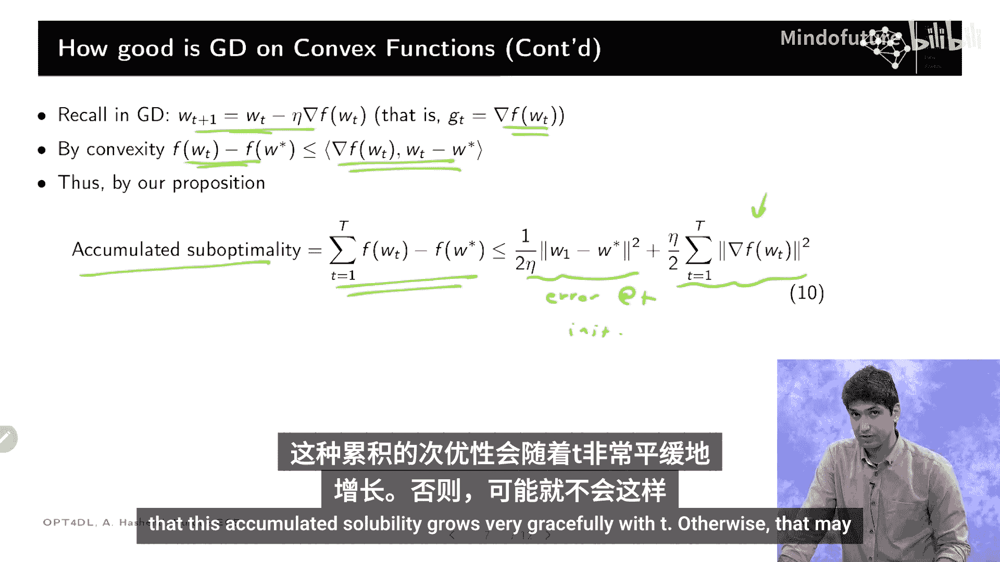

So， this means that。

To proceed further， we need some regular assumption on our function F。In particular。

 we need to characterize how large these gradientians are。So we're going to talk about。

The class of lips sheet functions in the next lecture that basically guarantee。

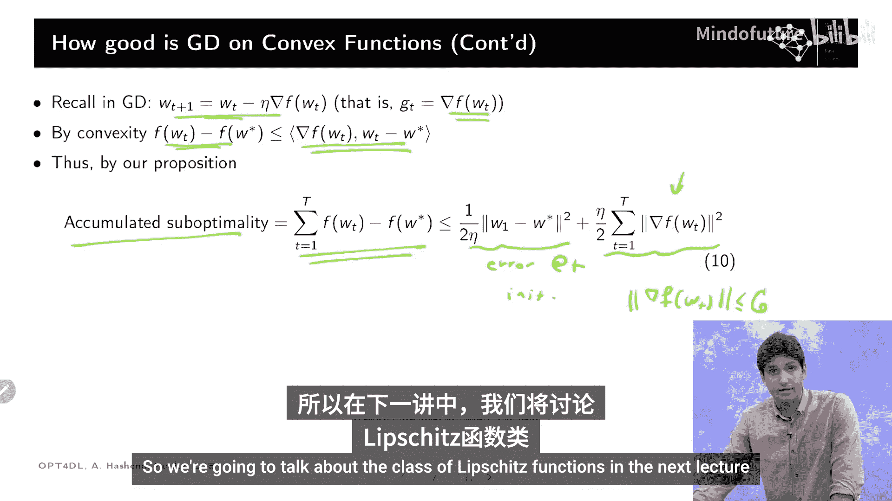

These gradients are， are bonded。

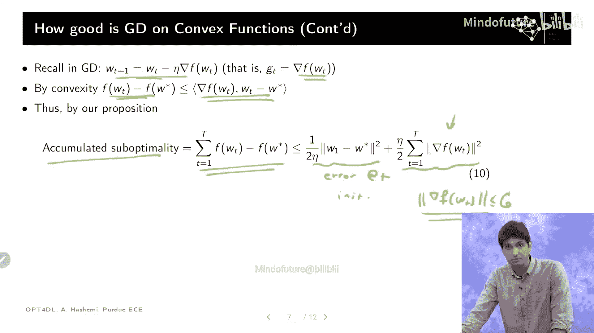

And we're gonna see the  four0 kilos of lipsis function。 We can actually。

Talk very precisely about the performance of the gradient descent in calculating the optimal solution。

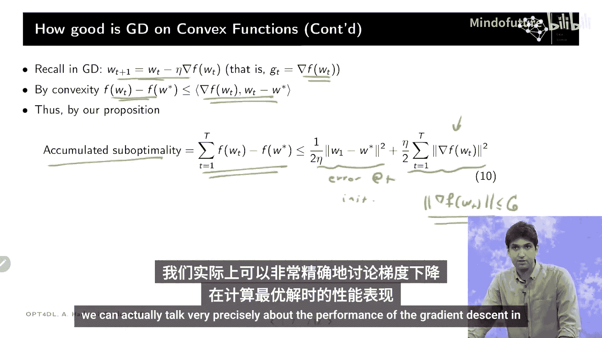

Thank you。